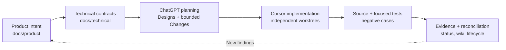
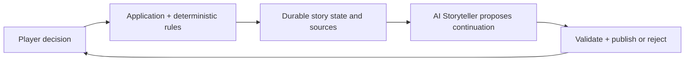

# Offscreen RPG

**A persistent, AI-assisted storytelling RPG and a repository-native engineering system for developing complex software with AI agents.** Both are first-class parts of this project.

The **game** explores what happens when a fictional world keeps coherent state, consequences, time and history beyond a single conversation. The **engineering system** explores how humans, ChatGPT, Cursor and other coding agents can design, implement, test and maintain that world without losing decisions, handing off unresolved architecture or mistaking generated text for working software.

> **Project status:** An evolving local engineering portfolio and experimental game platform, **not a publicly hosted or production-ready RPG**. Product/technical documentation describes selected targets; [STATUS.md](STATUS.md) separates implemented source, tested behavior, incomplete integrations and unproven capabilities.

## Two systems, developed together

| The storytelling platform | The engineering ecosystem |
| --- | --- |
| Persistent stories, characters and worlds | Product and technical documentation as explicit design authority |
| Deterministic rules, state, time and outcomes | Undertaking → Design → Change → small implementation tasks → proof |
| AI Storyteller proposing narrative continuations | ChatGPT as source-grounded architect/planner; bounded Cursor executors |
| Durable Library, branch/fork and source identity | A navigable wiki with retrieval, link/claim-health checks and lifecycle rules |
| Controlled publication, retries and provider costs | Reproducible evidence, negative tests, cost-aware agent orchestration |
| Browser, API, workers and data services | Isolated Change worktrees, parallel workstreams and controlled integration |

These are not two unrelated demos: **the RPG provides the hard, stateful engineering problems; the engineering system provides the repeatable method for solving them.** Each exposes weaknesses in the other.

## The engineering ecosystem

The repository treats its development process as **inspectable software engineering**, not a collection of chat prompts. It aims to keep architectural intent, current implementation, work authorization and test evidence distinguishable.



The current method emphasizes:

- **Documentation before new contracts:** Selected product behavior and architectural guarantees are established in the owning wiki before implementation is commissioned. Code and tests show *realization*, not product authority.
- **Explicit work lifecycles:** Undertakings coordinate multi-Change efforts; Designs resolve questions; Changes own lasting code or substantive documentation outcomes; standalone Tasks record independent actions; temporary packets retire after their results are promoted.
- **Planner-first, executor-cheap:** ChatGPT inspects source, interfaces, data schemas, failure paths and tests, deciding algorithms and preparing small execution-ready tasks. Cursor's parent and inexpensive subagents implement bounded edits and return factual receipts rather than repeating the investigation.
- **Parallelism without shared-checkout chaos:** Independently commissioned Changes get separate branches **and linked Git worktrees**. One integration custodian serializes shared files, reconciliations and final joins.
- **Discoverability and evidence:** The wiki has heading-level lookup and health checks. Change outcomes are reconciled with product/technical claims, tests, status and dated evidence. A selected design, an inspected implementation, a passing fixture and a live operational proof are not interchangeable.
- **Economics with correctness:** Limit unnecessary agent context, fanout and repeated test sweeps, without waiving authorization, privacy, data integrity, idempotency or provider spending safeguards.

### Explore the methodology

| Start here | What it explains |
| --- | --- |
| [Engineering System Tour](ENGINEERING.md) | Why the method exists, concrete examples, trade-offs and limitations |
| [How We Work](WORKFLOW.md) | End-to-end Undertaking, Design, Change, Task, review and Git lifecycle |
| [Repository Structure](REPOSITORY-STRUCTURE.md) | What belongs where; permanent knowledge versus temporary dossiers and retirement |
| [Documentation wiki](docs/README.md) | Product/technical authority and discoverable topic maps |
| [Agent entrypoint](AGENTS.md) · [ChatGPT planner](CHATGPT.md) | How a new coding agent or planner bootstraps repository-specific rules |
| [Work selection](work/QUEUE.md) · [Change catalog](work/changes/README.md) | Current default assignment, proposed work and execution receipts |
| [Evidence](evidence/README.md) · [realization status](STATUS.md) | What actually ran, what exists and what remains unproven |

### Try the repository navigation

With the [pinned local toolchain](docs/runbooks/local-development.md), from the repository root:

```bash
pnpm repo:brief
pnpm wiki:find "When does a completed activity earn its reward?"
pnpm wiki:read docs/product/gameplay/time-and-autonomy.md --outline
pnpm wiki:health
pnpm repo:maintenance
```

These are **discovery and integrity tools**, not proof that the game is production-ready. For a revision-stamped, Git-ignored source/wiki snapshot suitable for analysis in ChatGPT, run `pnpm repo:snapshot:chatgpt` ([runbook](docs/runbooks/chatgpt-design-snapshot.md)); it exports committed material, not your dirty working tree.

## The game: a life that continues while you're away

The long-term ambition is a story-driven RPG where you choose a world, create a character, act within its rules and return to a life with history. Time, travel, work, relationships, opportunities and consequences should persist rather than being reinvented whenever an LLM produces a new paragraph.

The distinction is **Storyteller versus authority**. The model can propose narration, explore context and suggest choices, but application rules and persistent state determine what is valid, what has happened, what can be published and what may be spent.



The current codebase includes a Next.js frontend, API and worker services, TypeScript application packages, PostgreSQL and supporting infrastructure/lab tooling. The [architecture atlas](docs/architecture/README.md) distinguishes **current source**, **selected targets** and **gaps**, including crash/replay and persistence boundaries. [Product](docs/product/README.md) and [technical contracts](docs/technical/README.md) provide the governing details.

**Reality check:** The repository contains implementation and focused tests for parts of persistent story creation, decisions, mechanical outcomes, time and publication. A coherent, generally reliable long-running campaign, arbitrary world mechanics, mature shared play and production hosting are **not established by those components**. See [STATUS.md](STATUS.md) and the dated [evidence](evidence/README.md), rather than inferring completeness from a diagram.

## Browse by role

| If you are… | Start with |
| --- | --- |
| **Evaluating the engineering work or portfolio** | [Engineering System Tour](ENGINEERING.md), then one product → technical → source → evidence trace |
| **Exploring the game design** | [Product wiki](docs/product/README.md) and [architecture atlas](docs/architecture/README.md) |
| **A new ChatGPT planner** | [AGENTS.md](AGENTS.md) → [CHATGPT.md](CHATGPT.md) → relevant source and planning standards |
| **A Cursor or other coding agent** | [AGENTS.md](AGENTS.md) → commissioned Change → bounded task and worktree instructions |
| **Running locally or checking proofs** | [Local development](docs/runbooks/local-development.md) → [STATUS.md](STATUS.md) → focused tests/evidence |

This project deliberately exposes its assumptions, gaps, unsuccessful experiments and development process. Its goal is not to appear finished, but to make both **the software and the way it gets built** understandable and testable.

*No project license has been selected yet.*
