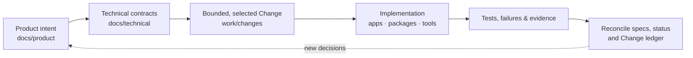
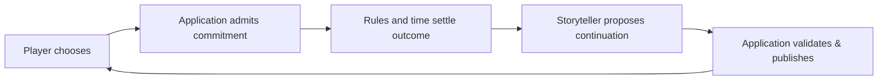

# Offscreen RPG

**Two projects in one repository: an off-screen AI storytelling RPG, and an engineering system for building software with AI agents without surrendering architecture, correctness or maintainability.**

The game is the proving ground. **The engineering workflow is currently the primary focus of this portfolio.** The idea is not “ask an LLM to generate a game.” It is to make product intent, technical decisions, implementation scope, source evidence and verification individually discoverable, durable and reviewable, including when different agents perform different roles.

> **Exploring this as an engineer or potential employer?** Start with the [Engineering System Tour](ENGINEERING.md), then ask your coding assistant to explain how a decision flows from product documentation into technical contracts, a bounded Change, executable source and verifiable evidence. [`AGENTS.md`](AGENTS.md) is the shared agent entry; [`CLAUDE.md`](CLAUDE.md) imports it. A fresh session should be able to learn the method from the repository, not from its author's chat history.

## The engineering system: design first, code second



Five deliberate practices hold this together:

| Practice | What to inspect |
| --- | --- |
| **Product → technical → code** | [Product owners](docs/product/README.md) establish intent; [technical owners](docs/technical/README.md) specify invariants; code and tests show what is *actually* realized. A selected future target is not a claim of implementation. |
| **Changes, not vague “features”** | [Change work-unit standard](.agents/references/change-work-unit-standard.md) and the [Change queue](work/changes/README.md) define bounded code-changing outcomes, acceptance, exclusions and reconciliation. **No selected Change is valid.** |
| **A traversable, tested documentation wiki** | [Documentation router](docs/README.md), `wiki:find` / `wiki:read` for heading-level retrieval, [wiki health and benchmarks](.agents/README.md) for navigability and known limits. |
| **Portable, role-aware agent harness** | [Agent entry](AGENTS.md), [layer-zero operating model](.agents/HARNESS.md), [roles](.agents/roles/README.md), on-demand skills and source receipts. ChatGPT may design; Cursor or Claude Code may investigate/implement when explicitly tasked. No agent is an authority simply because it generated text. |
| **Falsifiable evidence and cost control** | [Current realization](STATUS.md), source/tests, negative cases and dated [evidence](evidence/README.md). Evaluation tooling distinguishes a working fixture from a live proof, and recorded tool experiments from claims of productivity gains. |

### Explore it yourself

After installing the [pinned local toolchain](docs/runbooks/local-development.md), run these from the repository root:

```bash
pnpm repo:brief
pnpm wiki:find "When does a completed activity earn its reward?"
pnpm wiki:read docs/product/gameplay/time-and-autonomy.md --outline
pnpm wiki:health
```

`repo:brief --json` reports the local Git revision and dirty paths. The wiki tools locate **source-exact headings** and return bounded text, not free-floating AI summaries. Do not interpret a search hit as proof that the behavior is implemented; read `STATUS.md` and the relevant source/tests.

**Want to investigate this repository with ordinary ChatGPT rather than a separate coding-agent session?** Run:

```bash
pnpm repo:snapshot:chatgpt
```

This creates a **Git-ignored, revision-stamped ZIP** under `out/chatgpt-snapshots/`, including committed source/docs, `SNAPSHOT.json` provenance, and a portable `WIKI-INDEX.json` built from the existing wiki parser. The default is intentionally strict: if the wiki index cannot be generated, export fails instead of quietly downgrading. The explicit `--no-index` escape hatch produces a source-only ZIP when necessary. Neither mode includes uncommitted work. [Snapshot runbook](docs/runbooks/chatgpt-design-snapshot.md).

**For a 5-minute guided tour, examples, agent prompts, what has been measured and what remains experimental:** [**ENGINEERING.md**](ENGINEERING.md).

## The game: a life that continues when you're away

Choose a world, create a character, make decisions and return to a life that has accumulated history. Work, relationships and extraordinary events can all matter. Time and consequences should be earned: starting a journey does not mean arriving, and beginning a shift does not award its pay.

The Storyteller proposes narration and choices using bounded evidence. **The application and deterministic rules**, not the language model, own time, mechanics, state transitions, publication authority and spending limits. Durable documents are designed to preserve people, locations and continuity across story turns.



### What is real, and what is still a target?

This is a **local pre-POC engineering portfolio**, not a shipped commercial game. There is source for persistent story creation/openings, generated choices, mechanical checks, timed commitments, saved consequences, bounded retrieval and provider accounting. A historical OpenRouter rehearsal completed a 1,800-fictional-second warehouse shift with a single six-septim payout; this is **dated evidence**, not proof of general long-campaign reliability.

A configuration-faithful 10–15-turn campaign with durable change and later recall remains **unproved**. Full arbitrary-premise mechanics, general combat/travel, shared play, notifications and public hosting are not demonstrated. See [STATUS.md](STATUS.md) for current realization and [ROADMAP.md](ROADMAP.md) for owner strategy.

Next.js presents the experience; NestJS, Temporal workers, application packages and PostgreSQL implement the current platform. The proposed end-state may be ahead of the code by design. [Engine authority](docs/technical/engine/authority-and-transitions.md) and [platform topology](docs/technical/platform/topology.md) explain the distinction.

## Start by role

| You are… | Open first | Then |
| --- | --- | --- |
| **Evaluating the engineer and methodology** | [Engineering System Tour](ENGINEERING.md) | [Agent harness](.agents/HARNESS.md) · [documentation wiki](docs/README.md) · [Change standard](.agents/references/change-work-unit-standard.md) |
| **A fresh coding agent (including Claude Code)** | [AGENTS.md](AGENTS.md); [CLAUDE.md](CLAUDE.md) imports it | [STATUS](STATUS.md) · [selected Change](work/changes/README.md) · one relevant owner/heading |
| **Investigating a product/design question** | [Product map](docs/product/README.md) | [Technical map](docs/technical/README.md) · current implementation evidence |
| **Running the game or local tests** | [Local development](docs/runbooks/local-development.md) | [Chamber](docs/technical/lab/chamber-and-fixtures.md) · safe targeted checks |

The point of this repository is not that its code or workflow is perfect. It is that both are **inspectable, challengeable and designed to evolve**, with documented gaps and tests instead of confident anecdotes. No project license has been selected yet.
