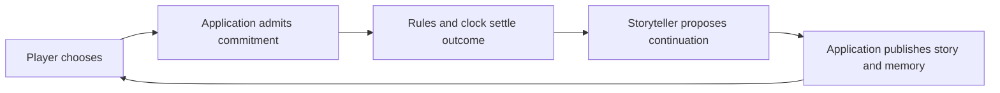

# Offscreen RPG

**An AI storytelling RPG where your character's life continues while you're away.**

Choose a world, create a character, make occasional decisions and return to a life with accumulated history. Ordinary work, relationships and dramatic events can all matter. Time and consequences make progress earned: starting a journey does not mean arriving, and starting a shift does not grant its pay. The intended experience includes configurable autonomy, pause and eventually shared stories and notifications.

## How it works

The Storyteller proposes narration and choices using a selected creative profile and bounded evidence. The application admits those proposals; deterministic rules own dice, elapsed fictional time and effects. An accepted commitment can continue while the player is away. Its settled result becomes evidence for the next Storyteller turn. Durable documents preserve the people, places and facts later turns need.

The engine has no preferred tone or pace. A quiet life and an action story are both valid; creative configuration chooses the experience while code preserves authority, continuity and spending limits. Worlds are content, not branches in the engine.

## What exists

This is a local pre-POC with persistent story creation, reviewed openings, generated choices, D&D-style checks, timed commitments, saved consequences, canonical documents, bounded retrieval and provider accounting. **Real OpenRouter runs have happened.** A September 24 run completed a 1,800-fictional-second warehouse shift, paid six septims once and sustained a short coherent conversation. Its responses proposed clue-note updates but no descriptive identity/relationship/thread records. Recall after leaving and returning remains unproved.

The next proof is a configuration-faithful 10–15-turn campaign with durable change and later recall. That proof has **not passed**. General arbitrary-premise mechanics, full combat/travel systems, shared play, notifications and a public hosted experience remain outside the demonstrated boundary. See [current progress](docs/progress.md) for the next action and [connected proof](docs/engineering/connected-poc-proof.md) for dated evidence and limits.

## Choose your entry

- **Returning owner or new contributor:** this page → [progress](docs/progress.md) → [documentation map](docs/README.md) for one question.
- **Coding agent:** [AGENTS.md](AGENTS.md), then `pnpm repo:brief`; follow the current plan and relevant [code route](docs/engineering/code-navigation.md).
- **Try it locally:** [development](docs/development.md). `pnpm chamber` uses offline development fixtures; `pnpm story:local` opens ordinary local Story mode, with live execution requiring explicit configuration and spending authority. `/demo` is a separate browser-only prototype that resets on refresh.
- **Understand the intended product:** [vision](docs/vision.md), [concepts](docs/concepts.md), then the relevant product topic in the map.
- **Understand the engine and its limits:** [engine model](docs/engineering/engine-model.md) connects mechanics, time, memory, authority, failure and next design decisions.

Next.js presents the game; NestJS and Temporal workers call shared application operations; PostgreSQL owns transactional state and published document roots. The [code map](docs/engineering/code-navigation.md) separates this wiring from the broader [architecture design](docs/technical/architecture.md).

This is a senior fullstack portfolio project aiming at a convincing, persistent playable experience. No project license has been selected yet.
