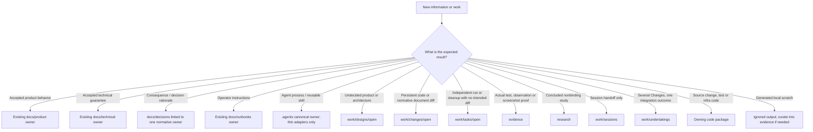

# Repository structure | owners, permanence, and retirement

**The repository geography handbook.** This is the **single navigation entrypoint for deciding where things belong, how long they should remain, and what to review when a folder becomes stale**. Pair it with [How We Work](WORKFLOW.md), which owns the end-to-end engineering *process*. This page owns **placement, discoverability and lifecycle**. Detailed rules remain in the linked standards, not duplicated here.

> **Core rule:** Make the current tree truthful and small. Put each accepted rule in one maintained home, each observed result in evidence, and each temporary working artifact on a lifecycle with an exit. Do not create a new folder because an agent wants somewhere to dump prose.

## 1. Four kinds of material, four retention behaviors

| Class | Examples | Correct treatment |
| --- | --- | --- |
| **Living permanent authority** | `docs/product/`, `docs/technical/`, root agent entrypoints, `.agents/` rules, maintained runbooks | Keep one canonical owner and revise it in place. Check current meaning and dependencies, **not age-based deletion**. Supersede explicitly |
| **Durable historical records** | `evidence/`, curated `research/`, decision rationale, work ledgers, immutable Git history | Preserve provenance, conclusions, limitations and recovery routes. Old does **not** mean obsolete. Review rights, sensitivity, duplicates and discoverability |
| **High-turnover workspaces** | `work/designs/open/`, `work/changes/open/`, `work/tasks/open/`, `work/sessions/`, active Undertaking dossiers, short-term packet archives | Every folder needs a current owner/outcome, a next decision/check, and terminal disposition. Promote **results** to durable homes; retire the temporary scaffolding |
| **Source-owned or generated output** | `apps/`, `packages/`, `tools/`, `infra/`, `scripts/`, ignored `out/` and caches | Code owners decide internal structure. Local/generated data should normally remain ignored; deliberately preserved, safe results go into evidence |

**Aging is a prompt to inspect, not proof of worthlessness.** A year-old selected invariant can be more current than yesterday's unratified proposal. Deleting a directory is never a substitute for resolving its authority, references and unique evidence.

## 2. Where should a new document go?



**Before creating a new directory:** (1) inspect this map and the nearest existing README; (2) search for an existing owner or sibling artifact; (3) decide *selected vs proposed vs observed*; (4) prefer a file or section in an established home; (5) specify maintainer, entry link and terminal condition if a new folder is truly needed. A new root-level folder needs a genuinely distinct responsibility and a discovery link. Avoid `misc/`, `old/`, `new-docs/`, duplicate `plans/` and per-agent work silos.

## 3. Root and permanent document zones

| Location | Expected to contain | Should not contain | Staleness review |
| --- | --- | --- | --- |
| [`README.md`](README.md) | Human introduction and route to major subsystems | Execution diary or a full competing handbook | Product description/links after material changes |
| [`WORKFLOW.md`](WORKFLOW.md) | **How we work:** Undertaking → Design → ratified docs → Changes → cheap Cursor implementation → proof/retirement | Detailed project-specific packet contents | When actual workflow rules change |
| **`REPOSITORY-STRUCTURE.md` (this page)** | **Where things live**, their permanence, classification and cleanup rules | Every individual folder's ever-changing status | When directory ownership, retention or controls change |
| `AGENTS.md`, `CHATGPT.md`, `CLAUDE.md` | Compact agent/client bootstrap and planner-specific rules | Copies of product law and dated Change handoffs | Verify all point at current canonical process |
| [`.agents/`](.agents/README.md) | Maintained coding-agent harness, roles, rules, skills, references, curated knowledge | Runtime Storyteller prompts or product commitments | After harness/model policy changes; avoid competing client rules |
| [`docs/product/`](docs/product/README.md) | **Ratified product intent, rights, gameplay and user experience** | Brainstorming, implementation diary, test-as-law | Impact review on related Changes; periodic semantic audit |
| [`docs/technical/`](docs/technical/README.md) | **Ratified technical invariants**, ownership, security, schema/transaction and failure contracts | Unselected alternatives or stale implementation claims | Cross-check source/STATUS after code changes |
| [`docs/decisions/`](docs/decisions/README.md) | Selected trade-off reasoning, consequences, revisit triggers | A competing copy of the normative specification | Supersession and links to authoritative heading |
| [`docs/architecture/`](docs/architecture/README.md) | Explanatory diagrams with current/source/target/gap labels | Alternative binding architecture authority | Refresh when model or source flow changes |
| [`docs/runbooks/`](docs/runbooks/README.md) | Human procedures: precise commands, preconditions, expected output and safety | Fictional commands or an unapproved target presented as runnable | Validate when environments/CLI change |
| `STATUS.md` / `ROADMAP.md` | Demonstrated realization / strategic direction | A second current-work queue or aspirational implementation claims | STATUS against source/evidence, roadmap against accepted choices |
| [`content/` authoring](docs/runbooks/content-package-authoring.md) | Versioned story worlds, rule samples and starts consumed by the game | Developer planning dossiers | Content-specific contract, not work-document lifecycle |

**Code zones intentionally out of scope:** `apps/`, `packages/`, `tools/`, `infra/` and `scripts/` have dynamic internal ownership. Follow nearest package README, build boundaries and tests. Never restructure source simply because this handbook categorizes the repo root. `.github/`, `.cursor/`, `.claude/` and `.githooks/` include executable automation/adapters; verify actual code and tool behavior before changing them.

### Agent rules live in layers

| Area | Purpose | Anti-drift discipline |
| --- | --- | --- |
| [`.agents/HARNESS.md`](.agents/HARNESS.md) | Stable coding-agent loading/authority contract | Keep distinct from game runtime agents |
| `.agents/rules/` | Triggered, binding local engineering rules | One owner; do not clone into tool adapters |
| `.agents/skills/` | On-demand repeatable procedures | Consolidate overlapping recipes where evidenced, preserve discovery |
| `.agents/references/` | Detailed standards, rationale and practices | Selected policy vs dated findings clearly labeled |
| `.agents/roles/` | Responsibility and delegation, not automatic swarms | Check access/permissions and keep optional agents optional |
| `.agents/knowledge/` | Curated professional background | Not a product rule or required cold-start dump |
| `.cursor/rules/`, `.claude/skills/`, `.github/copilot-instructions.md` | Thin platform adapters | Refer to canonical rules; no divergent development policy |

## 4. `work/` is temporary coordination, not product truth

The detailed classification lives in [work taxonomy](work/WORK-TAXONOMY.md). The sole *primary current-work* selection lives in [`work/QUEUE.md`](work/QUEUE.md), not every catalog or Undertaking. Explicit owner-commissioned parallel work uses scoped authorization, never implicit global selection.

| Subtree | Admission / active contents | Exit / terminal lifecycle |
| --- | --- | --- |
| [`work/undertakings/`](work/undertakings/README.md) | Real multi-Change transformation with named outcome; `UNDERTAKING.md`, scoped Changes and `undertaking/<slug>` integration branch | **Active → Landing → Closed**; integrate accepted result, reconcile, record compact disposition, retire temporary dossier/branch |
| [`work/designs/open/`](work/designs/README.md) | **Unresolved decision**, named owner, next choice and review trigger. Proposals are never product law | **Accepted:** promote chosen meaning to existing product/technical owners. **Rejected/deferred/superseded:** record reason. Write [design ledger](work/designs/ledger/2026-11.md) with exact Git SHA, repair links, remove inactive dossier after review. **No permanent designs archive** |
| [`work/changes/open/`](work/changes/README.md) | One independently verifiable *lasting* code/config/test **or substantive normative-doc** diff. `CHANGE.md` front door; complex Changes may have `SOURCE-MAP.md`, `EXECUTION.md`, `PROOF.md`, `TASKS.md` and optional `PLAN.md` | Only real Done/Cancelled closure; impact and proof ledger → short [archive](work/changes/archive/README.md) → compact [ledger](work/changes/ledger/2026-11.md) and exact Git recovery after retention review. No terminal Changes lingering open |
| [`work/tasks/open/`](work/tasks/README.md) | Independently tracked operational run, test, approved migration or housekeeping action with its own `TASK.md` and **no intended lasting diff** | Record factual run/blocked outcome in evidence; archive terminal Task. Do not turn every Change-local Composer T-ID into a standalone Task |
| [`work/sessions/`](work/sessions/README.md) | Temporary concise handoff continuity and decisions pending promotion | Move accepted decisions to product/technical owners and observations to evidence; retire old minutes, no transcript landfill |
| `work/changes/archive/` / `work/tasks/archive/` | Terminal packet *review cache* | Review at the default seven-day signal; preserve unique evidence and full-SHA recovery, repair inbound references, then authorized prune as applicable. Age alone never deletes |
| `work/designs/ledger/` / `work/changes/ledger/` | Compact historical disposition and source locators | Keep navigable and durable, **not** a reprinted packet archive |
| `work/IMPLEMENTATION-ROADMAP.md` | Short-term implementation priorities and gates | Update when implementation strategy changes, not a new selector |

**Every open folder needs an exit.** “Blocked” still belongs in open while the desired outcome is active; do not hide it to clear backlog. Conversely, a Design whose choice has been ratified can retire even while a *separate code Change* remains unfinished. Its selected behavior has moved to the wiki; implementation work has moved to the Change.

**Temporary Git branches are not work folders.** A commissioned implementation Change uses a dedicated short-lived `change/<id>-<slug>` branch from the actual reference branch (usually its Undertaking). Parent/children work there; parent squash-integrates accepted work back and deletes the branch. No per-T-ID branches. See the [branch procedure](WORKFLOW.md#7-git-one-integration-branch-one-temporary-branch-per-commissioned-implementation-change).

## 5. Durable history, evidence, and concluded research

| Area | Expected artifacts | Review / preservation |
| --- | --- | --- |
| [`evidence/runs/`](evidence/README.md) | Actual commands, source SHA, environment, negative observations, failure/proof results | Keep unique proof and reproducibility; an unexecuted test plan belongs in a Change `PROOF.md`, not a PASS record |
| [`evidence/inspections/`](evidence/README.md) | Source/UX/system inspections, dated review snapshots and immutable observations | Preserve causal provenance; detect duplicate retained copies and sensitivity before any consolidation |
| [`research/`](research/README.md) | Concluded studies, alternatives tested, negative results and reopening conditions | Non-normative. Promote accepted decisions to product/technical wiki, never turn research into silent code authority |
| [`docs/decisions/`](docs/decisions/README.md) | Accepted rationale and alternatives | Norm still has one owning product/technical heading; link superseding decisions |
| `Git commits / full-SHA ledger links` | Recoverable original working packet and its disposition | Source history complements curated evidence; don't assume Git is sufficient for all external/required proof retention |

Run receipts and experiments are distinct from proposed design dossiers. Historical or archived does not mean safe to erase. Preserve security, privacy and financial evidence where applicable.

## 6. Housekeeping procedure by zone

**Read-only triage does not require inventing a new Change.** Choose one zone and inspect current branch/HEAD, actual contents, owners and inbound references. A lasting new validator/script is a Change. An independently scheduled no-diff cleanup operation can be a standalone Task. A small safe link edit need not become another Undertaking.

| Zone | Typical stale signal | Action |
| --- | --- | --- |
| Root, `.agents/`, Cursor/Claude adapters | Contradictory branching/cost rule; obsolete skill; duplicated owner | Trace to canonical rule, reconcile adapter and remove duplicate *after* dependency check |
| Product/technical wiki | Selected target mislabeled implemented, stale guarantee, contradictory claim | Semantic review against actual current owners, code, and STATUS; do not rewrite canon merely to flatter code |
| Architecture/runbooks | Diagram shows retired route; command no longer works | Verify actual path/command and distinguish target from source |
| `work/designs/open/` | “Promoted”, “Done”, “dormant” or historical but still open; no owner/next decision | Classify and move outcome/ledger references, then review for retirement |
| `work/changes/open/` | Completed but open, stale Blocked rationale, absent next proof, duplicate scope | Verify acceptance, reconcile and archive; do not falsely mark Done |
| `work/tasks/open/` | Run completed, authorization expired, environment changed | Record actual receipt, retire or keep blocked with reason |
| `work/changes/archive/`, sessions | Review buffer elapsed and no unique value remaining after promotion | Run retirement inventory, check complete SHA ledger, unique evidence, link referrers; prune only when authorized |
| Evidence/research | Duplicate snapshots, missing SHA/context, unlinked result, sensitive old artifact | Curate or preserve, not bulk age deletion |

### Safe read-only scan

```bash
git status -sb
pnpm repo:brief
pnpm repo:maintenance
pnpm repo:code-health
pnpm repo:module-graph
pnpm repo:retirement
pnpm repo:docs-health
pnpm wiki:health
pnpm wiki:content-health
```

Use the commands relevant to the zone and real available runtime. `pnpm repo:maintenance --strict` is a **high-confidence lifecycle/route check**; freshness signals remain warnings. `pnpm repo:code-health` reports production source shape and growth against an explicit `--base` when you pass one. Its default exit stays 0 for existing size warnings. `--strict-new` fails only newly crossed severe bands, and exit 2 means the baseline was unavailable. `pnpm repo:module-graph` reports workspace manifest edges, source imports, and intra-application cycles. Existing intra-application cycles are observations. Undeclared production workspace imports, missing export subpaths, and package dependency cycles fail the command. Exit 2 means Git HEAD or the TypeScript parser was unavailable. `pnpm wiki:health` verifies paths/heading reachability, **not semantic correctness**. `pnpm wiki:content-health` produces review signals, not autonomous rewrite permission. `python scripts/check_docs.py` helps check Markdown links. No huge full-test suite for a narrow documentation move.

For each candidate record briefly: **path, current owner/lane, exact observed problem, inbound references, unique evidence, current successor, proposed keep/update/promote/retire disposition and authorization gate**. Inspect and resolve link dependencies first; don't replace broken citations with silence.

### Promotion and deletion gate

Before retiring a temporary Design, Change, Task or Undertaking:
1. Confirm its actual terminal **meaning/status** and where approved output now lives.
2. Preserve unique proof in `evidence/` and distinct concluded findings in `research/`; do not duplicate text wholesale.
3. Record a compact disposition with **full immutable Git SHA** and original path (plus current owner).
4. Audit inbound paths/anchors, indexes, queues and external consumers where known; repair references to permanent successor or exact Git history.
5. Check privacy/rights/retention/operational requirements and get appropriate owner permission for destructive cleanup.
6. Perform small reversible moves or deletion only after these gates, then run proportionate documentation/maintenance checks. Never infer deletion authority from seven days elapsed.

### Smell: loose planning documents outside an owner

Do **not** place `AUDIT-*.md`, `HANDOFF-*.md`, `ROADMAP-*.md`, `PROGRAM-*.md`, `REVIEW-*.md` or `REMEDIATION-*.md` directly in the roots of `work/changes/`, `work/designs/`, `work/undertakings/` or `work/tasks/`. They have **no individual lifecycle there**. An active cross-Change sequence belongs to its Undertaking; unratified architectural questions belong in a Design; real accepted implementation lives in specific Changes; concluded unique evidence belongs in `evidence/` or `research/`. Otherwise keep exact Git provenance and retire the dated handoff after reviewing backlinks.

**Review clues:** a document claims to be “current” but cites an older branch/SHA; several dated override notes; copied dispatch tables after Changes are Done; a free-floating Markdown in a catalog root; duplicate program documents that conflict with packet status. Inspect owner, current successor, inbound links, unique proof and deletion authorization. The strict maintenance checker now rejects unowned top-level work docs, but cannot prove semantic freshness.

## 7. Anti-drift rules for an unfamiliar agent

1. **Find the owner first.** Start with `AGENTS.md` → [WORKFLOW](WORKFLOW.md) and this map → nearest README/topic. Do not search the entire tree unless the actual owner is unknown.
2. **Classify the assertion and artifact:** selected, proposed, implemented, observed, active work, concluded historical. Directory placement alone does not grant authority.
3. **One canonical home per claim.** Cross-link instead of duplicating. New folders need owner, entrance link, bounded purpose and retirement condition.
4. **Designs, Changes and Tasks are not permanent encyclopedias.** Their decisions and proofs outlive their packet folders, in the proper durable owner.
5. **No new queue or cemetery by default.** In particular, avoid `work/features/`, `work/audits/`, `work/plans/`, `work/designs/archive/`, and permanent per-agent work dumps without showing why existing types fail.
6. **Preserve safely and honestly.** Do not mass-move or delete unknown files; don't mark Done just to clear the backlog; do not claim unrun checks passed.
7. **Code internals belong to code owners.** This guide should not be used to force a source package layout.

## 8. Inspected tree snapshot (dated evidence, not a second status index)

**Baseline:** `undertaking/storyteller-workshop` HEAD `0025370d5859c50c4dae53b7aff9fdfe616bde69` (2026-11-21), GitHub recursive tree. **2,183 tracked blobs, 652 Git tree directories**. This is a structural audit, not a deep read of every document or Cursor's uncommitted checkout.

| Tracked area | Observed footprint | Review inference (not deletion approval) |
| --- | ---: | --- |
| `work/changes/` | 449 files: 57 in `open/` and 385 in `archive/` | Archive dwarfs active working set; follow the short-lived review policy instead of treating HEAD as permanent historical storage |
| `work/designs/` | 151 files: 149 under `open/`, 21 first-level open entries | The Designs index itself identifies promoted, completed, dormant and historical candidates; audit them individually |
| `evidence/` | 149 files: 114 under `inspections/`, 32 under `runs/` | Large retained snapshot batches may contain unique proof; inspect provenance before deduplication |
| `research/` | 32 files, including 15 under `authored-scenarios/` | Curated studies and authored scenarios are not automatically active Design folders |
| `docs/` | 114 files, split among normative docs, diagrams, decisions and runbooks | Maintain semantic ownership and distinguish current implementation from selected target |
| `.agents/` | 67 files in rules, skills, references, roles and knowledge | Curate overlapping instructions and adapters, do not preload all agent material |

**Concrete risk examples:** some `work/designs/open/` index rows label their own dossiers promoted/completed/historical; the Change archive is already far larger than the open queue; `evidence/inspections/doc01-retained-observations/` holds a large preserved snapshot collection. None has been removed or reclassified by this inspection. Revisit with exact source, incoming links and unique-evidence checks rather than speculative cleanup.

## 9. Specialized references

| Need | Detailed owner |
| --- | --- |
| Development lifecycle and branch choreography | [WORKFLOW.md](WORKFLOW.md) · [Cursor parent orchestration](.agents/references/bounded-parent-orchestration.md) |
| Work-unit classification and Current work | [taxonomy](work/WORK-TAXONOMY.md) · [QUEUE](work/QUEUE.md) |
| Design acceptance and retirement | [Designs](work/designs/README.md) · [design ledger](work/designs/ledger/2026-11.md) |
| Change planning, closure and retirement | [Change standard](.agents/references/change-work-unit-standard.md) · [archive](work/changes/archive/README.md) |
| Tasks and operator authority | [Tasks](work/tasks/README.md) · [Task workflow](.agents/skills/task-workflow/SKILL.md) |
| Documentation integrity, staleness and guards | [documentation navigation](.agents/references/documentation-navigation-standard.md) · [repository maintenance](.agents/references/repository-maintenance.md) · [documentation rule](.agents/rules/documentation.md) |
