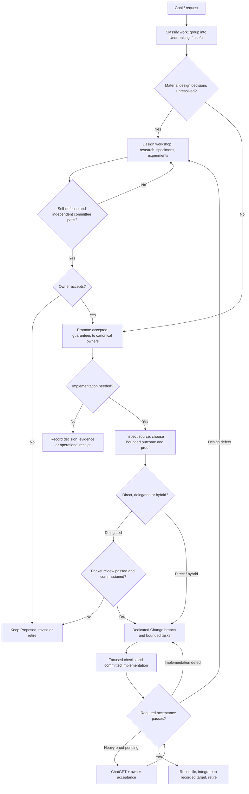
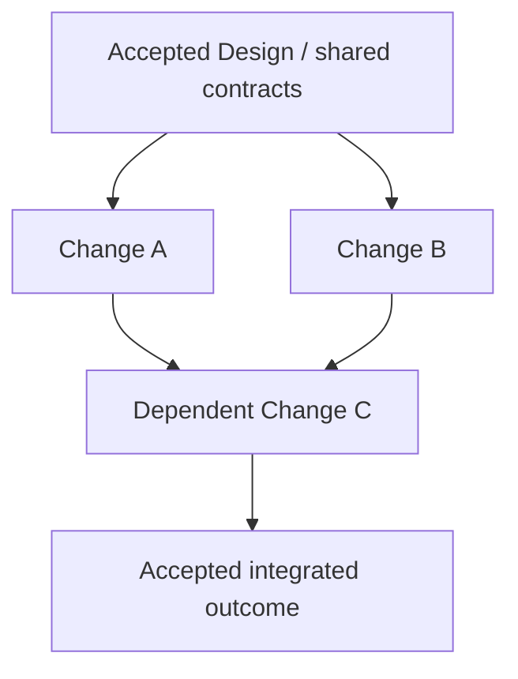

# How we work | engineering lifecycle and agent handbook

This is the human and agent navigation map for the sequence of engineering work. [AGENTS.md](AGENTS.md) owns shared permissions and role entrypoints; [repository structure](REPOSITORY-STRUCTURE.md) owns placement and retention; [engineering tour](ENGINEERING.md) explains the system. Follow detailed standards by decision point, not as universal preload.

**Principle:** decide what must be true, ratify it in canonical documentation, plan against actual source, implement the smallest sufficient delta, verify and retire temporary work. Proposed, selected, implemented and proven are distinct.

## Dependency readiness is not a planner blocker

Follow [the shared readiness rule](AGENTS.md#dependency-readiness-is-not-a-planner-blocker): frozen prerequisites can gate execution without reopening settled architecture. Commission and live permissions are separate from readiness. Return changed material assumptions to the planner.

## 1. Five-minute map



An Undertaking is optional and does not imply a separate integration branch. Already-settled small fixes need neither a Design nor a manufactured rewrite of canonical docs. Pure evaluation or operational work follows its own evidence/Task route.

### Roles and read budgets

| Role | Responsibility and route |
| --- | --- |
| All agents | [AGENTS](AGENTS.md), actual branch/HEAD, [QUEUE](work/QUEUE.md), relevant owners |
| Designer/planner | [CHATGPT](CHATGPT.md), [design method](.agents/rules/target-driven-renewal.md), [source investigation](.agents/references/planner-investigation-standard.md); settle expensive decisions |
| Cursor parent | Selected CHANGE + TASKS index, [parent procedure](.agents/references/bounded-parent-orchestration.md); one commissioned Change |
| Composer child | One T-ID, exact anchors, [task format](.agents/references/composer-first-execution.md); focused edit and checks |
| Reviewer | [Design committee](.agents/rules/target-driven-renewal.md#mandatory-independent-design-committee) or [packet readiness](.agents/references/packet-readiness-review.md), actual evidence; no self-certification |
| Acceptance owner | ChatGPT + human for substantial proof; exact tested revision, actual result and limitations |

## 2. What kind of work is this?

| Desired output | Unit and home | Exit |
| --- | --- | --- |
| Coordinated transformation | [Undertaking](work/undertakings/README.md) | Accepted integrated outcome; retire dossier |
| Unsettled architecture/product decision | [Design](work/designs/README.md) | Defend, ratify, promote or defer/retire |
| Lasting executable or substantive normative-doc diff | [Change](work/changes/README.md) | Required proof, reconciliation and integration |
| Independent operation with no planned lasting diff | [Task](work/tasks/README.md) | Actual operation receipt |
| Small assignment inside a Change | T-ID in TASKS.md | Child receipt, parent owns closure |
| Unknown fact or hypothesis | Investigation/experiment in appropriate Design, [research](research/README.md) or [evidence](evidence/README.md) | Actual finding, limitations and decision if applicable |

Classify by result, not verbs. "Test the Storyteller" may mean add a maintained assertion (Change), run an existing check (Task or acceptance), or discover a cause (investigation). A small link correction or read-only inspection needs no manufactured packet. [Work taxonomy](work/WORK-TAXONOMY.md) and [repository geography](REPOSITORY-STRUCTURE.md) own details.

[QUEUE](work/QUEUE.md) is the sole global selection. Named owner commission can authorize independent concurrent Changes; catalogs, Ready status and roadmap proximity cannot. Separate spend, production, destructive and resource permissions remain required.

## 3. Undertaking: group a real transformation

Use only for genuinely related work with shared outcome. Create technical UNDERTAKING.md and required human-first OVERVIEW.md from [template](work/undertakings/OVERVIEW-TEMPLATE.md), link both and catalog. Record included/excluded work, dependencies, acceptance, actual target and base SHA. Main is current trunk; a separate integration branch requires explicit authorization.

Read both at planner cold start. At kickoff, meaningful joins, changes to scope/risk or next wave, and before closure, reconcile overview against actual receipts, STATUS and technical ledger. Maintain 5%-rounded overall and major-track completion/remaining estimates, uncertainty, reasons and visual human-readable summary. These estimate effort/risk, not packet count. Custodian serializes edits; ChatGPT shares progress and link at meaningful milestones.

When selected integrated outcome passes, provide final before/after overview, reconcile and retire dossier. Merge/retire a separate authorized integration branch only if it exists. No extra program merge for work already joined main. [Undertaking lifecycle](work/undertakings/README.md).

## 4. Design first; documentation before implementation

For substantial design, follow [adaptive workshop](.agents/rules/target-driven-renewal.md), including posture, real source/upstream research, alternatives, specimens, feasible proof and self-defense. Apply [submission-quality gate](.agents/references/planning-artifact-quality.md), then independent committee on exact candidate. Every completed committee verdict is committed and verified. Only passed defense plus separate owner acceptance permits promotion of the selected scope. Decisive missing evidence gates affected scope. No packet wave as a substitute for Design.

[Product docs](docs/product/README.md) own intent; [technical docs](docs/technical/README.md) own guarantees (including authority, identity, transactions, retry/failure and compatibility). Source, tests, STATUS and evidence show realization. Promote newly accepted behavior/architecture to canonical owners before commissioning implementation. Existing accepted small-fix contracts need only citation. Reconcile realized claims after code and proof; no premature implemented claim or silent product rewrite to match code.

[Documentation ownership](docs/README.md) · [reconciliation](.agents/skills/documentation-reconciliation/SKILL.md).

## 5. Plan Changes for genuine parallel execution

Planner selects independently useful outcomes, freezes common contracts and maps dependency order, disjoint write/resource ownership and join proof. Prefer real parallelism across separate authorized Change parents; serialize shared migrations, package exports, lockfiles, canonical headings, clusters and data. Do not split atomic safety boundaries or manufacture concurrency.



One custodian serializes joins and shared ledgers. [Parallel scheduling standard](.agents/references/change-work-unit-standard.md#batch-execution-and-parallel-change-orchestration-2026-11-19) owns schedule format and isolation checks.

## 6. After design convergence: cheap execution, with or without Cursor

Choose direct planner work, bounded Cursor implementation or hybrid by actual access, scope, cost and proof needs. All routes retain Git ownership, permission and acceptance. Batch necessary owner-terminal checks; no hidden manual prerequisites or invented execution results.

For delegation, apply [source investigation](.agents/references/planner-investigation-standard.md), [packet construction](.agents/references/packet-design-manual.md), [task format](.agents/references/composer-first-execution.md), then [independent readiness](.agents/references/packet-readiness-review.md). One Change is one measurable outcome, normally 5–10 minutes active Cursor work and 1–5 tasks, at most seven actual assignments. [Submission standard](.agents/references/planning-artifact-quality.md) owns folder roles, scale, actual mandatory context, measurements and rejection. Tiny work needs no empty companions. Repartition excessive scope safely; do not delegate missing architecture.

A ready packet supplies selected algorithm, authority, exact source owners, prerequisites, task-specific anchors, focused normal/negative checks and acceptance owner. Ready is not commission.

## 7. Git: one integration branch, one temporary branch per commissioned implementation Change

```text
main (current trunk)
  ├── change/<id>-<slug>        # dedicated linked worktree
  └── change/<other-id>-<slug>  # separately commissioned, disjoint owners
```

Verify actual recorded target and HEAD. Dedicated branch/worktree before implementation; never switch primary checkout, discard existing work or create per-T-ID branches. Parent owns commits, named custodian serializes shared changes and accepted joins. On acceptance refresh target, reconcile safely, squash-integrate by default, verify and retire clean branch/worktree. Alternative target only by explicit authorization; preserve in-flight work. Exact guard, commands and cleanup rules: [branch policy](.agents/references/bounded-parent-orchestration.md#mandatory-change-branch-policy) · [commit rule](.agents/rules/git-commits.md).

## 8. Cursor execution: dispatcher, bounded children, real receipts

Parent reads selected front door/index, verifies branch and prerequisites, dispatches first bounded ready T-ID. Normally one Composer child, up to two with proven independence. Child reads card and exact anchors/required sections, implements decided change, runs focused normal/negative and reports actual receipt. No broad survey, nested agents or auto-next Change.

Local mechanical diagnosis is allowed; material source/authority contradiction returns to planner with exact symbol, failed assumption and reproducer. Parent owns review, staged paths, commits and acceptance handoff. No full-suite run per child. [Parent procedure](.agents/references/bounded-parent-orchestration.md) owns checkpoints, retries and receipts.

## 9. Verification, review and the next loop

At each bounded checkpoint: inspect changed files, test affected normal and negative contracts, confirm source/branch custody and document **what actually ran**. Tests are proportionate to risk; security, transaction correctness, privacy, idempotency and financial fences are non-negotiable. For material Changes use the frozen [acceptance matrix](.agents/rules/target-driven-renewal.md#design-verification-with-the-system), recording actual evidence tier, result, tested revision and outstanding limits. Distinguish NOT RUN from FAIL and inherited baseline failures from regressions.

**Integration versus outcome closure:** normally integrate and close once required acceptance passes. If essential safety, functional and affected compatibility gates pass, a specifically owner-accepted deferral of extended assurance may permit integration while its unresolved proof remains visible in the open Change or a linked, owned follow-up. Record integrated SHA, exact deferred scenario, rationale, risk, next proof and owner; do not mark unverified claims PASS or the unresolved outcome Done. Known material defects, failed mandatory gates or missing indispensable safety/correctness evidence block integration. New concrete findings may reopen a gate; do not add ornamental checks after the agreed acceptance passes. No deferral grants live mutation permission.

At a full Change close: demonstrate its accepted Goal; reconcile the Change's product/technical/code/related ledgers; update canonical docs as needed; update `STATUS.md` and evidence without overstating implementation; run applicable link/maintenance/close guards; archive and record the terminal disposition; integrate into the reference branch. **For Changes inside an Undertaking, the integration custodian also refreshes its `OVERVIEW.md` and checks/updates its required rough percentages when the completed outcome materially changes the human big picture; otherwise records that it remains accurate.** A passing subagent task alone is **not** a completed Change.

**Independent implementation-diff review beyond required acceptance is normally post-merge.** Precommission design defense and packet readiness are distinct mandatory gates where applicable. A full Change commission authorizes its parent to complete assigned cheap tests and inspect the focused diff; reconcile and integrate after all required acceptance, including ChatGPT/owner heavy proof, is recorded. An explicit owner-selected pre-merge review is exceptional. Failed required negative tests, credible unresolved authorization/financial/data integrity issues and unsafe Git/resource operations still stop integration. **ChatGPT reviews source/evidence deeply when valuable:** challenge what could fail, audit interfaces/permissions and acceptance holes, create a *new bounded Change* for a genuine persistent fix, or revise remaining T-IDs. Do not force paid Cursor to perform repeated duplicate audits. A review result is not a permission grant or a claim of passed live tests.

**Standalone operational Tasks** handle genuinely independent verification, approved one-off migrations, environment acceptance, cleanup/housekeeping runs or scheduled experiments where the outcome is an *action receipt* rather than persistent new code/docs. If a missing runner or permanent repair is needed, create a separate Change. [Tasks standard](work/tasks/README.md) · [Task workflow](.agents/skills/task-workflow/SKILL.md) · [evidence](evidence/README.md).

## 10. Maintenance, audits and retirement

[Repository structure](REPOSITORY-STRUCTURE.md#6-housekeeping-procedure-by-zone) owns triage and promotion/deletion gates. Active Designs and Changes have real owners/outcomes; deferred worthwhile work has a trigger; terminal artifacts move to archive after actual reconciliation. Promote accepted meaning, preserve unique evidence, full-SHA/path ledger and repair links. Seven-day archive review is not deletion authorization. Undertakings require final human overview and acceptance.

At code-bearing Change closure inspect craftsmanship and run `pnpm repo:code-health --base <actual-integration-branch>`; use --strict-new for newly crossed severe bands. Review repository hotspots roughly every two weeks during heavy development and before Undertaking integration. Warnings trigger source investigation, not automatic refactoring. [Code quality](.agents/rules/code-quality.md) owns details. [Documentation navigation](.agents/references/documentation-navigation-standard.md) and [maintenance](.agents/references/repository-maintenance.md) own checks; graph-clean does not mean semantically correct. No background automation implied.

Read-only triage or trivial safe correction needs no new packet. Reusable tooling or substantial maintained repairs are Changes; independent no-diff operations may be Tasks. Never tidy by deleting unique history, weakening proof or falsifying Done.

## 11. Quick start by intent

| You want to... | Begin with |
| --- | --- |
| **Start a major new program** | [Undertakings](work/undertakings/README.md) → required `OVERVIEW.md` + `UNDERTAKING.md` → [Designs](work/designs/README.md) as needed |
| **Explore a product/architecture idea** | [Designs](work/designs/README.md) and current [product/technical wiki](docs/README.md) |
| **Plan code for Cursor** | [CHATGPT.md](CHATGPT.md) → [planner standard](.agents/references/planner-investigation-standard.md) → [Change workflow](.agents/skills/change-workflow/SKILL.md) |
| **Commission Cursor to implement** | [QUEUE](work/QUEUE.md) or explicit commission → selected `CHANGE.md` + `TASKS.md` → [branch + dispatcher protocol](.agents/references/bounded-parent-orchestration.md) |
| **Run independent verification/maintenance** | [standalone Task](work/tasks/README.md), only if separately tracked |
| **Review/audit implementation** | [STATUS](STATUS.md), changed source/tests and dated [evidence](evidence/README.md), then amend/create Change as warranted |
| **Audit/clean the wiki or backlog** | [docs router](docs/README.md), [work taxonomy](work/WORK-TAXONOMY.md), [retirement rules](work/changes/archive/README.md) |
| **Understand why this system exists** | [Engineering System Tour](ENGINEERING.md) |
