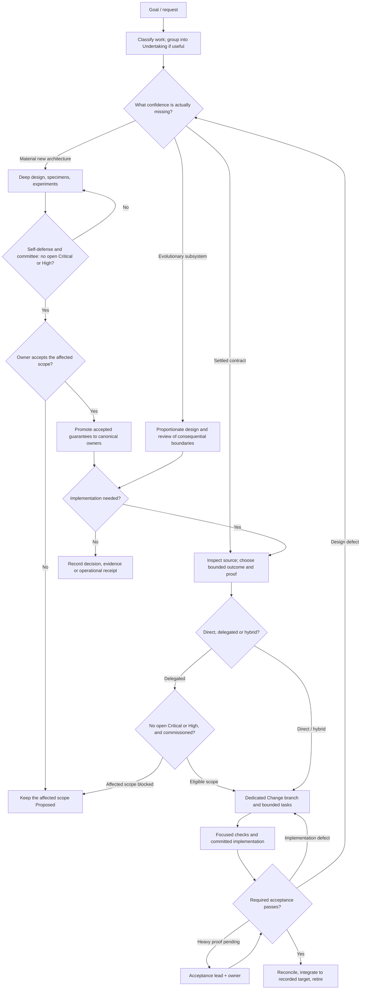
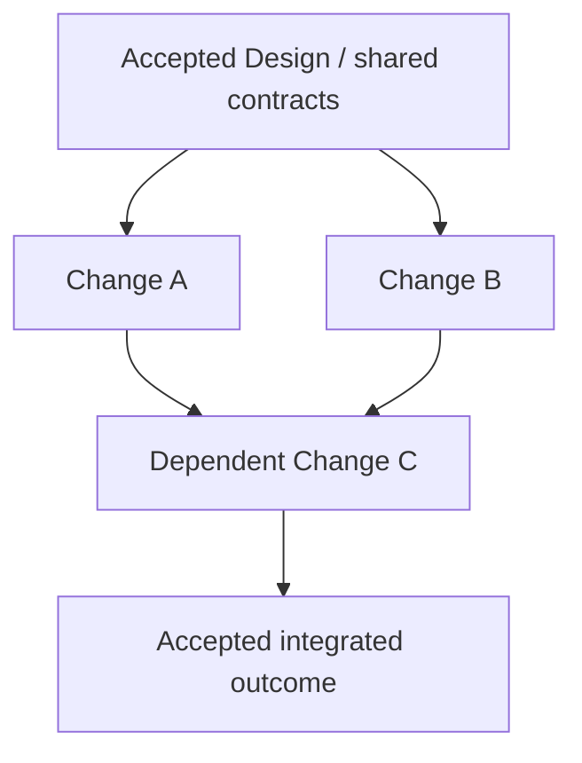

# How we work | engineering lifecycle and agent handbook

This is the human and agent navigation map for the sequence of engineering work. [AGENTS.md](AGENTS.md) owns shared permissions and role entrypoints; [repository structure](REPOSITORY-STRUCTURE.md) owns placement and retention; [engineering tour](ENGINEERING.md) explains the system. Follow detailed standards by decision point, not as universal preload.

**Principle:** decide what must be true, ratify it in canonical documentation, plan against actual source, implement the smallest sufficient delta, verify and retire temporary work. Proposed, selected, implemented and proven are distinct. Design, planning, documentation and review exist to accelerate correct, safe and maintainable software. [AGENTS.md](AGENTS.md#delivery-over-procedure-owner-decision-2026-11-27) owns that principle, finding severity and investigation depth.

## Dependency readiness is not a planner blocker

Follow [the shared readiness rule](AGENTS.md#dependency-readiness-is-not-a-planner-blocker): frozen prerequisites can gate execution without reopening settled architecture. Commission and live permissions are separate from readiness. Return changed material assumptions to the planner.

## 1. Five-minute map



An Undertaking is optional and does not imply a separate integration branch. Settled-contract fixes need neither a Design nor a manufactured rewrite of canonical docs. Evolutionary work does not take the material-architecture ceremony merely because it touches infrastructure. A blocked scope does not stop unrelated eligible work. Pure evaluation or operational work follows its own evidence/Task route.

### Roles and read budgets

| Role | Responsibility and route |
| --- | --- |
| All agents | [AGENTS](AGENTS.md), actual branch/HEAD, [QUEUE](work/QUEUE.md), relevant owners |
| Designer/planner | [Design method](.agents/rules/target-driven-renewal.md), [planner investigation](.agents/references/planner-investigation-standard.md); settle expensive decisions. Client adapters only when that client is selected |
| Implementation coordinator | Selected CHANGE + TASKS index, [parent procedure](.agents/references/bounded-parent-orchestration.md); one commissioned Change |
| Implementation task | One T-ID, exact anchors, [task format](.agents/references/task-execution-standard.md) when used; focused edit and checks. Without native subagents, the same card is a bounded direct execution path |
| Independent reviewer | [Design committee](.agents/rules/target-driven-renewal.md#mandatory-independent-design-committee) when the depth requires it, or [packet readiness](.agents/references/packet-readiness-review.md); [severity](AGENTS.md#finding-severity-and-blocking); no self-certification |
| Acceptance lead | Acceptance lead and owner for substantial proof; exact tested revision, actual result and limitations |

## 2. What kind of work is this?

| Desired output | Unit and home | Exit |
| --- | --- | --- |
| Coordinated transformation | [Undertaking](work/undertakings/README.md) | Accepted integrated outcome; retire dossier |
| Unsettled architecture/product decision | [Design](work/designs/README.md) | Defend, ratify, promote or defer/retire |
| Lasting executable or substantive normative-doc diff | [Change](work/changes/README.md) | Required proof, reconciliation and integration |
| Independent operation with no planned lasting diff | [Task](work/tasks/README.md) | Actual operation receipt |
| Small assignment inside a Change | T-ID in TASKS.md | Child receipt, parent owns closure |
| Unknown fact or hypothesis | Investigation/experiment in appropriate Design, [research](research/README.md) or [evidence](evidence/README.md) | Actual finding, limitations and decision if applicable |

Classify by result, not verbs. "Test the Storyteller" may mean add a maintained assertion (Change), run an existing check (Task or acceptance), or discover a cause (investigation). A small link correction or read-only inspection needs no manufactured packet. [Work taxonomy](work/WORK-TAXONOMY.md) and [repository geography](REPOSITORY-STRUCTURE.md) own details.

[QUEUE](work/QUEUE.md) is the sole global selection. Named owner commission can authorize independent concurrent Changes; catalogs, Ready status and roadmap proximity cannot. Separate spend, production, destructive and resource permissions remain required.

## 3. Undertaking: group a real transformation

Use only for genuinely related work with shared outcome. Create technical UNDERTAKING.md and required human-first OVERVIEW.md from [template](work/undertakings/OVERVIEW-TEMPLATE.md), link both and catalog. Record included/excluded work, dependencies, acceptance, actual target and base SHA. Main is current trunk; a separate integration branch requires explicit authorization.

Read both at planner cold start. At kickoff, meaningful joins, changes to scope/risk or next wave, and before closure, reconcile overview against actual receipts, STATUS and technical ledger. Maintain 5%-rounded overall and major-track completion/remaining estimates, uncertainty, reasons and visual human-readable summary. These estimate effort/risk, not packet count. The custodian serializes edits; the planner shares progress and the link at meaningful milestones.

When selected integrated outcome passes, provide final before/after overview, reconcile and retire dossier. Merge/retire a separate authorized integration branch only if it exists. No extra program merge for work already joined main. [Undertaking lifecycle](work/undertakings/README.md).

## 4. Design first; documentation before implementation

Choose [investigation depth](AGENTS.md#investigation-depth) from risk, novelty, uncertainty, blast radius and cost of failure. Focused work under settled contracts cites the accepted contract and proceeds to a compact Change or direct implementation. Evolutionary subsystem work investigates the affected subsystem, preserves relevant behavior and uses proportionate review of consequential boundaries. Material new architecture follows the [adaptive workshop](.agents/rules/target-driven-renewal.md): posture, real source and upstream research, alternatives, specimens, feasible proof, self-defense and an independent committee on the exact candidate.

Apply [submission quality](.agents/references/planning-artifact-quality.md) through the severity policy. Only Critical and High findings block the affected scope. The reviewer delivers a SHA-bound verdict; the reviewing session or the local custodian persists it, and promotion waits until that verdict is in the repository and matched to the reviewed candidate. Passed defense plus separate owner acceptance permits promotion of the selected scope. Indispensable missing evidence gates the affected scope. No packet wave as a substitute for an unresolved material architecture. Medium and Low findings do not start another design iteration.

[Product docs](docs/product/README.md) own intent; [technical docs](docs/technical/README.md) own guarantees (including authority, identity, transactions, retry/failure and compatibility). Source, tests, STATUS and evidence show realization. Promote newly accepted behavior/architecture to canonical owners before commissioning implementation. Existing accepted small-fix contracts need only citation. Reconcile realized claims after code and proof; no premature implemented claim or silent product rewrite to match code.

[Documentation ownership](docs/README.md) · [reconciliation](.agents/skills/documentation-reconciliation/SKILL.md).

## 5. Plan Changes for genuine parallel execution

The planner prepares the complete authorized batch: independently useful outcomes, frozen common contracts, dependency order, disjoint write and resource ownership, and join proof. Release each Change when it is independently ready. Do not wait for an unrelated Change, and do not move current-sprint work to backlog because it cannot be dispatched today. Prefer real parallelism across separate authorized Change parents; serialize shared migrations, package exports, lockfiles, canonical headings, clusters and data. Do not split atomic safety boundaries or manufacture concurrency. An owner commission of a named batch authorizes eligible Changes to proceed without a fresh confirmation at each routine checkpoint.



Map a Design's Change dependency graph before writing its task cards. Record the edges in the existing implementation plan or catalog. Each commissioned Change joins through the serialized lifecycle in [branch policy](.agents/references/bounded-parent-orchestration.md#mandatory-change-branch-policy). [Parallel scheduling standard](.agents/references/change-work-unit-standard.md#batch-execution-and-parallel-change-orchestration-2026-11-19) owns the schedule fields and isolation checks.

## 6. After design convergence: cheap execution

Choose direct planner work, delegated implementation or a hybrid by actual access, scope, cost and proof needs. All routes retain Git ownership, permission and acceptance. No client is compulsory. Batch necessary owner-terminal checks; no hidden manual prerequisites or invented execution results.

For delegation, apply [source investigation](.agents/references/planner-investigation-standard.md), [packet construction](.agents/references/packet-design-manual.md), [task format](.agents/references/task-execution-standard.md), then [independent readiness](.agents/references/packet-readiness-review.md). One Change prefers one measurable outcome, normally 5–10 minutes of active implementation and 1–5 tasks. Seven actual assignments is a strong default, with the narrow exception in [AGENTS.md](AGENTS.md#submission-shape). [Submission standard](.agents/references/planning-artifact-quality.md) owns folder roles, scale signals and mandatory context. Tiny work needs no empty companions. Repartition work whose size prevents reliable execution. Do not delegate missing architecture, and do not split a coherent bounded Change merely to satisfy a count.

A ready packet supplies selected algorithm, authority, exact source owners, prerequisites, task-specific anchors, focused normal/negative checks and acceptance owner. Ready is not commission.

## 7. Git: design implementation branch, then one temporary branch per Change

```text
main (trunk; design dossiers and packets normally live here)
  ├── implementation/<design-slug>   # or an existing grandfathered integration ref
  │     ├── change/<id>-<slug>       # joins back only to that design branch
  │     └── change/<other-id>-<slug>
  └── change/<standalone-id>-<slug>  # a Change with no commissioned Design joins main
```

Verify the recorded target and HEAD. A commissioned Design gets its implementation branch from the main revision that contains the accepted design; that commission includes creating the recorded branch. Constituent Changes use linked worktrees and join that branch with an ordinary merge. They do not join main. Standalone Changes keep the direct route and its established squash join. Never switch the primary checkout, discard existing work, or create a branch per task. The Change coordinator commits, joins under the target lock, verifies the new SHA, and retires only a clean integrated worktree. In-flight branches stay. Exact guard, join, retirement and cleanup rules: [branch policy](.agents/references/bounded-parent-orchestration.md#mandatory-change-branch-policy) · [commit rule](.agents/rules/git-commits.md).

## 8. Delegated execution: coordinator, bounded tasks, real receipts

The coordinator reads the selected front door and index, verifies branch and prerequisites, and carries the commissioned Change through implementation, focused checks, commit, Change-level join, and clean retirement. With native subagents, normally one implementation task runs, and up to two when independence is proven. Without them, the coordinator executes that same bounded task directly. The task reads its card and exact anchors, implements the decided change, runs focused normal and negative checks, and reports an actual receipt. No broad survey, nested swarms or auto-next Change. A finished task is not the end of a commission whose join is still safe.

Local mechanical diagnosis is allowed; material source/authority contradiction returns to planner with exact symbol, failed assumption and reproducer. Parent owns review, staged paths, commits and acceptance handoff. No full-suite run per child. [Parent procedure](.agents/references/bounded-parent-orchestration.md) owns checkpoints, retries and receipts.

## 9. Verification, review and the next loop

At each bounded checkpoint: inspect changed files, test affected normal and negative contracts, confirm source/branch custody and document **what actually ran**. Tests are proportionate to risk; security, transaction correctness, privacy, idempotency and financial fences are non-negotiable. For material Changes use the frozen [acceptance matrix](.agents/rules/target-driven-renewal.md#design-verification-with-the-system), recording actual evidence tier, result, tested revision and outstanding limits. Distinguish NOT RUN from FAIL and inherited baseline failures from regressions.

**Integration versus outcome closure:** keep these apart: implementation completed, the Change-level join gate passed, source integrated on the isolated design branch, design-wide acceptance passed, and final integration into main. A Design may allow the source join while joint acceptance is still pending. That join does not certify runtime behavior, activate anything live, or waive the joint proof. The constituent packet is still archived once its own obligations pass, after those joint obligations are recorded on the Design. The Change worktree does not have to stay open only because that design-level proof is still assigned. Completion is not reported while the open packet remains on the implementation branch. Main may keep the open copy until the design branch lands. Lookup uses the implementation branch. Indispensable Change-level proof still stops the join and keeps the worktree. Record the integrated SHA and the unresolved obligations on the implementation branch. Final main integration is the design-level closure, after every constituent is integrated and the required joint acceptance has passed. No constituent Change performs it.

If essential safety, functional and affected compatibility gates pass, a specifically owner-accepted deferral of extended assurance may permit integration while its unresolved proof remains visible in the open Change or a linked, owned follow-up. Record the integrated SHA, exact deferred scenario, rationale, risk, next proof and owner; do not mark unverified claims PASS or the unresolved outcome Done. Known Critical or High defects, failed required safety gates, or missing indispensable safety or correctness evidence block the affected integration. Deferred Medium and Low assurance does not. New concrete findings may reopen a gate when their consequence is Critical or High; do not add ornamental checks after the agreed acceptance passes. No deferral grants live mutation permission. Integrating individual Changes does not certify the whole system.

At a full Change close: demonstrate its accepted Goal; reconcile the Change's product/technical/code/related ledgers; update canonical docs as needed; update `STATUS.md` and evidence without overstating implementation; run applicable link/maintenance/close guards; archive and record the terminal disposition; integrate into the reference branch. **For Changes inside an Undertaking, the integration custodian also refreshes its `OVERVIEW.md` and checks/updates its required rough percentages when the completed outcome materially changes the human big picture; otherwise records that it remains accurate.** A passing subagent task alone is **not** a completed Change.

**Independent implementation-diff review beyond required acceptance is normally post-merge.** Precommission design defense and packet readiness are distinct mandatory gates where applicable. A full Change commission authorizes its coordinator to complete assigned cheap tests and inspect the focused diff; reconcile and integrate after all required acceptance, including acceptance-lead and owner heavy proof, is recorded. An explicit owner-selected pre-merge review is exceptional. Failed required negative tests, credible unresolved authorization/financial/data integrity issues and unsafe Git/resource operations still stop integration. The planner or independent reviewer reviews source and evidence when that adds judgment: challenge what could fail, audit interfaces, permissions and acceptance holes, and create a new bounded Change for a genuine persistent fix or revise remaining tasks. Do not force the implementation agent to repeat that audit. A review result is not a permission grant or a claim of passed live tests.

**Standalone operational Tasks** handle genuinely independent verification, approved one-off migrations, environment acceptance, cleanup/housekeeping runs or scheduled experiments where the outcome is an *action receipt* rather than persistent new code/docs. If a missing runner or permanent repair is needed, create a separate Change. [Tasks standard](work/tasks/README.md) · [Task workflow](.agents/skills/task-workflow/SKILL.md) · [evidence](evidence/README.md).

## 10. Maintenance, audits and retirement

[Repository structure](REPOSITORY-STRUCTURE.md#6-housekeeping-procedure-by-zone) owns triage and promotion/deletion gates. Active Designs and Changes have real owners/outcomes; deferred worthwhile work has a trigger; terminal artifacts move to archive after actual reconciliation. Promote accepted meaning, preserve unique evidence, full-SHA/path ledger and repair links. Seven-day archive review is not deletion authorization. Undertakings require final human overview and acceptance.

At code-bearing Change closure inspect craftsmanship and run `pnpm repo:code-health --base <actual-integration-branch>`; use --strict-new for newly crossed severe bands. Review repository hotspots roughly every two weeks during heavy development and before Undertaking integration. Warnings trigger source investigation, not automatic refactoring. [Code quality](.agents/rules/code-quality.md) owns details. [Documentation navigation](.agents/references/documentation-navigation-standard.md) and [maintenance](.agents/references/repository-maintenance.md) own checks; graph-clean does not mean semantically correct. No background automation implied.

Read-only triage or trivial safe correction needs no new packet. Reusable tooling or substantial maintained repairs are Changes; independent no-diff operations may be Tasks. Never tidy by deleting unique history, weakening proof or falsifying Done.

## 11. Quick start by intent

| You want to... | Begin with |
| --- | --- |
| **Start a major new program** | [Undertakings](work/undertakings/README.md) → required `OVERVIEW.md` + `UNDERTAKING.md` → [Designs](work/designs/README.md) as needed |
| **Explore a product/architecture idea** | [Designs](work/designs/README.md) and current [product/technical wiki](docs/README.md) |
| **Plan implementation** | [Planner standard](.agents/references/planner-investigation-standard.md) → [Change workflow](.agents/skills/change-workflow/SKILL.md) |
| **Commission implementation** | [QUEUE](work/QUEUE.md) or explicit commission → selected `CHANGE.md` + `TASKS.md` → [branch + dispatcher protocol](.agents/references/bounded-parent-orchestration.md) |
| **Run independent verification/maintenance** | [standalone Task](work/tasks/README.md), only if separately tracked |
| **Review/audit implementation** | [STATUS](STATUS.md), changed source/tests and dated [evidence](evidence/README.md), then amend/create Change as warranted |
| **Audit/clean the wiki or backlog** | [docs router](docs/README.md), [work taxonomy](work/WORK-TAXONOMY.md), [retirement rules](work/changes/archive/README.md) |
| **Understand why this system exists** | [Engineering System Tour](ENGINEERING.md) |
