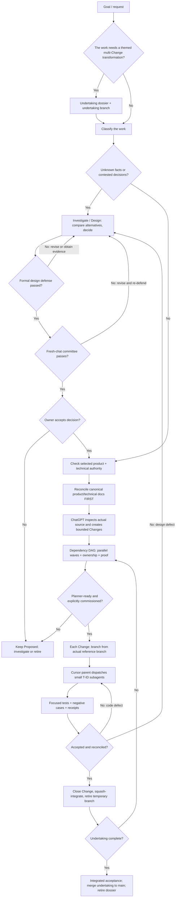
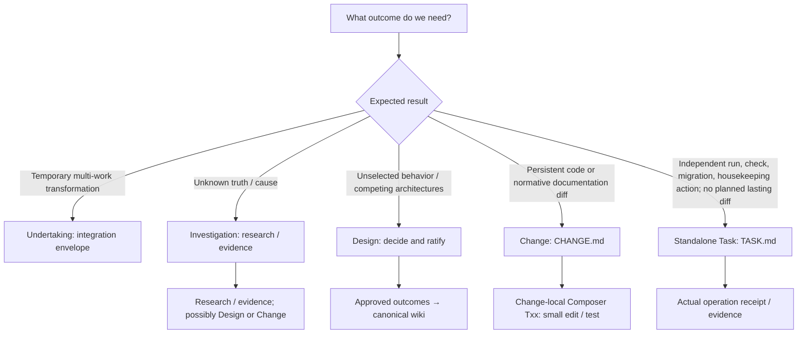
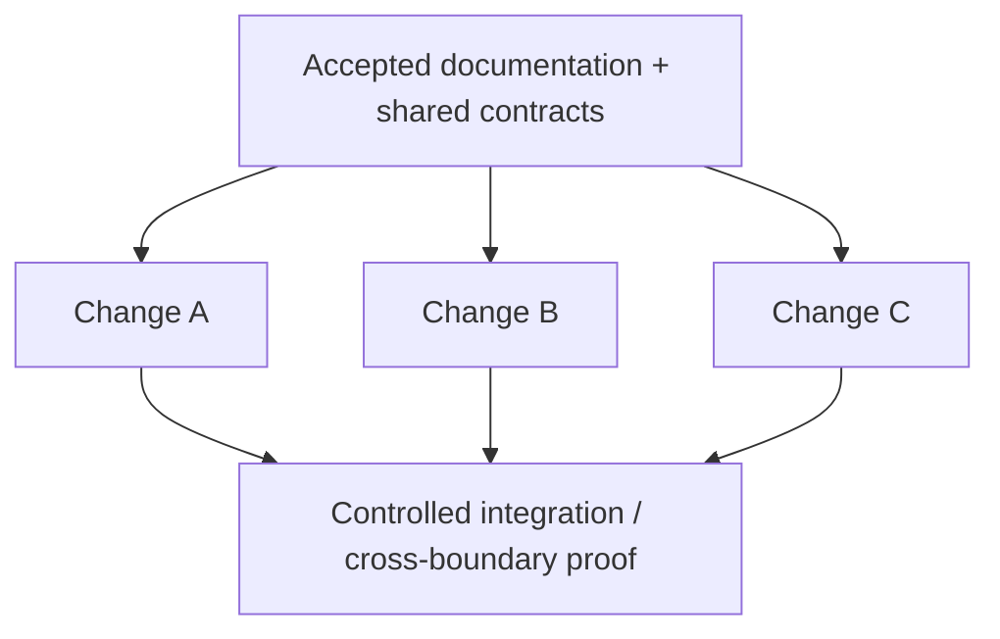

# How we work | engineering lifecycle and agent handbook

**Owner decision 2026-11-24: `main` is the integration trunk.** Storyteller Workshop remains an active outcome/acceptance dossier, not a separate integration branch. New Changes branch from current `main` and join `main` after their own proof, using dedicated Change branches and linked worktrees. The former `undertaking/storyteller-workshop` reference is a historical transition checkpoint; no new joins there. Reconcile in-flight branches against main without resetting or discarding user work. Do not force-push or delete the old branch until local migration is verified. This explicitly overrides older Storyteller Workshop target instructions, not safety, release, live acceptance or Change gates. The dossier closes on accepted outcome, not branch promotion.

## Dependency readiness is not a planner blocker

Owner direction (2026-11-24): distinguish design readiness, execution dependency order, commission, and live-resource permission. A settled packet with frozen interfaces, selected algorithm, scope and proof is **Ready (dependency-gated)** even when predecessors have not landed. An explicitly commissioned batch may dispatch each named packet as soon as its recorded predecessor receipts and source postconditions hold, without further planner promotion, certification, or owner approval. A parent may verify those postconditions and mechanically reconcile import paths, manifests, symbols and test paths under a frozen mapping; this is execution, not delegated architecture discovery. Do not require a pre-existing test harness when creating it is the selected task. Source implementation and deterministic tests proceed independently of separately gated live proof. Use **PLANNER-BLOCKED** only for a named material unresolved design, algorithm, authority, safety, or semantic contradiction that prevents correct execution; state exact missing decision/evidence and affected task, not a generic readiness disclaimer. Unfinished predecessors, normal integration sequencing, or absent future source implementing an already frozen contract are not planner blockers. Preserve all actual safety, correctness and resource permission gates. Before recommending `do ID`, ChatGPT must ensure the repository packet is actually commissioned and executable now or explicitly dependency-gated, and verify the push. No repeated approval for an unchanged commissioned contract. This rule clarifies all readiness/review language below; it does not waive source-grounded planning or permit uncommissioned sibling work.

**Companion map:** [REPOSITORY-STRUCTURE.md](REPOSITORY-STRUCTURE.md) owns the *where and how-long* of each folder, including permanent vs transient zones, admission and retirement, and safe housekeeping. This page owns the *sequence of work*. Consult both before reorganizing the repository.

**For ChatGPT packet authoring:** use [execution-first design](.agents/references/packet-design-manual.md); before calling a packet Ready apply the separate [adversarial readiness review](.agents/references/packet-readiness-review.md) and [compact worksheet](.agents/references/packet-review-checklist.md). This is a planner-only route, **not** a mandatory Cursor/Composer preload.

**Start here for the development method.** This is the **one navigational front door** for humans, ChatGPT planners and coding agents. It explains the sequence and where each decision belongs; it is **not** a second product specification, task queue, or replacement for the linked detailed standards. Read this page by role, then follow only relevant links. The short compulsory entrypoint is [AGENTS.md](AGENTS.md); [CHATGPT.md](CHATGPT.md) adds planner obligations; [.agents/HARNESS.md](.agents/HARNESS.md) governs the coding-agent harness.

> **Operating principle:** Decide what must be true; ratify it in product/technical documentation; let ChatGPT do expensive source-grounded planning; let cheaper Cursor agents execute small predecided edits; verify with real evidence; reconcile and retire temporary work. **Never confuse proposed, selected, implemented and proven.**

## 1. Five-minute map



**This is a typical *substantial* delivery path, not mandatory ceremony for every small operation.** An ordinary isolated Change does not need an Undertaking. Already-accepted, current product/technical contracts need no artificial rewrite. A test-only operation need not create code or design packets.

### Roles and read budgets

| Who / situation | First reads | Owns | Does **not** own |
| --- | --- | --- | --- |
| **Any repository agent** | `AGENTS.md`, this page's relevant section, actual branch/HEAD, [QUEUE](work/QUEUE.md) | Safe navigation and truthful source status | Inventing missing permissions or active work |
| **ChatGPT designing Changes** | [CHATGPT.md](CHATGPT.md), [planner standard](.agents/references/planner-investigation-standard.md), applicable owners and source/tests | Deep investigation, architecture, decisions, docs alignment, dependency/parallel design, proof plan, microscopic Cursor tasks | Sending unresolved architecture to paid executor |
| **Cursor parent commissioned on a Change** | Change `CHANGE.md`, `TASKS.md`, [parent orchestration](.agents/references/bounded-parent-orchestration.md) | Dedicated Change branch, economical dispatch, integration checkpoints, docs/proof, closure and join | New architecture surveys, unselected Changes |
| **Cursor Composer child** | **One** T-ID plus its 2–5 exact source/test anchors | One patch and focused normal/negative check, short factual receipt | Whole repo scans, parallel research swarms, own Change selection, own branch per T-ID |
| **Reviewer / investigator** | Claim/Change, actual current source, acceptance evidence | Challenge assumptions and missed cases; propose precise correction | Calling unrun tests PASS or silently broadening acceptance |

**Cost strategy:** Spend planning effort in ChatGPT; minimize Cursor context, redundant tests, agents and speculative polish. Cheap does not mean compromising authorization, data integrity, privacy, idempotency or financial safety. See [Composer task policy](.agents/references/composer-first-execution.md) and [Cursor budget](.agents/references/cursor-model-budget-policy.md).

## 2. What kind of work is this?



| Unit | Where it lives | Use when | Exit |
| --- | --- | --- | --- |
| **Undertaking** | [`work/undertakings/`](work/undertakings/README.md) | Several thematically related work units need one integration identity | Active → Landing → Closed; land or abandon, record disposition, retire branch/dossier |
| **Design / open investigation** | [`work/designs/open/`](work/designs/README.md) | A real product/architecture choice or unknown remains | Accept into canonical wiki, defer/reject/retire with [design ledger](work/designs/ledger/2026-11.md) and Git provenance |
| **Change** | [future backlog](work/changes/backlog/README.md) → [`open/YYYY-MM-DD--slug/CHANGE.md`](work/changes/README.md) | Produce independently verifiable **lasting source/config/test or authoritative-doc diff** | Prove + reconcile; archive briefly and ledger/Git retire |
| **Standalone Task** | [`work/tasks/open/YYYY-MM-DD--slug/TASK.md`](work/tasks/README.md) | An independent run, cleanup action, scheduled verification or explicit resource gate merits its own receipt | Record actual action/evidence; archive |
| **Composer T-ID** | `<Change>/TASKS.md#Txx` | Tiny implementation step **inside** one Change | Child receipt; parent Change owns acceptance |
| **Experiment / evidence / research** | [lab protocols](docs/technical/lab/chamber-and-fixtures.md), [evidence](evidence/README.md), [research](research/README.md) | Test a hypothesis, preserve what happened, or explain a finding | Dated facts and reproducibility, not automatic product authority |

**The classifier is the *desired output*, not the wording.** “Test the Storyteller” can mean a Change adding a new assertion, a standalone Task running a previously defined test, or an Investigation discovering why a test fails. “Audit the wiki” is normally an Investigation; a verified structural/semantic repair is a documentation Change, while running `pnpm wiki:health` may simply be part of an existing Change. Avoid folder creation as a substitute for decisions.

**Global selection:** [`work/QUEUE.md`](work/QUEUE.md) is the **only** primary Current work selector; catalogs are not queues. Direct owner commissioning of an individual Change or explicitly approved parallel batch is a scoped authorization, not permission to autonomously start its siblings. `Ready`, `Selected`, and **permission for provider/production/destructive actions** are separate gates.

## 3. Undertaking: group a real transformation

Create an Undertaking **only when several Changes/Designs genuinely share a transformation and should land as one reviewed program**. Name the *outcome* (`Storyteller Workshop`, not `phase-2-consolidated`). Create `work/undertakings/<slug>/UNDERTAKING.md` with purpose, included/excluded work, known dependencies, status and exit/acceptance conditions. **At the same time create `OVERVIEW.md`** from [the Undertaking overview template](work/undertakings/OVERVIEW-TEMPLATE.md). It is the **first read for a human supervisor** and a required ChatGPT cold-start read; the technical dossier remains the evidence/acceptance owner. Link both bidirectionally and from the Undertakings index. Track `Active → Landing → Closed`.

Branch from the chosen actual integration base, usually `main`, as `undertaking/<slug>`. Record base SHA. **Do the program's ratified documentation and planned Change packets on the Undertaking branch.** Do not send Change implementations straight to `main`. Multiple simultaneous Undertakings are exceptional, not prohibited by physics.

**Human-progress loop:** At kickoff, after a material Change integration, changed scope/roadmap, major milestone, next-wave planning handoff and before landing, refresh the undertaking `OVERVIEW.md` from current integrated code/receipts + `STATUS.md` + the technical `UNDERTAKING.md` ledger. Show achieved, active, remaining, blockers and a human-observable next milestone in plain language. **Always maintain a 5%-rounded overall completion/remaining percentage, plus major-track estimates, visual bars, uncertainty and reasons** under the [required overview template](work/undertakings/OVERVIEW-TEMPLATE.md). Treat these as subjective engineering-effort/risk judgments, never as a fraction of completed Changes; revise downward when new integration work appears. **Proactively give the owner a concise accessible overview, including numeric progress estimates and a link,** at meaningful checkpoints; not after every T-ID. Assign a named integration custodian to serialize shared overview edits while Change parents submit factual receipts. Keep the overview visual and short, without a shadow queue or false Done claims. A standalone new ChatGPT planning session must read the current overview before setting the next wave.

When all selected child outcomes are complete, review the integrated docs, source, tests, evidence, queue/status and permissions on the undertaking branch. Then merge the coherent undertaking into its documented upstream (usually `main`), verify and retire the temporary branch and dossier with concise historical disposition. This is **not** the end of every individual Change.

[Undertaking lifecycle owner](work/undertakings/README.md) · [current example](work/undertakings/storyteller-workshop/UNDERTAKING.md).

## 4. Design first; documentation before implementation

For substantial work, choose an [adaptive design workshop](.agents/rules/target-driven-renewal.md#adaptive-design-workshop-choose-the-investigation-not-a-universal-sequence) suited to the domain. Keep speculative specimens and experiments isolated; converge through evidence and the [mandatory formal architecture defense](.agents/rules/target-driven-renewal.md#mandatory-formal-architecture-defense-and-convergence) before projecting the design into implementation. Establish the [verification architecture and acceptance matrix](.agents/rules/target-driven-renewal.md#design-verification-with-the-system) alongside the target. A material objection requires revision and re-defense; decisive unavailable evidence gates the affected scope. Record the designer's verdict, then require a [fresh-chat independent committee verdict](.agents/rules/target-driven-renewal.md#mandatory-independent-design-committee) on the exact candidate revision before owner acceptance and implementation planning. Every committee outcome must be committed to the reviewed design branch and the commit verified before the review is complete; chat-only outcomes do not count, including rejection or an early consultation. Consultation is not formal acceptance; formal submission follows passed self-defense. Direct implementation, Cursor or hybrid are execution choices, not design methods.

**Product docs decide what should happen** ([`docs/product/`](docs/product/README.md)). **Technical docs decide what must be guaranteed** ([`docs/technical/`](docs/technical/README.md)), including identity, permissions, schemas, transaction fences, concurrency, failure/retry, spend and backward compatibility. **Code/tests/STATUS/evidence show what has actually been realized.**

For new behavior or changed guarantees:
1. For substantial design or renewal, follow the [design-led renewal rule](.agents/rules/target-driven-renewal.md). Establish intent, research credible alternatives, build concrete specimens, independently challenge and revise, and run authorized experiments before Change planning. Clean-slate design may deliberately exclude legacy internals until the target is coherent; inspect integration and preservation constraints before implementation. Work in [Designs](work/designs/README.md); do not manufacture a dossier for a settled small fix.
2. Obtain necessary owner product/technical authority. Mark proposals, selected-but-unimplemented behavior and observed implementation distinctly.
3. **For newly accepted product behavior or changed architecture/authority, reconcile the canonical documents on the reference/Undertaking branch *before* commissioning Cursor.** A substantive doc revision can itself be a [documentation Change](.agents/references/change-work-unit-standard.md), with normal lifecycle/negative review. A small editorial adjustment need not become a packet.
4. Only then choose direct planner implementation, bounded Cursor Changes, or a hybrid against that selected target. Packet generation is optional; scope, branch ownership, proof and permission gates are not. Existing accepted contracts for bug fixes or implementation details may simply be cited, with any discovered drift reconciled before Change closure; no-op rewrites are not a quality gate.

After implementation, update realized-state claims, source mappings, proofs and any necessary technical details **again**. Documentation-first does **not** imply falsely labeling future behavior implemented. If reality challenges the selected design, return the decision to ChatGPT/owner, rather than silently changing the product bible to match code.

[Documentation ownership](docs/README.md) · [documentation reconciliation skill](.agents/skills/documentation-reconciliation/SKILL.md) · [Change workflow](.agents/skills/change-workflow/SKILL.md).

## 5. Plan Changes for genuine parallel execution

**Default preference for *future* multi-Change planning: parallelizable outcomes.** ChatGPT should identify the dependency graph and cut Changes along real independent behavior/authority seams, not arbitrary file counts. Freeze shared interfaces, migrations and cross-service algorithms **before** launching parallel Cursor chats. Each independent Change must have its own observable outcome, source owner, positive/negative tests, permission boundary, branch and integration receipt.

For every substantial program, write a compact execution schedule answering:
- **Can start together:** independent, explicitly authorized Changes with frozen interfaces and nonconflicting write/resource ownership.
- **Must wait:** exact predecessor output or accepted schema/API/contract required.
- **Serial owner:** shared DB migrations, package exports, lockfile, root configuration, canonical docs headings, Game Authority or cluster resources.
- **Join:** when and in what order the branches integrate into the same reference branch, and which tests validate the joined state.



Do not fabricate concurrency by splitting an atomic transaction or introducing repeated merge conflicts. Parallelism saves elapsed time only when it doesn't multiply Cursor tokens. **No retroactive change to WR02–WR08 is implied by this guide.** [Parallel Change scheduling standard](.agents/references/change-work-unit-standard.md#batch-execution-and-parallel-change-orchestration-2026-11-19).

## 6. After design convergence: cheap execution, with or without Cursor

The direct route can use ChatGPT-authored source/configuration and iterative owner terminal feedback, especially for disposable local infrastructure. Do not generate a Cursor packet solely to transfer a task the planner can execute competently. Record exact scope, decisions and actual proof; do not relax the Git or permission rules. A commission remains active through the agreed scope across checkpoints, regardless of execution route. Continue actual work rather than requesting another approval for settled steps; batch owner-operated checks when local execution is necessary. The packet layers below apply when delegation is selected.

For a **nontrivial implementation Change**, ChatGPT verifies current branch/HEAD and current agent rules first, then inspects real entrypoints, owners, affected source/tests, interfaces, schema and migration conventions, concurrency and failure paths, security/privacy/spend and the dependency graph. Explicitly **decide** the algorithm, input/output contract, transaction/lock/CAS, error/negative behavior and compatibility. Mark any genuinely unsettled design **not ready**.

Packet layers (not all mandatory for tiny work):

```text
work/changes/backlog/<domain>/YYYY-MM-DD--change-name/   # future, Proposed, not dispatchable
work/changes/open/YYYY-MM-DD--change-name/                 # active or realistically next few days
  CHANGE.md        # mandatory front door: desired outcome, authority, readiness, branch, acceptance and reconciliation
  SOURCE-MAP.md    # planner's verified source symbols, call/data ownership and observed baseline (complex work)
  EXECUTION.md     # planner's selected step-by-step algorithm / contracts and failure cases (complex work)
  PROOF.md         # planner's focused normal, negative, crash/permission and join checks (complex work)
  TASKS.md         # tiny sequential T01...Txx dispatch cards for Cursor (nontrivial implementation)
  PLAN.md          # optional *execution checkpoint*, not a duplicated architecture essay
```

A usable T-ID gives: **specific source SHA and affected functions, 2–5 read anchors, 1–3 primary write owners plus focused tests, exact delta/algorithm, preconditions/dependencies, normal + discriminating negative proof, cwd/command, stop condition and compact receipt**. One T-ID is a patch, not a clandestine subsystem-design assignment. Future dependent tasks must be refreshed by ChatGPT against predecessor code when contracts change.

**Planning acceptance gate:** a capable inexpensive executor can begin the defined edit *without choosing architecture*. If it cannot, fix the packet in ChatGPT, rather than paying Cursor to search for the missing answer. [Planner investigation standard](.agents/references/planner-investigation-standard.md) · [packet profiles](.agents/references/change-packet-profiles.md) · [Composer microtask standard](.agents/references/composer-first-execution.md) · [Change template/skill](.agents/skills/change-workflow/SKILL.md).

## 7. Git: one integration branch, one temporary branch per commissioned implementation Change

```text
main
  └── undertaking/storyteller-workshop       # integration + docs/planning, later lands to main
        ├── change/wr02-library             # executes WR02; squash-joins back; retired
        ├── change/wr03-workdesk            # created later, from then-current undertaking HEAD
        └── ...                             # separate authorized parallel Changes only
```

1. Parent identifies **actual reference branch** from the Change/Undertaking. No assumption that it is `main`. For an ordinary stand-alone Change outside an undertaking, the selected reference may be `main`.
2. **Before the first implementation edit**, create `change/<id>-<slug>` from that reference branch's current HEAD; record base SHA and target. The Change branch is **mandatory**. A dedicated linked Git worktree is **mandatory for every commissioned Cursor Change**, including when it is the only active chat. The primary checkout stays on its existing integration branch. Never `git switch` it to the Change branch.
3. The Cursor parent and its bounded children work on the **same Change branch**. No per-T-ID branches, no child commit ceremony. Parent commits coherent batch milestones.
4. On actual accepted Change completion, parent refreshes the reference branch, reconciles changed shared ownership, runs proportionate join checks, **squash-integrates into that same reference branch** by default, records final SHA, closes/retires packet and deletes the temporary branch/worktree.
5. If the Undertaking has a dedicated reference, land it after acceptance; when owner selects main, Changes join main directly while the dossier remains active. Do not leave temporary Change branches as permanent graveyards.

**Protect existing work:** inspect status/branch before edits. Never hard-reset, force-push, discard uncommitted changes or rewrite published history merely for cosmetic hygiene. If a Change began directly on its reference branch, preserve it and isolate future edits at the next safe checkpoint. For active parallel sessions, assign source and resource owners up front.

[Canonical parent/branch orchestration](.agents/references/bounded-parent-orchestration.md#mandatory-change-branch-policy) · [Git commit rule](.agents/rules/git-commits.md).

## 8. Cursor execution: dispatcher, bounded children, real receipts

**Cursor parent:** read selected `CHANGE.md` and `TASKS.md`, verify git status/reference/base, choose **first unfinished ready** T-ID, dispatch one inexpensive Composer child, consume the compact receipt, integrate the patch and repeat. Normally **one child at a time within a Change**; separate **independent Change chats** may run concurrently when owner authorized. Two children within one Change only if truly disjoint.

**Child:** read only its T-ID and 2–5 named source/test anchors, implement the specified change, run focused positive/negative tests, send six-line receipt. No architecture reconnaissance, paid provider calls without approval, large regression sweeps, research swarms, speculative refactor, roleplaying a reviewer or spawning additional children.

**Exception:** a real contradiction gets one focused diagnosis and one materially changed retry at most; for cross-service design/schema/fencing problems, stop promptly and return `T-ID | file:symbol | failed assumption | reproducer | planner question` to ChatGPT. Minor local syntax/type repairs can be handled directly. Parent owns batch commits/closure, not every child. Avoid repeatedly running the full repo test suite for unchanged code. **No test run → NOT RUN, not PASS.**

[Budget-first parent protocol](.agents/references/bounded-parent-orchestration.md) · [Composer execution](.agents/references/composer-first-execution.md).

## 9. Verification, review and the next loop

At each bounded checkpoint: inspect changed files, test affected normal and negative contracts, confirm source/branch custody and document **what actually ran**. Tests are proportionate to risk; security, transaction correctness, privacy, idempotency and financial fences are non-negotiable. For material Changes use the frozen [acceptance matrix](.agents/rules/target-driven-renewal.md#design-verification-with-the-system), recording actual evidence tier, result, tested revision and outstanding limits. Distinguish NOT RUN from FAIL and inherited baseline failures from regressions.

**Integration versus outcome closure:** normally integrate and close once required acceptance passes. If essential safety, functional and affected compatibility gates pass, a specifically owner-accepted deferral of extended assurance may permit integration while its unresolved proof remains visible in the open Change or a linked, owned follow-up. Record integrated SHA, exact deferred scenario, rationale, risk, next proof and owner; do not mark unverified claims PASS or the unresolved outcome Done. Known material defects, failed mandatory gates or missing indispensable safety/correctness evidence block integration. New concrete findings may reopen a gate; do not add ornamental checks after the agreed acceptance passes. No deferral grants live mutation permission.

At a full Change close: demonstrate its accepted Goal; reconcile the Change's product/technical/code/related ledgers; update canonical docs as needed; update `STATUS.md` and evidence without overstating implementation; run applicable link/maintenance/close guards; archive and record the terminal disposition; integrate into the reference branch. **For Changes inside an Undertaking, the integration custodian also refreshes its `OVERVIEW.md` and checks/updates its required rough percentages when the completed outcome materially changes the human big picture; otherwise records that it remains accurate.** A passing subagent task alone is **not** a completed Change.

**Independent review is normally post-merge, not a general Change completion gate.** A full Change commission already authorizes its parent to complete tests, inspect the focused diff, reconcile and integrate into its specified branch. An explicit owner-selected pre-merge review is exceptional. Failed required negative tests, credible unresolved authorization/financial/data integrity issues and unsafe Git/resource operations still stop integration. **ChatGPT reviews source/evidence deeply when valuable:** challenge what could fail, audit interfaces/permissions and acceptance holes, create a *new bounded Change* for a genuine persistent fix, or revise remaining T-IDs. Do not force paid Cursor to perform repeated duplicate audits. A review result is not a permission grant or a claim of passed live tests.

**Standalone operational Tasks** handle genuinely independent verification, approved one-off migrations, environment acceptance, cleanup/housekeeping runs or scheduled experiments where the outcome is an *action receipt* rather than persistent new code/docs. If a missing runner or permanent repair is needed, create a separate Change. [Tasks standard](work/tasks/README.md) · [Task workflow](.agents/skills/task-workflow/SKILL.md) · [evidence](evidence/README.md).

## 10. Maintenance, audits and retirement

The working tree should describe **what is actionable today**, not keep an endlessly growing graveyard.

- **Design:** once accepted/declined/deferred, retain the decision and original full SHA in the [design ledger](work/designs/ledger/2026-11.md), migrate accepted normative claims to docs, repair links, and retire the original after review. No permanent design archive.
- **Deferred Change:** place in [domain backlog](work/changes/backlog/README.md) while unselected, retain explicit owner/dependency; promote into `open/` only after current branch/source/readiness reconciliation and owner commission. **Do not mislabel backlog placement as Done or Ready.**
- **Change:** after actual Done/Cancelled reconciliation, move to [Change archive](work/changes/archive/README.md) for short review. The normal seven-day age is a **review signal, not deletion permission**. Move unique proof to evidence, store full-SHA recovery pointer in [Change ledger](work/changes/ledger/2026-11.md), repair inbound links, then prune only after an authorized review.
- **Undertaking:** close only after integrated acceptance and consistent status/queue/docs, **including a final supervisor-readable before/after view in `OVERVIEW.md` and a human handoff**; retire active dossier and integration branch with compact record.
- **Source architecture and code growth:** code quality receives the same lifecycle attention as documentation. At every code-bearing Change's closure, inspect the changed code for understandable responsibilities, runtime trust boundaries and size/growth signals, and run `pnpm repo:code-health --base <actual-integration-branch>`. Use `--strict-new` only for newly crossed severe bands. Review repo-wide hotspots roughly **every two weeks** during heavy development and before Undertaking integration. Numeric warnings trigger manual source/owner investigation, not automatic directory moves or new packets. Top confirmed findings belong in the [existing code-craft remediation schedule](work/designs/open/code-architecture-health/README.md). This is a practice cadence, not an installed background automation.
- **Audit / documentation health:** audit is a method, not necessarily another work type. Use [wiki index](docs/README.md), `pnpm wiki:find`, `pnpm wiki:read`, `pnpm wiki:health`, `pnpm repo:docs-health`, `pnpm repo:maintenance`, `pnpm repo:retirement`, and a focused manual semantic/claim-owner review as relevant. A graph-clean wiki can still be factually misleading. Use documentation Changes for durable repairs; evidence/research for findings.
- **Housekeeping:** a small safe maintenance edit needs no huge ceremony. A reusable script/fix is a Change; a meaningful independent cleanup run may be a Task; a plain read-only check need not create either.

Do not delete history, downgrade tests, falsely close blockers or run destructive infrastructure operations to achieve cosmetic tidiness.

## 11. Quick start by intent

| You want to... | Begin with |
| --- | --- |
| **Start a major new program** | [Undertakings](work/undertakings/README.md) → required `OVERVIEW.md` + `UNDERTAKING.md` → [Designs](work/designs/README.md) as needed |
| **Explore a product/architecture idea** | [Designs](work/designs/README.md) and current [product/technical wiki](docs/README.md) |
| **Plan code for Cursor** | [CHATGPT.md](CHATGPT.md) → [planner standard](.agents/references/planner-investigation-standard.md) → [Change workflow](.agents/skills/change-workflow/SKILL.md) |
| **Commission Cursor to implement** | [QUEUE](work/QUEUE.md) or explicit commission → selected `CHANGE.md` + `TASKS.md` → [branch + dispatcher protocol](.agents/references/bounded-parent-orchestration.md) |
| **Run independent verification/maintenance** | [standalone Task](work/tasks/README.md), only if separately tracked |
| **Review/audit implementation** | [STATUS](STATUS.md), changed source/tests and dated [evidence](evidence/README.md), then amend/create Change as warranted |
| **Audit/clean the wiki or backlog** | [docs router](docs/README.md), [work taxonomy](work/WORK-TAXONOMY.md), [retirement rules](work/changes/archive/README.md) |
| **Understand why this system exists** | [Engineering System Tour](ENGINEERING.md) |
