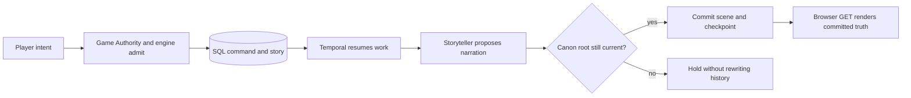

# Documentation

**Repository-wide file ownership:** [Repository structure](../REPOSITORY-STRUCTURE.md) distinguishes permanent product/technical authority from proposals, proofs, work packets, agent rules and operational runbooks. Use that map before adding another docs subtree.

**How documentation enters the development lifecycle:** [How we work](../WORKFLOW.md) explains ratifying product and technical contracts *before* Cursor implementation, how authoritative documentation Changes work, and how verification/realized-state reconciliation returns here. This page remains the product/technical knowledge router.

**New to the game itself and its code?** Begin with the [five-minute human architecture tour](architecture/00-human-tour.md), followed by [visitor/login](architecture/11-visitor-and-session.md), [story creation/Storyteller setup](architecture/12-creating-a-story.md), [Play/scene/fork](architecture/13-playing-and-forking.md), and [Admin](architecture/14-admin-tour.md). These are dated, source-grounded explainers, not a second product specification or evidence that the multi-Pod turn passed.

**New to parallel Cursor development?** Begin with the [illustrated developer environments guide](architecture/10-developer-environments.md), then [the technical owner](technical/platform/developer-environments.md) or [safe operating commands](runbooks/dev-worktree-stacks.md). It distinguishes the proven two-slot foundation from the selected resource-on-demand future.

Product behavior is the bible. Technical contracts say what the system must guarantee. Code and tests are artifacts of those contracts. A selected target is not a claim that it is implemented, and selection is not proof that the target is coherent, enjoyable, or affordable. A proposed design is not a norm. Deterministic selected invariants stay binding, including consent, no model-owned dice, and no duplicate effects. Naming shared play inside a selected ambition does not make that play deliverable or implemented. `pnpm wiki:find` labels each heading from that heading: a nested proposal stays out of the normative lane, and a status or uncertain hit is not a gameplay rule or a paid-production grant.

Product truth has two questions. Authority asks what the owner selected as a preference or obligation. Evidence asks whether that behavior has been demonstrated. An illustrative scene, an unimplemented selected target, a proposed policy, and a demonstrated playable capability are different things. Before a Change depends on an ambitious or cross-system mechanic, read [STATUS](../STATUS.md) and the dated historical [product-reality claim register](../research/product-reality/CLAIM-REGISTER-2026-11-18.md). That register is historical research, not a current claim census or new mechanic. If no play or cost evidence exists, propose a bounded test or a design decision instead of implementation.

## Storyteller evolution | fastest authoritative routes

Permanent owners distinguish selected targets, proposals and realization. [STATUS](../STATUS.md) and dated evidence describe actual coverage; integration alone does not prove acceptance.

| Question | Permanent owner |
| --- | --- |
| How does a player start? | [Entry and onboarding](product/experience/entry-and-onboarding.md#creation-information-architecture) |
| What is the Storyteller now? | [Product behavior](product/storyteller/behavior-and-quality.md#investigative-writing-revision-and-delegation) · [technical controller](technical/storyteller/operation-and-controller.md#two-loops) |
| What is the Library and exact source identity? | [Canonical documents and packages](technical/storyteller/canonical-documents-and-packages.md#product-commitment) |
| What tools, skills, Workdesk and assistants exist? | [Prompts and tools](technical/storyteller/prompts-and-tools.md#selected-compilation-and-tool-contract) |
| How does context stay small across long stories? | [Context selection and recall](technical/storyteller/context-selection-and-recall.md#what-source-enters-this-task) |
| What exactly is a published scene? | [Generation and publication](technical/storyteller/generation-and-publication.md#scene-publication-fence) · [engine state](technical/engine/authority-and-transitions.md#a-minimum-state-ledger) |
| How does an active scene fork? | [Lifecycle and compatibility](technical/engine/lifecycle-and-compatibility.md#forked-continuities) |
| What owns fictional time? | [Chronology and activities](technical/engine/chronology-and-activities.md) |
| What remains current legacy/runtime evidence? | [STATUS](../STATUS.md) |

## Visual introduction: follow a decision through the software

[**Designing resilience while playing**](architecture/09-chaos-and-zero-token-play.md) maps a scripted campaign, strict zero-provider execution, a guarded Pod chaos monkey and SQL/S3 invariants. This is a proposed test program, **not a passed real-game chaos test**.

[**Open the Architecture Atlas**](architecture/README.md) for the human-first diagram tour: system/process maps, Storyteller sequences, SQL/S3 transaction fences, failure state machines, historical forks, Kubernetes and client trust. The atlas explains, but never supersedes, the canonical product and technical pages.

**This diagram explains the selected full-turn target, not demonstrated Kubernetes behavior.** Use [STATUS](../STATUS.md) and the governing technical contracts for current coverage. The [19 November distributed-turn audit](../work/designs/archive/distributed-turn-poc/POC-READINESS-AUDIT-2026-11-19.md) is superseded historical evidence, not the current implementation plan.

Start here, then open the owner. Two steps should be enough for a scoped question.

| Question | Owner |
| --- | --- |
| How and why is this software developed with AI coding agents? | [Engineering System Tour](../ENGINEERING.md) · [Agent harness](../.agents/HARNESS.md) · [Change standard](../.agents/references/change-work-unit-standard.md) |
| What is the game, in one place? | [Vision](product/foundations/vision.md) |
| What is selected for the first Living Book POC, and what is not yet built? | [POC product behavior](product/experience/living-book-poc.md) · [POC client boundary](technical/client/living-book-poc.md) · [status](../STATUS.md). No POC code is implied by these specs |
| What is the selected visual-system architecture and queued UI/DIR work? | [Product requirements](product/experience/design-system-and-expression.md) · [Semantic design system](technical/client/semantic-design-foundation.md) · [Conditional scene production](technical/client/scene-direction-production.md) · [Phase 3 queue](../work/designs/open/player-experience-refoundation/phase-3/README.md) |
| Where is the broader proposed player-experience redesign, design research and visual-system work? | [Experience refoundation design program](../work/designs/open/player-experience-refoundation/README.md) · [process and gates](../work/designs/open/player-experience-refoundation/DESIGN-PROCESS.md). Not ratified; no implementation authorization |
| Which developer-agent search and knowledge-graph tools were tried and declined? | [Retrieval experiments and decisions](../research/agent-practice/RETRIEVAL-EXPERIMENTS-2026-11-17.md) · [Cognee findings](../research/agent-practice/COGNEE-EVALUATION-2026-11-17.md). **Historical research, not product authority**; use `wiki:find --include-historic` for detailed searching |
| When does fictional time move, and what if I do nothing? | [Pace](product/gameplay/time-and-autonomy.md#pace) |
| Does a fictional deadline, such as the goblin scene, select a delegated choice? | [First playable scope](product/gameplay/time-and-autonomy.md#first-playable-scope) · [What it must not do](product/storyteller/behavior-and-quality.md#what-it-must-not-do) · [Decisions with deadlines](technical/engine/chronology-and-activities.md#decisions-with-deadlines). The scene is illustration. An unanswered decision stays open. A timed fallback stays Proposed/Blocked |
| Who may change dice, items and commitments? | [Rules](product/gameplay/rules.md) |
| What may the Storyteller invent, and what must it refuse? | [Behavior and quality](product/storyteller/behavior-and-quality.md) |
| What should the player see on return, and what is still a draft? | [Return and journal](product/experience/return-and-journal.md) · [shared play](../work/designs/backlog/shared-play/README.md) · [player replay](../work/designs/backlog/player-replay/README.md) |
| What engine are we building toward, and why not a chat that writes truth? | [Selected engine](technical/engine/selected-architecture.md) · [decision](decisions/D-0001--modular-engine.md) |
| Is the Kubernetes laboratory the game engine? | [Distributed learning target](technical/platform/topology.md#distributed-learning-target). Selected educational target. The engine remains [D-0001](decisions/D-0001--modular-engine.md). This index does not deploy the laboratory |
| Does the model have a bounded loop, and when must it stop? | [Controller](technical/storyteller/operation-and-controller.md) · [prompts and tools](technical/storyteller/prompts-and-tools.md) |
| What may staff see or change, and what is only proposed? | [Authority](product/admin/authority-and-governance.md) · [Player 360](product/admin/player-360-and-support.md) · [LiveOps](product/admin/gameplay-and-liveops.md) |
| What is a forensic turn, and what was the model shown? | [Turn capsule](technical/observability/identities-and-evidence.md#turn-evidence-capsule) |
| Is a proposed raw-artifact retention window already mandatory? | [Retention owner map](technical/observability/retention-and-access.md#owner-map). Unratified recommendation. A 90-day or 180-day candidate is not a production or legal grant |
| Where do hydration, cache and commands live? | [State and server boundary](technical/client/state-and-server-boundary.md) |
| How do I run a Chamber test without paying a model? | [Chamber fixtures](technical/lab/chamber-and-fixtures.md) · [local development](runbooks/local-development.md) |
| How do I operate the portfolio locally? | [Runbooks](runbooks/README.md) |
| Which source package owns a behavior? | [API routes](../apps/api/README.md#find-the-request-route) · [Story Engine operations](../packages/story-engine/README.md) · [Game mechanics](../packages/game/README.md#find-the-owning-rule). A product proposal is not a source owner |
| Is a selected product target already feasible? | [STATUS](../STATUS.md) · [product-reality claims](../research/product-reality/CLAIM-REGISTER-2026-11-18.md). Selection is not proof. The claim register adds no rule |
| What has been demonstrated, and which Change may be implemented? | [STATUS](../STATUS.md) · [strategy](../ROADMAP.md) · [work selection](../work/QUEUE.md) · [Change catalog](../work/changes/README.md) · [Tasks](../work/tasks/README.md) |

Subject maps: [product](product/README.md), [technical](technical/README.md), [runbooks](runbooks/README.md). Open policy that is not accepted lives under [work/designs](../work/designs/README.md). Dated observations live under [evidence](../evidence/README.md). Coding-agent rules live under `.agents/`, separate from in-game provider cost ([spending](technical/platform/spending-and-entitlements.md)).

Historical Change dossiers stay in `work/changes/archive/`. They are not the first place to read the current contract.
