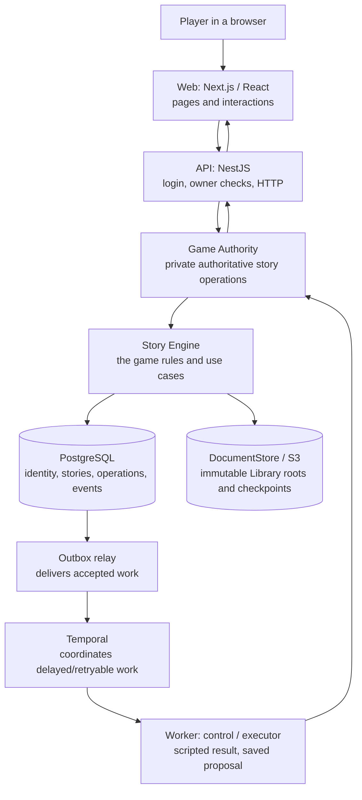
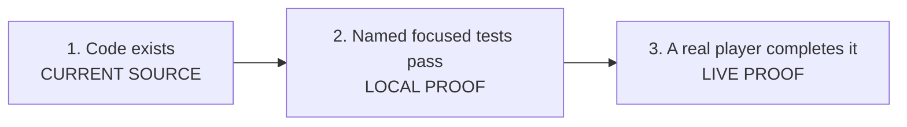

# Start here: Offscreen RPG for a new human engineer

**Question:** I have never seen this codebase. Where do I begin, what are the big parts, and what happens when a player clicks something?

**Source inspected:** `undertaking/storyteller-workshop@e2c0e751`, 2026-11-23. **Evidence label:** CURRENT SOURCE means observed in repository code, **not** proven in a running cluster. The full provider-free scene-1 → scene-2 → historical-fork **cold Kind** acceptance remains open. Selected future behavior is explicitly separate from installed code. This is a reading guide, not a new product or technical contract.

## The shortest map

This is a **composite** picture of the important journeys, not a claim that opening the home page launches all these services. Some paths run inside the API in **embedded mode**; in **distributed mode**, the API's `StorySeam` calls Game Authority over private HTTP. The outbox does not execute a story itself. Temporal orchestrates tasks, but game truth is only real after authoritative state is committed. A Storyteller result is a *proposal*, not permission to alter game state, and neither this diagram nor the source it summarizes proves a live turn. Read [system owners](01-system-and-ownership.md) and [one turn](02-one-turn.md) for deeper treatment.

## Two meanings of “where it lives”

| Place | Human translation | Does it own the game's truth? |
| --- | --- | --- |
| `apps/web` | The screens: landing, sign-in, stories, Play, Admin | No. UI cache displays server state |
| `apps/api` | Public HTTP reception; session, permissions, routes | Not by virtue of being an API. It delegates business operations |
| `apps/game-authority` | Private HTTP boundary for launch, start, resolution, fork, reads and Storyteller custody/publication roles | It exposes/hosts authority, with game logic in shared engine modules |
| `apps/worker` | Outbox delivery and Temporal Activities | No; it cannot declare a scene published merely because work finished |
| `packages/story-engine` | Core story, campaign, generation and Storyteller use cases | Implements authority and state transitions invoked by app composition |
| `packages/storyteller` | Task shapes, profiles, scripted/provider generation helpers | A writer library, not the game ledger |
| `packages/workflows` | Temporal workflows and contracts | Timing/orchestration, not final business authority |
| `packages/db` | Schema and DB access tools | Official relational ledger |
| `packages/documents` | Exact-version immutable documents/Library and checkpoint storage | Official content-addressed source, with DB references |
| Domain interface packages (`story-interface`, `admin-interface`, `identity-interface`, `lab-interface`, …) | Shared wire validation and transport types (retired monolithic `@offscreen/contracts`) | Makes components agree about data |
| `packages/admin` | Staff identity, permissions and support operations | Separate staff powers with explicit gates |
| `packages/game` | Game-specific mechanics/rules components | Not automatically a separate process |
| `infra/kubernetes/lab` | Historical name for disposable local cluster/runtime work | **Not** a fifth product service; the term's boundaries need SEM01 audit |

**Naming caution:** historical packet codes in test harnesses and compatibility references are *not* architectural vocabulary. `packages/application` does not exist in the source tree; a guide or evidence note that cites it records a historical path. `packages/story-engine` is the current owner for many modules formerly reached through it. Confirm actual imports before following an old link, and use the [package map](../../packages/README.md) for the present tree.

## Choose a journey, not a package

| You want to understand… | Start here | Key question |
| --- | --- | --- |
| Anonymous landing, GitHub sign-in and private pages | [11. Visitor and session](11-visitor-and-session.md) | Who knows the user's identity? |
| Create a story and choose the Storyteller | [12. Creating a story](12-creating-a-story.md) | Why are there two creation paths? |
| A choice becomes scene 2, and a past scene becomes a fork | [13. Playing and forking](13-playing-and-forking.md) | When is a scene truly committed? |
| Staff sign-in, case, player lookup and restricted evidence | [14. Admin tour](14-admin-tour.md) | Why is a player session insufficient? |
| Deep technical detail after the first pass | [Existing architecture chapters](README.md#choose-the-question-you-want-answered) | What transactions, caches, failures and exact roots are involved? |

## Three kinds of “done”

**Do not skip a box.** A selected design, or a documentation Change that records one, sits before the first box: it is not code at all. A source join of a construction Change reaches only the first box. The provider-free distributed turn has code and focused local tests, including source-only HTTP/fixture/SQL helpers. The repository's tracked acceptance status does **not** establish one complete cold Kind scene-2 and independent fork, nor an authorized real-LLM continuation. [STATUS](../../STATUS.md) owns evidence; [implementation roadmap](../../work/IMPLEMENTATION-ROADMAP.md) owns execution milestones; the TURN03 cold-cluster proof was cancelled on 2026-11-27 and none of its gates is a pending claim.

## Read code without getting buried

1. Start at the **page** or **event handler** that corresponds to what the human did.
2. Find the outgoing **HTTP method + path**. In Nest, locate the controller method with matching decorator.
3. Find the **business owner** that controller calls (`StorySeam` or an engine application).
4. Ask what changes durably: **SQL row, outbox notice, immutable document root, checkpoint**?
5. If response is **202**, follow the background execution and eventual authoritative **GET**. The response did *not* mean scene 2 existed.
6. For any command ask: **Who is allowed, what is the operation ID, what happens after a timeout, what prevents duplicate effects?**

Example source trail: [Play screen](../../apps/web/src/features/play/view.tsx) → [resolution hook](../../apps/web/src/features/play/use-resolution-command.ts) → [Nest story command](../../apps/api/src/modules/stories/controllers/story-commands.ts) → [private Story Seam](../../apps/api/src/modules/stories/game-authority-client.ts) → [Game Authority server](../../apps/game-authority/src/server.ts) → [Story Engine](../../packages/story-engine/README.md). Only read the next file after the previous one answers your question.

## What these diagrams do *not* settle

This guide is a reading aid: nothing it draws is selected architecture, and it records no decision. It intentionally does not decide whether the newer direct prompt launch or the older draft/opening path should be removed; whether the `lab` path is well named; or whether all current modules are justified. Those are genuine design/audit questions, not permission to rename code during a documentation change. [SEM01](../../work/changes/backlog/quality-evaluation/2026-11-23--sem01-semantic-debt-and-codebase-inventory/CHANGE.md) owns the broader source-based architectural/semantic debt inventory.

**Maintenance rule:** when a source owner changes a route, update its journey page and source anchor in the same accepted Change. Keep permanent selected requirements in `docs/product` and `docs/technical`; these pages are descriptive maps with dated inspection labels. Do not paint a target path as already proved.
