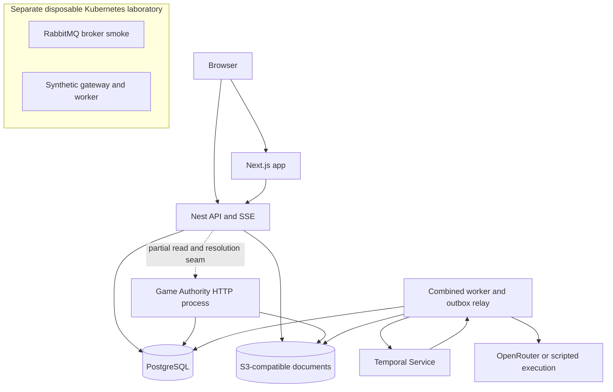
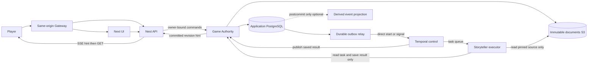
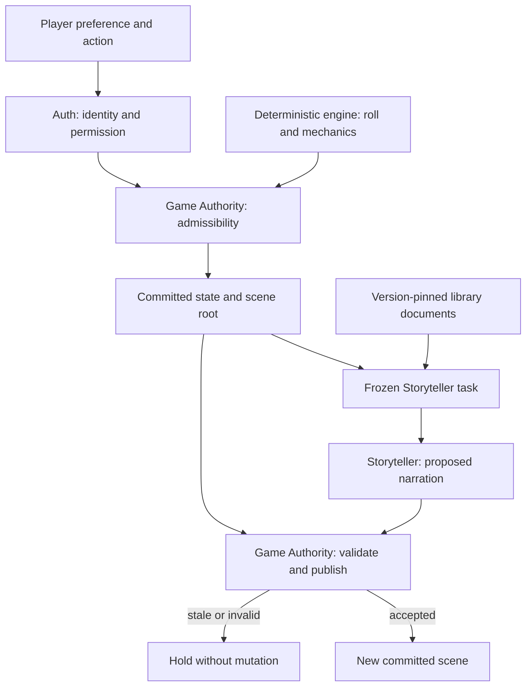

# 1. System map and decision ownership

> **Historical-source caution (2026-11-23):** this chapter's first “Current source” diagram describes the 2026-11-19 `584b594` snapshot, not all capabilities at current `e2c0e751`. Current distributed `StorySeam` routes **launch, start, read, resolution and fork** through the private Game Authority server, and `apps/worker` has separate distributed control/execution Activities. The previous statement that Nest start/fork remained local or that the worker was exclusively combined is **historical**. Read [human map](00-human-tour.md), [creation](12-creating-a-story.md) and [playing](13-playing-and-forking.md) for current source; keep the older diagram only as baseline context, not runtime proof.

**Storyteller evolution:** the Storyteller is a writer over a rooted Library and Workdesk, while Game Authority remains the sole publisher of authoritative scene state. Treat service/process boxes as deployment choices, not permission to move world authority into the model.

**Reader question:** what parts exist today, what do we want to separate, and who gets to decide the game? **Baseline:** 584b594, 2026-11-19. This map describes inspected source and a **selected target**, not a successful multi-Pod test. Canonical [topology](../technical/platform/topology.md), [engine](../technical/engine/selected-architecture.md).

## Current source: a modular application, not yet independent game microservices

In source, the optional Game Authority service implements remote **story snapshot GET and resolution PUT**; Nest still calls its local application for candidate start and fork. The current worker's storytellerV1 Activity calls a runtime that **both executes and publishes**. The laboratory broker/synthetic Pods are **not** a working game. See apps/api/src/modules/stories/controller.ts, apps/game-authority/src/server.ts, apps/worker/src/runtime/index.ts, packages/workflows/src/index.ts and packages/application/src/storyteller/runtime.ts.

## Selected target: one story writer, a separate model executor

**Solid arrows are selected architecture, not all landed.** The current writer-exclusivity gap (Nest local start/fork), absent separate executor and missing saved-result-to-generation publication bridge must close before claiming a distributed story. The dashed Rabbit projection is **optional**; it cannot authorize a scene or wake Storyteller. Neither Redis nor an optional retrieval index is canon truth.

## Who makes the call? Logical ownership is not a service-per-noun plan

The engine and Game Authority are **logical write authorities** even while sharing modules. Do not create Inventory, Economy, Guild or Dungeon services simply because there are nouns in the game. [Game rules](../product/gameplay/rules.md) owns mechanics; [Storyteller behavior](../product/storyteller/behavior-and-quality.md) owns creative limits; [publication](../technical/storyteller/generation-and-publication.md) owns when the model's proposal may become truth.

## Source guide and testable boundary

| Responsibility | Inspected source owner | Currently true / next gap |
| --- | --- | --- |
| Browser/server React | apps/web/src, apps/web/next.config.ts | App exists; actual same-origin kind route not yet proven |
| Auth, public HTTP, SSE | apps/api/src/modules, apps/api/src/main.ts | Signed requests and local story methods; partial remote GA routing |
| Private Game Authority | apps/game-authority/src/{application,server}.ts | Read/admit resolution; start/fork and result publication transport still need design implementation |
| Transactional game state | packages/application/src/stories, packages/game | Existing deterministic logic; keep one write decision |
| Durable workflow | packages/workflows/src/index.ts, apps/worker/src | One combined storytellerV1 execution/publication Activity today |
| Task custody | packages/application/src/storyteller/execution.ts | Claim and saved validated result exist; no independent worker-to-GA API at baseline |
| Canon storage | packages/documents and packages/application/src/stories/scene-checkpoint.ts | Immutable object+SQL selector pattern exists; deploy with shared S3 and prove cross-Pod |
| Broader infra | infra/kubernetes/lab | Several independent component smokes and **synthetic** workloads; real application join pending |

**Diagnostic test for a supposed distribution win:** can a Nest Pod start/fork/publish directly when distributed mode is configured and GA is down? If yes, routing isolation is incomplete. If an executor has a general story-write DB credential, architectural isolation is weaker than the diagram. Both cases must be explicitly checked; a pretty Pod chart is not proof.
