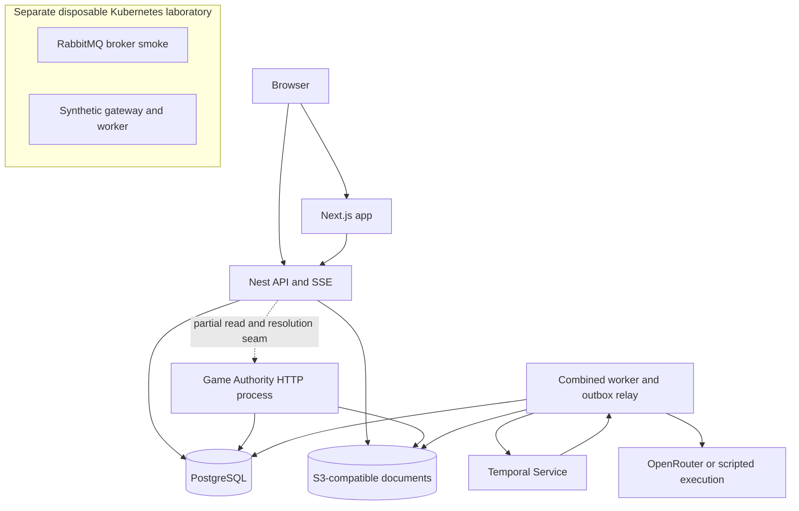
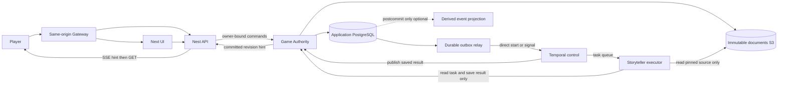
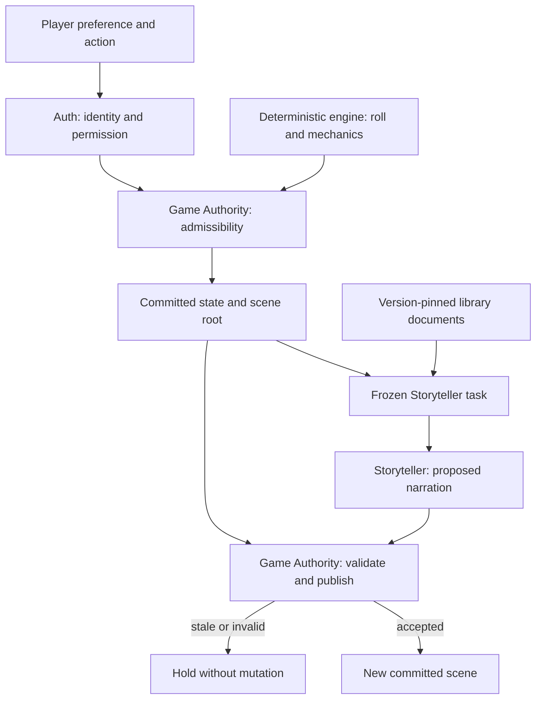

# 1. System map and decision ownership

> **How to read the two source diagrams (2026-11-27):** the first diagram below is the 2026-11-19 `584b594` baseline, kept as dated context. At the later inspected revision `e2c0e751` the API's `StorySeam` routes **launch, start, read, resolution and fork** to the private Game Authority server in distributed mode, and `apps/worker` has separate distributed control and execution Activities. The older statements that Nest start/fork stayed local and that the worker was exclusively combined are therefore historical. Neither inspection is a runtime proof; follow the [human map](00-human-tour.md), [creation](12-creating-a-story.md) and [playing](13-playing-and-forking.md) for the later route.

**Storyteller evolution:** the Storyteller is a writer over a rooted Library and Workdesk, while Game Authority remains the sole publisher of authoritative scene state. Treat service/process boxes as deployment choices, not permission to move world authority into the model.

**Reader question:** what parts exist today, what do we want to separate, and who gets to decide the game? **Baseline:** 584b594, 2026-11-19, updated where the caution above says so. This chapter keeps two things apart: the inspected **current source** and the **selected target**. Neither is a successful multi-Pod test. Canonical [topology](../technical/platform/topology.md), [engine](../technical/engine/selected-architecture.md).

## Current source: a modular application, not yet independent game microservices

**Baseline reading (584b594):** the optional Game Authority service implemented remote story snapshot GET and resolution PUT, Nest called its local story-engine modules for candidate start and fork, and the worker's `storytellerV1` Activity called a runtime that **both executed and published**. **Later source (e2c0e751 and the current tree):** the Story Seam carries the wider command set to Game Authority, and `storytellerDistributedV1` with distributed control and execution Activities exists beside `storytellerV1`; whether each path has run end to end on a cluster is a proof question this chapter does not answer. The laboratory broker and synthetic Pods are **not** a working game. Source routes: `apps/api/src/modules/stories/game-authority-client.ts`, `apps/game-authority/src/server.ts`, `apps/worker/src/activities/`, `packages/workflows/src/index.ts`, and `packages/story-engine/src/storyteller/` (the deleted `packages/application` held the runtime in the baseline).

## Selected target: one story writer, a separate model executor

**Solid arrows are selected architecture, not all landed.** The writer-exclusivity gap named at the baseline (Nest local start/fork), the separate-executor question and the saved-result-to-generation publication bridge are the items to re-verify against the later source before claiming a distributed story; the baseline text must not be read as current. The dashed Rabbit projection is **optional**; it cannot authorize a scene or wake Storyteller. Neither Redis nor an optional retrieval index is canon truth.

## Who makes the call? Logical ownership is not a service-per-noun plan

The engine and Game Authority are **logical write authorities** even while sharing modules. Do not create Inventory, Economy, Guild or Dungeon services simply because there are nouns in the game. [Game rules](../product/gameplay/rules.md) owns mechanics; [Storyteller behavior](../product/storyteller/behavior-and-quality.md) owns creative limits; [publication](../technical/storyteller/generation-and-publication.md) owns when the model's proposal may become truth.

## Source guide and testable boundary

Columns two and three give the **inspected owner** and what was true at the 2026-11-19 baseline unless the row says later; confirm against the current tree before relying on a row. A source route is where to read, not evidence that the behavior ran.

| Responsibility | Inspected source owner | Currently true / next gap |
| --- | --- | --- |
| Browser/server React | apps/web/src, apps/web/next.config.ts | App exists; actual same-origin kind route not yet proven |
| Auth, public HTTP, SSE | apps/api/src/modules, apps/api/src/main.ts | Signed requests; Story Seam to Game Authority in distributed mode, other story routes local |
| Private Game Authority | apps/game-authority/src/{application,server}.ts | Baseline: read/admit resolution only. Later source adds launch, start and fork; result-publication transport re-verify |
| Transactional game state | packages/story-engine/src/stories, packages/game | Existing deterministic logic; keep one write decision |
| Durable workflow | packages/workflows/src/index.ts, apps/worker/src | Baseline: one combined storytellerV1 Activity. Later: storytellerDistributedV1 beside it |
| Task custody | packages/story-engine/src/storyteller/execution.ts | Claim and saved validated result exist; independent worker-to-GA transport was absent at baseline |
| Canon storage | packages/documents and packages/story-engine/src/stories/scene-checkpoint.ts | Immutable object+SQL selector pattern exists; deploy with shared S3 and prove cross-Pod |
| Broader infra | infra/{platform,environments,verification,images,dev} per [infra/README.md](../../infra/README.md) | Several independent component smokes and **synthetic** workloads; real application join pending |

**Diagnostic test for a supposed distribution win:** can a Nest Pod start/fork/publish directly when distributed mode is configured and GA is down? If yes, routing isolation is incomplete. If an executor has a general story-write DB credential, architectural isolation is weaker than the diagram. Both cases must be explicitly checked; a pretty Pod chart is not proof.
