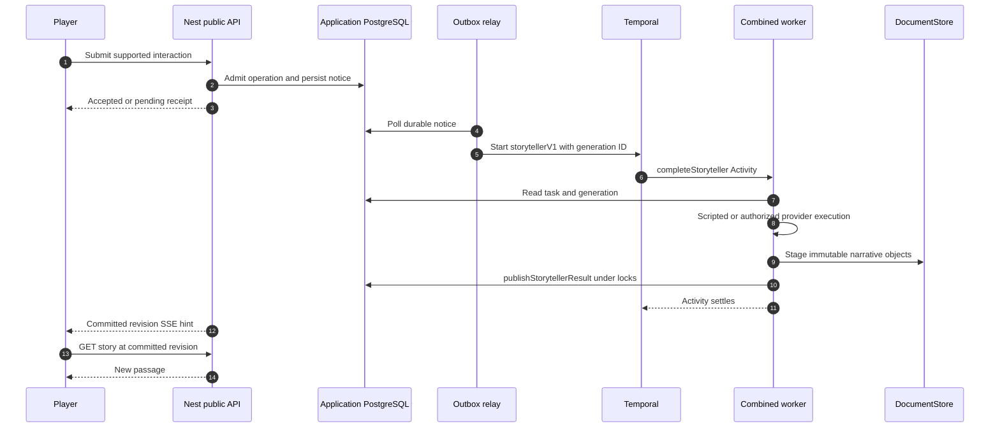
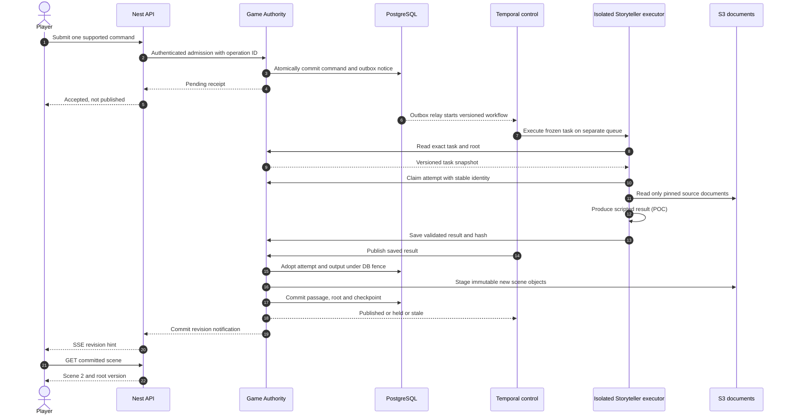
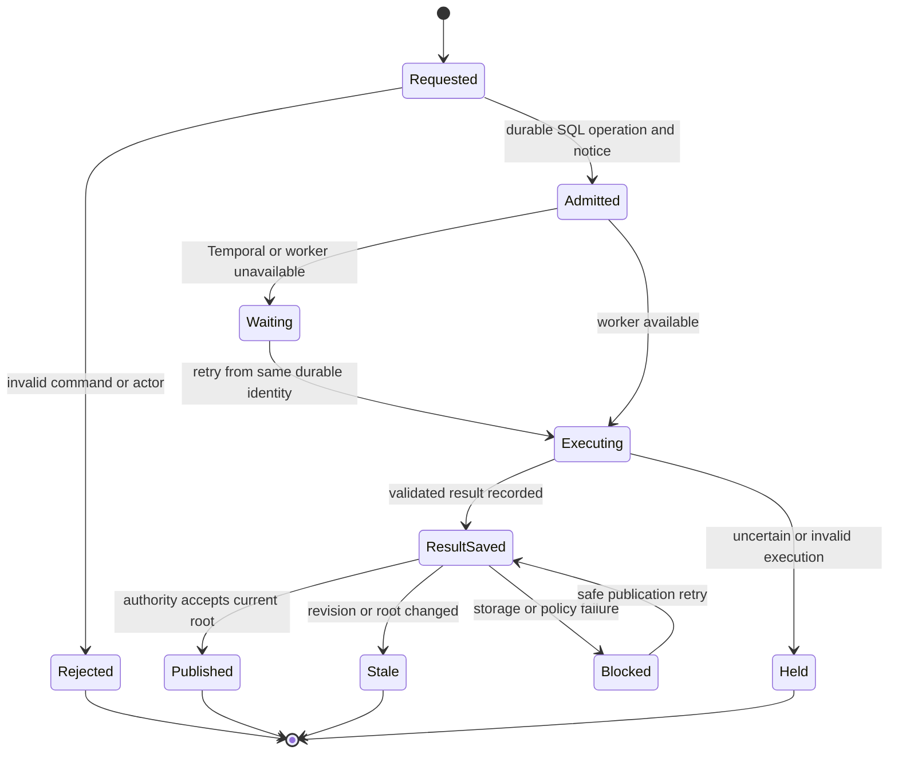
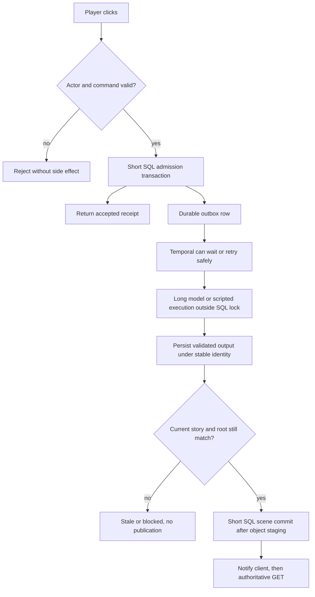

# 2. One turn: from player click to a committed second scene

**Storyteller evolution turn:** the target sequence is captured scene/root → adaptive writer mission (Library/skills/Workdesk/optional assistants) → structured proposal → Game Authority validation → coherent post-publication scene boundary. Old one-shot or preview/Start paths are current/legacy realization, not the target sequence.

**Reader question:** where is the long-running operation, when is the player's choice accepted, and who declares a scene real? [Execution contract](../technical/platform/execution-and-delivery.md), [generation/publication](../technical/storyteller/generation-and-publication.md), [response contracts](../technical/platform/http-api-and-client-contracts.md). **Baseline:** 584b594; CURRENT and TARGET are intentionally separate.

## Current source: one combined Storyteller Activity

**Caution:** this shows the current logical path reconstructed from source, **not** an observed complete live run. The worker currently calls createStorytellerRuntime.complete, which performs generation **and** publication. The story may remain pending or be refused; not every admitted operation yields a scene. Workflow idempotence does not imply exactly-once provider billing.

## Selected distributed turn: execution and publication separated

**The player path in this diagram is still a target.** The “PG to Temporal” arrow abbreviates a relay polling SQL and starting Temporal directly; PostgreSQL does not speak Temporal. No Rabbit hop is required. The executor must not mutate game truth.

**Control publication is now source, not only a target.** `publishSavedStoryteller` calls Game Authority over HTTP with the control token and does not open SQL. A disposable `offscreen_auth_test` handoff published one saved scripted generation through that activity (`story03-distributed-handoff.live.test.ts`, **1/1**, `STORYTELLER_LIVE_ENABLED=false`). That test starts the workflow by hand.

**One local HTTP turn is now observed.** `tools/api-integration/test/story03-causal-multiprocess.integration.ts` (**7/7**, about 46s) signs in, requests the Turn03 opening, starts the story, and submits the visible choice over HTTP. Separate OS processes run the relay, the control worker, and the executor. Game Authority is its own HTTP server. The continuation notice is `storyteller.distributed.v1`. Scene 2 is read back with GET after the workers restart. One case drops the continuation publish acknowledgement after Game Authority commits and still leaves one published scene. Another holds the save response, kills the executor while the story is still revision 1, and the restarted executor publishes that same saved result once. Documents are a local filesystem store. A separate sandbox test marks a lagging saved continuation `stale` and adds no passage. This run does not prove the browser, SSE, or a cold kind cluster. Default Compose remains the combined worker above. The selected TASK/CLAIM/SAVE/PUBLISH protocol is detailed in [STORY03](https://github.com/DenisSkulovic/offscreen-rpg/blob/34e2b4fd8d9d9967e13311da3a938460b1a02244/work/changes/archive/2026-11/storyteller/2026-11-19--story03-separate-temporal-executor-and-publication/EXECUTION.md).

## Admission is not completion

This is a **conceptual operation state machine**, not the physical schema of one table. The database has distinct records: generation, attempt, publication, story and outbox. A retry or hold only occurs when its actual persisted state and safety policy permit it. In particular, an ambiguous billable provider send must **not** silently loop from Held to Executing.

## Where slow time is allowed

The **whole point** of Temporal is that the HTTP request does not hold open while a model thinks. The **whole point** of SQL fences is that a late model does not overwrite a newer scene. The **whole point** of S3 immutability is that scene 1 remains readable after scene 2 and a fork. See [data transactions](03-data-and-transactions.md) and [failure recovery](04-failure-and-recovery.md).

## What remains genuinely unproven

- The Game Authority currently forwards only remote GET and resolution PUT; candidate start and fork still have local Nest paths.
- Task custody is present in the application package but not exposed as role-separated private transport.
- The current generation output and attempt custody result have a missing **atomic adoption bridge**, required by the SQL generation-state constraint.
- The separate executor queue and real cluster image were not deployed/tested in this planning pass.
- A fake/scripted scene proves the plumbing, not narrative quality or live-provider spend safety.

Acceptance for the **first credible POC** is a logged single actor: committed scene 1 → submitted command → versioned Temporal workflow → fake Storyteller result → Game Authority committed scene 2 → SSE/GET → historical fork. See [TURN03](../../work/changes/open/2026-11-19--turn03-full-distributed-forkable-turn-proof/PROOF.md).
