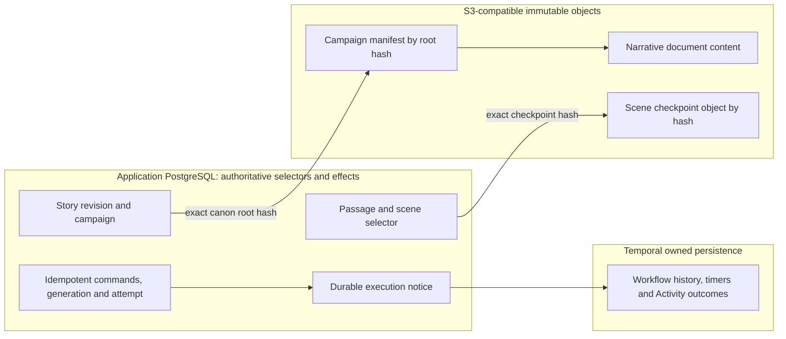
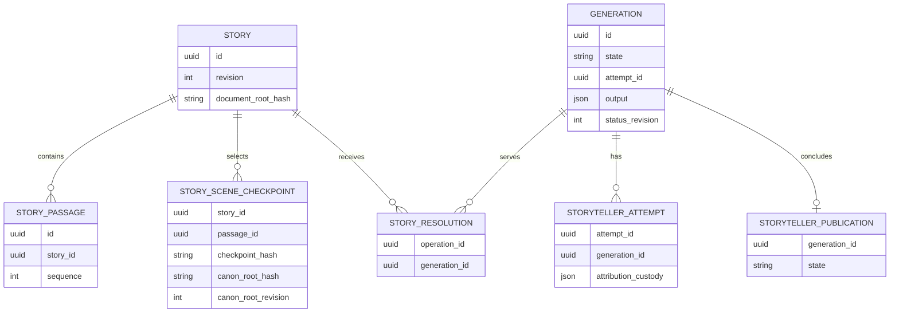
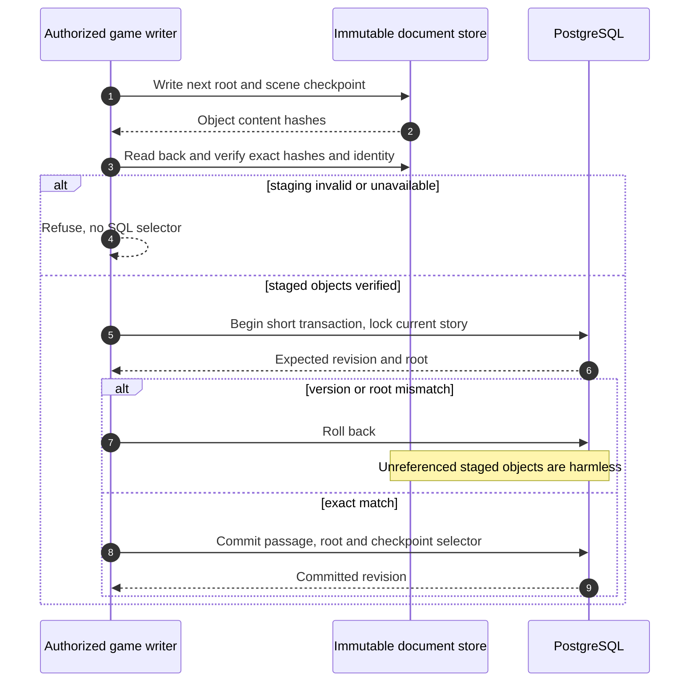
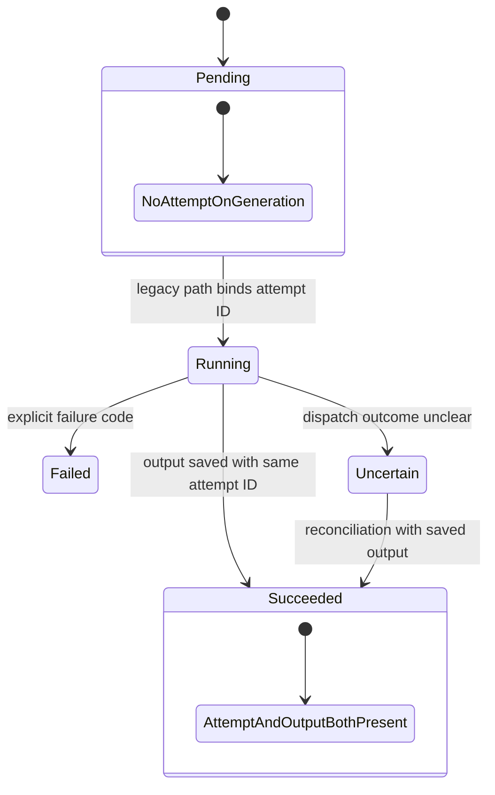
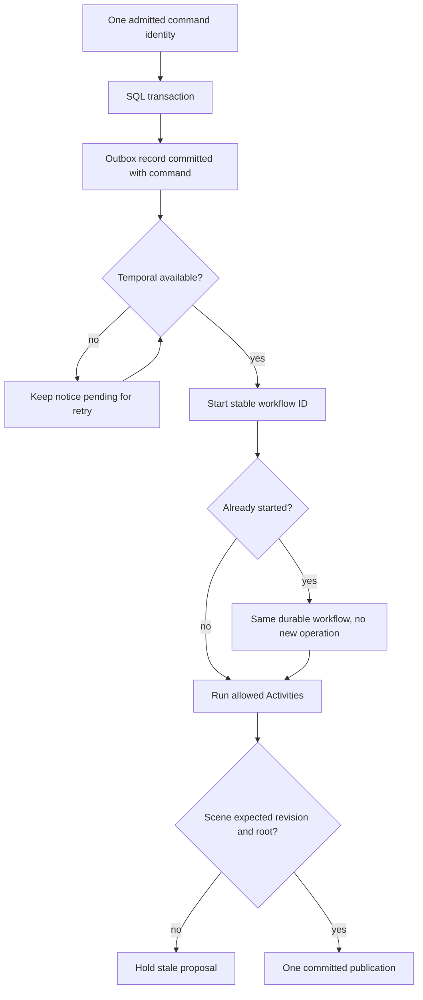

# 3. Data truth, transaction boundaries and durable messages

**Reader question:** which bytes form the story's truth and how do we prevent partial scenes? **Baseline:** 584b594. Canonical [data/persistence](../technical/platform/data-and-persistence.md), [canonical documents](../technical/storyteller/canonical-documents-and-packages.md), [execution](../technical/platform/execution-and-delivery.md).

## The three different persistence jobs

Application SQL answers **which** scene, revision, result and root are committed. S3 stores immutable **what** content/scene snapshots those hashes identify. Temporal owns durable **how the work runs**, not game state. A SQL commit is not atomic with S3 or Temporal; the protocol is deliberately staged and idempotent rather than an imaginary global transaction.

## Schema relationships, simplified and source-backed

**Conceptual ER, not migration DDL.** These are representative identities and relationships; not every edge is necessarily a physical foreign-key constraint. See packages/db/src/schema/{stories,generations,storyteller,outbox}.ts for actual columns/constraints. Never generate a migration from this diagram.

## Current checkpoint commit is stage-then-select, not S3 within a SQL transaction

**CURRENT SOURCE pattern:** packages/application/src/stories/scene-checkpoint.ts:stageSceneCheckpointObject writes/verifies, and insertStagedSceneCheckpointSelector checks story revision/root and passage identity in SQL; storyteller publication similarly stages then adopts under a later SQL lock. The system does **not** promise an ACID transaction across S3 and SQL. A missing or corrupt referenced object must fail the historical read, not silently substitute the latest state.

## A critical unimplemented bridge: custody is not generation success

**Physical database constraint, CURRENT:** generation_state_shape in packages/db/src/schema/generations.ts requires:
- pending: no attempt ID, output or failure code;
- running/uncertain: attempt ID, no output or failure code;
- succeeded: **attempt ID AND output**;
- failed: attempt ID and failure code, no output.

**GAP/TARGET:** new createStorytellerTaskCustody in packages/application/src/storyteller/execution.ts can insert a storyteller_attempt and save validated attribution.custody.result, **but does not populate generation.attemptId/output/state**. The separate Game Authority needs a transactionally fenced, idempotent saved-attempt → succeeded-generation adoption using the exact saved attempt ID and output before calling publishStorytellerResult. Duplicate adoption or a conflicting legacy attempt must not overwrite a result. See [STORY03 design](../../work/changes/open/2026-11-19--story03-separate-temporal-executor-and-publication/EXECUTION.md).

## The durability chain has independent guarantees

**Important distinction:** Temporal start retry is at-least-once, workflow identity deduplicates execution coordination, and PostgreSQL application constraints deduplicate **effects**. None of those alone prevents double billing by an external provider. A broker event can be delivered multiple times and is not source-of-truth authority. The selected story wake is SQL outbox **direct to Temporal**, not SQL outbox → Rabbit → Temporal.
