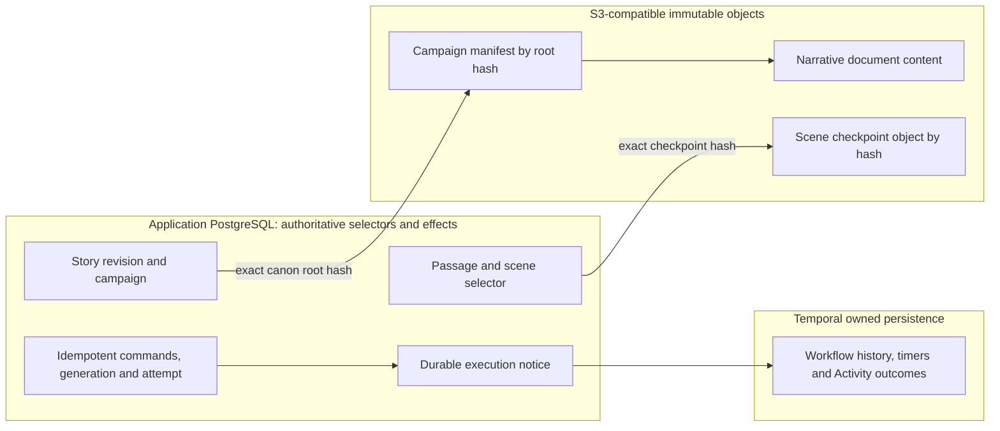
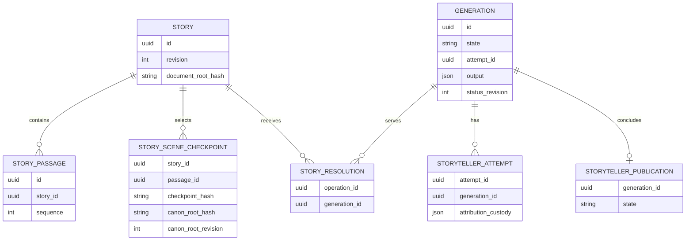
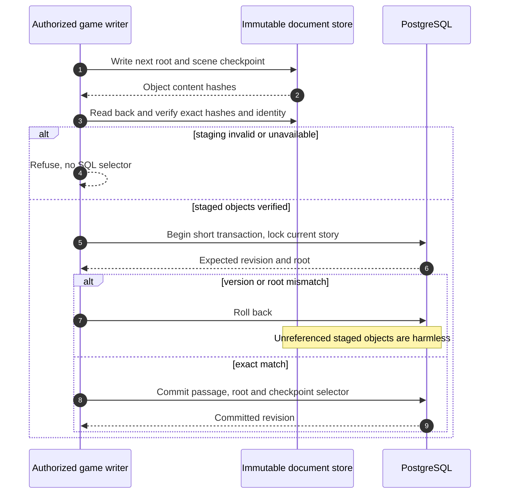
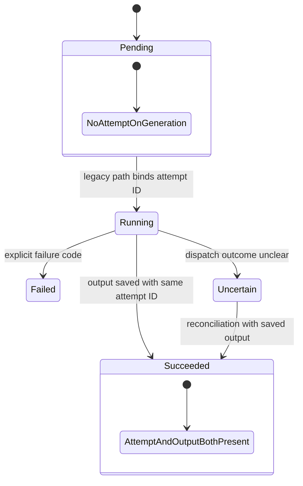
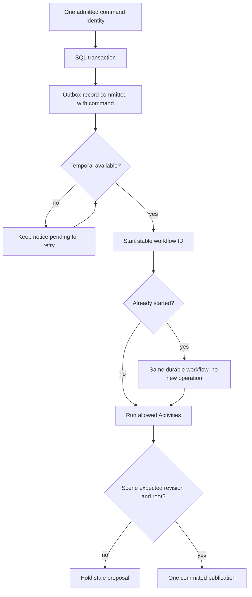

# 3. Data truth, transaction boundaries and durable messages

**Storyteller evolution data boundary:** scene publication atomically selects an immutable Library root and semantic fictional-state frontier. Workdesk drafts and search indexes are provisional/derived; provider attempts, worker leases and billing remain operational records outside forked fiction.

**Reader question:** which bytes form the story's truth and how do we prevent partial scenes? **Baseline:** 584b594, with the checkpoint and adoption routes re-pointed to the present source tree below. Canonical [data/persistence](../technical/platform/data-and-persistence.md), [canonical documents](../technical/storyteller/canonical-documents-and-packages.md), [execution](../technical/platform/execution-and-delivery.md).

## The three different persistence jobs

Application SQL answers **which** scene, revision, result and root are committed. S3 stores immutable **what** content/scene snapshots those hashes identify. Temporal owns durable **how the work runs**, not game state. A SQL commit is not atomic with S3 or Temporal; the protocol is deliberately staged and idempotent rather than an imaginary global transaction.

## Schema relationships, simplified and source-backed

**Conceptual ER, not migration DDL.** These are representative identities and relationships; not every edge is necessarily a physical foreign-key constraint. See packages/db/src/schema/{stories,generations,storyteller,outbox}.ts for actual columns/constraints. Never generate a migration from this diagram.

## Current checkpoint commit is stage-then-select, not S3 within a SQL transaction

**CURRENT SOURCE pattern (route corrected from the deleted `packages/application`):** packages/story-engine/src/stories/scene-checkpoint.ts:stageSceneCheckpointObject writes/verifies, and insertStagedSceneCheckpointSelector checks story revision/root and passage identity in SQL; storyteller publication similarly stages then adopts under a later SQL lock. The system does **not** promise an ACID transaction across S3 and SQL. A missing or corrupt referenced object must fail the historical read, not silently substitute the latest state.

## A critical unimplemented bridge: custody is not generation success

Heading retained for inbound links; the section's current reading is at the end (custody versus adoption).

**Physical database constraint, CURRENT:** generation_state_shape in packages/db/src/schema/generations.ts requires:
- pending: no attempt ID, output or failure code;
- running/uncertain: attempt ID, no output or failure code;
- succeeded: **attempt ID AND output**;
- failed: attempt ID and failure code, no output.

**Additional CURRENT SQL invariant:** the same schema has `generation_repair_shape`: a successful generation must **not** keep a repairCandidate or repairDiagnostic. A future saved-result adoption must reject a pending generation with unresolved repair metadata, not clear evidence silently to satisfy the check. This is a separate negative proof from ordinary attempt/result idempotence.

**Custody is not adoption (the authority line this section guards).** `createStorytellerTaskCustody` plus private Game Authority routes persist one scripted attempt and its validated `attribution.custody.result` when two HTTP clients race the same generation on disposable PostgreSQL. The seam refuses a provider-mode task and a non-scripted attempt with `unsupported-execution` (**27/27** current-head provider-free tests at that closure; the earlier **10/10** at `ec73a535` did not include the refusal). A custody save alone leaves the generation row without `attemptId`, `output` or `succeeded`: saving a result is not the model or worker declaring committed truth. See [STORY02](https://github.com/DenisSkulovic/offscreen-rpg/blob/34e2b4fd8d9d9967e13311da3a938460b1a02244/work/changes/archive/2026-11/storyteller/2026-11-19--story02-private-task-and-result-custody/CHANGE.md) and [remote task custody](../technical/storyteller/generation-and-publication.md#remote-task-custody). **Not proved:** cross-Pod executors.

**Baseline gap and present source.** At 584b594 the saved-attempt to succeeded-generation adoption was a GAP/TARGET for [STORY03](https://github.com/DenisSkulovic/offscreen-rpg/blob/34e2b4fd8d9d9967e13311da3a938460b1a02244/work/changes/archive/2026-11/storyteller/2026-11-19--story03-separate-temporal-executor-and-publication/EXECUTION.md). Source now has `adoptSavedStorytellerGeneration` in `packages/story-engine/src/storyteller/generation-adoption.ts`, returning `adopted`, `idempotent`, `held` (for example `repair-pending`) or `refused`, and Game Authority adopts the saved attempt inside its publication route. The requirements remain the selected guarantees: adoption stays transactionally fenced and idempotent before `publishStorytellerResult`; duplicate adoption or a conflicting legacy attempt must not overwrite a result; and a generation with unresolved repair metadata is held, not silently cleared. Source existence and the local scripted runs do not prove adoption under a Pod race.

## The durability chain has independent guarantees

**Important distinction:** Temporal start retry is at-least-once, workflow identity deduplicates execution coordination, and PostgreSQL application constraints deduplicate **effects**. None of those alone prevents double billing by an external provider. A broker event can be delivered multiple times and is not source-of-truth authority. The selected story wake is SQL outbox **direct to Temporal**, not SQL outbox → Rabbit → Temporal.
