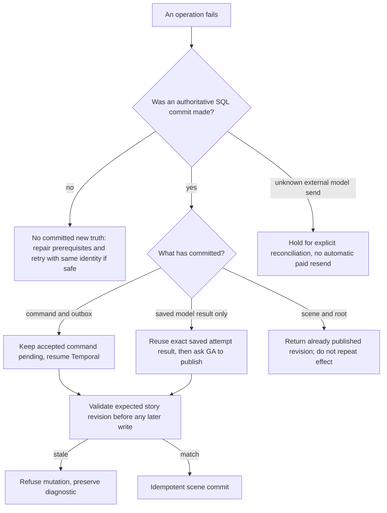
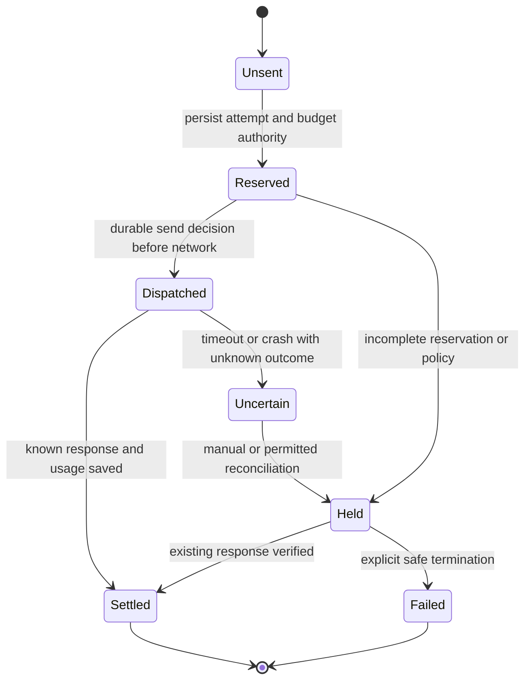
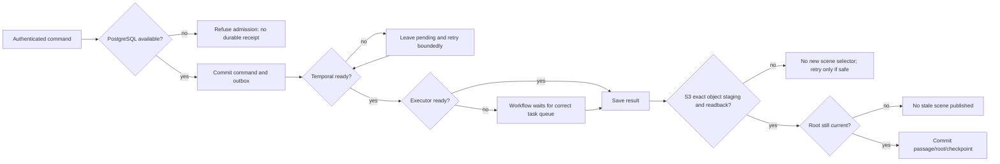
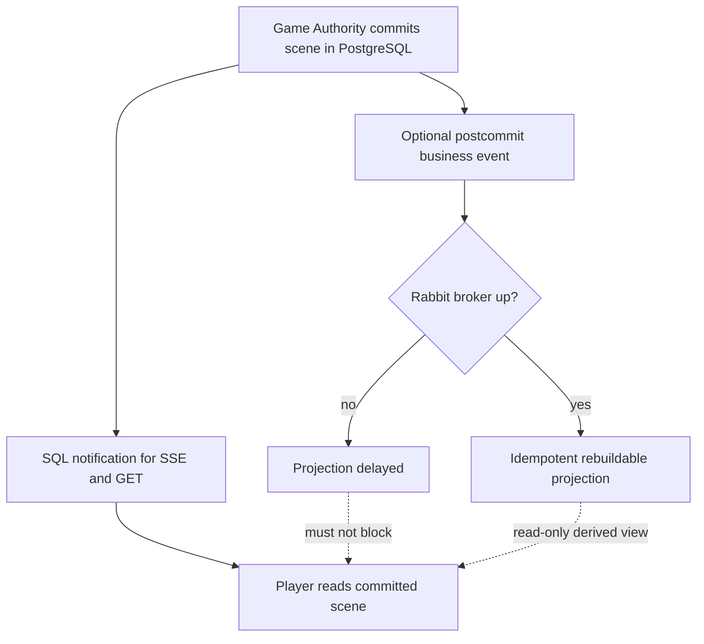

# 4. Failure, replay and resilience atlas

**Reader question:** if we kill something at the worst possible moment, what must happen next? **Baseline:** 584b594, with the adoption statement below updated to the present source. The diagrams show **selected resilience contracts** and known current primitives, not an executed cross-Pod fault campaign.

**The four rules every diagram here applies.** (1) Failure domains differ: an uncommitted failure may retry with the same identity, a committed one must return the existing result. (2) A possibly sent billable provider call is never resent automatically; a new attempt is a new budget decision. (3) A late or stale result is held or refused, never merged over a newer scene, and a missing historical object fails the read instead of being replaced by the current head. (4) The RabbitMQ projection is optional and never gates a scene. Canonical [engine concurrency/recovery](../technical/engine/concurrency-and-recovery.md), [execution and delivery](../technical/platform/execution-and-delivery.md), [uncertain work](../runbooks/uncertain-work-recovery.md).

## Start with the right failure domain



**Not a blanket retry policy.** Reading SQL again or calling Temporal Start with an existing deterministic workflow ID is different from calling an external billable provider. A timeout is not evidence that no provider response was produced.

## Crash windows for a single Storyteller turn

```mermaid
sequenceDiagram
    autonumber
    participant GA as Game Authority
    participant PG as PostgreSQL
    participant T as Temporal
    participant EX as Executor
    participant S3 as S3
    GA->>PG: Commit command and outbox
    Note over PG,T: Crash A - Temporal unavailable; notice remains retryable
    T->>EX: Dispatch frozen generation
    EX->>GA: Claim and save validated result
    GA->>PG: Persist custody hash
    Note over EX,PG: Crash B - saved result before publish; no second model call
    T->>GA: Publish saved generation result
    GA->>PG: Atomically adopt saved attempt and output
    GA->>S3: Stage and verify new root/checkpoint
    Note over S3,PG: Crash C - orphaned immutable objects, no SQL pointer yet
    GA->>PG: Commit story revision and checkpoint reference
    Note over GA,PG: Crash D - acknowledgement lost after commit; replay returns existing result
    GA-->>T: Published
```

For Crash B and D, application idempotency and root fences are mandatory. S3 writes are **not** undone by a distributed rollback; unreferenced objects can be retained/garbage-collected under a separate retention policy. A scene must never reference content that failed to stage. At the 584b594 baseline the Game Authority adopt operation was a **gap**; source now has `adoptSavedStorytellerGeneration` and a Game Authority publish route that adopts the saved attempt ([chapter 3](03-data-and-transactions.md#a-critical-unimplemented-bridge-custody-is-not-generation-success)). Local scripted runs exercise Crash B and D shapes; a successful Crash B recovery across Pods is still **not proved**.

## External provider: safe retry is a question, not a default



**SELECTED POLICY / not a claim about every current code path.** A real provider send in an ambiguous state does **not** return to Unsent or Dispatched automatically. A new authorized attempt is a distinct operation and budget decision, not Temporal's ordinary retry. The zero-spend scripted fixture is deterministic and may be safely recomputed only under its recorded hash/idempotence rules. [Spend authority](../technical/platform/spending-and-entitlements.md) and [provider boundary](../technical/storyteller/provider-boundary.md) remain canonical.

## Temporary infrastructure failure is not a failed game command



An entire PostgreSQL outage blocks safe **new admission**. A Temporal outage can leave a **previously admitted** command pending. S3 failure can block **publication**, but should not erase the previous scene. If Temporal history itself is lost (not just one worker Pod), restoring the SQL database alone does not recreate workflow history: quarantine and reconcile from a confirmed boundary instead of assuming recovery.

## The RabbitMQ question: isolate an optional projection



The selected Storyteller wake **does not go through Rabbit**. Exactly-once publication cannot be obtained by drawing broker arrows: event consumers need dedupe/inbox semantics, and no consumer owns the canonical scene. The Rabbit *laboratory* proves redelivery and persistence at the broker level, not an application projection already deployed.

## Failure matrix: evidence to insist on

| Cut point | Acceptable observation | Not acceptable |
| --- | --- | --- |
| Duplicate public command | Same stable operation, one mechanical effect | Second roll or item transfer |
| Outbox → Temporal ack lost | Workflow start with stable ID dedupes; notice resolves | A second independent generation |
| Worker killed after saved fake result | Saved hash reused; later one GA publication | Re-run billable provider by default |
| S3 staged, SQL aborted | No reachable selector to staged object | Half-visible new scene |
| SQL committed, response lost | Existing result returned | Duplicate scene/checkpoint |
| Root advanced while model in flight | Stale result held/refused | Story overwritten by old prompt |
| Missing historical checkpoint blob | Exact read fails | Latest state substituted as if historical |
| Rabbit down | Core turn still works | Scene stuck waiting for projection |
| SSE listener drops | Refresh GET shows committed state | Browser repeats irreversible command |
| Unauthorized actor or worker | No data/side effect | Global story or attempt access |

**Saga terminology:** the first POC is closer to a **recoverable orchestrated pipeline with idempotent effects** than a classic compensating saga. We have deliberately **not designed a compensating delete of committed game truth** or a distributed transaction spanning SQL+S3+Temporal. If future mechanics genuinely require reversible business steps, their compensations and irreversible boundaries must be separately designed, simulated and tested. Do not label an Activity retry a “saga” and assume resilience comes for free.
