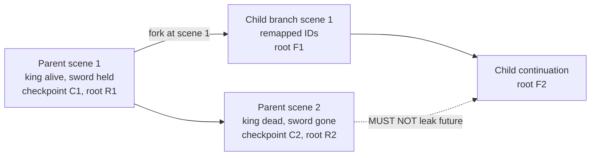
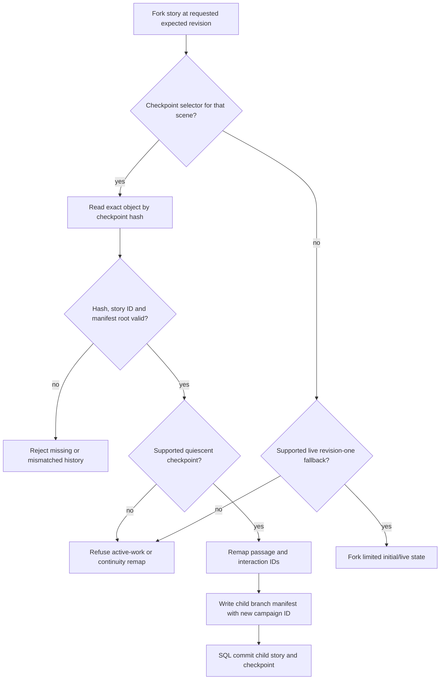
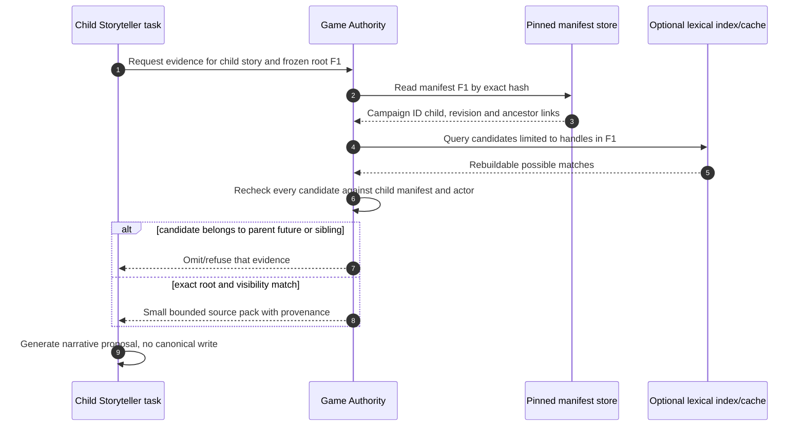
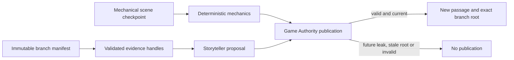

# 5. Scene checkpoints, historical forks and branch-safe memory

**Reader question:** after the story reaches scene 2, how can I return to scene 1 without inheriting its future? **Baseline:** 584b594. Canonical [scene-rooted canon](../technical/storyteller/canonical-documents-and-packages.md), [data checkpoint](../technical/platform/data-and-persistence.md#scene-checkpoint-v1), [context selection](../technical/storyteller/context-selection-and-recall.md).

## Timeline is not one mutable notebook

This example matches the existing **local historical-fork regression theme**, not a promised game scenario or a full kind test. The two timelines may share immutable **ancestor content**, but the child branch receives its own campaign identity and future state. A fork from scene 1 should not copy the parent's scene-2 condition, inventory change or knowledge.

## Current implementation: exact checkpoint beats live-head copy

**CURRENT SOURCE:** packages/application/src/stories/forks.ts uses forkFromSceneCheckpoint for the requested historical selector and a restricted forkLiveRevisionOne fallback without selector. readSceneCheckpointReference verifies immutable checkpoint and its canon root; the fork remaps identities and writes a child manifest. **Limit:** selected checkpoints with active holds/work, nontrivial pending offers or unsupported continuity remaps are deliberately rejected. “Fork from any scene, including active work” is a longer-term product ambition, **not yet implemented**. A quiescent checkpoint fork in distributed mode is now public Nest → private Game Authority `PUT /internal/v1/stories/:sourceId/forks/:forkId` → the same application `stories.fork` once; compose/local mode still calls that function in-process. Private GA start is archived with BOOT03. Cross-Pod child continuation and cold kind remain unproved.

## Knowledge retrieval must use the branch, not a global newest index

**SELECTED TARGET / partially implemented source:** packages/application/src/storyteller/context-capture.ts already has a bounded capture with storyId, revision and root hash; canonical-knowledge.ts loads the supplied root and checks campaignId/revision; packages/storyteller/src/tasks/memory-exploration.ts defines bounded ask_memory/read_memory shapes. A fully remote, branch-pinned tool/evidence resolver for the separated Storyteller executor remains a gap. The index is a retrieval aid; even a cached “hit” must be validated against the active branch and actor permission.

## Source and effect authority are different

A Storyteller memory result may say “the king is alive in this branch” **only** if the branch's pinned evidence supports it. That retrieved text alone does not transfer a sword or kill a king; the deterministic engine and authoritative consequence rules own mechanical facts. “Model knows every past scene forever” is not a current capability.

## Fork POC proof: the relevant negative matters more than a smiley green test

A meaningful end-to-end fixture should create scenes C1 and C2, fork the parent at C1, continue on child, and assert all of the following in SQL and S3: the child has new story/campaign identity and source pin, C1 state and passage appear consistently, parent C2 root remains unchanged, **the child context excludes parent C2**, and the child obtains its own independent next checkpoint. Kill/restart the actual worker before child continuation to rule out hidden in-memory assumptions. Also prove that a missing C1 object, wrong owner, mismatched root and an active-work unsupported checkpoint fail closed.

**Existing test tier:** packages/application/test/historical-fork.test.mjs and scene-checkpoint tests provide local confidence. See [DATA06 investigation](../../work/changes/archive/2026-11/other/2026-11-19--data06-fork-scoped-memory-context-minimum/SOURCE-MAP.md) and [TURN03 proof](../../work/changes/open/2026-11-19--turn03-full-distributed-forkable-turn-proof/PROOF.md) for the missing distributed proof. **No cross-Pod fork claim follows from these diagrams.**
