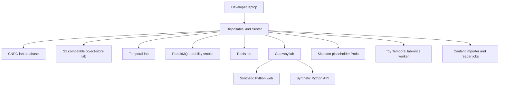
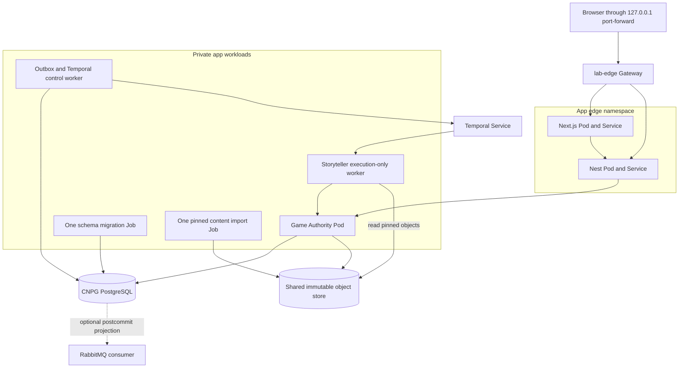
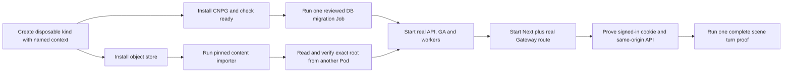
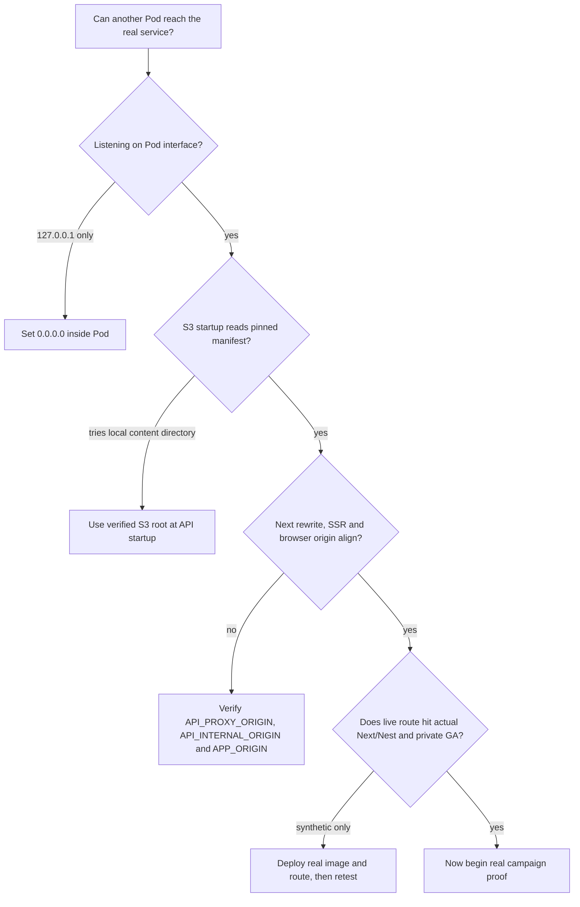

# 6. Kubernetes: the laboratory versus an actual game release

**Reader question:** what's really running in kind, and how do we prove it serves a player? **Baseline:** 584b594, 2026-11-19. Canonical [topology](../technical/platform/topology.md#distributed-learning-target), [release](../technical/platform/deployment-and-compatibility.md), [Kubernetes runbooks](../runbooks/README.md), [TURN02 plan](../../work/changes/open/2026-11-19--turn02-compose-real-kubernetes-application-release/EXECUTION.md).

## CURRENT SOURCE: component labs and synthetic applications

The infrastructure work is meaningful: component installers and smokes exist under infra/kubernetes/lab. But infra/kubernetes/lab/skeletons/workloads.yaml is explicitly marked **placeholder**. Gateway routes currently target **synthetic-web** and **synthetic-api**, not Next and Nest. The Temporal lab toy is not the actual storytellerV1 Activity worker. **An all-green infrastructure lab is not an all-green game**.

## SELECTED TARGET: one real disposable release

The selected release uses actual application images with a verifiable source SHA and digest, not a Python stand-in. Only Next/Nest are public through the one loopback-forwarded origin; GA, Temporal, object storage and databases are internal. PostgreSQL schema writes and migrations require strict ownership. Keep Compose/local workflows usable; Kubernetes is an experiment target, not a stealth production migration.

## Startup ordering is a dependency graph, not a prayer

**Failure behavior:** a missing migration, wrong S3 root or failed auth should prevent the release from claiming healthy **game capability**. Startup readiness is only a weaker probe. A content importer is not an opening campaign candidate; source registration, draft/candidate creation and Game Authority start are distinct actions.

## Four source-level gotchas, already identified

Observed in code at baseline: apps/web/package.json starts Next bound to 127.0.0.1; apps/api/src/config.ts and apps/game-authority/src/config.ts default to localhost; apps/api/src/main.ts calls importRulePackageDirectory against a local path even with an S3 DocumentStore; Next has a build-sensitive API_PROXY_ORIGIN rewrite while SSR uses API_INTERNAL_ORIGIN. These are documented **release blockers**, not proof that the fixes have shipped.

## Proof levels are separate

| Evidence | What it actually proves | What it does NOT |
| --- | --- | --- |
| Pod Ready / kind smoke | A process or synthetic component responds | Real app, auth, game state |
| Service-to-Service HTTP | DNS/routing/interface and token behavior | Storyteller output or canon |
| Temporal task queue poll | Worker can execute chosen Activity | Game Authority publication |
| Signed-in browser scene | Next/API/auth can read a committed passage | Independent model executor |
| Full TURN03 trace | Specific scene1→command→fake executor→GA scene2→SSE/GET→fork | Paid model storytelling or production HA |
| Separately authorized TURN04 | One actual model-authored result through same pipeline | Cost/quality at scale or universal reliability |

The lab is disposable and resource-bounded. Scripts should refuse unknown contexts and avoid deleting protected volumes. For actual commands and preconditions follow runbooks, not this conceptual drawing.
