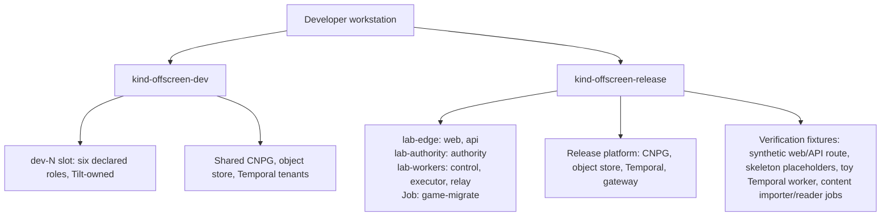
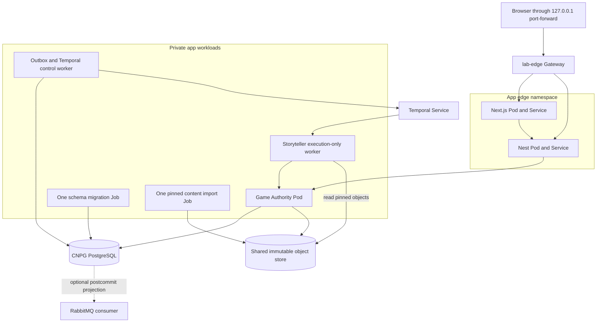
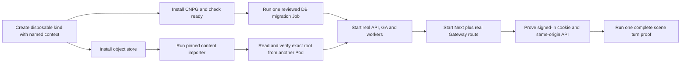
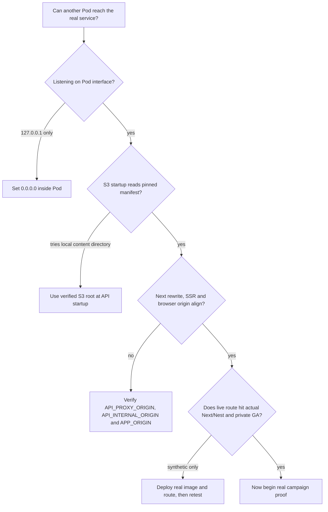

# 6. Kubernetes: the laboratory versus an actual game release

**Reader question:** what do the local clusters declare, what has actually been observed running, and how would we prove it serves a player? **Original baseline:** 584b594, 2026-11-19; current declarations re-read from source for this page, no live run. Canonical [topology](../technical/platform/topology.md#distributed-learning-target), [release](../technical/platform/deployment-and-compatibility.md), [Kubernetes runbooks](../runbooks/README.md), [TURN02 plan](https://github.com/DenisSkulovic/offscreen-rpg/blob/34e2b4fd8d9d9967e13311da3a938460b1a02244/work/changes/archive/2026-11/distributed/2026-11-19--turn02-compose-real-kubernetes-application-release/EXECUTION.md).

## CURRENT SOURCE: component labs and synthetic applications

Two different things exist in source, and the picture keeps them apart. The **application deployment declarations** are two profiles of one local Helm chart; the **component labs** are verification fixtures that use synthetic stand-ins.

- **Current declarations.** `infra/workloads/profiles/development.yaml` and `release.yaml` declare the same six roles (web, api, authority, control, executor, relay; see [topology: Current deployment declarations](../technical/platform/topology.md#current-deployment-declarations)). Release roles are separated across namespaces `lab-edge`, `lab-authority` and `lab-workers` with a `game-migrate` Job. The exact local routes are: development `pnpm dev` (runbook [dev worktree stacks](../runbooks/dev-worktree-stacks.md)); release `pnpm stack:up`, which on a cold start runs the cluster bootstrap, `infra/environments/release/platform.mjs ensure kind-offscreen-release` (postgres, object storage, Temporal, gateway) and `infra/environments/release/install.sh`, and on a warm start skips cluster creation ([infra/README.md](../../infra/README.md)). Component installers and smokes live under `infra/platform`.
- **Synthetic fixtures remain.** `infra/verification/fixtures/skeletons/workloads.yaml` is explicitly marked **placeholder**, and `infra/verification/smoke/gateway/routes.yaml` still targets **synthetic-web** and **synthetic-api**. The Temporal lab toy is not the actual storytellerV1 Activity worker. The real game edge route is `infra/environments/release/game-edge-route.yaml`.
- **Runtime observations (dated, not current proof).** On 2026-11-20 a fresh `kind-offscreen-release` routed `/sign-in` to Next and `/api/me` to Nest and kept Game Authority off the public Gateway; the disposable application release is recorded under [Kubernetes as a deliberate extension](../technical/platform/deployment-and-compatibility.md#kubernetes-as-a-deliberate-extension). A full gameplay turn through that release was not run (the TURN03 proof was cancelled). It is not the hosted release.

**An all-green infrastructure lab is not an all-green game**, and a declared role is not a running game. The release context is `kind-offscreen-release` and the development context `kind-offscreen-dev`; an older single "lab" context name in a historical observation is not a current command.

## SELECTED TARGET: one real disposable release

The selected release uses actual application images with a verifiable source SHA and digest, not a Python stand-in. Only Next/Nest are public through the one loopback-forwarded origin; GA, Temporal, object storage and databases are internal. PostgreSQL schema writes and migrations require strict ownership. Kubernetes is an experiment target, not a stealth production migration; there is no Compose orchestration file to keep usable.

## Startup ordering is a dependency graph, not a prayer

**Failure behavior:** a missing migration, wrong S3 root or failed auth should prevent the release from claiming healthy **game capability**. Startup readiness is only a weaker probe. A content importer is not an opening campaign candidate; source registration, draft/candidate creation and Game Authority start are distinct actions.

## Four source-level gotchas, already identified

Observed in code at the 2026-11-19 baseline (not re-verified against current source here): apps/web/package.json starts Next bound to 127.0.0.1; apps/api/src/config.ts and apps/game-authority/src/config.ts default to localhost; apps/api/src/main.ts calls importRulePackageDirectory against a local path even with an S3 DocumentStore; Next has a build-sensitive API_PROXY_ORIGIN rewrite while SSR uses API_INTERNAL_ORIGIN. The 2026-11-20 lab images listen on the Pod interface, read the pinned rule hash, and use the Nest Service origin. Those lab facts do not make the hosted release true.

## Proof levels are separate

| Evidence | What it actually proves | What it does NOT |
| --- | --- | --- |
| Pod Ready / kind smoke | A process or synthetic component responds | Real app, auth, game state |
| Service-to-Service HTTP | DNS/routing/interface and token behavior | Storyteller output or canon |
| Temporal task queue poll | Worker can execute chosen Activity | Game Authority publication |
| Signed-in browser scene | Next/API/auth can read a committed passage | Independent model executor |
| Full TURN03 trace (selected, never run; TURN03 was cancelled) | Would show scene1→command→fake executor→GA scene2→SSE/GET→fork | Paid model storytelling or production HA |
| Separately authorized TURN04 | One actual model-authored result through same pipeline | Cost/quality at scale or universal reliability |

The lab is disposable and resource-bounded. Scripts should refuse unknown contexts and avoid deleting protected volumes. For actual commands and preconditions follow runbooks, not this conceptual drawing.
