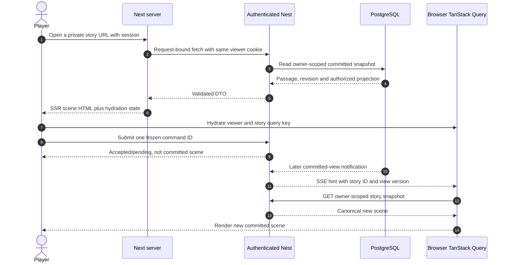
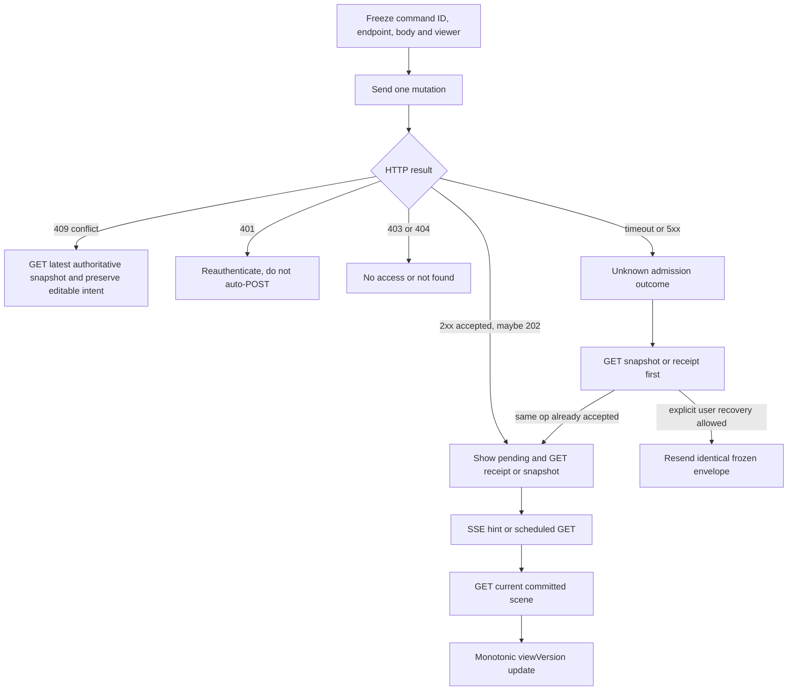
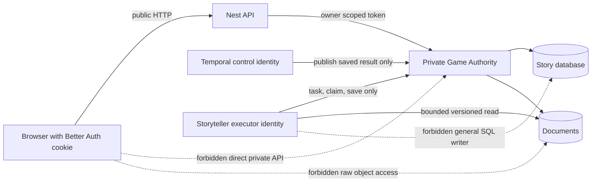
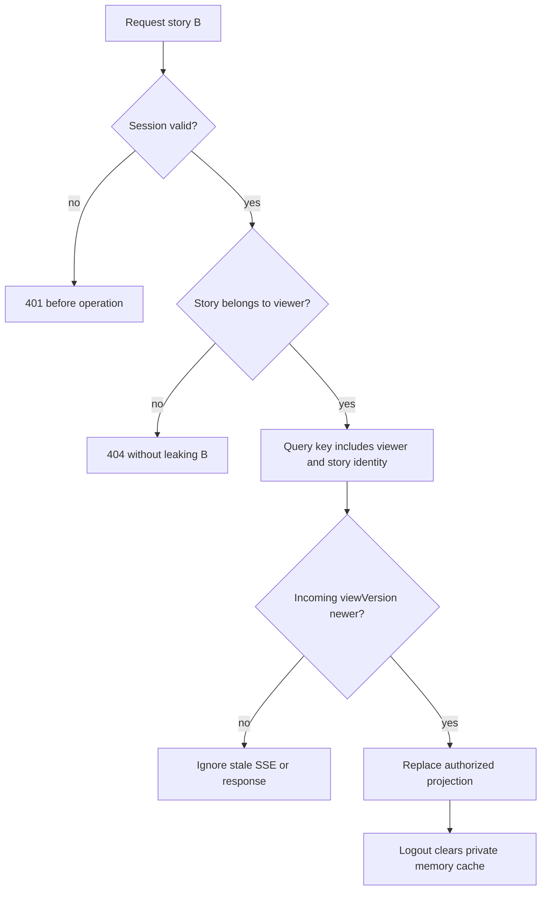

# 7. The browser, session and trust perimeter

**Reader question:** when does a player actually see a committed scene, and which actors can access private data? **Baseline:** 584b594. Canonical [client state/server boundary](../technical/client/state-and-server-boundary.md), [authentication](../technical/platform/identities-and-access.md), [platform trust](../technical/platform/security-and-trust-boundaries.md).

## Query cache is a projection, never another story authority

The client contract selects **request-scoped** server QueryClient and **one memory-only viewer-scoped** browser QueryClient, no duplicate story state in Zustand/useState. Only GET provides story truth. The SSE event contains a small invalidation hint, **not** private narrative. A dropped event recovers via GET or bounded pending polling; it never triggers a new POST. Browser code must not import Node-only token/origin configuration.

## Status handling makes retries safe

**SELECTED client behavior; code coverage varies.** The contract says mutations have **zero automatic retries**. Recovery of a frozen operation is an explicit, bounded action after checking authoritative state, not a useEffect that repeats irreversible game commands on reconnect. A 409 is not permission to rewrite the request with a new ID and hope.

## Cross-service trust boundary

**TARGET with gaps.** Today the private GA server authenticates a shared bearer for its limited read/resolution seam; separate control/executor role credentials **are not implemented** at baseline. A software routing boundary does not imply PostgreSQL privilege enforcement unless actual DB roles and negative writes are tested. No user browser request should go directly to GA, PostgreSQL, S3 internals, Temporal or the model provider.

## View isolation between players and story branches

This is a compact view of the selected security/client contract, not a standalone audit of browser cache, OAuth configuration, cookie flags or revocation race timing. The client boundary explicitly forbids cross-viewer cached payloads and late hydration from overwriting newer data. The current Nest story hub (apps/api/src/modules/stories/story-update-hub.ts) listens to PostgreSQL notifications, emits small story-update hints and reconnects on LISTEN failure; it is not a Rabbit consumer.

## What to test, not merely trust

- Real same-origin Next rewrite and SSR must hit **the same Nest service** while the browser cookie remains scoped to the forwarded origin. Backend API_INTERNAL_ORIGIN and API_PROXY_ORIGIN are different knobs.
- Owner A can open A's scene; owner B receives the same not-found behavior as a nonexistent story. A browser's stale A query must not render in B's session or after logout.
- A POST that times out and later succeeds must not be replayed by SSE reconnect or hydration. One admitted mechanical outcome and one passage.
- Out-of-order event versions and late GET results cannot roll back the visible committed scene.
- Executor credential cannot call GA publish/start or query raw SQL; control credential cannot act as a browser owner. Not yet proven in kind.
