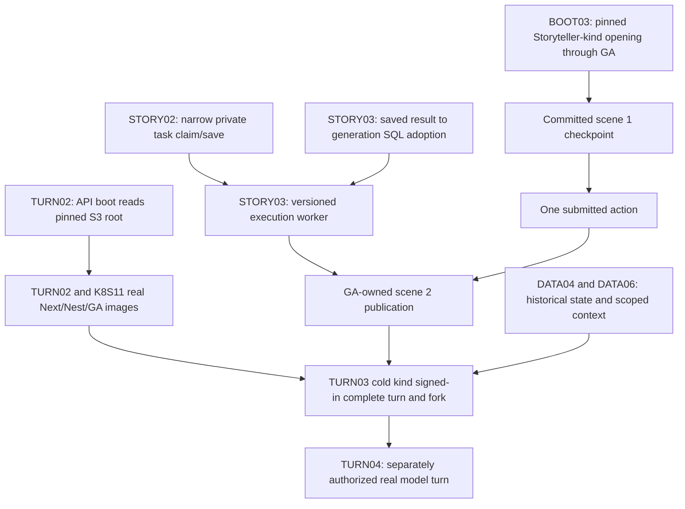
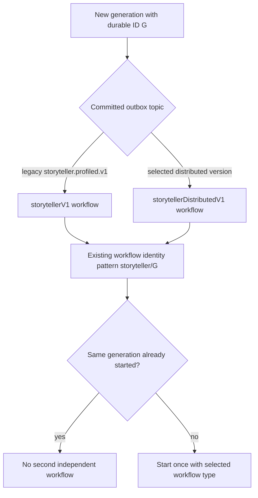
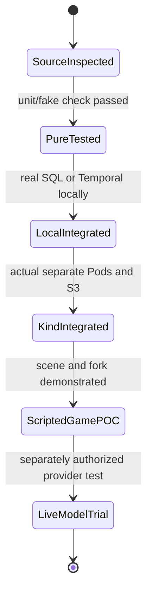

# 8. Gaps found by drawing the architecture

**Reader question:** which arrows are real, which are merely selected, and which architectural choices still need proof? **Inspection:** source snapshot 584b594 and current documentation handoff, 2026-11-19. This is a **diagnostic ledger**, not a new authoritative spec or an automatic Change selector. Canonical [source audit](../../work/designs/open/distributed-turn-poc/POC-READINESS-AUDIT-2026-11-19.md), [queue](../../work/changes/README.md) and [STATUS](../../STATUS.md).

## The POC gates, ordered by dependency rather than fashion

**All arrows here are prerequisites/selected planning gates, not evidence of completion.** The actual queue selects implementation and maintains statuses. Existing pieces may be partially landed and should be reconciled instead of reimplemented.

## A gap is an architectural finding when it distinguishes competing outcomes

| Priority | Inspected signal | Missing proof or contract | Owner |
| --- | --- | --- | --- |
| **P0** | STORY02 stores attempt custody but generation_state_shape requires succeeded generation to have attemptId **and** output | GA atomic saved-attempt adoption, durable idempotence and crash/retry proof | [STORY03](../../work/changes/open/2026-11-19--story03-separate-temporal-executor-and-publication/EXECUTION.md) |
| **P0** | Nest still starts/forks locally while GA only read/admit-resolution transport is present | All selected POC writes route through GA and fail closed if unavailable; DB privilege enforcement separately characterized | [BOOT03](../../work/changes/archive/2026-11/other/2026-11-19--boot03-game-authority-start-admission/SOURCE-MAP.md), DIST03 |
| **P0** | storytellerV1 is one combined Activity and worker; task custody not remote | New named versioned Workflow, separate queue/credential, legacy history replay preserved | STORY02/STORY03 |
| **P0** | A fresh 2026-11-20 kind cluster runs Next, Nest, Game Authority, control, executor, and relay beside the synthetic fixtures | Hosted release, replica proof, and the TURN03 scene and fork | [TURN02](../../work/changes/archive/2026-11/other/2026-11-19--turn02-compose-real-kubernetes-application-release/SOURCE-MAP.md), K8S11, TURN03 |
| **P0** | The fresh lab API reads pinned rule `d643427fa3292ce61484deb15f2e9fc6755c613b17260db6f390ea23bd99d7ab` | A hosted release still does not load that pin | TURN02 |
| **P1** | Historical checkpoint-based fork exists for quiescent source scenes in local tests | Private GA fork path + child distributed continuation proves no parent-future knowledge | DATA04/DATA06/TURN03 |
| **P1** | Postgres SSE hints exist; Next rewrite and SSR use separate origin configs | Same-origin authenticated actual-browser GET/SSE and missed-event recovery | K8S11/TURN03 |
| **P1** | Existing attempt claim is idempotent but **not** an exclusive send lease | Provider spend/resend policy for remote executor; real model only under explicit authority | TURN04 |
| **P2 optional** | Rabbit lab proves broker behavior; no game projection deployed | Postcommit derived read model with separate idempotent consumer, if educationally desired | DIST02 and DIST04 Cancelled (no independent consumer); K8S03 Rabbit lab optional; not POC critical |
| **Later** | Supported checkpoint refuses active work/offer/remap cases | Product decision + extended state remap and new negative proof for arbitrary moments | New explicitly scoped product/design decision, not silently DATA06 |

## A conflict detected during the diagram review: workflow identity

The canonical [Storyteller workflow identity](../technical/platform/execution-and-delivery.md#storyteller-workflow-identity) selects one stable workflow id of **storyteller/{generationId}**, and old workflow histories remain registered. A previous planner-only STORY03 handoff mistakenly suggested **storyteller-distributed/{generationId}**. That would permit two different workflow identities for one generation across a mixed routing/recovery window. **Decision for this audit:** follow the canonical identity and freeze versioned workflow type at **notice admission**, with distinct legacy/new outbox selectors. The current dispatcher uses notice.id as a workflow-id fallback during explicit recovery; the new selected distributed selector must be audited so the *same generation* never acquires a fresh workflow identity when a recovery notice is created. This is a real implementation requirement for STORY03, not proof it is already fixed.

## Proof tiers are gates, not interchangeable adjectives

This is an **evidence ladder** for the POC claim, not a Change workflow or a requirement that every unit test runs all steps. A source-inspected diagram cannot be called KindIntegrated. A successful scripted Storyteller proves flow/custody/publication but not narrative competence. One successful live trial does not prove production scaling, quality, exact-once provider charging or indefinite persistence.

## Diagram maintenance and proof

Every Mermaid chart under [atlas](README.md) must have:
1. The reader question, a source SHA or date, **CURRENT / TARGET / GAP / PROOF** distinction, and a nearby canonical owner link.
2. A diagram type suited to its job: sequence for causal order, state for durable transitions, ER for schema shape, flowchart for dependency or decision. Do not convert every heading into a vast flowchart; visual clutter is also documentation debt.
3. No fictional process owner, provider, table, queue, accepted state transition or tested capability. Prefer exact source labels or an explicitly conceptual label.
4. For critical workflows, at least one distinct **negative failure path**, identity and source of truth.
5. Co-change with any code altering the depicted route. The implementer changes the owning permanent technical heading first, then the relevant atlas diagram and navigation; a stale diagram is a failed documentation reconciliation, not a historical artifact to quietly ignore.
6. At least basic Mermaid render validation by an installed, pinned compatible renderer if one is available. **This planning pass did not run Mermaid CLI or a GitHub renderer.** Source fence/link validation is useful but is not full syntax/render proof. Adding a verified, inexpensive render check is a bounded follow-up, not a reason to run expensive Cursor design agents.

**Do not multiply truth owners:** these pages are explanatory maps. Ratified behavior is still owned by [product](../product/README.md) and [technical](../technical/README.md). Implementation status is still [STATUS](../../STATUS.md) and the [Change ledger](../../work/changes/README.md). Open architectural questions here must become source-grounded designs or explicit blockers with a single owner rather than being “resolved” by drawing an arrow.

**Next diagrams worth adding only when their source is settled:** full funding reservation/uncertain allocation timeline; multi-actor story permissions; complete client scene-direction rendering pipeline; Admin support case disclosure and audit; active-work historical fork state migration; disaster recovery of *both* Temporal and SQL. Each is a meaningful subsystem, but adding speculative diagrams before deciding its owners would manufacture certainty.
