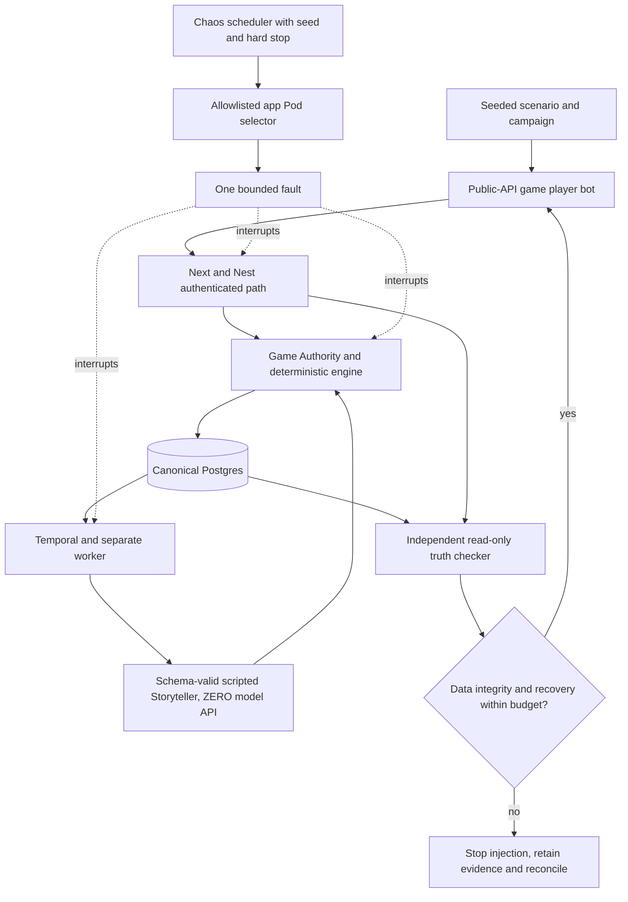
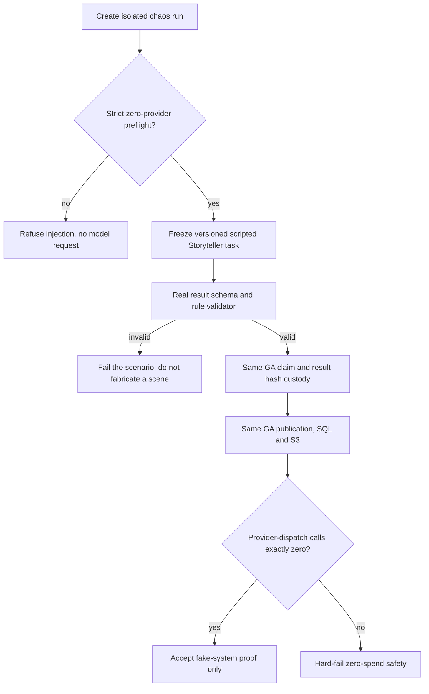
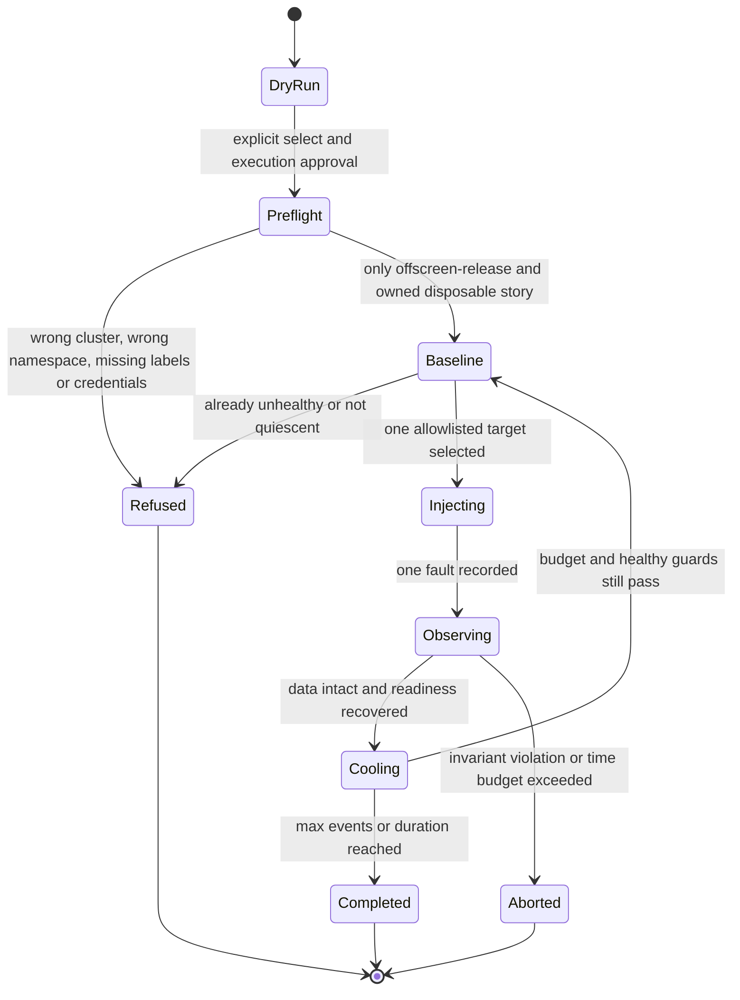
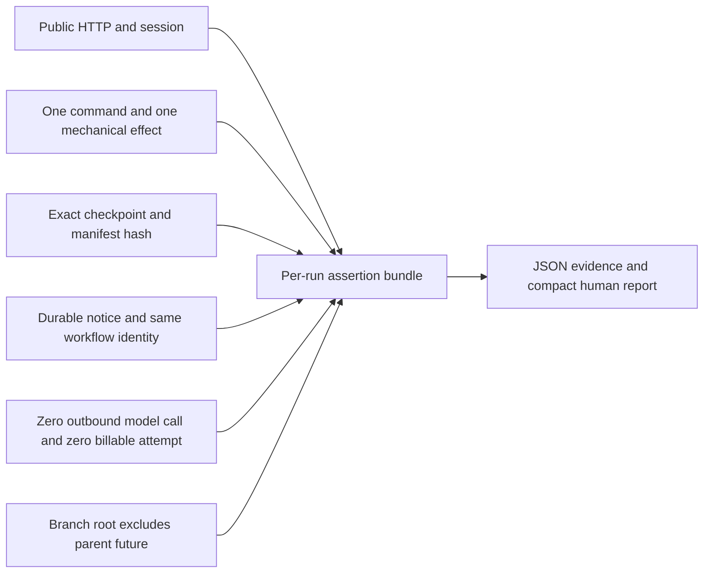

# 9. Chaos Lab | play the game while the system breaks

**Question:** can an authenticated player continue a real scripted campaign while selected Kubernetes processes disappear, recover and sometimes come back in the wrong order? **Status:** **DESIGN** (2026-11-19), not an implemented campaign-chaos runner. One earlier Rabbit-consumer-loss test **did** run under [K8S10](../../work/changes/open/2026-11-19--k8s10-distributed-fault-and-load-harness/CHANGE.md), but it exercised a toy broker client, not a real Storyteller turn. Source inspection baseline: `584b594`. Canonical [lab experiment protocol](../technical/lab/experiment-protocol.md), [execution](../technical/platform/execution-and-delivery.md), [resilience](04-failure-and-recovery.md), [failure runbook](../runbooks/kubernetes-fault.md).

## Our central idea: one continuous synthetic game as a live reliability oracle



The bot plays the **actual supported public API**, not direct SQL calls. It creates a valid owned draft + succeeded **Storyteller-kind opening candidate with scripted execution** and pinned package; starts a real campaign; chooses from actual available options; sends stable operation IDs; re-reads a committed snapshot after every action; optionally forks a supported quiescent scene and continues independently. Its scenario and action selection are seeded. A continuously running bot plus independent source-of-truth assertions lets us detect damage far earlier than waiting for a human to notice. Humans can play in the **same disposable environment**, but destructive chaos must never target a valuable personal campaign by default.

## We already have the right no-provider fixture

The actual `packages/storyteller/src/fixtures/index.ts:scriptedStorytellerResult` is a repeatable schema-valid Storyteller response, using authored rehearsal content and `scriptedMechanicalConsequence`. `packages/application/src/storyteller/execution.ts:createStorytellerExecution.generate` has an explicit scripted branch. `packages/application/src/storyteller/config.ts:readStorytellerExecution` defaults to offline unless `STORYTELLER_LIVE_ENABLED=true` **and** a valid approved JSON policy exists. This is a better contract than lorem ipsum: it exercises validation, documented choices, mechanical consequences, canonical source, result hashes and publication while avoiding LLM calls.



**Preflight must be layered:** `STORYTELLER_LIVE_ENABLED` absent/false, all frozen tasks `execution.mode=scripted`, no `OPENROUTER_API_KEY` or other model secret in these Pods, no live provider adapter in composition, a dispatch tripwire that records and throws on attempted model transport, accounting and stage assertions for **zero actual provider dispatches**, plus network-level egress controls **only when the installed CNI enforces NetworkPolicy**. Do not pretend NetworkPolicy works under a CNI that doesn't implement it. Credentials absent is necessary but not sufficient as an auditable guard. A correct fake result may be deterministic while the system's scheduling is not.

## Two complementary experiments: targeted cuts, then seeded randomness

```mermaid
sequenceDiagram
    autonumber
    participant Bot as Scripted game bot
    participant O as SQL/S3/public oracle
    participant M as Chaos controller
    participant K as Kubernetes
    Bot->>O: Establish healthy committed baseline
    O-->>M: Safe run ID, pins, invariant snapshot
    M->>K: Select eligible app Pod, record UID and owner
    K-->>M: Target confirmed
    M->>K: Graceful Pod deletion OR separately approved abrupt crash
    Bot->>Bot: Continue safe idempotent actions/reads
    loop until timeout or healthy
      O->>O: Check story root, duplicate effects, availability and recovery
    end
    alt invariant violation or exceeded limit
      O-->>M: ABORT and stop further injection
      M->>K: No new faults; leave current run inspectable
    else recovered and baseline re-established
      O-->>M: Round accepted with timings
      M->>M: Wait cooldown / pick next eligible target
    end
```

A **graceful deletion** tests workload restart and request draining. An **abrupt crash** is a distinct, stronger mechanism; `kubectl delete pod --force --grace-period=0` is **not reliable proof of actual process death**, and is unsafe for stateful Pods. First use ordinary `kubectl delete pod` on allowlisted disposable *app* Deployments. Implement abrupt process failure separately against disposable known application containers, with observable stop and process replacement, after a reviewed controller exists.

## The safety fence, before randomness



**Never inject by default.** Explicit `--execute`, current cluster `kind-offscreen-release`, cluster name `offscreen-release`, owner-known run and namespace/Deployment allowlist, baseline READY, budget limit, current context/UID recheck immediately before deletion, one fault in flight, no wildcard labels, and a local mutual-exclusion lock are mandatory. Exclude database Pods/PVCs, Temporal persistence, content store, control plane, nodes, migration Jobs, other namespaces and personal campaign resources from the initial random pool. **Do not create/delete the cluster as part of the chaos loop.** Stop injection on unhealthy baseline, first data invariant failure, missing owner match, cleanup failure or maximum recovery deadline.

Randomness uses a recorded seed and produces a sequence of **eligible target choices** with each chosen UID and event timestamp. Seeds improve replayability, but timing/race interleavings are not perfectly deterministic; record actual start/end timestamps and observed worker histories. No infinite unattended job; set a short duration/event cap, evidence TTL and disk limit. The first engineering default should be **one fault, wait until health returns, then a cooldown**, not a Pod kill every 3 seconds. Fast 3–5-second kill loops are a separately approved saturation profile **after** non-overlapping recovery tests pass and sufficient replica/capacity exist.

## Failure categories, with different expected behavior

| Fault | Initial tier | What we should see | Do not claim |
| --- | --- | --- | --- |
| One Next Pod deleted | Early app, 1 replica | Temporary UI unavailability is acceptable; after replacement, session survives and GET is consistent | Zero downtime with one replica |
| One Nest Pod deleted during POST | Early app | Response may be ambiguous; same operation reconciles, never a second action | HTTP always returns success during kill |
| One Game Authority Pod deleted during publication | Early app | Saved result survives and one committed scene eventually appears | Exactly one Activity execution |
| Separate Storyteller worker killed **after result save** | **Top priority targeted fault** | Reuse saved hash, one publication, zero new model dispatch | Time alone proves no duplicate |
| Outbox/Temporal worker gone | Early app | Durable notice/workflow resumes on recovered worker; no lost command | Workflow continues while sole worker down |
| Rabbit derived projection unavailable | Optional | Canon scene and SSE/GET still work; derived projection catches up | Rabbit is part of story availability |
| Redis restart | Later, if actual application depends on it | Defined cache/session behavior, no truth loss | Redis availability is essential to every scene |
| Object store unavailable before scene commit | Targeted later | Hold publication; never write a dangling SQL selector | No player-visible degradation |
| PostgreSQL **single primary** unavailable | Targeted later | New writes refuse/pause; restore and recheck committed truth | Automatic HA or instant failover: current CNPG lab is `instances: 1` |
| Temporal service/control unavailable | Targeted later | Workflow remains durable in Temporal's persistence and later resumes if backend survived | Rebuild missing Temporal history from SQL for free |
| DNS/network delay or one partition | Later with proven tool isolation | Backoff/timeouts; no stale canonical write | Randomly cutting host Docker networking is safe |
| Bounded local burst/latency | Later | Throughput, p50/p95/p99, rejection and recovery within measured budget | Public DDoS capability or arbitrary load |
| Multiple replicas, Pod startup reordered | Later when actually deployed | Dependency readiness, root/pin verification and restart converge | One replica proves scaling |
| Resource exhaustion, disk full, PVC loss | Specialized destructive profile only | Mostly **fail closed**, perhaps manual restore, no invented automatic availability | Safe default random monkey |

The one-replica CNPG lab is rendered from `infra/platform/postgres/chart` (`instances: 1`). Killing it every few seconds creates unavailability; for multi-replica failover, first build and verify an appropriate backup/HA environment and separate approval. **Do not delete PVCs** or simulate data loss in the ordinary chaos pool.

## Health is a collection of invariants, not a green Pod count



Measure: time from injection to readiness, time from injection to **playable scene recovery**, admitted→committed p50/p95/p99 where sample size permits, operation duplicates, failed retries vs safe replays, dangling selectors, stale publications, pending work age, S3/PG checkpoint agreement, unauthorized access and actual Pod restarts. **Latency percentiles from tiny samples are meaningless; label sample count.** Distinguish `FAIL` (violated data invariant), `RECOVERED` (correct eventually within stated bound), `DEGRADED` (expected temporary unavailability), `TIMEOUT`, `ABORTED`, and `NOT-RUN`.

The report must contain: source SHA/dirty state, image digests, fixture and pinned root hashes, actor/story/command/generation/workflow/attempt/passage/checkpoint IDs, random seed, exact Kubernetes context/namespace/Pod UID/owner, fault kind/grace, start/end and recovery timestamps, baseline health, status/reason, actual SQL+S3 oracle, model dispatch count, memory/CPU and retained sanitized traces. **No raw user story text, secrets, model prompts or tokens** in default artifacts.

## Why random kills alone are not enough

A random monkey may never hit “DB committed but HTTP ACK lost” or “provider result saved before GA publication.” Use [named causal failure points](../technical/lab/experiment-protocol.md#5-fault-cut-points) to force the system into specific windows, then combine those with randomized Pod deletion. The existing [Chamber](../technical/lab/chamber-and-fixtures.md) already defines test-only semantic faults and scripted holds; **reuse it** for pre-commit/post-commit cutpoints instead of inventing production debug endpoints.

The correct testing sequence is **deterministic unit/integration → one named crash-window fault → seeded single-Pod chaos → bounded multi-run chaos → sustained soak → controlled load and network faults → optional later infrastructure failover**. This is continuous hypothesis testing, not “run it for days until it never fails.” Each failure should become a smaller reproducible regression test.

**Implementation owner:** extend **existing [K8S10](../../work/changes/open/2026-11-19--k8s10-distributed-fault-and-load-harness/CHANGE.md)**, don't create a competing CHAOS program. Its first Rabbit consumer-loss smoke is landed; the game-chaos runner is a planned, unselected next slice. [SOURCE-MAP](../../work/changes/open/2026-11-19--k8s10-distributed-fault-and-load-harness/SOURCE-MAP.md), [EXECUTION](../../work/changes/open/2026-11-19--k8s10-distributed-fault-and-load-harness/EXECUTION.md), [PROOF](../../work/changes/open/2026-11-19--k8s10-distributed-fault-and-load-harness/PROOF.md) and [TASKS](../../work/changes/open/2026-11-19--k8s10-distributed-fault-and-load-harness/TASKS.md) hold the detailed future implementation plan.
