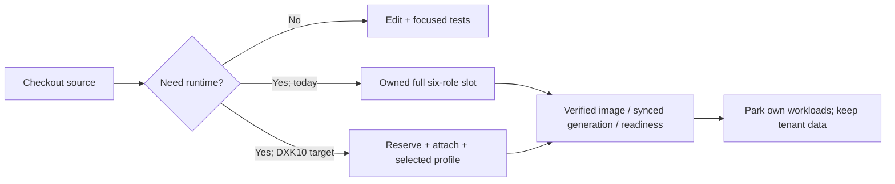
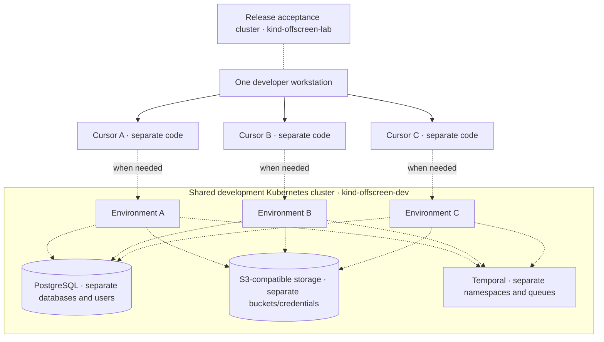
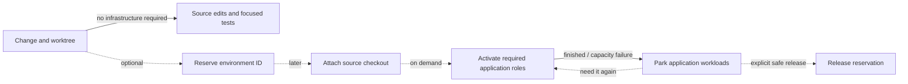
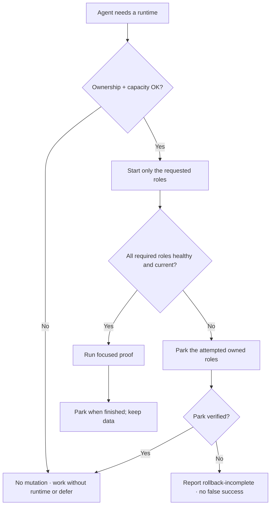

# Developer environments | three coding agents, one workstation

**Question:** How can several Cursor agents work on Offscreen RPG without overwriting each other's code, game data, running services or ports?

**Audience:** humans first. **Observed state at integration `undertaking/storyteller-workshop@8a782ffd` (2026-11-23):** a fresh worktree started an owned full six-role dev environment unattended, reached current-generation readiness and parked with tenant state intact. DXK11 removed redundant Kind imports: where both nodes already contain the canonical image digest, aliases are created locally rather than reimporting the same image. `pnpm dev:reserve` and `pnpm dev:attach` are source-tested registry commands and do not start Pods. Selective profiles and cross-checkout handoff of a provisioned environment remain **design, not commands**. Cluster absence during reserve/attach was proven with an isolated temporary registry, not by inspecting a live cluster.

**Performance reality:** original parked activation took 376 s with ten redundant Kind imports; the later DXK11 115.8 s run incurred a genuine new artifact plus two node imports, so it **does not** measure a pure same-image warm restart. Same-image restart performance is still to be established.

**If you need to operate it:** [dev runbook](../runbooks/dev-worktree-stacks.md). **If you need the exact engineering guarantees:** [developer environment contract](../technical/platform/developer-environments.md). **If you need the latest proof:** [DXK09](../../work/changes/open/2026-11-22--dxk09-isolated-parallel-development-stacks/PROOF.md). Do not use this picture as execution permission.

## The idea in one minute

A Cursor is a programmer working on a particular piece of the game. A **worktree** gives it separate source files. An **environment** gives it a separate address and, when needed, a place to run the game. A **tenant** gives it separate saved data. All environments share the same underlying workstation and some database/object/workflow servers.

Three programmers need not run three complete copies of everything. One may edit source and run unit tests without a game server. Another may need a browser. A third may need the full application. Each should consume only the resources its task actually needs.

**Important distinction:** the small environment boxes are **not** separate Kubernetes clusters. The release lab is a different cluster with a different purpose; it must not be repurposed as an extra Cursor stack.

## What is running, and when?

Reserve and attach are today's registry CLI. The rest of this diagram, especially per-profile activation and release, is still the DXK10 target. `pnpm dev` still attempts a **full six-workload application stack**. Consult the [runbook's current commands](../runbooks/dev-worktree-stacks.md#what-works-on-the-integrated-branch).

## What a full application stack contains

| Role | Plain-language job |
| --- | --- |
| Web | What you see in the browser |
| API | Authentication and HTTP requests |
| Game Authority | Decides authoritative changes to game state |
| Control worker | Coordinates selected background operations |
| Executor worker | Runs Storyteller execution tasks |
| Relay worker | Moves durable notices into workflows |

These six roles are application processes, **not** six separate full copies of PostgreSQL, S3 or Temporal. They may share one development image artifact while running different commands. An environment that needs fewer roles should eventually activate only its proven dependency-closed profile.

## The two most important safety rules

**Your environment is yours.** A Cursor may modify or park its own workloads, but it must not kill another Cursor's processes, adopt its ports, use its database identity, or reset shared infrastructure to fix its own test. When a slot stops, its saved data and tenant secrets remain.

**A failed startup does not get to occupy half a stack.** If an agent requests a complete stack and readiness fails, the intended behavior is to park **all its attempted application roles**, verify cleanup, and report whether the cause was capacity or a software defect. If cleanup fails, report `rollback-incomplete`; do not claim the slot is parked. This has focused test evidence in the in-flight DXK09 branch, but is not yet an integrated, fully accepted unattended workflow.

This is a **selected fail-closed behavior model**. It is not evidence that every branch and failure mode has been tested live.

## Why images and Tilt became difficult

A **container image** is a packaged runtime. **Kind** makes that image available to Kubernetes. **Tilt** watches source edits and updates a development environment. **Kubernetes** runs Pods. If image loading and Tilt independently rewrite what a Pod should run, a green Pod may still contain an old image.

The selected correction is simple to state: **image preparation returns one verified artifact; Tilt owns the desired active development Deployment; Kubernetes replaces Pods; readiness only observes**. This architecture decision is documented precisely in the [technical contract](../technical/platform/developer-environments.md#one-owner-for-the-active-development-image) but is **not yet proven as integrated code**. An unverified local image-generation fix must never be described here as shipped.

## What is proven versus still ahead?

| Capability | Status at this documentation checkpoint |
| --- | --- |
| Two distinct live development stacks and isolated source changes | Live-observed in earlier DXK09 receipts |
| Stop one stack without stopping another | Live-observed in earlier DXK09 receipts |
| Separate SQL, object-storage and Temporal tenants | Live-observed in bounded earlier trials |
| Fully unattended new-worktree startup and current-image readiness | **Not accepted**; in-flight image ownership correction |
| Automatic partial-start rollback | Local Cursor tests reported; integrated acceptance pending |
| Reserve and attach without launching pods | Source-tested CLI. No live cluster observation in this Change |
| Activate Web-only/API/full profiles | **Selected DXK10-B target, not implemented** |
| Three simultaneously productive Cursor agents | End-user goal; not yet demonstrated |
| Four healthy full application stacks | Separate capacity target; unproven on this machine |
| Real browser OAuth and complete game/release acceptance | Separate outstanding proofs |

**Next:** finish [DXK09](../../work/changes/open/2026-11-22--dxk09-isolated-parallel-development-stacks/CHANGE.md)'s truthful ordinary development gate, implement [DXK10](../../work/changes/backlog/platform-operations/2026-11-23--dxk10-demand-driven-dev-lifecycle/CHANGE.md)'s demand-driven activation, then use it for independent application Changes. Do not demand four full stacks merely to let three agents edit and test code.

## Find the next layer

| You want to know… | Read |
| --- | --- |
| Which developer commands are safe today? | [Worktree development runbook](../runbooks/dev-worktree-stacks.md) |
| Which component owns image builds, Tilt, Kubernetes and readiness? | [Developer environment technical contract](../technical/platform/developer-environments.md) |
| What exactly passed and failed? | [DXK09 operational proof](../../work/changes/open/2026-11-22--dxk09-isolated-parallel-development-stacks/PROOF.md) |
| How will idle reservations and partial profiles work? | [DXK10 design proposal](../../work/changes/backlog/platform-operations/2026-11-23--dxk10-demand-driven-dev-lifecycle/CHANGE.md) |
| Why is release testing isolated from development? | [Infrastructure restructuring program](../../work/changes/backlog/platform-operations/INFRA-RESTRUCTURE-PLAN.md) |
