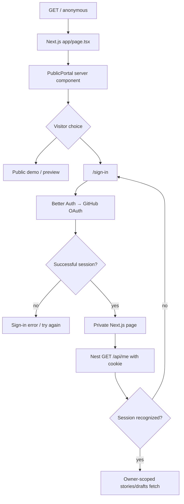
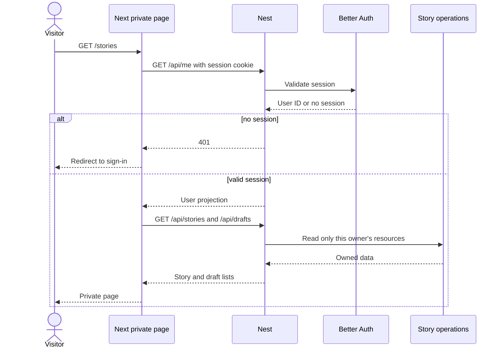

# 11. Visitor, GitHub sign-in and a private page

**Question:** Someone types our URL into a browser. What actually happens? **Baseline:** source inspected at `e2c0e751` on 2026-11-23; CURRENT SOURCE, **not** a live OAuth/browser acceptance. [Canonical identity contract](../technical/platform/identities-and-access.md). [Back to the human map](00-human-tour.md).

## A visitor needs almost nothing

| Step | What you see | Code to open |
| --- | --- | --- |
| Anonymous `/` | Public portal, no Nest session dependency in this component | [page](../../apps/web/app/page.tsx) → [PublicPortal](../../apps/web/src/features/public-portal/public-portal.tsx) |
| Sign-in page | Continue with GitHub, optional safe return destination | [sign-in page](../../apps/web/app/sign-in/page.tsx) → [button](../../apps/web/src/features/session/sign-in-button.tsx) |
| OAuth round-trip | GitHub redirects through Better Auth's `/api/auth` handler, with callback/error URL | [browser auth client](../../apps/web/src/lib/auth-client.ts) → [Better Auth setup](../../apps/api/src/modules/auth/auth.ts) |
| Private layout | User must have a session | [authenticated layout](../../apps/web/app/(authenticated)/layout.tsx) → [requireViewer](../../apps/web/src/server/viewer.ts) |
| Account check | Nest looks up session via Better Auth | [IdentityService + `GET /api/me`](../../apps/api/src/modules/auth/identity.ts) |
| Owned story list | Two independent owned-resource reads, not only a login test | [stories page](../../apps/web/app/(authenticated)/stories/page.tsx) → [stories controller](../../apps/api/src/modules/stories/controllers/catalogue-and-launch.ts), [draft controller](../../apps/api/src/modules/drafts/controller.ts) |

**Registration:** The inspected web UI uses GitHub social sign-in, not a separate password-registration form. A first-time account is handled by Better Auth's user/session data. Do not invent an additional registration page or claim that OAuth succeeded in the real cluster without a browser proof.

## The session is a pass, not a master key

**Authentication** means “which user is this?” **Authorization** means “can this user read or change this *specific* story?” The private Next layout gates the shell; Nest controllers and business operations still check ownership for individual data. The `requireViewer()` function itself explicitly says it is **not endpoint authorization**.

**Why a cookie passes from Next to Nest:** Next performs request-bound server reads, so its server forwards the incoming visitor cookie to Nest's session validation. It should not invent ownership from a client cache. For detailed cache/SSR behavior, go to [browser and trust](07-client-and-trust.md).

## If it fails

| What breaks | Expected behavior to understand |
| --- | --- |
| No/expired session | Nest `/api/me` returns 401; private Next page redirects to sign-in |
| Nest unreachable | Sign-in screen still offers sign-in; private session gate treats unavailable account service as an error, **not** authenticated access |
| Login succeeds, story belongs to another player | Login does not grant access; story read/command denies by owner |
| Cookie and terminal story bearer both supplied | Story-specific identity path refuses mixed credentials; terminal bearer cannot authenticate Draft or Admin operations |
| Browser loses return path | Safe entry-destination helper constrains where sign-in may redirect |

## Try this five-file tour

1. `apps/web/app/page.tsx` is only a few lines: it hands rendering to PublicPortal.
2. `apps/web/src/features/session/sign-in-button.tsx` is the first client-side network action.
3. `apps/api/src/modules/auth/auth.ts` configures Better Auth.
4. `apps/web/src/server/viewer.ts` gates private server-rendered pages.
5. `apps/api/src/modules/auth/identity.ts` resolves the actual authenticated user.

**Status:** Browser OAuth in the full disposable Kubernetes release is still not a completed TURN03 acceptance gate in the inspected evidence. This page documents implemented source and its intended failure behavior, not a live sign-in certification.
