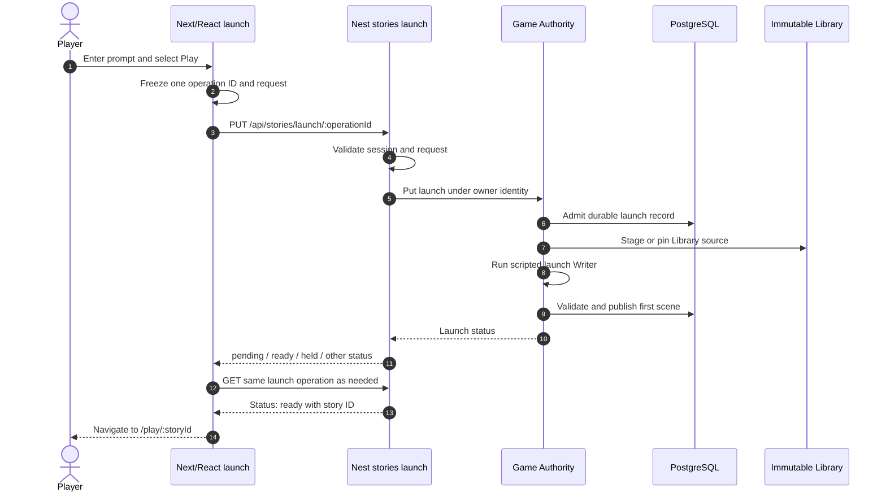
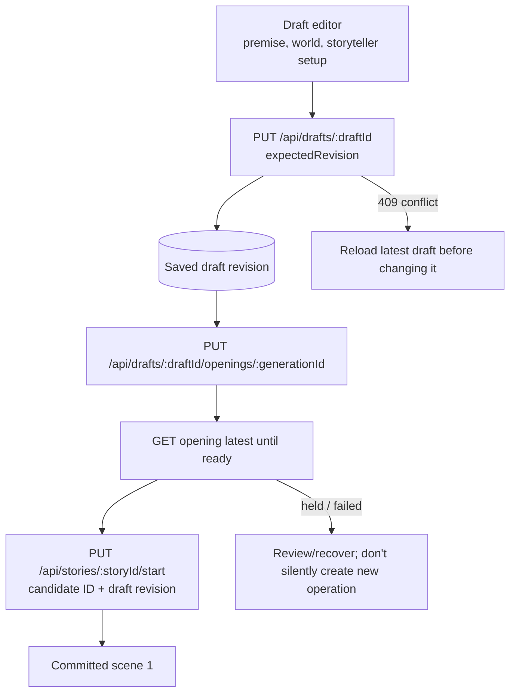

# 12. Creating a story and setting up its Storyteller

**Question:** Why do I see both a prompt-first story launch and a draft/opening/Start system? **Baseline:** source inspected at `e2c0e751`, 2026-11-23. CURRENT SOURCE, not an end-to-end cluster claim. [Product entry and onboarding](../product/experience/entry-and-onboarding.md) owns intended experience; [Storyteller operations](../technical/storyteller/operation-and-controller.md) owns selected deeper Writer behavior. [Start at the human map](00-human-tour.md).

## There are two entry routes, not one giant wizard

| Journey | Human action | Current source | Role |
| --- | --- | --- | --- |
| **A. Direct launch** | On `/stories/new`, type a prompt (or choose a prepared preset) and press Play | `useStoryLaunch` → `PUT /api/stories/launch/:operationId` → Game Authority launch service | Current prompt-first UI |
| **B. Draft + opening** | Edit a draft, choose setup including Storyteller, save, request an opening candidate, then Start | `PUT /api/drafts/:id` → `PUT /api/drafts/:id/openings/:generationId` → `PUT /api/stories/:storyId/start` | Existing authoring journey and provider-free TURN03 golden trace |

**Do not silently equate them.** The current UI has both a direct `/stories/new` surface and a persisted draft editor at `/stories/[id]`. TURN03's low-level acceptance fixture takes route B. The choice of which authoring path should be canonical over time requires product review; this documentation does not delete either.

## A. The direct Play/Story Prompt launch

**Start at the button:** [launch form](../../apps/web/src/features/stories/launch/story-launch-form.tsx) calls [`useStoryLaunch`](../../apps/web/src/features/stories/launch/use-story-launch.ts). The hook freezes a single `operationId`, stores a small recovery pointer, sends **PUT**, then checks status by **GET** without making up a new story. When state becomes `ready`, it navigates to `/play/:storyId`. An HTTP response alone does not make a scene visible; **ready** must come from the launch status.

**Follow the backend:** [Nest launch controller](../../apps/api/src/modules/stories/controllers/catalogue-and-launch.ts) validates the owner's request and calls `StorySeam.putLaunch` in [game-authority-client.ts](../../apps/api/src/modules/stories/game-authority-client.ts). Under distributed configuration this is a private Game Authority call; embedded configuration uses an in-process seam. The [launch service](../../apps/game-authority/src/launch-put.ts) owns the launch ledger, Library staging, scripted Writer mission and opening publication. PostgreSQL holds identity and launch state; DocumentStore holds immutable source objects.

**Important limit:** This source path currently invokes `runScriptedLaunchWriter`. A target future Writer might conduct multi-round research using real models, but **do not read this as an already enabled paid model launch**.

## B. The saved draft and opening candidate route

The [draft editor](../../apps/web/src/features/stories/drafts/draft-editor.tsx) collects the setup. [`useDraftSave`](../../apps/web/src/features/stories/drafts/use-draft-save.ts) sends a frozen draft plus expected revision, with **zero automatic retries**. Backend entry points are [DraftsController](../../apps/api/src/modules/drafts/controller.ts), [OpeningsController](../../apps/api/src/modules/drafts/openings-controller.ts), and [StoriesCommandsController.startFromCandidate](../../apps/api/src/modules/stories/controllers/story-commands.ts). In the distributed seam, the start command is passed to private Game Authority.

The public [StorytellersController](../../apps/api/src/modules/drafts/storytellers-controller.ts) serves a Storyteller **profile catalogue**. That is not the same thing as starting a model or granting spending. A saved draft includes the chosen creative setup and can lead to an opening candidate. `apps/web/src/features/stories/drafts/draft-editor.tsx` is where the draft-specific Storyteller selection becomes a user choice.

## What actually means “Storyteller setup”?

There are three levels that should not be confused:

1. **Player-facing preference:** the premise, storytelling direction, world/character context and optional profile. Part of draft/launch input.
2. **Frozen task input:** a validated input and exact Library/rule/source references used when generation starts. It must not silently change halfway through.
3. **Execution authority:** whether a scripted fixture or a paid provider is permitted to act, with reserved limits and provider custody. A profile choice is **not** an authorization to spend.

For deeper source after these routes, read [Story Engine](../../packages/story-engine/README.md), [documents](../../packages/documents/README.md) and [Storyteller generation/publication](../technical/storyteller/generation-and-publication.md). Avoid diving into every Writer helper before understanding which path called it.

## Failures worth understanding

| Situation | What we must not pretend happened |
| --- | --- |
| Draft save returns 409 | The stale draft was **not** safely overwritten |
| Opening generation stays pending | A candidate is **not yet** usable |
| PUT launch times out | A new operation ID is **not** an acceptable automatic replay; check the frozen one by GET |
| Launch is held/uncertain | The user does **not** have a guaranteed published opening |
| A scripted Writer ran | A paid LLM request was **not** made |
| Opening exists but Start fails | A candidate is **not** necessarily an active story |

**Status:** Both paths exist in source. TURN03's route-B local scripted trace and associated fake-only helpers do **not** establish the complete real release player journey. Follow [playing and forking](13-playing-and-forking.md) for the next step.
