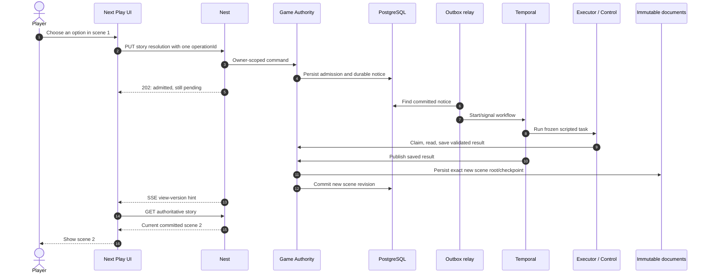
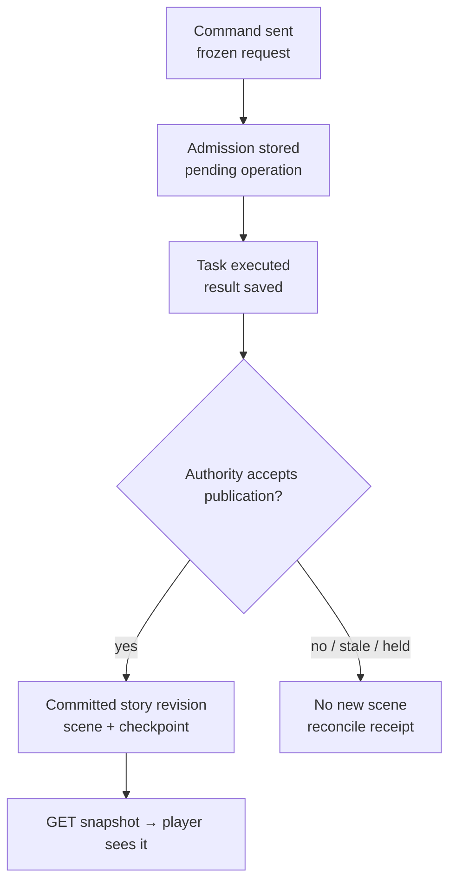
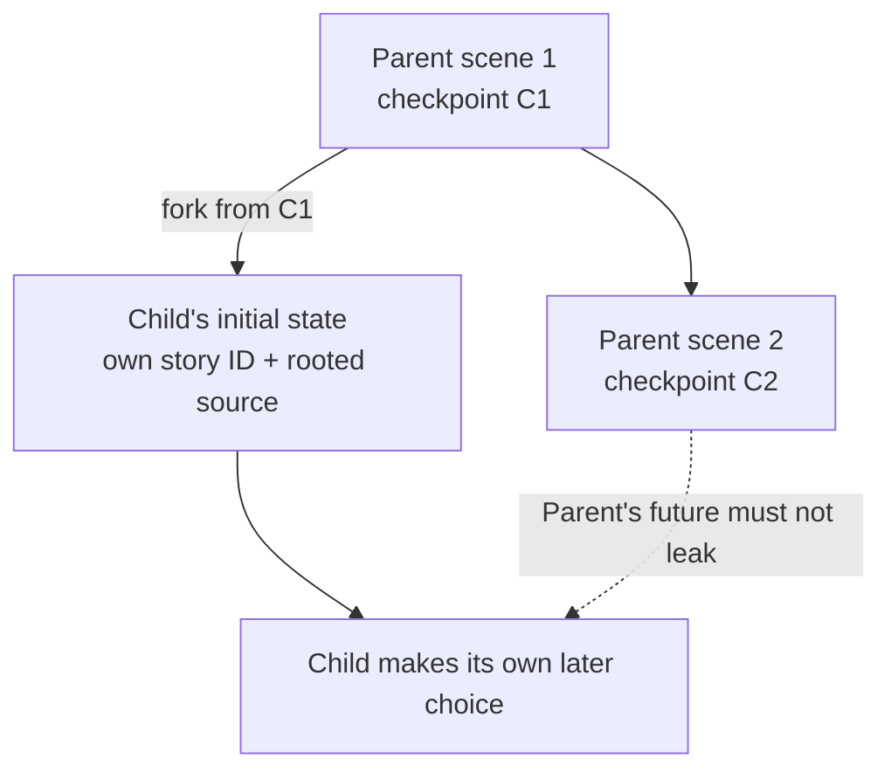

# 13. Playing, waiting for scene 2, and forking a past scene

**Question:** I clicked an option. Which parts run, when does it become true, and how can I fork a past scene? **Baseline:** source inspected at `e2c0e751`, 2026-11-23. Source is implemented and lower-tier tests exist; a complete real cold-kind story/fork is **NOT PROVEN** in inspected status. [Engine authority](../technical/engine/authority-and-transitions.md), [publication fence](../technical/storyteller/generation-and-publication.md). [Start with the human tour](00-human-tour.md).

## The single most important sentence

**HTTP 202 means “we accepted your command.” It does not mean “scene 2 exists.”**

This is the **distributed design represented by current components**. It is not a report of a complete passing release run. The durable outbox is read by a **relay**, not magically sent from PostgreSQL to Temporal. Temporal coordinates execution; the executor cannot directly declare game state real.

## What does the click actually call?

| Human moment | Current code | Why |
| --- | --- | --- |
| Browser renders `/play/:id` | [Next Play page](../../apps/web/app/%28authenticated%29/play/[id]/page.tsx) | Server authenticates, reads owner-scoped snapshot and seeds React Query |
| User chooses | [Play view](../../apps/web/src/features/play/view.tsx) → [useResolutionCommand](../../apps/web/src/features/play/use-resolution-command.ts) | Freeze operationId, expected revision, interaction and option |
| Public HTTP admission | [Nest story commands](../../apps/api/src/modules/stories/controllers/story-commands.ts) `admitResolution` | Validates player identity, routes to Story Seam, returns HTTP 202 |
| Private game operation | [StorySeam](../../apps/api/src/modules/stories/game-authority-client.ts) → [Game Authority server](../../apps/game-authority/src/server.ts) | In distributed mode, owner-scoped private resolution request |
| Game logic | [Story Engine resolution](../../packages/story-engine/src/stories/resolution.ts) | Validates/admits chosen interaction and versioned work |
| Work delivery | [worker outbox dispatch](../../apps/worker/src/outbox/dispatch.ts) | Maps durable notice to a Temporal workflow |
| Scripted task execution | [distributed executor activity](../../apps/worker/src/activities/storyteller-distributed-execution.ts) | Reads frozen task through custody, claims and saves scripted result |
| Publication | [distributed control activity](../../apps/worker/src/activities/storyteller-distributed-control.ts) | Calls Game Authority's private publication route |
| User sees result | [live-update bridge](../../apps/web/src/features/play/use-story-live-updates.ts) → scoped snapshot GET | SSE hints invalidate the cached view; GET is authoritative |

**Embedded vs distributed matters.** Under `GAME_AUTHORITY_MODE=embedded`, Story Seam can invoke in-process business operations. Under `distributed`, it calls the private Game Authority server and fails closed when unavailable. Do not draw two separate algorithms just because two transports are supported. [Story Seam source](../../apps/api/src/modules/stories/game-authority-client.ts).

## Three different things people call “the state”

- **UI/query state:** what the browser last fetched. It can be stale.
- **Operation state:** whether a particular command was admitted, held, completed or uncertain. It needs a stable operation ID.
- **Game state:** the committed scene, revision, fictional consequences and exact document roots. A UI event or generated text does not override it.

If the SSE connection dies, the browser can poll/GET. If a write's response is lost, it must reconcile the **same frozen operation**, not silently create a second action. [Client and trust](07-client-and-trust.md) explains this in more detail.

## How a scene fork works

A fork at scene 1 **must not** clone the parent's current scene-2 state. The request names a historical passage/checkpoint and the expected current revision. Game Authority passes it into the Story Engine's checkpoint-aware fork logic; that verifies historical source identity, builds a separate child lineage and keeps independently evolving history. Some active/pending historical states are still restricted; “fork any arbitrary moment” is not established by the source.

| Fork step | Source to follow |
| --- | --- |
| Player requests fork | [Nest `StoriesCommandsController.fork`](../../apps/api/src/modules/stories/controllers/story-commands.ts) |
| API forwards private command | [Story Seam](../../apps/api/src/modules/stories/game-authority-client.ts) |
| Game applies checkpoint-aware fork | [Story Engine forks](../../packages/story-engine/src/stories/forks.ts) |
| Historical scene has a checkpoint reference | [Nest historical scene read](../../apps/api/src/modules/stories/controllers/story-reads.ts) and [checkpoint guide](05-scenes-and-forks.md) |

The TURN03 trace checks the fork's source lineage. **An independent *child continuation* is a stronger requirement**, and the full cold-kind eight-gate report still must prove it.

## What TURN03 proves versus what it does not

| Evidence level | Meaning |
| --- | --- |
| **Code exists** | Routes, Story Seam, distributed Worker, checkpoint and client recovery paths exist |
| **Local proof** | Focused tests, local multiprocess scripted scenarios and injected source-only acceptance adapters test selected behavior |
| **Real release proof, still open** | One actual authenticated multi-Pod story gets scene 2; exact SQL/Temporal/S3 custody, GET/SSE, historical fork with independent child and recovery matrix all observed |
| **Real LLM turn, later** | Separately authorized provider-mode executor with cost/retry custody; current distributed executor deliberately refuses non-scripted mode |

[Current execution roadmap](../../work/IMPLEMENTATION-ROADMAP.md) tracks the order. [TURN03 proof packet](../../work/changes/open/2026-11-19--turn03-full-distributed-forkable-turn-proof/PROOF.md) tracks the gate definition; its test fixtures should not be mistaken for the user's product APIs.

## Failure examples worth tracing with your eyes

1. **HTTP 202, Worker crashed:** story remains pending; inspect outbox notice, Temporal state and receipt. Do not infer scene 2.
2. **Two clicks or lost response:** one frozen operation ID and revision fence protect against duplicate effects; do not send a new logical command.
3. **Saved Storyteller result but publication blocked:** a proposal exists, but no new scene is committed. The control/authority path must settle or report held/stale.
4. **Missing historical checkpoint:** reject the fork instead of copying today's live head.
5. **SSE lost:** an eventual authoritative GET recovers the latest committed scene; the SSE payload isn't the scene.

**Good source-reading exercise:** Starting at `use-resolution-command.ts`, find where `operationId` is created and stored. Then find `@Put(':id/resolutions/:operationId')` in Nest, and ask what the handler returns. You now have a concrete place to follow the game, not an abstract list of packages.
