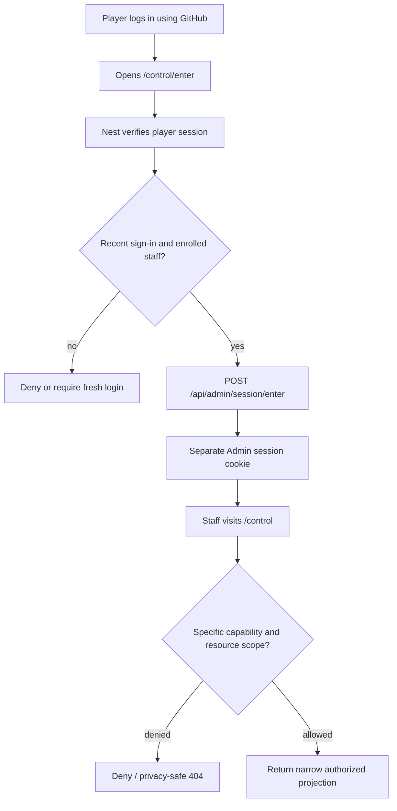
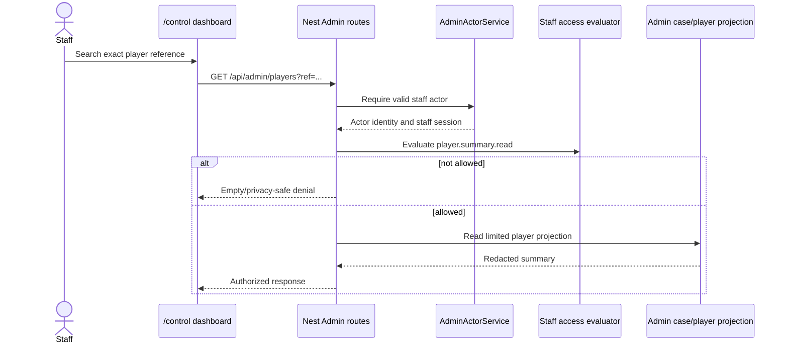

# 14. Admin and support: an entirely separate permission journey

**Question:** How does a logged-in player become a staff actor, view another player's summary or investigate a support case? **Baseline:** source inspected at `e2c0e751` on 2026-11-23. CURRENT SOURCE; no live staff-session smoke or broad authorization review was performed for this documentation. [Platform identity](../technical/platform/identities-and-access.md), [security boundaries](../technical/platform/security-and-trust-boundaries.md). [Human map](00-human-tour.md).

## Player login does not give staff powers

The [Admin enter page](../../apps/web/app/%28control%29/control/enter/page.tsx) explicitly says the visitor is already a *player identity* but must separately enter staff mode. The [EnterAdminSessionButton](../../apps/web/src/features/admin/enter-admin-session.tsx) requests a separate Admin session. [Nest AdminSessionController](../../apps/api/src/modules/admin/controllers/admin-session.ts) handles `POST /api/admin/session/enter`, `GET /api/admin/me`, and `POST /api/admin/session/exit`. The [AdminActorService](../../apps/api/src/modules/admin/admin-actor-service.ts) checks the underlying Better Auth session **and** resolves the separate staff session. Missing fresh identity, enrollment or authority does not grant access.

## A support lookup is not unrestricted database browsing

Admin reads use their own resource-specific permissions. A valid staff session is necessary but **not sufficient**. [AdminPlayersController](../../apps/api/src/modules/admin/controllers/admin-players.ts) has a narrow exact-reference finder and authorized summary read. It explicitly avoids using a broad email search or dumping raw narratives/tokens into a Player 360 list.

## Find the current Admin features

| Human task | Page / API owner | Important restriction |
| --- | --- | --- |
| Enter/exit staff mode | `/control/enter` → `AdminSessionController` | Needs player identity, recent session and enrolled staff |
| Open staff dashboard | [control page](../../apps/web/app/%28control%29/control/%28staff%29/page.tsx) | `requireAdminActor` checks staff mode |
| Find a player | [AdminPlayersController](../../apps/api/src/modules/admin/controllers/admin-players.ts), `GET /api/admin/players` | Exact-ref lookup, permission-gated, privacy-safe output |
| View Player 360 | `GET /api/admin/players/:playerId` | `player.summary.read` for specific target |
| Create / read support cases | [AdminCasesController](../../apps/api/src/modules/admin/controllers/admin-cases.ts) | Capabilities such as `case.create` and `case.summary.read`; linked resources get extra checks |
| Access case-scoped campaign situation | Admin case route in [AdminCasesController](../../apps/api/src/modules/admin/controllers/admin-cases.ts) | Requires the precise authorized case/campaign scope; not a general scene read |
| Investigate audit/evidence | [AdminEvidenceController](../../apps/api/src/modules/admin/controllers/admin-evidence.ts) | Own specific capability checks and redacted data |
| Grant/staff access decisions | [AdminActorService](../../apps/api/src/modules/admin/admin-actor-service.ts) and `@offscreen/admin` | Deny-by-default policies; enrollment alone doesn't imply universal permission |

The API controllers are split by responsibility in `apps/api/src/modules/admin/controllers/`: `admin-session`, `admin-players`, `admin-cases`, and `admin-evidence`. The main `apps/api/src/modules/admin/controller.ts` is a registry/re-export, **not** an 850-line current controller. Avoid old docs that suggest everything still lives there.

## Why Admin was built separately

- **Identity separation:** your normal browser session is not a staff capability.
- **Scope separation:** staff can be permitted to a particular resource or case, not all private player state.
- **Data minimization:** support summaries and evidence often intentionally exclude player content, tokens and raw logs.
- **Auditability:** sensitive actions need a durable actor and explicit authorization, not an unchecked UI toggle.

## Failure paths

| Situation | Correct behavior |
| --- | --- |
| Normal player opens Control without staff enrollment | Denied; no auto-upgrade from player identity |
| Enrolled staff member has an old login | Step-up/fresh sign-in required |
| Valid staff session requests an ungranted player | Privacy-safe refusal, often 404 or limited empty result depending on route |
| Staff can read case metadata but not linked campaign | The second, resource-specific capability check still applies |
| Admin API cannot resolve session | Fail closed rather than assume a staff actor from cached UI data |

**What this page does not claim:** every admin feature has been independently exercised through a live browser; all proposed Admin vision/features are implemented; or a staff actor can impersonate arbitrary players. Inspect [the API Admin README](../../apps/api/src/modules/admin/README.md) and [current STATUS](../../STATUS.md) before promising a capability in the product.
