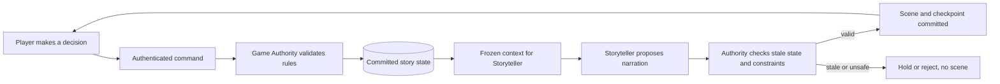
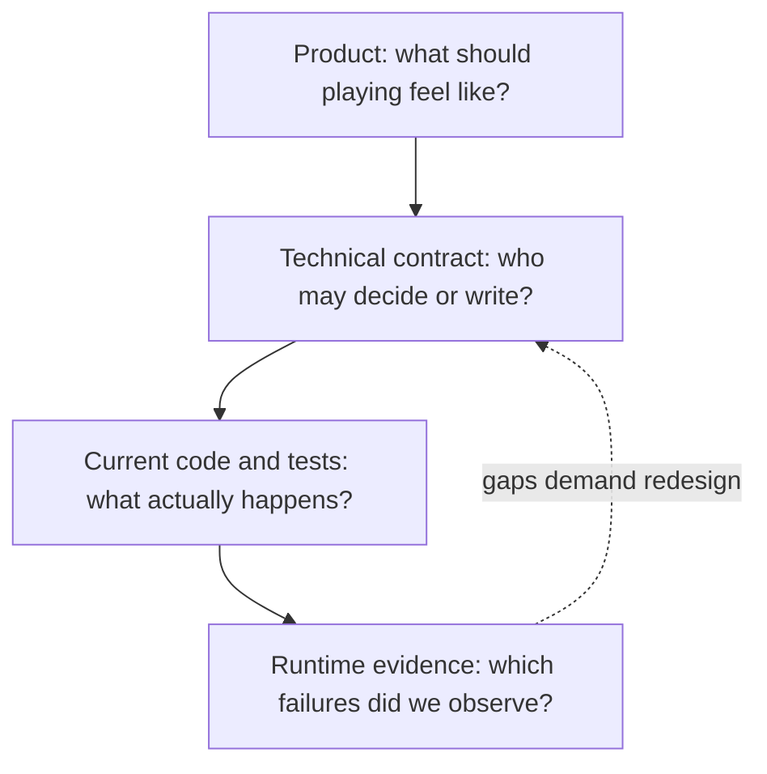

# Architecture atlas | see the game, the system and its failure boundaries

**Storyteller evolution reading rule:** this atlas explains the target selected in product/technical owners. Where an older diagram still shows preview/Start, flat manifests, quiescent-only forks or a universal character/D&D shape, follow the linked permanent owner instead. The target flow is **Play/Story Prompt → writer mission over rooted Library → Game Authority → coherent published scene → review/fork from that exact boundary**.

**For humans first.** This is the visually navigable front door to the architecture, not an alternative source of truth. Product behavior remains under [product](../product/README.md), technical contracts under [technical](../technical/README.md), concrete capabilities under [STATUS](../../STATUS.md), and future implementation work under [Changes](../../work/changes/README.md). The diagrams describe connections, not authority to add mechanics or deploy services.

**Inspection baseline:** code and documents from Git snapshot 584b594 (2026-11-19), supplemented by that day's planning handoffs. **Diagrams are intentionally labeled:**
- **CURRENT SOURCE:** a path or constraint present in inspected code; not necessarily exercised end-to-end or deployed on Kubernetes.
- **SELECTED TARGET:** an architectural behavior/design accepted as the direction, but not necessarily implemented.
- **GAP / PROPOSED:** a known missing link or unresolved choice. No code or deployment is implied.
- **PROOF:** a test or operational observation exists; distinguish unit/local integration from actual cross-Pod evidence.

## The game in one picture

The Storyteller is not the game database, dice roller or wallet. The **application** commits canonical consequences. A model can suggest wording and document changes; validated authority decides which effects become real. An accepted command is not a published scene. See [engine authority](../technical/engine/selected-architecture.md) and [Storyteller publication](../technical/storyteller/generation-and-publication.md).

## Three layers, different questions

Do not infer CURRENT from a SELECTED design or PROOF from passing a fake fixture. This distinction is why some arrows on later diagrams are dashed or tagged target.

## Choose the question you want answered

| Human question | Illustrated chapter | Canonical owner |
| --- | --- | --- |
| What are all the services, and who owns decisions? | [1. System and ownership](01-system-and-ownership.md) | [Topology](../technical/platform/topology.md) |
| What exactly happens between clicking and the next scene? | [2. One Storyteller turn](02-one-turn.md) | [Execution](../technical/platform/execution-and-delivery.md), [publication](../technical/storyteller/generation-and-publication.md) |
| How do SQL, outbox, S3 and Temporal avoid half-written truth? | [3. Data and transaction boundaries](03-data-and-transactions.md) | [Persistence](../technical/platform/data-and-persistence.md) |
| What happens when workers, DB, S3, broker or model fail? | [4. Failure and recovery](04-failure-and-recovery.md) | [Concurrency/recovery](../technical/engine/concurrency-and-recovery.md) |
| How can scene 1 fork after scene 2 without future lore leaking? | [5. Checkpoints and forks](05-scenes-and-forks.md) | [Scene-rooted canon](../technical/storyteller/canonical-documents-and-packages.md) |
| What actually runs in Kubernetes and what is still fake? | [6. Runtime and deployment](06-runtime-and-deployment.md) | [Topology](../technical/platform/topology.md), [runbooks](../runbooks/README.md) |
| How can three Cursor agents work independently on one machine? | [10. Developer environments, illustrated](10-developer-environments.md) | [Developer environment contract](../technical/platform/developer-environments.md), [operating commands](../runbooks/dev-worktree-stacks.md) |
| How do sessions, browser state and SSE preserve truth? | [7. Client and trust](07-client-and-trust.md) | [Client](../technical/client/state-and-server-boundary.md), [identity](../technical/platform/identities-and-access.md) |
| Can we play a campaign while randomly killing Pods without any LLM calls? | [9. Chaos Lab and zero-token play](09-chaos-and-zero-token-play.md) | [K8S10](../../work/changes/open/2026-11-19--k8s10-distributed-fault-and-load-harness/CHANGE.md), [lab protocol](../technical/lab/experiment-protocol.md) |\n| Where do our diagrams expose unanswered design questions? | [8. Assumptions and gaps](08-gaps-and-decisions.md) | [POC source audit](../../work/designs/open/distributed-turn-poc/POC-READINESS-AUDIT-2026-11-19.md) |

**Jump into the actual source:** [API](../../apps/api/README.md), [Game Authority](../../apps/game-authority/README.md), [Worker](../../apps/worker/README.md), [application](../../packages/application/README.md), [workflows](../../packages/workflows/README.md), [DB](../../packages/db/README.md). The source links explain who *currently* implements a concept. The diagrams use shorter readable actor names, not invented package names.

## Diagrams as maintained architecture

The atlas contains Mermaid source right in Markdown. It is readable as text by a coding agent and renderable by GitHub. Prefer flowcharts for ownership/decisions, sequence for causality, state for legal transitions, ER for persistence, and timeline/decision charts only where the type genuinely clarifies something.

For each diagram, preserve: **baseline/status label, a reader question, a link to its canonical owner, at least one meaningful failure or negative when applicable, and a correction when source changes**. These are conceptual views: no diagram should become a second, conflicting source of implementation requirements. A diagram-only edit may still require checking current code. Keep each drawing small enough to read on a phone; use multiple focused pictures rather than one planet-sized chart.

This atlas is the visible start of diagram coverage, **not** a claim that every technical page already has a diagram or that Mermaid has been mechanically rendered by CI. [Diagram maintenance guidance](08-gaps-and-decisions.md#diagram-maintenance-and-proof) names the remaining checks.
