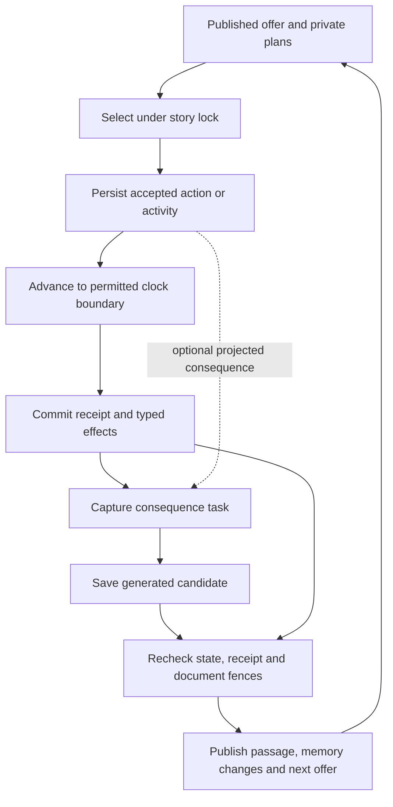

# Engine model and evolution boundaries

This is the implemented engine's conceptual map, source-inspected on **2026-10-23** at gameplay baseline `fc00d13` (documentation baseline `0c05006`). It connects responsibilities and exposes limits; the linked contracts own detailed design. Start with the [one-page product overview](../../README.md); use [progress](../progress.md) for the selected work and [code navigation](code-navigation.md) for file entry points.

## The engine in a few paragraphs

The Storyteller proposes a passage, choices, private executable plans and optional memory changes. The application validates the proposal against captured state, rules, evidence and budget. A visible choice is permission to request its stored plan, not permission for the model to decide the result later. Starting from an authored world/character package is connected; deriving arbitrary executable mechanics from any premise remains unfinished.

Selection admits a commitment. The campaign clock earns fictional time only for its accepted action/activity while permitted to advance. At the appropriate boundary, deterministic rules settle rolls and effects into a receipt. A consequence task narrates that evidence and proposes what follows. Some consequences can be prepared against a projected receipt before settlement; publication must still match the committed result. Quiet work may settle without a model call.

Generation and publication are separate. A successful provider response is a candidate; publication rechecks the story, state and document-root fences before committing a passage and admitted changes. PostgreSQL owns current mechanical state and execution/accounting records. Immutable documents own published narrative and descriptive canon under a database-selected root. The broader plan to move mechanical content into structured documents is incomplete.

Continuity is several connected mechanisms: typed facts/receipts, published passages, retained source-backed notes, versioned descriptive records, scene recall cues and bounded retrieval. Saving something does not ensure a future task selects it; selecting it does not currently guarantee it survives final request packing. That distinction matters more than whether a system has something called “memory.”

## Read the same engine through different lenses

| Lens | Current responsibility and boundary | Deeper owner |
| --- | --- | --- |
| Player agency | Public offers refer to admitted private plans; subsequent choice consumes the current offer. Generated prose cannot grant unsupported mechanics. Broader delegated autonomy is unfinished. | [Gameplay](../gameplay.md), [solo integration](../technical/solo-gameplay-contract.md) |
| Mechanics | D&D-style checks, declared facts/quantities, constrained outcomes and activity definitions. World content supplies meaning; policy validates supported operations. | [Rules/activities](../technical/rules-and-activities.md), [pure game source](../../packages/game/src/immediate-actions.ts) |
| Time | One campaign frontier; accepted action/activity earns time, pause/decision/model holds constrain advancement, obligations can interrupt. Scheduler delay and player deliberation are not fictional labor. | [Committed time](../technical/committed-time.md), [transition policy](../../packages/application/src/campaign/action-execution-transition.ts) |
| Narrative | Profile, current evidence and task purpose shape prose/options. Reports describe historical work without acquiring a new controlling scene. Mechanical outcomes constrain narration. | [Storytelling](../storytelling.md), [runtime](../technical/storyteller-runtime.md) |
| Memory | Sources, notes, descriptive documents and exact retrieval have different authority and lifecycles; scene restart changes the working set, not all persistent history. | [Canonical files](../technical/canonical-files.md), [long-story memory](long-story-memory-and-retrieval.md) |
| Persistence | SQL transactions own command identity and current state; staged immutable objects become visible through a fenced root commit. Storage migration is partial. | [Documents guide](../../packages/documents/README.md), [publication](../../packages/application/src/storyteller/publication.ts) |
| Failure and money | Durable operations, outbox/workflow delivery, generation attempts, reservations and publication state are separate. Uncertain provider delivery needs reconciliation; retry is not a license to reroll or buy another response. | [Application recovery](../../packages/application/README.md#execution-failure-and-retry), [provider dispatch](../technical/provider-dispatch-review.md) |
| Presentation | Next.js consumes public projections; API and workers call shared application operations. A browser demo, fixture rehearsal and real Story run are different evidence. | [Development modes](../development.md), [code map](code-navigation.md) |

## Execution, identities and failure boundaries

| Boundary | What protects it in the inspected source | What this does not establish |
| --- | --- | --- |
| Duplicate/stale selection | `campaign/actions.ts` checks command receipt before expected revision, then current offer/authorization, prerequisites and execution slot under the story lock. | Every possible stale UI or concurrency interleaving has not been exercised in this investigation. |
| Early/duplicate settlement | Clock projection is tied to the accepted execution identity. `action-executions.ts` settles a running execution transactionally; a terminal execution is not resolved again. Controlling obligations can interrupt before its target. | This is not a general multi-actor/capacity scheduler. |
| Delayed/invalid narration | A receipt is authoritative independently of narration. Publication checks projected-result identity/digest and current root/state; a held or rejected candidate cannot rewrite the roll. | A successfully saved response is not evidence that its publication or every memory change committed. |
| Workflow redelivery | Workflows coordinate wakeups and application calls; application/database operations own state. Paid dispatch has its own authority, attempts and uncertainty handling. | Workflow retry settings alone do not prove safe provider retry. The broader failure/hold matrix remains acceptance work. |

Keep these coordinates separate: **operation ID** deduplicates a command; **offer ID** identifies available permission; **execution/receipt ID** identifies accepted work/result; **fictional seconds** measure earned world time; **narrative revision** orders publications; **public view revision** can change with quiet mechanical progress; **document root/revision** fixes knowledge; **task/attempt IDs** identify captured work and provider delivery. None is a substitute for all the others. [Concepts](../concepts.md) owns the vocabulary.

## How narrow are the mechanics?

| Primitive inspected | What it can express now | Evolution pressure |
| --- | --- | --- |
| Character schema | Six ability scores, applicable-ability subset, skills/proficiencies, HP fields, declared facts and quantities | HP fields alone do not implement combat; species-neutral applicability does not make arbitrary premise-to-state creation complete. |
| Action effects | Change an existing quantity; set an existing character fact. Separate receipt-backed story-fact declarations can introduce bounded discoveries. | No general entity-target/HP/possession effect vocabulary in this action path; story-fact update/retirement remains unfinished. The older authored item-transfer path is separate. |
| Finite automatic/check plans | Frozen success/failure outcomes, positive duration, prerequisites and supported roll | A plan must contain the actual outcome; “discover a useful clue” without defining the clue leaves authority unresolved. |
| Processes | Contribution or clock-wait progress, conditions, occurrence policy, scheduled checks, completion effects/follow-up | A capacity label is not implemented shared-capacity arbitration. Broad travel/combat/process families and explicit abandonment remain work. |
| Bounded accepted sequence | Already-offered supported steps can be admitted as a finite chain | This is not an agent inventing its next activities indefinitely while the player is away. |

Sources: [state](../../packages/game/src/state.ts), [effects](../../packages/game/src/effects.ts), [plans](../../packages/game/src/immediate-actions.ts), [activities](../../packages/game/src/activities.ts). When a feature needs a new target, effect or lifecycle, design that typed boundary before asking the Storyteller to narrate it. When it only needs different tone, lore or motivation, use the owning content/profile instead of adding a simulation subsystem.

The [abstract and ordinary-life benchmarks](../playthroughs.md) remain design pressure. A microbe need not acquire a wallet, biography or settlement to satisfy continuity. A quiet routine need not generate a scene at every progress boundary.

## Memory: persistence → selection → final request

| Layer | Current behavior | Diagnostic question |
| --- | --- | --- |
| Exact history and typed state | Committed passages and mechanical receipts preserve what actually happened; current typed state constrains execution. | Was this published/settled, or merely proposed? |
| Continuity notes | Source-backed create/update/retire patches modify retained notes. An empty patch preserves prior notes. Notes require their source passages in context. | What is the retained state after applying patches, and which sources does it require? |
| Descriptive canon | Same-result create/revise proposals can materialize identity, relationship, lore and thread records under the publication fence. | Was a needed record ever proposed and committed? A retrieval fix cannot create it. |
| Selection | Narrative choices have exact document hints. Active-scene cues also feed mechanical tasks. Mechanical choices have no equivalent explicit dependency sidecar yet. | Was the current identity selected, by which path, from which manifest? |
| Packing | At most 64 catalogue entries, eight complete bodies, 4 KiB per body and 12 KiB aggregate in ordinary campaign context. Further whole-request bounding may remove selected bodies. | Does the **final captured request** contain the needed version, with a truthful omission trace? |

Two source-inspected limits need explicit S3 treatment: the loader slices the catalogue before resolving explicit IDs, so an otherwise eligible exact ID beyond that slice is unavailable; the request builder can remove selected documents as it shrinks the request. Neither was reproduced at runtime in this investigation. See [context loading](../../packages/application/src/storyteller/context.ts) and [request packing](../../packages/storyteller/src/context/index.ts). Required versus optional evidence must be explicit before a sidecar can guarantee continuity.

The September 24 v16 responses proposed creating and twice updating a clue note, proposed no descriptive documents in five consequences, then requested scene restart with no document recall cues. The trajectory ended at departure. **It did not demonstrate failed recall after returning.** Raw responses establish proposals; source shows that empty later note patches preserve prior notes if publication commits. Retained database state was not rechecked because Docker was stopped. The [evidence ledger](connected-poc-proof.md#memory-reinspection--2026-10-23) records identities and limits.

## What to evolve next, and what remains uncertain

| Candidate | Information or capability gained | Decision |
| --- | --- | --- |
| Connected continuity slice | Distinguishes retained notes, record creation, dependency selection and final request retention; proves one changed fact survives departure and return. | **Selected S3.** Follow the [bounded phases](../features/2026-09-21--21-56--story-mode-vvardenfell-continuity/PLAN.md), not a blind sidecar-only implementation. |
| More live campaign turns immediately | Reveals model behavior, but leaves the same missing causal evidence and can repeat an already-known gap. | Use a short falsifiable live experiment after the relevant structural change; retain every failed result. |
| Broader mechanics/autonomy | Enables more kinds of life, conflict and absence. | Keep product questions explicit; choose the next mechanic from a concrete playthrough rather than accumulating generic engine primitives. |
| Canonical migration or semantic search | Improves ownership consistency or retrieval reach. | Important later work, but neither by itself explains absent document proposals in a six-generation run. |
| Prompt/profile tuning | May improve materialization or creative adherence. | Inspect the exact packet first. Existing guidance already asks for meaningful entity promotion; adding the same instruction is not a diagnosis. |

We understand the inspected ownership and transition boundaries well enough to design the next bounded slice. We have **not** established arbitrary-world adequacy, sustained recall, owner enjoyment, all recovery interleavings or scalable memory behavior. September live evidence, source inspection and proposed acceptance must remain distinct. The remaining infrastructure limitation affects runtime reinspection, not the ability to prepare the design.

## Maintaining this understanding

This map changes when an authority boundary, executable primitive or connected lifecycle changes. Keep detailed invariants in their technical/source owner and link here. [Documentation maintenance](../../.agents/rules/documentation.md) defines the discovery method. Judge discovery by whether a reader can answer a real question with a small amount of relevant material, not by file count, diagram count or confidence of the recap.

The October rediscovery exposed four maintenance failures:

| Failure encountered | Repair and remaining limit |
| --- | --- |
| A checkpoint's “no notes” diagnosis propagated into several higher-level summaries without checking raw responses. | Corrected the evidence owner and incoming summaries; require proposal/state/input distinctions. Historical database state remains unverified. |
| Product vocabulary, setup guidance and storage status lagged implementation: zero-time actions, disconnected providers and planned exploration. | Corrected those owner sections; explicitly separated storage migration targets from live SQL authority. Other untouched contracts are not certified by this pass. |
| Package/file maps explained where to look but lacked an integrated account of the engine's limits. | Added this conceptual layer and routed it from the onepager, documentation map and code map. The next fresh-context use must judge whether it actually answers questions efficiently. |
| Investigation itself sometimes guessed paths and batched too much text, producing failed lookups and truncated output. | Use file discovery, symbol/heading lookup and bounded excerpts; stop widening when the relevant boundary is known. No measured token/time improvement is claimed. |

A useful future discovery check is to answer, from the overview and this map: who owns an outcome, what advances time, what survives a scene restart, which mechanics can express a proposed feature, and what evidence supports the answer. Follow one source route only for the unresolved part. If these answers still require loading whole packages, repair the missing abstraction instead of accepting that cost as inevitable.
