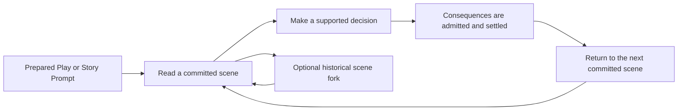

# Product

What players and staff must be able to rely on. Technical guarantees are [technical](../technical/README.md). What is built is [STATUS](../../STATUS.md). Unaccepted drafts are [work/designs](../../work/designs/README.md).

A selected experience target is a product preference, not a demonstration that the experience is playable, coherent, or affordable. [STATUS](../../STATUS.md) records what has been shown. The dated historical [product-reality claim register](../../research/product-reality/CLAIM-REGISTER-2026-11-18.md) records which ambitions lacked that evidence at the November 18 baseline; recheck current STATUS and owners. It adds no rule. Shared play named on a selected page is not delivered and not implemented. Consent, authoritative dice, and no duplicate effects stay binding.

**Current maturity:** this is intended product behavior, not a catalogue of delivered features. Legacy gameplay, Storyteller and player/staff interfaces are exploratory POCs unless the exact capability has affirmative evidence in the [maturity baseline](../../STATUS.md#2026-11-27--capability-maturity-baseline). Selected player rights, authority, consent and safety constraints remain binding even for a POC.

## The player loop, before the infrastructure

This describes product intent. It does **not** assert that every loop, arbitrary premise, long-life scene or fork can already be played. Read [Living Book target](experience/living-book-poc.md), [rules](gameplay/rules.md), [STATUS](../../STATUS.md), and the [visual architecture atlas](../architecture/README.md) for current-versus-target system details.

| Question | Owner |
| --- | --- |
| Is a selected target already feasible? | [STATUS](../../STATUS.md) · [product-reality claims](../../research/product-reality/CLAIM-REGISTER-2026-11-18.md). Selection is not proof |
| What persistent life are we building? | [Vision](foundations/vision.md) |
| How does creation work now? | [Prepared Play / Story Prompt](experience/entry-and-onboarding.md#creation-information-architecture) |
| What is the Storyteller as a writer? | [Investigative writing, revision and delegation](storyteller/behavior-and-quality.md#investigative-writing-revision-and-delegation) |
| What does historical forkability promise? | [Scene history and alternate continuities](foundations/vision.md#scene-history-and-alternate-continuities) · [acceptance narratives](gameplay/acceptance-scenarios.md#storyteller-refoundation-acceptance-narratives) |
| What do the nouns mean? | [Concepts](foundations/concepts.md) |
| What do dice, items and forms promise? | [Rules](gameplay/rules.md) |
| How does an intention become committed work? | [Actions and commitments](gameplay/actions-and-commitments.md) |
| When does time move if nobody accepts an action? | [Pace](gameplay/time-and-autonomy.md#pace) |
| What is remembered, and what is only prose? | [Continuity](gameplay/continuity.md) |
| Which bodies and worlds must work? | [Flexible settings and protagonists](gameplay/worlds-and-characters.md#flexible-settings-and-protagonists). Ability applicability stays on that heading. Sparse identity and pinned starts follow on the same page |
| Which stories define acceptance texture? | [Harbor and return](gameplay/acceptance-scenarios.md#first-solo-acceptance-walkthrough--harbor-and-return) is the first solo acceptance oracle. It is an authored target, not a logged run. [Acceptance scenarios](gameplay/acceptance-scenarios.md) keeps the later wizard and goblin stress vignette. [Long-life benchmark playthroughs](gameplay/long-life-benchmark-playthroughs.md) covers accumulated time. The selected first milestone is solo; see STATUS for what has actually been tested. The small-party ambition is a distant later aspiration, not that milestone. Each decision point names its governing heading |
| What reusable visual language and Storyteller expression may the player experience? | [Design system and expressive worlds](experience/design-system-and-expression.md) |
| What must the screen never fake? | [Principles](experience/principles.md) |
| How does someone arrive and create a life? | [Entry](experience/entry-and-onboarding.md#current-poc-honesty). Prepared starts and Create your own story are both present. The freeform route is not a promise that any premise plays |
| What has been accepted for the first Living Book POC, without approving final art direction? | [Living Book POC](experience/living-book-poc.md) |
| How do choice and waiting feel? | [Play and decisions](experience/play-and-decisions.md) |
| How does return and a long journal work? | [Return and journal](experience/return-and-journal.md) |
| How are the spaces arranged? | [Navigation](experience/navigation-and-stories.md) |
| What controls and accessibility are owed? | [Settings and accessibility](experience/settings-and-accessibility.md) |
| What may presentation claim? | [Presentation](experience/presentation.md) |
| What may the Storyteller do and refuse? | [Behavior](storyteller/behavior-and-quality.md) |
| What creative controls exist? | [Profiles and settings](storyteller/profiles-and-settings.md) |
| How should memory behave? | [Memory](storyteller/memory-and-continuity.md) |
| What may staff do, and what is still only proposed? | [Admin](admin/README.md) |

Shared play and player-facing replay are proposed, not norms: [shared play](../../work/designs/backlog/shared-play/README.md), [player replay](../../work/designs/backlog/player-replay/README.md).

Economy, progression, space, relationships, collaboration, and content policy that are not already selected stay Proposed in the [gameplay domain coverage catalogue](../../work/designs/open/gameplay-domain-coverage/README.md). That catalogue adds no rule.
