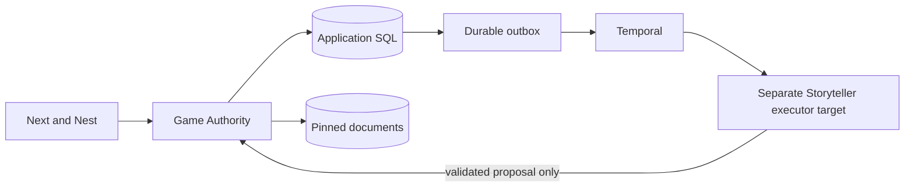

# Technical contracts

## Storyteller evolution | authoritative implementation contracts

| Engineering question | Owner |
| --- | --- |
| Library roots, source roles, exact identity, structural sharing | [Canonical documents and packages](storyteller/canonical-documents-and-packages.md#product-commitment) |
| Context selection, rooted recall and retrieval | [Context selection and recall](storyteller/context-selection-and-recall.md#what-source-enters-this-task) |
| Durable writer mission and provider/cost custody | [Operation and controller](storyteller/operation-and-controller.md#two-loops) |
| Writer tools, skills, Workdesk and delegated research | [Prompts and tools](storyteller/prompts-and-tools.md#selected-compilation-and-tool-contract) |
| Scene publication boundary | [Generation and publication](storyteller/generation-and-publication.md#scene-publication-fence) |
| Direct launch and historical fork lifecycle | [Lifecycle and compatibility](engine/lifecycle-and-compatibility.md#forked-continuities) |
| Post-publication state and Game Authority | [Authority and transitions](engine/authority-and-transitions.md#a-minimum-state-ledger) |
| Fictional time and active commitments | [Chronology and activities](engine/chronology-and-activities.md) · [mechanics and capabilities](engine/mechanics-and-capabilities.md) |

One owner per guarantee. Product intent is [product](../product/README.md). These pages include selected future design. They are not a status report.

## Architecture at a glance

**Selected distributed target illustration, not a live topology inventory.** The [Architecture Atlas](../architecture/README.md) explains the architecture; [STATUS](../../STATUS.md), current source and dated evidence establish realization. The [19 November distributed-turn audit](../../work/designs/archive/distributed-turn-poc/POC-READINESS-AUDIT-2026-11-19.md) is superseded historical evidence, not current readiness. Recheck the owning contracts and source before planning.

| Question | Owner |
| --- | --- |
| What knowledge can a Storyteller read at a forked scene, and what remains only a search candidate? | [Fork-scoped retrieval and task input](storyteller/context-selection-and-recall.md#fork-scoped-retrieval-and-task-input--selected-target-2026-11-19) and [Scene-rooted canon](storyteller/canonical-documents-and-packages.md#scene-rooted-canon-and-fork-safe-publication--selected-target-2026-11-19). Selected target, not proof of working historical recall |
| What is deployed, and who calls whom? | [Topology](platform/topology.md) |
| How should infrastructure commands present plans, status, progress and failures? | [Infrastructure operator experience](platform/infrastructure-operator-experience.md) |
| Who owns dev image build/load, Tilt deployment selection, slot identities and safe backoff? | [Developer environments contract](platform/developer-environments.md) · [human diagram](../architecture/10-developer-environments.md). Selected architecture is distinct from DXK09 integrated/live proof |
| What may the educational laboratory practice, and what is still the current runtime? | [Distributed learning target](platform/topology.md#distributed-learning-target). A selected learning target. Not a deployed cluster, not a broker in the game, and not a replacement of [D-0001](../decisions/D-0001--modular-engine.md) |
| Which proposed service would own a write, and is that service running? | [Proposed service ownership](platform/topology.md#proposed-service-ownership). The linked service-ownership section includes historical proposals; check accepted successors and current source/STATUS for deployment. A Game Economy service was considered and rejected |
| What is a command, a business event, and a workflow? | [Commands, business events, and workflows](platform/execution-and-delivery.md#commands-business-events-and-workflows). The chamber outbox still wakes Temporal. A broker event is not a committed story fact |
| Does a shared database cluster allow every service to write every schema? | [Proposed service schemas and delivery records](platform/data-and-persistence.md#proposed-service-schemas-and-delivery-records). No. A shared logical PostgreSQL cluster does not grant shared schema writes |
| Can a replay duplicate an admitted roll, a story-item transfer, or another committed effect? | [Commands, business events, and workflows](platform/execution-and-delivery.md#commands-business-events-and-workflows). No. An imaginary market is not a service |
| Who owns a committed scene checkpoint for a future fork? | [Proposed service ownership](platform/topology.md#proposed-service-ownership). The engine is the single consistency boundary. See [lifecycle and compatibility](engine/lifecycle-and-compatibility.md#forked-continuities) for the selected contract and STATUS for measured coverage. Historical fixture proof is not arbitrary active-scene or cross-Pod acceptance |
| Is a service command a new player HTTP route? | [Service calls are not player routes](platform/http-api-and-client-contracts.md#service-calls-are-not-player-routes). No route was added |
| Who is logged in, and what may they read? | [Identities and access](platform/identities-and-access.md) |
| What must every player route agree about actor, operation id, 202, GET, and errors? | [HTTP and client contracts](platform/http-api-and-client-contracts.md) |
| Which trust boundary may this actor cross? | [Platform trust boundaries](platform/security-and-trust-boundaries.md) |
| How do local platform capabilities compose? | [Local developer platform](platform/local-developer-platform.md) · [operator guide](../runbooks/local-development-platform.md) |
| How are persistent workstation resource records collected? | [Workstation observability](platform/workstation-observability.md) · [operator guide](../runbooks/workstation-observability.md); source/fixture evidence is not installed collector proof |
| How is optional native Redis installed and operated? | [Native Redis contract](platform/redis-native-infrastructure.md) · [operator failure notes](../runbooks/redis-native-baseline.md); check residual assurance in the owner |
| How is optional native RabbitMQ installed and proved? | [Native RabbitMQ contract](platform/rabbitmq-native-infrastructure.md) · [operator guide](../runbooks/kubernetes-rabbitmq.md); integrated source is not heavy acceptance |
| How is local Temporal deployed, persisted and operated? | [Temporal infrastructure](platform/temporal-infrastructure.md) · [operator runbook](../runbooks/kubernetes-temporal.md) |
| How is optional native Kubernetes observability installed and proved? | [Native observability infrastructure](platform/observability-native-infrastructure.md) · [operator runbook](../runbooks/kubernetes-observability.md) |
| Who owns SQL declarations and database execution? | [Database infrastructure and domain persistence](platform/database-infrastructure.md) |
| How are exceptional local data repairs catalogued and targeted? | [Controlled database operations](platform/database-operations.md). Operator tool in `tools/db-operations`; not application runtime. Live proof separately gated. |
| How is local object storage provisioned and portable S3 bound? | [Native local object storage](platform/object-storage-infrastructure.md). Selected native source integrated; heavy acceptance pending per owning contract. |
| Where does durable state live? | [Data and persistence](platform/data-and-persistence.md) |
| May a cache replace the durable record? | [Redis boundary](platform/persistence-and-caching.md#redis-boundary). Optional acceleration. PostgreSQL remains the record |
| How does a command survive retry? | [Execution and delivery](platform/execution-and-delivery.md) |
| Who may spend on a model call? | [Spending and entitlements](platform/spending-and-entitlements.md) |
| How does a release stay compatible? | [Deployment and compatibility](platform/deployment-and-compatibility.md) |
| How do we reach the player? | [Notifications](platform/notifications.md) |
| What engine are we building, and what did we reject? | [Selected architecture](engine/selected-architecture.md) |
| What may commit a transition today? | [Authority and transitions](engine/authority-and-transitions.md) |
| What may a rule change? | [Mechanics and capabilities](engine/mechanics-and-capabilities.md) |
| When does fictional time advance? | [Chronology and activities](engine/chronology-and-activities.md) |
| Does the landed response-deadline code set mechanical engine policy? | [Decisions with deadlines](engine/chronology-and-activities.md#decisions-with-deadlines). Do not import the narrative-rehearsal default. [Implemented decision deadline](platform/data-and-persistence.md#implemented-decision-deadline) and [Implemented solo response deadline](platform/execution-and-delivery.md#implemented-solo-response-deadline) record that fixture. They are not the policy |
| How do stories start, fork and end? | [Lifecycle](engine/lifecycle-and-compatibility.md) |
| What lock and capture behavior is proved? | [Concurrency and recovery](engine/concurrency-and-recovery.md) |
| How do calendars name the same chronology? | [Calendars](engine/calendars-and-world-time.md) |
| How do ticks and tags work? | [Ticks and tags](engine/ticks-and-tags.md) |
| What are the two Storyteller loops? | [Operation and controller](storyteller/operation-and-controller.md) |
| What may be published? | [Generation and publication](storyteller/generation-and-publication.md) |
| When does the model stop reading? | [Prompts and tools](storyteller/prompts-and-tools.md) |
| What enters one request, and what does it cost? | [Request context and cost](storyteller/request-context-and-cost.md) |
| Where does narrative canon live? | [Context and memory](storyteller/context-and-memory.md) |
| How is a provider call reserved and settled? | [Provider boundary](storyteller/provider-boundary.md) |
| How are story settings versioned? | [Versioned settings](storyteller/versioned-settings.md) |
| How do SSR, cache and commands divide? | [State and server boundary](client/state-and-server-boundary.md) |
| What is the accepted client stack? | [Architecture](client/architecture.md) |
| How do clicks and drafts behave? | [Interaction contracts](client/interaction-contracts.md) |
| How is the first Living Book POC integrated without changing game authority? | [Living Book POC client target](client/living-book-poc.md) |
| How are platform/book tokens and reusable controls owned? | [Semantic design foundation](client/semantic-design-foundation.md) |
| How could source-bound Storyteller art direction be authored? | [Conditional scene production](client/scene-direction-production.md) |
| What visual runtime is selected? | [Presentation runtime](client/presentation-runtime.md) |
| What accessibility and cost bars apply? | [Accessibility and performance](client/accessibility-and-performance.md) |
| What may a staff grant do? | [Admin topology](admin/topology-and-authorization.md) |
| How does the staff console navigate, render and isolate its data? | [Console and read models](admin/console-and-read-models.md) |
| What may an investigation reveal? | [Investigation and privacy](admin/investigation-and-privacy.md) |
| Does an Admin command description grant a write? | [Operational intent is not a raw CRUD mutation](admin/commands-and-audit.md#1-operational-intent-is-not-a-raw-crud-mutation). Selected target. No production write grant. The refusal list is [Negative acceptance](admin/commands-and-audit.md#8-negative-acceptance) |
| What may a forensic reader reconstruct? | [Investigation and reconstruction](observability/investigation-and-reconstruction.md). Proposed read/security contract, not a new grant |
| How is application telemetry separated from durable evidence? | [Telemetry and diagnostics](observability/telemetry-and-diagnostics.md). Application instrumentation recommendation; native platform contract is separate |
| What is a forensic turn capsule? | [Identities and evidence](observability/identities-and-evidence.md#turn-evidence-capsule) |
| Is a raw-artifact retention window already mandatory? | [Retention owner map](observability/retention-and-access.md#owner-map). Unratified recommendation. Candidate day counts are not a grant |
| Does transition capture authorize a writer? | [Capture owner map](observability/capture-and-provenance.md#owner-map). Proposal. No code, schema, or test is authorized |
| How is a Chamber fixture not a gameplay proof? | [Chamber and fixtures](lab/chamber-and-fixtures.md) |
| Which Chamber label is which proof? | [Proof tiers](lab/experiment-protocol.md#proof-tiers). A fixture, a connected smoke, and a manual QA mark are not live player acceptance |

Accepted trade-offs that are not the norm itself: [decisions](../decisions/README.md).

- [Verification programmes: infrastructure, packages and apps](platform/verification-programmes.md)
