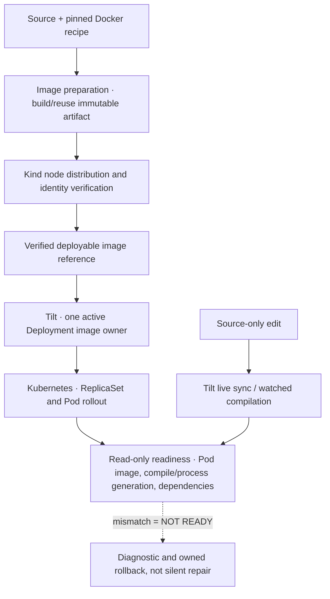

# Development environments | identity, image authority, activation and failure contracts

**Local developer platform direction:** [composition and capability contract](local-developer-platform.md) and [permanent acceptance catalog](../../../infra/verification/CAPABILITIES.md). This document retains environment identity/lifecycle authority. Profile selection remains target-only until implementation and proof.

**Source ownership:** [infrastructure atlas](../../../infra/README.md) owns selected directory layout and release/development terminology. INF01–INF05 relocate source without changing current context, tenant or runtime identities. Existing paths below are observed baseline until corresponding Change integrates.

**Owns:** the selected technical invariants for development environment identity, capacity admission, image/deployment authority and safe park/release. **Does not own:** player/game behavior, the release cluster's acceptance tests, executable commands, or empirical proof. **Status:** selected architecture; distinguish observed DXK09 implementation from unimplemented DXK10 target. **Reviewed against:** the owned-slot receipt at `d0e35b63` (2026-11-23). The earlier `e93f33c7` trial is failure evidence, not the current image path.

Human explanation: [Developer environments, illustrated](../../architecture/10-developer-environments.md). Exact operational route: [Dev runbook](../../runbooks/dev-worktree-stacks.md). Evidence: [DXK09 PROOF](../../../work/changes/open/2026-11-22--dxk09-isolated-parallel-development-stacks/PROOF.md). Resource-lifecycle implementation proposal: [DXK10](../../../work/changes/backlog/platform-operations/2026-11-23--dxk10-demand-driven-dev-lifecycle/CHANGE.md).

## Boundary and topology

- One physical workstation can host two **different purposes**: `kind-offscreen-dev` for disposable developer application runtimes with durable tenant state, and `kind-offscreen-lab` for cold/release/fault acceptance. They are not interchangeable; starting dev never silently mutates the release lab.
- Within the dev cluster, each `dev-N` identity has one Kubernetes application namespace, dynamic local port bundle, own process/session fences, distinct SQL database/login, scoped S3 identity/bucket, Temporal namespace/queues and auth secrets.
- The shared SQL/S3/Temporal **servers** are not duplicated for every Cursor. A tenant is durable, but application Pods need not remain running.
- A Git worktree owns **source files**, not the durable identity of the environment. Explicit source attachment, reservation and active process lease are separate concepts. Current v2 implementation/acceptance details must be read from DXK09's active receipts; the fully decoupled commands remain selected DXK10 behavior.
- Four simultaneously healthy *full* stacks are a separate resource-capacity experiment, **not** a prerequisite for one or three Changes to perform source-only work.

## One owner for the active development image

**Selected decision (2026-11-23):** Tilt is the only active development **Deployment Pod-template desired-state writer**. Image preparation creates or reuses the canonical artifact, distributes it to the required Kind nodes and verifies availability; it must **not patch or scale active Deployments**. Kubernetes performs rollouts from desired Deployment changes. Readiness must be observational, never a repair/controller loop.

**Landed correction:** image preparation writes a content-derived ref and does not patch Deployments. Tilt selects that ref. Readiness accepts a sibling tag only when the running container digest is on the selected image. The `e93f33c7` trial, where the loader also patched `offscreen.dev/image-generation`, remains the failure that this correction replaced.

**Selected image rules:**
1. Artifact identity must be content-derived and correspond to bytes actually loaded into the relevant Kind nodes. A mutable alias being present in `ctr images ls` is insufficient. Docker image config digest, OCI index digest, manifest digest and CRI image ID are different representations; only compare identities that have a proven mapping.
2. Prefer a content-addressed deployment reference and Tilt's custom-build output-reference handoff **if** the active Tilt/Kind custom-build contract supports it. This is an implementation option to verify, not a claim of current API usage. Do not invent a digest conversion or make a mutable alias into an 'immutable' label by renaming it.
3. The image loader **does not** patch Kubernetes Deployments, annotations or Pods; no ad hoc `kubectl delete pod` or polling reconciler may own deployment images.
4. Tilt is the sole owner of desired image selection **after the initial bootstrap handoff**. A startup reconciler may create owned Namespace, Services, Secrets and initial parked Deployments; the handoff must be explicit, and startup must not repeatedly overwrite Tilt-managed active Pod templates.
5. A new verified base-image generation selects a new image in the Deployment and rolls affected roles; an unchanged base generation must not cause needless rollout. Source live-sync updates the compiled/process generation without necessarily building a new base image.
6. Shared union-image content may be reused by Web, API, Authority and Worker roles, but each role retains its own source watcher and its own independent readiness. Image aliasing must not cause one slot or node to adopt another slot's desired state.
7. Readiness requires actual Pod runtime identity and loaded source/process generation to match the desired selection. `Deployment Available`, HTTP 200 or a Temporal worker's `RUNNING` log alone are insufficient. Startup and status share one slot observation (six roles, node image identity, remote compiled generation, in-pod web). A host URL is announced only after this process owns the forward and host HTTP succeeds on that port. The compile supervisor does not start a replacement runtime until the previous child exit is confirmed; a second stop timeout fails the supervisor and drops the ready receipt.
8. A failed image load, stale runtime, conflicting writer, or unverifiable identity returns an explicit failure and triggers **only the attempted owner's** bounded rollback when activation already began. Never conceal drift with a successfully returning `pnpm dev`.

**Source ownership map at inspected integration baseline:**

| Concern | Current source anchor | Selected owner contract |
| --- | --- | --- |
| Runtime orchestration, status, process fencing | `tools/dev-environments/src/application/dev-lifecycle.mjs::runDevTiltLaunch` and `dev-status.mjs::printDevStatus`; `src/cli/dev-tilt.mjs` parses and dispatches | Lifecycle coordinator; cannot be a second live image writer |
| Reservation/session identity | `tools/dev-environments/src/domain/dev-environment-session.mjs` and `dev-worktree-{allocator,registry}.mjs` | Local atomic registry, owned sessions, not Git state |
| Cold slot reconciliation | `tools/dev-environments/src/application/dev-slot-startup.mjs::reconcileOwnedDevSlot` | Provision/bind initial slot resources; hand off active Deployments |
| Graph and initial Kubernetes objects | `tools/dev-environments/src/rendering/dev-slot-app-graph.mjs::renderDevSlotAppGraph` | Consistent renderer and initially parked/bootstrapped objects |
| Tilt graph and application live sync | root `Tiltfile` with `infra/images/development/sync-plan.mjs` | Sole active deployment writer and source-update controller |
| Build and node imports | `infra/images/development/load-dev-slot-image.sh` (`--tilt-ref` for Tilt) | Consolidated preparation contract; no Kubernetes Deployment patch |
| Image fingerprint and reuse | `infra/images/development/image-plan.mjs` | Pure image planning; no hidden Kubernetes mutation |
| Current-generation verification | `tools/dev-environments/runtime/generation.mjs`, `status.mjs`, and `src/application/dev-status.mjs` | Read-only verifier, fail closed; one compile supervisor per compiled role |
| Worker runtime | `apps/worker/src/runtime/index.ts` | Temporal SDK and source/watch compatibility belong to worker runtime, not the image loader |

These anchors describe the inspected integration baseline and the local conflict, **not** a promise that the unintegrated image-refactor branch already follows the target.

## Distinct lifecycle operations

Reserve and attach are implemented as registry-only commands with focused tests. Provision, profile activation, release, and destroy remain selected future behavior.

| Operation | Permitted state change | Forbidden side effect |
| --- | --- | --- |
| Work on a Change | Source/tests only | Implicit environment reservation or startup |
| Reserve | Allocate unique local ID and port bundle atomically | Build, SQL/S3/Temporal provisioning, Pods, listeners |
| Attach | Change verified source binding | Live foreign session takeover |
| Provision | Ensure only needed owned tenant dependencies | Cross-slot DML or credentials; destructive reset |
| Activate(profile) | Start dependency-closed desired roles, verify all | Silent full-stack default for minimal request; routing to foreign services |
| Park/stop | Scale owned active roles to zero and terminate fenced owned processes | Delete tenants, secrets, namespace data or another session |
| Release | End idle reservation after ownership verification | Reassign durable tenant identity to another owner |
| Destroy | Separately authorized destructive disposal | Implicit call from stop, chat exit or Change archive |

Projected slot Secrets are create-only. Reads distinguish present, absent, and unreadable. An existing projected value must match its backing secret or the approved app input; a mismatch refuses with field names and writes nothing. Tokens already present as 48 hex characters stay; a token is generated only when that field is absent. Projection requires a selected owner and the in-process schema proof and does not allocate a slot.

SQL provisioning writes only the selected slot. Registered peer slot ids are a catalog allowlist: existing peer databases are proved and left untouched, and an unknown database refuses the write. Schema projection accepts only the in-process migration proof (slot and applied count matching the verified journal). The runtime role keeps SELECT on the dev schema-gate table and loses INSERT, UPDATE, and DELETE on that table after the migration role records the count.

Reservation, attachment, provisioning and activation are **independent facts**, not one exclusive state enum. Status must reflect all separately and must never mutate anything. Preserve PID + Linux process start ticks, Kubernetes UIDs, canonical checkout path and assigned ports. Do not infer a lease is dead solely from a Cursor chat ending. Retained tenant IDs must remain fenced against reassignment after release.

## Capacity admission and failed-start rollback

- A successful preflight is **not a reservation of memory**. The observed two-full-stack peak was about 2.64 GiB `MemAvailable` and 3.38 GiB swap consumed on the 20 GiB WSL cap; a third full stack has not been demonstrated. Keep the existing 4 GiB full-start admission threshold pending separate measured evidence.
- Evaluate available capacity and foreign owner/port/context conflicts **before** startup mutation. Source-only/unit tests require no Kubernetes activation.
- For a requested set of roles, **all required** roles and host endpoints must be current/healthy within a bounded window. Inactive optional roles are `INACTIVE`, not `NOT READY`; a missing required role cannot borrow another environment's service.
- Ordinary `pnpm dev` refuses a verified running owned session (PID and start ticks) and tells the operator to run `pnpm dev:stop` then `pnpm dev`. It does not replace that session. Occupied ports without a verified owned session refuse; an arbitrary listener is not labeled owned.
- One kernel flock per slot (`registryRoot/operations/<slot>.lock`) covers admission through initial readiness, and `dev:stop`. A second start or stop on that slot refuses immediately with a retry hint. The foreground launcher releases the lock after the session is published. Cleanup of a touched startup is one owned park; a second exit callback does not scale again. Claim parked only after the existing zero-replica predicate. Live cluster proof of this lock is not part of the source receipt.
- If startup fails after mutation, stop owned Tilt/forwarders and park the **entire attempted profile**. Claim parked only when desired replicas are observed at zero. If cleanup fails, emit `rollback-incomplete` with exact affected owned resources. Do not signal a foreign process, delete tenant data, leave healthy fragments running, or claim `PARKED`.
- Never reduce the safety threshold, force stop other Cursors, delete the release lab or hammer an unchanged failed admission in a retry loop. Agents defer work or use cheaper proofs until capacity changes.
- Local DXK09 Cursor receipts report implementation of partial-start rollback with focused tests; live autonomous complete acceptance is still pending at this source checkpoint. DXK10 selectively activates only what is requested.

## Temporal watcher compatibility is separate

The relay on pinned Node 24.19.0 and Temporal SDK 1.24.0 reportedly hit `RangeError: Invalid atomic access index` in a worker-thread callback. The in-flight branch reportedly enabled Temporal's supported `debugMode` only for `OFFSCREEN_DEV_WATCHED_COMPILATION === '1'`, and the worker reached `RUNNING`. **That log is not a workflow-task execution proof.** Main-thread workflow execution changes scheduling/diagnostic behavior and must not be mistaken for release-parity acceptance. Preserve release behavior; prove one real task, stop/restart, and ideally native worker-thread operation independently. Do not treat a worker compatibility issue as an image-generation problem.

## Readiness and evidence ladder

| Claim | Required evidence |
| --- | --- |
| Build/image preparation works | Clean Docker build plus exact node image identity |
| Image selection is correct | One writer, desired Deployment image, running CRI identity and no stale Pod |
| Source edit is current | Changed file → compilation → loaded process generation → endpoint behavior |
| Fully usable developer environment | All requested roles READY, host HTTP, own start/status/stop, data retained |
| Two agents are isolated | Two independent owned source edits, URLs, processes and tenants without cross-mutation |
| Capacity is adequate | Measured simultaneous workload with memory, swap, CPU and connection headroom |
| Game/release behavior works | Separate signed-in story, OAuth, cold-kind release and fault evidence; never implied by green Pods |

Current proof belongs in [DXK09 PROOF](../../../work/changes/open/2026-11-22--dxk09-isolated-parallel-development-stacks/PROOF.md) and [STATUS](../../../STATUS.md), **not** in this selected design. If an implementation contradicts a selected invariant, stop and reconcile the owning contract; don't silently edit the contract to excuse the code.

## Contract dependencies

| Relation | Governing owner |
| --- | --- |
| constrained-by | [Documentation and status distinctions](../../../.agents/rules/documentation.md#documentation-is-the-product-bible--non-negotiable) |
| constrained-by | [DXK09 scope and real proof](../../../work/changes/open/2026-11-22--dxk09-isolated-parallel-development-stacks/CHANGE.md) |
| informative implementation proposal (not authority over this selected contract) | [DXK10 reserved/active/retained lifecycle packet](../../../work/changes/backlog/platform-operations/2026-11-23--dxk10-demand-driven-dev-lifecycle/CHANGE.md) |
| co-change | [Operator runbook](../../runbooks/dev-worktree-stacks.md) and [human diagram](../../architecture/10-developer-environments.md) |
