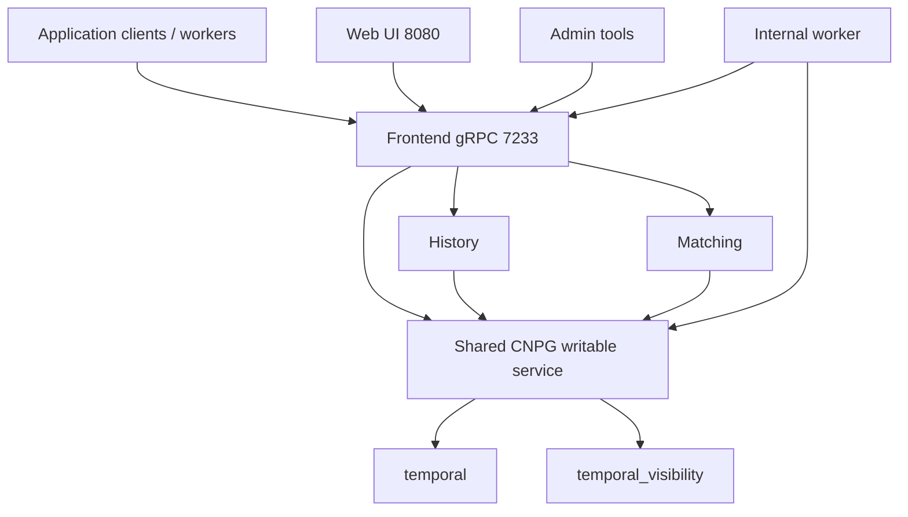

# Local Temporal infrastructure

**Selected and implemented local architecture, 2026-11-26.** Development install and repeat ensure observed; release and complete cold-cluster reproduction not yet proven. This is the infrastructure contract, not application workflow semantics ([execution and delivery](execution-and-delivery.md)), hosted architecture, or a promise of high availability. [Operator procedure](../../runbooks/kubernetes-temporal.md) · [observed evidence](../../../evidence/runs/2026-11-26-temporal-platform.md).

## Ownership and topology

One native upstream Helm release named `temporal` per local Kind cluster. No repository-owned Temporal chart, embedded PostgreSQL Deployment, Temporal PVC, per-slot server, or extra Temporal operator. Helm owns workload deployment and vendor schema hooks; CNPG owns the existing PostgreSQL cluster and database/role resources; environment lifecycle owns application Temporal namespaces. Application workers are not the Temporal server's internal worker.

| Environment | Kubernetes context | Temporal Kubernetes namespace | Writable PostgreSQL endpoint |
| --- | --- | --- | --- |
| Development | kind-offscreen-dev | offscreen-dev-temporal | dev-pg-rw.offscreen-dev-postgres.svc:5432 |
| Release | kind-offscreen-release | lab-temporal | lab-pg-rw.lab-postgres.svc:5432 |

One replica each of frontend, history, matching, internal worker, web and admin tools. Server role requests 100m CPU / 512Mi memory each; web and admin 50m / 128Mi each (steady request total 500m / 2304Mi). Requests are not usage or limits. Frontend has ClusterIP RPC 7233 and HTTP 7243; four headless membership/metrics Services and web ClusterIP 8080. No ingress, NodePort or LoadBalancer. The web and admin tools are trusted-local operations, not application authorization. Metrics annotations enable scrape on 9090; no ServiceMonitor. Monitoring integration is not proven.

## Configuration and source owners

| Source | Responsibility |
| --- | --- |
| [chart.pin](../../../infra/platform/temporal/chart.pin) | Upstream chart 1.8.0, released archive URL and SHA-256 |
| [values.yaml](../../../infra/platform/temporal/values.yaml) | Server/admin 1.32.2, UI 2.58.1, immutable OCI index digests, common configuration and resources |
| [profiles](../../../infra/platform/temporal/profiles) | Only the two SQL endpoint overrides |
| [install.mjs](../../../infra/platform/temporal/install.mjs) | Verified archive acquisition, fresh install, exact-match no-op, admission and lock |
| [readiness.mjs](../../../infra/platform/temporal/readiness.mjs) | Read-only Helm/ownership/rollout/image/frontend RPC observation; web readiness separate |
| [namespaces.mjs](../../../infra/platform/temporal/namespaces.mjs) | Bounded describe/create adapter for explicit application namespaces |
| [PostgreSQL persistence declarations](../../../infra/platform/postgres/temporal-persistence/resources.yaml) and [preparation](../../../infra/platform/postgres/temporal-persistence/prepare.mjs) | Fresh role/database creation and catalog/authentication gates |

The versioned files are authoritative for exact pins; do not duplicate digests into scripts. Both profiles use the same topology and values except endpoints and Kubernetes namespace. History shard count is 512 and immutable for an initialized store. Use upstream postgres12 SQL plugin on existing compatible CNPG; dev PostgreSQL 18.7 was observed. No Elasticsearch, broker or Redis required by Temporal. PostgreSQL tuning and internals may be redesigned separately; preserve this persistence contract rather than the current helper structure.

## Persistence and credentials

Dedicated SQL databases `temporal` (history) and `temporal_visibility` (visibility), one scoped owner/login `temporal`, no superuser/createdb/createrole/replication/bypassrls/inherited memberships. CNPG DatabaseRole and Database CRs retain SQL resources. Kubernetes Database names temporal and temporal-visibility. Basic-auth source Secret temporal-db in PG namespace; projection with same name in Temporal namespace; username/password through stdin and Secret references, never Git, values, argv or logs. No automatic rotation.

Fresh provisioning refuses pre-existing or unreadable identities, checks unrelated non-template connectable databases for PUBLIC CONNECT, creates non-login role and closed stores, revokes PUBLIC CONNECT/TEMPORARY on these two databases only, verifies ownership/ACLs, opens through CNPG, verifies empty owner-writable public schema and no unrelated non-template DB CONNECT, then enables login and verifies actual credentials against both stores. CNPG owns Secret RBAC and may reconcile asynchronously; wait for applied/current generation and semantic spec, not raw serialization. Verify credential resourceVersion before success. Do not silently change unrelated ACLs. Release baseline was observed with default PUBLIC CONNECT on lab and postgres; normal ensure refuses until isolation is resolved through separately authorized PostgreSQL work. No exception implemented.

Chart has createDatabase false, manageSchema true; upstream pre-install/pre-upgrade Job initializes vendor schemas (two sequential init containers, deadline 240s, backoff 1), not application migrations. Successful install includes schema hooks, but ordinary readiness does not query schema version or prove workflow recovery. Partial schema writes are possible; no automatic rollback, adoption or retry.

## Lifecycle and evidence

Use public platform plan/up/status/render commands, not a parallel installer. Fresh ensure checks explicit context/host memory, holds a per-context local flock, verifies pinned HTTPS archive bytes before durable writes, requires absent Helm release and absent Temporal Kubernetes namespace, prepares PG, projects Secret, invokes native Helm with bounded waits, then checks readiness. A deployed matching release with healthy core and web is unchanged; mismatched/pending/failed/unreadable release or foreign/partial namespace refuses. No automatic upgrade, repair, deletion, downgrade or credential rotation. A deliberate UI-only maintenance upgrade was observed; generic repository-controlled upgrades remain unimplemented.

Core readiness requires owned namespace and Helm resources, current ready deployments with intended image pins, frontend ClusterIP/selector/7233 and RPC health SERVING. Admin tools included; UI readiness separate and does not guarantee browser execution. No per-slot installation. Dev slot startup registers/verifies its explicit durable Temporal namespace (one-day retention for new registration), not a default fallback; release explicitly uses default (three days when newly created). Existing namespaces are not silently changed. Actual namespace JSON compatibility, slot activation and release default registration still need live proof. Parking preserves tenant histories. Deleting the Kubernetes Temporal namespace does not itself delete the external CNPG stores; deleting the Kind cluster can destroy local persistent state. Neither is a backup.

Observed development: native installation 66s, six ready Pods, six Services, no Temporal PVC, both database CRs and role applied, RPC SERVING; initial namespace list only temporal-system. UI corrected from 2.56.1 to 2.58.1 for Chrome CSP; only web Pod replaced, revision 2, browser worked after restarting loopback port-forward. Repeat ensure 2s. Both original integrated renders had 16 resources; final updated UI dev render succeeded. See [evidence](../../../evidence/runs/2026-11-26-temporal-platform.md). Not proven: release ACL correction/install, fresh clone/cold cluster, namespace lifecycle, workflow execution/history/restart/failover/restore, hosted security/HA, generic upgrades and CNPG normalization-specific regression test. Retired legacy embedded-database tests do not certify this architecture.
