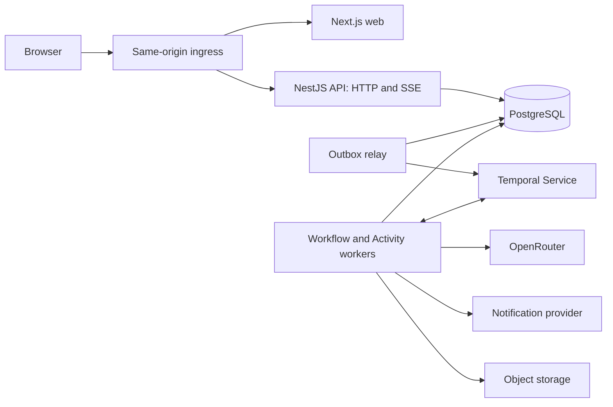

# Technical architecture

This is the implementation design; the [implementation overview](../../../STATUS.md) tracks coverage and current priorities, while the [development guide](../../../docs/runbooks/local-development.md) explains how to run and test existing code. The design supports the [product walkthrough](../../product/gameplay/acceptance-scenarios.md). Product choices still open in [questions](../../../work/designs/open/product-open-questions.md) remain open; a technical example does not decide them. Dependencies are pinned and integration-tested as each component is introduced. Build the broader application with scripted substitutes before connecting paid services.

The current application shape is [Recommendation](#recommendation) and [Runtime shape](#runtime-shape). The additional educational laboratory is [Distributed learning target](#distributed-learning-target). That laboratory is not a description of the running system.

## Who owns the boundary

| Boundary | Owner |
| --- | --- |
| Sessions, invitations, and membership | [Authentication and sessions](./identities-and-access.md#authentication-and-sessions) |
| Entitlement | [Distinct authorities](./spending-and-entitlements.md#distinct-authorities) |
| Funding allowance | [Distinct authorities](./spending-and-entitlements.md#distinct-authorities) |
| Task recipe | [Distinct authorities](./spending-and-entitlements.md#distinct-authorities) |
| Usage window | [Distinct authorities](./spending-and-entitlements.md#distinct-authorities) |
| Creative setting | [Settings with distinct meanings](../../product/storyteller/profiles-and-settings.md#settings-with-distinct-meanings) |
| Notification delivery | [Delivery flow](./notifications.md#delivery-flow) |
| Selected topology | This page: [Runtime shape](#runtime-shape) for the application, and [Distributed learning target](#distributed-learning-target) for the educational laboratory |
| Compatibility | [First hosted deployment](./deployment-and-compatibility.md#first-hosted-deployment) |

Selected topology stays on this page.

## Recommendation

Build a TypeScript modular monolith with a React/Next.js frontend, a NestJS API and Temporal workers. PostgreSQL owns committed application data; Temporal owns durable workflow execution and timers. Local development stays on containers and Compose. Kubernetes is a separate educational laboratory, specified in [Distributed learning target](#distributed-learning-target). That laboratory is not this table, and it is not a claim that a cluster is running.

| Area | Recommended starting point | Reason and boundary |
| --- | --- | --- |
| Repository | pnpm workspaces + Turborepo | Shared packages, one lockfile, repeatable task graph and build caching. No custom monorepo framework. |
| Application language | TypeScript in strict mode | Share contracts and selected pure logic. SQL migrations and infrastructure configuration still use their natural formats. |
| Frontend | React + Next.js App Router | Public pages can be prerendered; authenticated story screens use dynamic data and client interaction. |
| Backend | NestJS, initially its Express adapter | Clear application modules, dependency injection and HTTP integration. No Nest microservice transports. |
| Database | PostgreSQL + Drizzle + reviewed SQL migrations | Relational integrity and transactions, with JSONB for flexible narrative content. |
| Durable execution | Temporal TypeScript SDK and Temporal Service | Story workflows, timers, message handling and bounded Activities. The application path has no separate background-job broker. A laboratory broker is [Distributed learning target](#distributed-learning-target), not this row. |
| Browser updates | HTTP commands + Server-Sent Events | Players submit occasional actions; the server publishes committed changes. Bidirectional sockets are unnecessary initially. |
| Authentication | Better Auth with GitHub OAuth | Library-managed identity/sessions through its Node handler in the Nest Express server. |
| Models | OpenRouter behind a small application adapter | One initial gateway with controlled model/provider selection. No LiteLLM service initially. |
| AI workflow | Bounded TypeScript steps orchestrated by Temporal | Model calls and tools execute as Activities. LangGraph is only an optional graph abstraction if agent complexity warrants it. |
| AI observability | Proposed: OpenTelemetry-compatible traces; Langfuse as the proposed AI destination | Proposed observer path. Inspect prompts, attempts, quality and cost without making telemetry part of story correctness. No inspected proof on this page that either service is deployed or tested. |
| Media | Object storage with an S3-compatible interface | Database stores metadata and references, not large image blobs. |

Turborepo understands workspace packages and the lockfile; its role here is task execution and caching, not architectural enforcement. Package exports and import rules establish boundaries. [Turborepo repository structure](https://turborepo.dev/docs/crafting-your-repository/structuring-a-repository).

## Runtime shape



The API and Activity workers share application modules and PostgreSQL access without depending on each other. Workflow code is a separate deterministic bundle that calls Activities rather than importing database or network clients. The Chamber and integration workspaces compose deployables only for local development and tests. Long model calls and delivery work do not occupy HTTP request lifetimes. Processes can be scaled differently while remaining one modular application. Temporal is infrastructure, not a reason to split the game into microservices.

A diagram of future infrastructure is not a claim that the service is deployed and tested. OpenTelemetry and Langfuse stay planned on the [recommendation](#recommendation) table. Demonstrated coverage is [capability coverage](../../../STATUS.md#capability-coverage).

The outbox relay forwards durable database notices into Temporal using stable identifiers. Temporal Service has its own managed persistence; its history tables are not application tables. Browser reads come from application PostgreSQL snapshots, not directly from workflow history.

There is no service per faction, inventory, storyteller or notification type. Extract a service only when a measured scaling, ownership or isolation requirement pays for independent deployment, contracts and failure handling. Kubernetes would not change this decision: it can host a monolith.

This diagram is the current selected application shape. The educational laboratory does not replace it. Hosting these same processes on Kubernetes would still be one modular application. Independently deployable skeletons belong to [Distributed learning target](#distributed-learning-target) and are not deployed by this diagram.

## Distributed learning target

Selected educational target, recorded 2026-11-19. This section is the only platform contract for that laboratory. It is not the current runtime, not [First hosted deployment](./deployment-and-compatibility.md#first-hosted-deployment), and not a player-facing feature. [D-0001](../../decisions/D-0001--modular-engine.md#continuity-on-2026-11-19) records the same limit: the modular engine stays, and only the deferral of a learning environment moves.

| Reading | What is selected or observed | What this reading does not say |
| --- | --- | --- |
| Current implementation | Docker Compose runs PostgreSQL, Redis, Temporal's development server, and an S3-compatible mock. The application is a modular monolith: web, API, and Temporal workers share packages. Inspect `compose.yaml`. | The game is not deployed on Kubernetes. RabbitMQ, CloudNativePG, a production Temporal cluster, and separately deployed game services are not in that Compose file and are not deployed. |
| Working engine | [D-0001](../../decisions/D-0001--modular-engine.md) and [Alternatives that lose for now](../engine/selected-architecture.md#alternatives-that-lose-for-now). PostgreSQL owns committed story state. Rules stay pure. The Storyteller proposes and does not commit. | A process split does not move those owners. Event-sourced microservices remain rejected. An LLM-led chat remains rejected as mechanical truth. |
| Educational laboratory | The owner chose to practice a local Kubernetes environment on purpose: a disposable cluster, durable PostgreSQL under an operator, a message broker, Redis as a disposable cache, S3-compatible object storage, a Temporal deployment with its own persistence, observability, and independently deployable service skeletons. The first exercised slice is the kind procedure in [Kubernetes lab](../../runbooks/kubernetes-lab.md). A 2026-11-19 run created that cluster, passed its probes, and deleted it. | The kind procedure is not the hosted release and not the running game. RabbitMQ, CloudNativePG, a production Temporal cluster, and service extraction remain unbuilt. A broker message is not a committed story fact. Redis is not application authority. Object storage is not the story transaction. A service skeleton is not an extracted game module. |

The application path stays the [runtime shape](#runtime-shape) above. [Commands and durable delivery](./execution-and-delivery.md#commands-and-durable-delivery) remains the bridge from the transactional outbox to Temporal. [Who owns the durable record](./data-and-persistence.md#who-owns-the-durable-record) remains the storage split. [Redis boundary](./persistence-and-caching.md#redis-boundary) remains the cache rule, including inside the laboratory. Compose remains the local development route until a later Change proves a replacement. This section does not delete it.

The laboratory may host the same modular application before it hosts any extracted service. There is still no service per faction, inventory, Storyteller, or notification type. Staff access stays a logical control plane inside the application, as [Dependency and trade-off rationale](../admin/topology-and-authorization.md#7-dependency-and-trade-off-rationale) already requires. A later skeleton Change has to name a process boundary and an event contract without moving rule ownership.

Negative: a diagram, a Change packet, or a running disposable cluster does not mean RabbitMQ, six microservices, a production Temporal cluster, or Kubernetes are the deployed game. Game truth and deterministic rule ownership do not move because processes are split.

## Code organization

For current entry points use [apps/api](../../../apps/api/README.md), [packages/application](../../../packages/application/README.md), and [packages/storyteller](../../../packages/storyteller/README.md). The [2026-11 code-navigation inspection](../../../evidence/inspections/doc01-retained-observations/engineering/code-navigation.md) is dated evidence, not the current owner. This document owns the architectural design.

Target layout. Create each package when its first implementation needs it:

```text
apps/
  web/                 Next.js presentation
  api/                 HTTP, auth integration, SSE, webhooks
  worker/              Temporal worker bootstrap and Activity bindings
tools/
  chamber/             local authenticated product launcher
  api-integration/     PostgreSQL, Temporal and browser integration harness
packages/
  game/                framework-free game state, checks, effects, offers and time
  contracts/           Zod schemas, transport types, public error shapes
  workflows/           deterministic Temporal workflows and message contracts
  application/         use cases, transactions and application adapters
  db/                  Drizzle schema, migrations, database access
  storyteller/         profiles, context, tasks, planning, providers and fixtures
  config/              validated environment and build configuration
```

Keep UI components inside `web` until another application genuinely shares them. Keep server packages out of the browser dependency graph. Sharing TypeScript does not mean exporting database rows, secrets or hidden storyteller plans to clients. Runtime validation is necessary for HTTP, jobs, model output and stored versioned JSON; TypeScript types disappear at runtime.

Keep dependencies directional: `game` depends on no application package, runtime framework or database; `contracts` projects game values into transport validation without application imports; `application` composes `game`, `contracts`, `db` and `storyteller`. `workflows` imports only deterministic helpers and type-only Activity contracts, never NestJS, database clients or provider SDKs. Activity implementations live outside the workflow bundle. The Storyteller package receives constrained context/tool adapters rather than importing the application orchestrator back. Enforce these boundaries through package exports and import checks instead of trusting folder names.

Application capabilities cover drafts, story lifecycle, campaign mechanics, generation, Storyteller execution, outbox delivery and developer tools. `@offscreen/application/stories` is the public story facade; initialization, continuation, timing and snapshot/history reads are story-local modules behind it. Authored Chamber fixtures are selected through one closed catalog exposed by the developer-tools facade. The worker maps outbox topics to workflow start or wake in one dispatch table. Modules expose application operations rather than letting every caller update arbitrary tables. A story transition can coordinate those operations in one database transaction. Do not introduce a repository interface for every table or an event bus for every local function call.

## Storage choices and alternatives

PostgreSQL fits memberships, ownership, deadlines, ordered chronology and atomic state changes. Flexible lore is not a reason to select MongoDB: put variable descriptive fields in JSONB while keeping constraints and relationships explicit. This is a fit judgment, not a claim that MongoDB cannot transact.

Drizzle is recommended because this design needs visible SQL, constraints and locking. Prisma is a viable alternative if its development experience is preferred; neither removes the need to understand transactions. Use generated SQL migrations that are reviewed before application, not automatic schema pushing in production. [Drizzle transactions](https://orm.drizzle.team/docs/transactions), [migrations](https://orm.drizzle.team/docs/migrations).

Redis is optional for measured read-cache, distributed rate-limit or live fan-out needs. It is never application authority and is not part of the minimum execution stack. Cacheable projections use the owner-scoped, version-addressed cache-aside contract in [Persistence and caching](./persistence-and-caching.md); commands and transactional workers always recheck PostgreSQL. Kafka and separate document, graph or vector databases have no demonstrated first-version requirement.

## What handles events and background work

| Need | Mechanism |
| --- | --- |
| A journey wait, deadline or paused story | Temporal workflow and durable timers. |
| Player input reaching a running story | Persisted command receipt, outbox relay and Temporal Signal. |
| Model call, image generation or notification send | Temporal Activity, or a bounded delivery workflow where independence is needed. |
| Database commit that must trigger external work | Transactional outbox with stable IDs and retryable delivery. |
| New scene reaching connected browsers | SSE, snapshots and lightweight live-change hints. |
| A local module informing another module | A direct application call unless durable decoupling is actually needed. |

The application path still does not use a separate event broker. Temporal Task Queues dispatch workflow and Activity work; they are not general application publish/subscribe. [Commands and durable delivery](./execution-and-delivery.md#commands-and-durable-delivery) remains the bridge from the transactional outbox to Temporal, and polling that outbox is enough for the bridge. The educational laboratory may practice a broker such as RabbitMQ before a measured production need exists. A message on that broker is not a committed story fact. Keep the application outbox relay narrow; do not grow subscriber routing, per-subscriber backlogs, and dead-letter administration into a homemade broker.

### Gameplay transitions and durable follow-ups

An admitted command or timer wake loads and locks authoritative state, then a purpose-specific policy describes a typed transition. The transition separates three concerns: the next authoritative state, durable domain facts for chronology/audit, and explicit follow-up intents such as scheduling work or preparing narration. The application transaction applies the state and facts and records any durable follow-up in the transactional outbox before committing. Temporal performs the follow-up after commit and rechecks authority at its application entry point.

This event-oriented boundary does not make campaign state event-sourced. Current state remains an authoritative PostgreSQL projection, and facts that must agree—clock position, roll, effects, receipt and lifecycle state—commit atomically. Local invariant-preserving work remains a direct typed call. Do not replace readable coordination with a generic in-process event bus or invisible subscribers. A timer identifies work that may be due; it does not decide the mechanic, narration policy or next gameplay mode.

Finite actions and activities may share lifecycle facts and follow-up intent delivery while retaining distinct resolution policies. Generality here means exhaustive types and replaceable policy boundaries, not a universal JSON execution object.

## User-flow contracts

| Player flow | Defining technical contract |
| --- | --- |
| Sign in or follow an invitation | [Client and identity](./identities-and-access.md): return destination, session, redemption and access. |
| Edit, generate, review and start | [Story lifecycle](../engine/lifecycle-and-compatibility.md): draft/candidate revisions and one live initialization. |
| Choose, wait, interrupt, pause or resume | [Execution](./execution-and-delivery.md): command admission, timers, resolution and commit fences. |
| Interpret a choice and prepare what follows | [Storyteller runtime](../storyteller/operation-and-controller.md): proposal boundaries and conditional publication. |
| Leave and return on another device | [Return and journal](../../product/experience/return-and-journal.md) for the player promise; [client architecture](../client/architecture.md) for the snapshot read. |
| Hear about a decision away from the browser | [Notifications](./notifications.md): subscription ownership, delivery and expiry. |
| Reach a limit, lose a participant or finish | [Story lifecycle](../engine/lifecycle-and-compatibility.md): holds, access changes and terminal states. |
| Keep memories and spending coherent | [Data](./data-and-persistence.md) and [context and cost](../storyteller/request-context-and-cost.md). |

These contracts are enough to build the first integrated slice. They are not proof of implementation correctness or evidence that open play policies have been decided. Group input, autonomy, pace and funding choices must be selected before implementing the affected resolution rules.

## Scale targets and current limits

Design for growth toward thousands of active stories and, later, larger shared worlds. These are distinct loads: many independent stories distribute naturally, while many participants touching the same scene or object contend on shared state. No current benchmark establishes either capacity. The chamber is owner-only and uses one current passage and a short story-row lock; multiplayer is not available by raising a configuration limit.

Keep work bounded: paginated history, compact workflow references, limited database pools, bounded generation concurrency and fair admission across accounts/stories. A hundred participants should not automatically trigger a hundred model calls for the same shared outcome. Batch intentions only where the declared decision policy permits it; independent scenes need independent progress. Worker replicas and Temporal alone do not remove database contention or provider limits.

Before claiming capacity, run a scripted workload with many idle stories, a burst of simultaneous deadlines, reconnecting clients and a busy shared scene. Measure command latency, deadline-to-publication delay, lock waits, outbox backlog, worker saturation and database connections. Add slow fake generation and verify that one busy story cannot monopolize generation or delay control operations. The chamber's two-second snapshot polling is a development mechanism; measure its request load and replace it with scoped updates/reconnect recovery before using it as a large public deployment pattern.

## Where to go deeper

- [Data](./data-and-persistence.md): durable records, constraints and flexible content.
- [Story lifecycle](../engine/lifecycle-and-compatibility.md): draft, preview, start, holds, membership and completion.
- [Execution](./execution-and-delivery.md): time, scheduling, races and recovery.
- [Identity and access](./identities-and-access.md): sessions, invitations and membership. Frontend and transport: [client architecture](../client/architecture.md). Shared play stays [proposed](../../../work/designs/open/shared-play/README.md).
- [Storyteller runtime](../storyteller/operation-and-controller.md): model routing, tools and bounded workflows.
- [Context and cost](../storyteller/request-context-and-cost.md): memory, caching, prompts and spending.
- [Notifications](./notifications.md): reaching the player away from the page.
- [Delivery and validation](./deployment-and-compatibility.md): deployment, tests, telemetry and build sequence.
