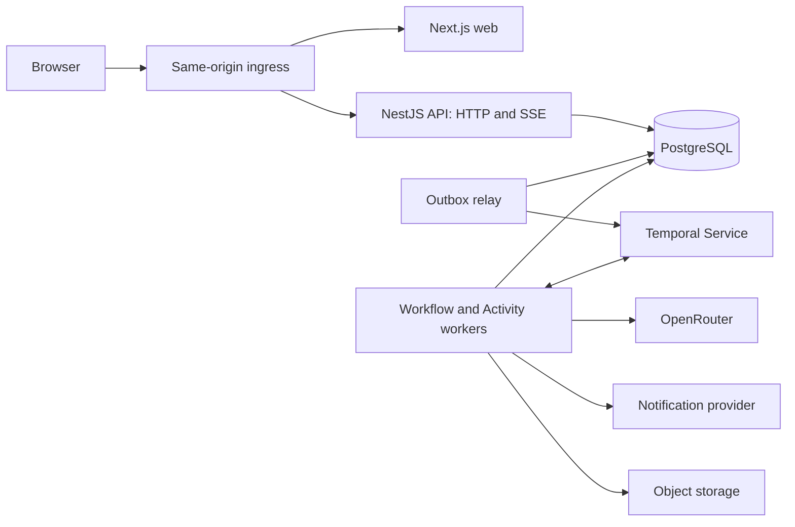

# Technical architecture

This is the implementation design; the [implementation overview](../../../STATUS.md) tracks coverage and current priorities, while the [development guide](../../../docs/runbooks/local-development.md) explains how to run and test existing code. The design supports the [product walkthrough](../../product/gameplay/acceptance-scenarios.md). Product choices still open in [questions](../../../work/designs/open/product-open-questions.md) remain open; a technical example does not decide them. Dependencies are pinned and integration-tested as each component is introduced. Build the broader application with scripted substitutes before connecting paid services.

The current application shape is [Recommendation](#recommendation) and [Runtime shape](#runtime-shape). The additional educational laboratory is [Distributed learning target](#distributed-learning-target). Proposed process ownership, still unextracted, is [Proposed service ownership](#proposed-service-ownership). The laboratory and that ownership are not a description of the running system.

## Who owns the boundary

| Boundary | Owner |
| --- | --- |
| Sessions, invitations, and membership | [Authentication and sessions](./identities-and-access.md#authentication-and-sessions) |
| Entitlement | [Distinct authorities](./spending-and-entitlements.md#distinct-authorities) |
| Funding allowance | [Distinct authorities](./spending-and-entitlements.md#distinct-authorities) |
| Task recipe | [Distinct authorities](./spending-and-entitlements.md#distinct-authorities) |
| Usage window | [Distinct authorities](./spending-and-entitlements.md#distinct-authorities) |
| Creative setting | [Settings with distinct meanings](../../product/storyteller/profiles-and-settings.md#settings-with-distinct-meanings) |
| Notification delivery | [Delivery flow](./notifications.md#delivery-flow) |
| Selected topology | This page: [Runtime shape](#runtime-shape) for the application, [Distributed learning target](#distributed-learning-target) for the educational laboratory, and [Proposed service ownership](#proposed-service-ownership) for the unextracted process contract |
| Compatibility | [First hosted deployment](./deployment-and-compatibility.md#first-hosted-deployment) |

Selected topology stays on this page.

## Recommendation

Build a TypeScript modular monolith with a React/Next.js frontend, a NestJS API and Temporal workers. PostgreSQL owns committed application data; Temporal owns durable workflow execution and timers. Local development stays on containers and Compose. Kubernetes is a separate educational laboratory, specified in [Distributed learning target](#distributed-learning-target). That laboratory is not this table, and it is not a claim that a cluster is running.

| Area | Recommended starting point | Reason and boundary |
| --- | --- | --- |
| Repository | pnpm workspaces + Turborepo | Shared packages, one lockfile, repeatable task graph and build caching. No custom monorepo framework. |
| Application language | TypeScript in strict mode | Share contracts and selected pure logic. SQL migrations and infrastructure configuration still use their natural formats. |
| Frontend | React + Next.js App Router | Public pages can be prerendered; authenticated story screens use dynamic data and client interaction. |
| Backend | NestJS, initially its Express adapter | Clear application modules, dependency injection and HTTP integration. No Nest microservice transports. |
| Database | PostgreSQL + Drizzle + reviewed SQL migrations | Relational integrity and transactions, with JSONB for flexible narrative content. |
| Durable execution | Temporal TypeScript SDK and Temporal Service | Story workflows, timers, message handling and bounded Activities. The application path has no separate background-job broker. A laboratory broker is [Distributed learning target](#distributed-learning-target), not this row. |
| Browser updates | HTTP commands + Server-Sent Events | Players submit occasional actions; the server publishes committed changes. Bidirectional sockets are unnecessary initially. |
| Authentication | Better Auth with GitHub OAuth | Library-managed identity/sessions through its Node handler in the Nest Express server. |
| Models | OpenRouter behind a small application adapter | One initial gateway with controlled model/provider selection. No LiteLLM service initially. |
| AI workflow | Bounded TypeScript steps orchestrated by Temporal | Model calls and tools execute as Activities. LangGraph is only an optional graph abstraction if agent complexity warrants it. |
| AI observability | Proposed: OpenTelemetry-compatible traces; Langfuse as the proposed AI destination | Proposed observer path. Inspect prompts, attempts, quality and cost without making telemetry part of story correctness. No inspected proof on this page that either service is deployed or tested. |
| Media | Object storage with an S3-compatible interface | Database stores metadata and references, not large image blobs. |

Turborepo understands workspace packages and the lockfile; its role here is task execution and caching, not architectural enforcement. Package exports and import rules establish boundaries. [Turborepo repository structure](https://turborepo.dev/docs/crafting-your-repository/structuring-a-repository).

## Runtime shape



The API and Activity workers share application modules and PostgreSQL access without depending on each other. Workflow code is a separate deterministic bundle that calls Activities rather than importing database or network clients. The Chamber and integration workspaces compose deployables only for local development and tests. Long model calls and delivery work do not occupy HTTP request lifetimes. Processes can be scaled differently while remaining one modular application. Temporal is infrastructure, not a reason to split the game into microservices.

A diagram of future infrastructure is not a claim that the service is deployed and tested. OpenTelemetry and Langfuse stay planned on the [recommendation](#recommendation) table. Demonstrated coverage is [capability coverage](../../../STATUS.md#capability-coverage).

The outbox relay forwards durable database notices into Temporal using stable identifiers. Temporal Service has its own managed persistence; its history tables are not application tables. Browser reads come from application PostgreSQL snapshots, not directly from workflow history.

There is no service per faction, inventory, storyteller or notification type. Extract a service only when a measured scaling, ownership or isolation requirement pays for independent deployment, contracts and failure handling. Kubernetes would not change this decision: it can host a monolith.

This diagram is the current selected application shape. The educational laboratory does not replace it. Hosting these same processes on Kubernetes would still be one modular application. Independently deployable skeletons belong to [Distributed learning target](#distributed-learning-target) and are not deployed by this diagram. Who would own each write after a later extraction is [Proposed service ownership](#proposed-service-ownership). That ownership is a proposed target. It is not this diagram.

## Distributed learning target

**Storyteller knowledge boundary for distribution (owner clarification, 2026-11-19):** A separate Storyteller service does **not** receive an unrestricted read/write mount of all campaign files or a global graph as its private truth. It consumes version-pinned task context and bounded, scoped memory tools; it returns descriptive proposals with provenance. The authoritative game/publication path commits coherent scene state **and** a scene-specific canon root. A search service, Cognee graph, Redis cache or object-store listing is a rebuildable retrieval aid and must not leak future parent/sibling branch events into a fork. No knowledge product or vector store is required for the infrastructure lab skeletons; [ARCH03](../../../work/changes/archive/2026-11/other/2026-11-19--arch03-branch-scoped-storyteller-knowledge/CHANGE.md) owns the deeper design and evaluation before actual extraction.

**Snapshot/fork constraint for distribution (owner clarification, 2026-11-19):** The [long-term player promise](../../product/foundations/vision.md#scene-history-and-alternate-continuities) is faithful historical scene checkpoints and an independent fork from **any committed scene**, including its complete applicable mechanical/world state (equipment/possessions where meaningful). Do not distribute authoritative writes across services in a way that makes an exact scene checkpoint/fork impossible or reliant on whichever service responds first. ARCH02 must explicitly design the consistency boundary and reject partial historical state or later-timeline contamination. This is the selected future behavior, not current implemented functionality.

**Product boundary for every lab service (owner clarification, 2026-11-19):** The playable game is text-first, D&D-style, world-neutral narrative with a Storyteller acting as Dungeon Master, *not* a business-domain simulator. [Vision](../../product/foundations/vision.md#the-dd-foundation) and [rules](../../product/gameplay/rules.md#world-independent-foundation) explicitly require D&D checks, recorded consequences and optional world-dependent resources. The engine validates, rolls and commits mechanically consequential state; the Storyteller interprets, proposes and narrates. The world has only selectively retained continuity-relevant facts, not an exhaustive object census. An equipment list or an owned story item may be mechanically relevant, but no universal inventory, market, currency or economy subsystem is required. A microbe campaign can have none of them. **Do not create a Game Economy service.** A billing/entitlements service, if eventually justified, handles real SaaS payments and inference budgets, never fictional merchants. Illustration generation is optional media, not a prerequisite of a text-based adventure. Microservice count must follow real runtime scaling/isolation and authority boundaries, not a diagram's arbitrary nouns. [ARCH02](../../../work/changes/archive/2026-11/other/2026-11-19--arch02-service-ownership-and-event-contracts/CHANGE.md) decided the separately deployable process responsibilities. [K8S08](../../../work/changes/archive/2026-11/other/2026-11-19--k8s08-service-skeleton-and-event-contracts/CHANGE.md) then ran four synthetic placeholders and deleted the cluster. Those placeholders are not extracted game services.


Selected educational target, recorded 2026-11-19. This section is the only platform contract for that laboratory. It is not the current runtime, not [First hosted deployment](./deployment-and-compatibility.md#first-hosted-deployment), and not a player-facing feature. [D-0001](../../decisions/D-0001--modular-engine.md#continuity-on-2026-11-19) records the same limit: the modular engine stays, and only the deferral of a learning environment moves.

| Reading | What is selected or observed | What this reading does not say |
| --- | --- | --- |
| Current implementation | Docker Compose runs PostgreSQL, Redis, Temporal's development server, and an S3-compatible mock. The application is a modular monolith: web, API, and Temporal workers share packages. Inspect `compose.yaml`. | The game is not deployed on Kubernetes. RabbitMQ, CloudNativePG, a production Temporal cluster, and separately deployed game services are not in that Compose file and are not deployed. |
| Working engine | [D-0001](../../decisions/D-0001--modular-engine.md) and [Alternatives that lose for now](../engine/selected-architecture.md#alternatives-that-lose-for-now). PostgreSQL owns committed story state. Rules stay pure. The Storyteller proposes and does not commit. | A process split does not move those owners. Event-sourced microservices remain rejected. An LLM-led chat remains rejected as mechanical truth. |
| Educational laboratory | The owner chose to practice a local Kubernetes environment on purpose: a disposable cluster, durable PostgreSQL under an operator, a message broker, Redis as a disposable cache, S3-compatible object storage, a Temporal deployment with its own persistence, observability, and independently deployable service skeletons. The first exercised slice is the kind procedure in [Kubernetes lab](../../runbooks/kubernetes-lab.md). A 2026-11-19 run created that cluster, passed its probes, and deleted it. | The kind procedure is not the hosted release and not the running game. A disposable CloudNativePG 1.30.2 primary kept a committed row after its Pod was deleted, and that cluster was then removed. The proof is [Kubernetes Postgres](../../runbooks/kubernetes-postgres.md). It is not the Compose database and not a backup. A disposable RabbitMQ 4.3.4 broker kept three messages across a Pod restart and redelivered the message whose consumer died before acknowledgement. That cluster was then removed. The proof is [Kubernetes RabbitMQ](../../runbooks/kubernetes-rabbitmq.md). One replica is not high availability, and a broker message is not a committed story fact. A disposable Temporal 1.32.2 server kept one non-game workflow through a worker stop and a server Pod replacement. The effect stayed one row, the database claim stayed the same, and that cluster was then removed. The proof is [Kubernetes Temporal](../../runbooks/kubernetes-temporal.md). It is not the Compose development server, and deleting the kind cluster is not a backup of workflow history. A production Temporal cluster and service extraction remain unbuilt. A disposable Redis 8.2.1 instance passed TTL, flush, and connection-loss checks, and that cluster was deleted. The proof is [Kubernetes Redis](../../runbooks/kubernetes-redis.md). Redis is not application authority. A disposable Traefik v3.7.19 Gateway routed synthetic `/` and `/api` through a loopback port-forward, and that cluster was then removed. The proof is [Kubernetes gateway](../../runbooks/kubernetes-gateway.md). It does not deploy Next or Nest, and it is not application authorization. A disposable SeaweedFS 4.54 store put, returned, and deleted an object, and the surviving object was still readable after the store Pod was deleted. That cluster was then removed. The proof is [Kubernetes object storage](../../runbooks/kubernetes-object-storage.md). Deleting the kind cluster does not preserve that volume and is not a backup. Object storage is not the story transaction. Compose still runs its own S3 mock for the game. A disposable collector 0.165.0 recorded one synthetic hop-a to hop-b trace and one missing-hop failure after hop-b was gone. That cluster was then removed. The proof is [Kubernetes observability](../../runbooks/kubernetes-observability.md). The game was not instrumented, and a collected trace is not a committed story fact. A service skeleton is not an extracted game module. Four ClusterIP placeholders applied one synthetic operation id once, the duplicate left the effect count at 1, and that cluster was then removed. The proof is [Kubernetes service skeletons](../../runbooks/kubernetes-skeletons.md). |

The application path stays the [runtime shape](#runtime-shape) above. [Commands and durable delivery](./execution-and-delivery.md#commands-and-durable-delivery) remains the bridge from the transactional outbox to Temporal. [Who owns the durable record](./data-and-persistence.md#who-owns-the-durable-record) remains the storage split. [Redis boundary](./persistence-and-caching.md#redis-boundary) remains the cache rule, including inside the laboratory. Compose remains the local development route until a later Change proves a replacement. This section does not delete it.

One host process, [apps/game-authority](../../../apps/game-authority/README.md), can serve the owned story snapshot read and one scripted resolution admission. Nest stays the browser session surface. With `GAME_AUTHORITY_MODE=distributed`, Nest calls `GET /internal/v1/stories/:storyId` and `PUT /internal/v1/stories/:storyId/resolutions/:operationId` using a service credential and the session actor id. That process imports `createStoryApplication`, which admits through `createStoryResolution` and `lockOwnedStory`. It does not insert a second receipt. Unset mode keeps the API process as the writer for that seam. `compose.yaml` does not start the new process. The public gateway still sends `/api/**` to Nest and has no route to `/internal/v1`. Start, campaign commands, and publication stay on their current writers. This process is not a cluster deployment and not a Game Economy service. Provider-free proof (2026-11-20) covers only this read/resolution seam at in-process and Nest integration tiers; it does not claim start or publication on Game Authority, and a Nest resolution no-fallback negative when the process is down remains open in [DIST03 T02](../../../work/changes/open/2026-11-19--dist03-game-authority-private-boundary/TASKS.md#t02--freeze-explicit-scope-and-reconcile-done-eligibility--doc-complete-change-not-done). The local procedure is [Game Authority seam](../../runbooks/local-development.md#game-authority-seam).

The laboratory may host the same modular application before it hosts any extracted service. [Proposed service ownership](#proposed-service-ownership) names web/API, the engine, the Storyteller, and notifications, and it rejects a Game Economy service. The engine is the single consistency boundary for a committed scene checkpoint. That checkpoint is selected future behavior, not a built fork. That section does not extract code, does not deploy those processes, and does not move rule ownership. There is still no service per NPC, item, faction, or inventory. Staff access stays a logical control plane inside the application, as [Dependency and trade-off rationale](../admin/topology-and-authorization.md#7-dependency-and-trade-off-rationale) already requires.

Negative: a diagram, a Change packet, or a running disposable cluster does not mean RabbitMQ, six microservices, a production Temporal cluster, or Kubernetes are the deployed game. Game truth and deterministic rule ownership do not move because processes are split.

### Selected lab edge

Selected target, recorded 2026-11-19. The gateway sends `/` and story pages to Next.js. It sends `/api/**`, including the long-lived `GET /api/stories/:id/updates` stream, to NestJS. Next renders the page and prefetches the authorized read. Nest admits commands and emits SSE invalidation hints. GET remains authoritative. A missed SSE event is recovered by GET. That recovery does not create a command, a reroll, or a fork.

This is the selected target. Two Next replicas and two Nest replicas were not tested on Kubernetes. [K8S09](../../../work/changes/archive/2026-11/other/2026-11-19--k8s09-gateway-api-edge-networking/CHANGE.md) proved a synthetic Traefik gateway for `/` and `/api` on loopback and then deleted that cluster. It did not deploy Next or Nest. The hosted proof list is [Web edge checklist](./deployment-and-compatibility.md#web-edge-checklist). This subsection is not [First hosted deployment](./deployment-and-compatibility.md#first-hosted-deployment).

Next server readers call Nest at `API_INTERNAL_ORIGIN`. For local Compose, `apps/web/next.config.ts` rewrites browser `/api` to Nest. On this lab edge the gateway is the public route for that prefix, and the Compose rewrite stays the local stand-in. Cookies, session checks, and resource authorization stay with their current owners. There is no extra backend-for-frontend. WebSockets are not required. The story SSE hint stays off RabbitMQ.

Client recovery stays on [End-to-end update transport](../client/architecture.md#4-end-to-end-update-transport-selected-not-future-conjecture) and [Commands and hints](../client/state-and-server-boundary.md#commands-and-hints). The hint message stays on [GET truth and SSE hints](./http-api-and-client-contracts.md#get-truth-and-sse-hints).

## Proposed service ownership

Selected proposed target, recorded 2026-11-19, revised the same day to the owner clarification in [Distributed learning target](#distributed-learning-target). The game is text-first, world-neutral, and D&D-style. The Storyteller is the Dungeon Master. The engine validates rules, rolls, and commits. This section names who would own a write if the laboratory later extracts processes. It is not [Runtime shape](#runtime-shape), not a deployed cluster, and not a player feature. One local process, `apps/game-authority`, serves the owned snapshot read and one scripted resolution admission. It is not in `compose.yaml` and it is not a cluster deployment. No other row below is a separate service. Inspected source at `4962e373` has `apps/web`, `apps/api`, and `apps/worker`, plus shared packages. `compose.yaml` runs PostgreSQL, Temporal's development server, Redis, and an S3-compatible mock. It has no RabbitMQ service and no separate game service.

| Label | Meaning in this section |
| --- | --- |
| Current runtime | What the modular monolith on Compose does in source. |
| Proposed target | The ownership a later extraction would have to keep. Not deployed and not extracted. |
| Proven | Demonstrated as a separate running service. None of the rows below has that demonstration. |

A local function call inside the monolith stays a local call. This table is not permission to add an in-process bus, an event-sourced engine, or one service per NPC, item, faction, or inventory.

The player edge stays Next.js for the interface and NestJS for authenticated HTTP and the SSE hint. Neither owns a world-state change. That split is [Selected lab edge](#selected-lab-edge). The synthetic gateway substrate is [K8S09](../../../work/changes/archive/2026-11/other/2026-11-19--k8s09-gateway-api-edge-networking/CHANGE.md). Do not add another backend-for-frontend, require WebSockets, or move the story SSE hint onto the broker. GET remains the truth.

One extracted call exists. `apps/game-authority` serves the owned snapshot read and one scripted resolution admission when the API is started with `GAME_AUTHORITY_MODE=distributed`. The API process does not also write that receipt. Compose mode does not start that process and does not make that call. Start, campaign commands, publication, notifications, and the Storyteller stay on their current writers. This is not a cluster service and not a Game Economy service.

`GAME_AUTHORITY_MODE` is an implemented switch for that HTTP seam only: invalid distributed config fails at read; distributed mode does not silently fall back to in-process SQL. Storyteller notice topics and Temporal task queues use separate switches; default Compose keeps `storyteller.profiled.v1` and `offscreen-local`. Per-service names and rollback are [D1 migration switches](../../../work/designs/open/distributed-turn-poc/D1-EXECUTION-CONTRACT.md#migration-and-rollback-switches) and [DIST01](../../../work/changes/open/2026-11-19--dist01-ratify-game-authority-delivery-boundaries/CHANGE.md#migration-and-rollback-switches).

| Service | Authoritative data | Incoming commands | Produced events | Dependents | Failure policy | Label |
| --- | --- | --- | --- | --- | --- | --- |
| Web/API | No story aggregate and no committed roll. Current handlers in `apps/web` and `apps/api` admit and read through shared application modules. A later edge still stores no second copy of the engine's aggregates. It does not own a committed scene checkpoint. | Player HTTP commands and reads. Today those handlers call application code in-process. | The admitting module writes the command receipt and any outbox notice in the same database transaction. The edge does not publish a broker event. A later edge forwards a command to the owner and does not emit a fact that mutates that owner. | The browser. Other processes do not treat this edge as the story ledger. | If the API cannot accept HTTP, new admission stops. Already committed PostgreSQL state remains. HTTP 202 is not a commit. A lost response retries the same operation id. | Current runtime for the monolith edge. Proposed target for an independent process. Not proven as a separate service. |
| Engine | Mechanical story state: snapshot, chronology, command receipts, admitted rolls, deadlines, and a story item or equipment note when the world uses one. Today that state is in the shared application schema, written by `packages/application` with rules in `packages/game`. A later engine process is the only writer of those aggregates. It does not own prompts or notification subscriptions. The engine is the single consistency boundary for a committed scene checkpoint. That checkpoint is selected future behavior, not the current journal, and it is not proven. | Admitted player commands and timer wakes. Today HTTP admission and Temporal activities call application operations. A later command is addressed to the engine. A business event from another process is not itself an engine write. | Today, committed rows and outbox notices that start or signal a workflow. A later fact, such as a story advance or a sealed decision, is written only after the engine commits. Those names are contract classes, not implemented broker topics and not new player actions. | Web/API reads. The Storyteller's proposal input. A notification that follows a commit. | If the engine cannot commit, no world change is published. The same transition id returns the stored result. It does not append a second passage, roll the dice again, or apply the same story-item transfer again. | Current runtime as in-process modules. Proposed target as a process boundary. Not proven as a separate service. |
| Storyteller | Generation records, attempt identity, and provider-packet hashes. Not mechanical story state. Today this is `packages/storyteller` and the generation tables. The Storyteller is the Dungeon Master: it interprets, proposes, and narrates. It does not validate the roll or commit the effect. It does not own a committed scene checkpoint. A later Storyteller process consumes version-pinned task context and bounded, branch-scoped memory. It does not receive an unrestricted mount of all campaign files or a global graph as its private truth. It does not commit the scene checkpoint or the scene's canon root. A Redis cache, an object listing, or a search index is a rebuildable aid and must not leak later parent or sibling facts into a fork. [ARCH03](../../../work/changes/archive/2026-11/other/2026-11-19--arch03-branch-scoped-storyteller-knowledge/CHANGE.md) owns the retrieval and publication design. This row does not design that mechanism and does not install Cognee or any index. This limit is selected future behavior, not a built service. | A generation task bound to a frozen revision. Today a worker Activity runs it. A later task is a command from the engine or its workflow, not a broker message that commits the story. The task context is version-pinned. | It returns descriptive proposals with provenance. A proposal or a settled attempt. Today the application commits a story change only through the story transaction. A proposal cannot apply a roll, a story-item transfer, or another committed effect, and it cannot commit the scene checkpoint or the scene's canon root. | The engine, which admits or rejects the proposal. Inference spending stays on [Distinct authorities](./spending-and-entitlements.md#distinct-authorities). | A failed or late generation does not rewrite a story that has moved on. An uncertain provider attempt does not start a second paid call. | Current runtime as a package and Activities. Proposed target as a separate process. Not proven as a separate service. |
| Notifications | Subscriptions and per-recipient delivery records. Not story state and not a committed scene checkpoint. The delivery design on [Delivery flow](./notifications.md#delivery-flow) stands. A separate notifications process is not deployed. The chamber does not demonstrate phone delivery. | A deliver command with a stable notification id, taken from a committed transaction's outbox. Today that design uses the outbox and a Temporal delivery workflow. A later process accepts the same command through its inbox. | Delivery attempted, skipped, or expired. Not a game command. Opening the notification loads current state through web/API. | None for world mutation. The player returns through HTTP. | A duplicate send is tolerated. A notification button or URL cannot apply a second roll, story-item transfer, or other committed effect. Expired or paused decisions are rechecked before send. Contact is best effort. | Selected delivery design on the notifications page. Proposed target as its own process. Not proven as a separate service. |

Three message classes stay separate. The delivery rules are [Commands, business events, and workflows](./execution-and-delivery.md#commands-business-events-and-workflows). Schema, inbox, and cluster rules are [Proposed service schemas and delivery records](./data-and-persistence.md#proposed-service-schemas-and-delivery-records).

| Class | Role | Label |
| --- | --- | --- |
| Authoritative command | A request the owner executes at most once, under its idempotency key. | Current runtime for in-process admission and player HTTP. Proposed target for a cross-service command. |
| Business event | An immutable fact written after the owner's commit. A reader may lag. A replay is not a new command. | Proposed target. Current runtime has committed rows and outbox notices, not a broker catalog. |
| Temporal workflow | Durable wait, wake, and Activity retry. Workflow history is not application authority. | Current runtime for the chamber workflows on the execution page. Not a proven multi-service orchestrator. |

A Game Economy service was considered and rejected. An imaginary market is not a service. The game has no mandatory inventory, market, currency, shops, farming, or employment system. A microbe campaign can have none of those. An equipment note or a story item can still be a committed game fact inside the engine.

Optional media and real SaaS billing are not rows in the table. Illustration is optional media, not a service the text game requires. A later platform process might store image bytes. It is not a fictional-world service, not current runtime, and not proven. Real SaaS billing or entitlements is a platform concern only if isolation later justifies it, and it never handles fictional merchants. It is not current runtime and not proven. Inference spending stays on [Distinct authorities](./spending-and-entitlements.md#distinct-authorities). Neither optional media nor SaaS billing owns a committed scene checkpoint.

The engine is the single consistency boundary for a committed scene checkpoint. A future fork from any committed scene must reconstruct that scene's mechanical state from the engine's committed record. It must not assemble history by asking whichever service answers first. Web/API, the Storyteller, notifications, optional media, and SaaS billing do not own that historical state. A fork must not inherit later writes from the parent timeline. This is selected future behavior. The current journal and the current-only fork do not implement it. It is not proven and it is not built. A later Storyteller process consumes version-pinned task context and bounded, branch-scoped memory. It does not receive an unrestricted mount of all campaign files or a global graph as its private truth. It returns descriptive proposals with provenance. It does not commit the scene checkpoint or the scene's canon root. The engine admits the generation and is the publisher. A later remote worker would hold only the proposal. Today `completeStoryteller` still generates and publishes in one activity. That activity is one operation. The remote worker is not assembled. The PostgreSQL outbox starts the workflow by a direct Temporal RPC. The identity is [Storyteller workflow identity](./execution-and-delivery.md#storyteller-workflow-identity). A Redis cache, an object listing, or a search index is a rebuildable aid. It must not leak later parent or sibling facts into a fork. [ARCH03](../../../work/changes/archive/2026-11/other/2026-11-19--arch03-branch-scoped-storyteller-knowledge/CHANGE.md) owns the retrieval and publication design. This page does not design that mechanism and does not install Cognee or any index. This limit is selected future behavior, not a built service.

Negative: a replay cannot duplicate an admitted roll, a story-item transfer, or another committed effect. An imaginary market is not a service. A shared logical PostgreSQL cluster does not grant shared schema writes. Co-locating processes on one cluster would not let the Storyteller update story rows, and it would not let notifications apply an effect.

## Code organization

For current entry points use [apps/api](../../../apps/api/README.md), [apps/game-authority](../../../apps/game-authority/README.md), [packages/application](../../../packages/application/README.md), and [packages/storyteller](../../../packages/storyteller/README.md). The [2026-11 code-navigation inspection](../../../evidence/inspections/doc01-retained-observations/engineering/code-navigation.md) is dated evidence, not the current owner. This document owns the architectural design.

Target layout. Create each package when its first implementation needs it:

```text
apps/
  web/                 Next.js presentation
  api/                 HTTP, auth integration, SSE, webhooks
  game-authority/      private snapshot read and scripted resolution
  worker/              Temporal worker bootstrap and Activity bindings
tools/
  chamber/             local authenticated product launcher
  api-integration/     PostgreSQL, Temporal and browser integration harness
packages/
  game/                framework-free game state, checks, effects, offers and time
  contracts/           Zod schemas, transport types, public error shapes
  workflows/           deterministic Temporal workflows and message contracts
  application/         use cases, transactions and application adapters
  db/                  Drizzle schema, migrations, database access
  storyteller/         profiles, context, tasks, planning, providers and fixtures
  config/              validated environment and build configuration
```

Keep UI components inside `web` until another application genuinely shares them. Keep server packages out of the browser dependency graph. Sharing TypeScript does not mean exporting database rows, secrets or hidden storyteller plans to clients. Runtime validation is necessary for HTTP, jobs, model output and stored versioned JSON; TypeScript types disappear at runtime.

Keep dependencies directional: `game` depends on no application package, runtime framework or database; `contracts` projects game values into transport validation without application imports; `application` composes `game`, `contracts`, `db` and `storyteller`. `workflows` imports only deterministic helpers and type-only Activity contracts, never NestJS, database clients or provider SDKs. Activity implementations live outside the workflow bundle. The Storyteller package receives constrained context/tool adapters rather than importing the application orchestrator back. Enforce these boundaries through package exports and import checks instead of trusting folder names.

Application capabilities cover drafts, story lifecycle, campaign mechanics, generation, Storyteller execution, outbox delivery and developer tools. `@offscreen/application/stories` is the public story facade; initialization, continuation, timing and snapshot/history reads are story-local modules behind it. Authored Chamber fixtures are selected through one closed catalog exposed by the developer-tools facade. The worker maps outbox topics to workflow start or wake in one dispatch table. Modules expose application operations rather than letting every caller update arbitrary tables. A story transition can coordinate those operations in one database transaction. Do not introduce a repository interface for every table or an event bus for every local function call.

## Storage choices and alternatives

PostgreSQL fits memberships, ownership, deadlines, ordered chronology and atomic state changes. Flexible lore is not a reason to select MongoDB: put variable descriptive fields in JSONB while keeping constraints and relationships explicit. This is a fit judgment, not a claim that MongoDB cannot transact.

Drizzle is recommended because this design needs visible SQL, constraints and locking. Prisma is a viable alternative if its development experience is preferred; neither removes the need to understand transactions. Use generated SQL migrations that are reviewed before application, not automatic schema pushing in production. [Drizzle transactions](https://orm.drizzle.team/docs/transactions), [migrations](https://orm.drizzle.team/docs/migrations).

Redis is optional for measured read-cache, distributed rate-limit or live fan-out needs. It is never application authority and is not part of the minimum execution stack. Cacheable projections use the owner-scoped, version-addressed cache-aside contract in [Persistence and caching](./persistence-and-caching.md); commands and transactional workers always recheck PostgreSQL. Kafka and separate document, graph or vector databases have no demonstrated first-version requirement.

## What handles events and background work

| Need | Mechanism |
| --- | --- |
| A journey wait, deadline or paused story | Temporal workflow and durable timers. |
| Player input reaching a running story | Persisted command receipt, outbox relay and Temporal Signal. |
| Model call, image generation or notification send | Temporal Activity, or a bounded delivery workflow where independence is needed. |
| Database commit that must trigger external work | Transactional outbox with stable IDs and retryable delivery. |
| New scene reaching connected browsers | SSE, snapshots and lightweight live-change hints. |
| A local module informing another module | A direct application call unless durable decoupling is actually needed. |

The application path still does not use a separate event broker. Temporal Task Queues dispatch workflow and Activity work; they are not general application publish/subscribe. [Commands and durable delivery](./execution-and-delivery.md#commands-and-durable-delivery) remains the bridge from the transactional outbox to Temporal, and polling that outbox is enough for the bridge. The educational laboratory may practice a broker such as RabbitMQ before a measured production need exists. A message on that broker is not a committed story fact. How a command, a business event, and a workflow stay different is [Commands, business events, and workflows](./execution-and-delivery.md#commands-business-events-and-workflows). That classification does not add a broker to this table. Keep the application outbox relay narrow; do not grow subscriber routing, per-subscriber backlogs, and dead-letter administration into a homemade broker.

### Gameplay transitions and durable follow-ups

An admitted command or timer wake loads and locks authoritative state, then a purpose-specific policy describes a typed transition. The transition separates three concerns: the next authoritative state, durable domain facts for chronology/audit, and explicit follow-up intents such as scheduling work or preparing narration. The application transaction applies the state and facts and records any durable follow-up in the transactional outbox before committing. Temporal performs the follow-up after commit and rechecks authority at its application entry point.

This event-oriented boundary does not make campaign state event-sourced. Current state remains an authoritative PostgreSQL projection, and facts that must agree—clock position, roll, effects, receipt and lifecycle state—commit atomically. Local invariant-preserving work remains a direct typed call. Do not replace readable coordination with a generic in-process event bus or invisible subscribers. A timer identifies work that may be due; it does not decide the mechanic, narration policy or next gameplay mode.

Finite actions and activities may share lifecycle facts and follow-up intent delivery while retaining distinct resolution policies. Generality here means exhaustive types and replaceable policy boundaries, not a universal JSON execution object.

## User-flow contracts

| Player flow | Defining technical contract |
| --- | --- |
| Sign in or follow an invitation | [Client and identity](./identities-and-access.md): return destination, session, redemption and access. |
| Edit, generate, review and start | [Story lifecycle](../engine/lifecycle-and-compatibility.md): draft/candidate revisions and one live initialization. |
| Choose, wait, interrupt, pause or resume | [Execution](./execution-and-delivery.md): command admission, timers, resolution and commit fences. |
| Interpret a choice and prepare what follows | [Storyteller runtime](../storyteller/operation-and-controller.md): proposal boundaries and conditional publication. |
| Leave and return on another device | [Return and journal](../../product/experience/return-and-journal.md) for the player promise; [client architecture](../client/architecture.md) for the snapshot read. |
| Hear about a decision away from the browser | [Notifications](./notifications.md): subscription ownership, delivery and expiry. |
| Reach a limit, lose a participant or finish | [Story lifecycle](../engine/lifecycle-and-compatibility.md): holds, access changes and terminal states. |
| Keep memories and spending coherent | [Data](./data-and-persistence.md) and [context and cost](../storyteller/request-context-and-cost.md). |

These contracts are enough to build the first integrated slice. They are not proof of implementation correctness or evidence that open play policies have been decided. Group input, autonomy, pace and funding choices must be selected before implementing the affected resolution rules.

## Scale targets and current limits

Design for growth toward thousands of active stories and, later, larger shared worlds. These are distinct loads: many independent stories distribute naturally, while many participants touching the same scene or object contend on shared state. No current benchmark establishes either capacity. The chamber is owner-only and uses one current passage and a short story-row lock; multiplayer is not available by raising a configuration limit.

Keep work bounded: paginated history, compact workflow references, limited database pools, bounded generation concurrency and fair admission across accounts/stories. A hundred participants should not automatically trigger a hundred model calls for the same shared outcome. Batch intentions only where the declared decision policy permits it; independent scenes need independent progress. Worker replicas and Temporal alone do not remove database contention or provider limits.

Before claiming capacity, run a scripted workload with many idle stories, a burst of simultaneous deadlines, reconnecting clients and a busy shared scene. Measure command latency, deadline-to-publication delay, lock waits, outbox backlog, worker saturation and database connections. Add slow fake generation and verify that one busy story cannot monopolize generation or delay control operations. The chamber's two-second snapshot polling is a development mechanism; measure its request load and replace it with scoped updates/reconnect recovery before using it as a large public deployment pattern.

## Where to go deeper

- [Data](./data-and-persistence.md): durable records, constraints and flexible content. Proposed schema and inbox rules are [Proposed service schemas and delivery records](./data-and-persistence.md#proposed-service-schemas-and-delivery-records).
- [Proposed service ownership](#proposed-service-ownership): unextracted process boundaries. Not the running diagram above.
- [Story lifecycle](../engine/lifecycle-and-compatibility.md): draft, preview, start, holds, membership and completion.
- [Execution](./execution-and-delivery.md): time, scheduling, races and recovery.
- [Identity and access](./identities-and-access.md): sessions, invitations and membership. Frontend and transport: [client architecture](../client/architecture.md). Shared play stays [proposed](../../../work/designs/open/shared-play/README.md).
- [Storyteller runtime](../storyteller/operation-and-controller.md): model routing, tools and bounded workflows.
- [Context and cost](../storyteller/request-context-and-cost.md): memory, caching, prompts and spending.
- [Notifications](./notifications.md): reaching the player away from the page.
- [Delivery and validation](./deployment-and-compatibility.md): deployment, tests, telemetry and build sequence.

## Contract dependencies

| This claim | Relation | Governing claim | Why a change triggers review |
| --- | --- | --- | --- |
| [Proposed service ownership](#proposed-service-ownership) | constrained-by | [Distributed learning target](./topology.md#distributed-learning-target) | The laboratory is not the running game. Naming a service does not deploy it or move rule ownership. |
| [Proposed service ownership](#proposed-service-ownership) | constrained-by | [Who owns the durable record](./data-and-persistence.md#who-owns-the-durable-record) | PostgreSQL remains the story record. A proposed service does not replace that owner with a broker. |
| [Proposed service ownership](#proposed-service-ownership) | constrained-by | [Quantities and ownership](./data-and-persistence.md#quantities-and-ownership) | One mutable authority per scarce fact. A second consumer cannot become a second ledger. |
| [Proposed service ownership](#proposed-service-ownership) | constrained-by | [Commands and durable delivery](./execution-and-delivery.md#commands-and-durable-delivery) | The current outbox-to-Temporal bridge stays the application path. The proposed broker does not replace it. |
