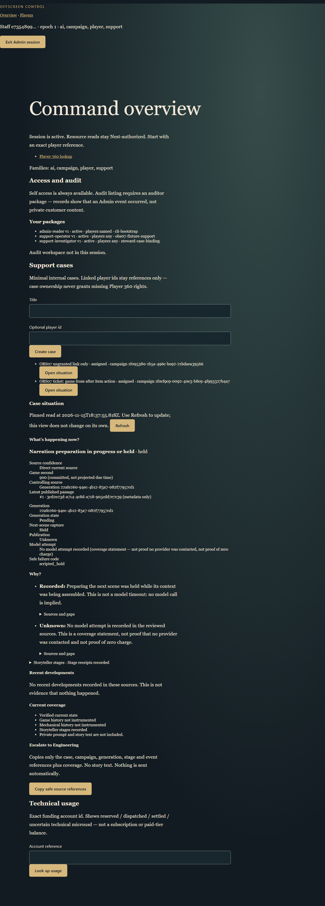

# OBS07 | Support Situation UI (2026-11-15)

**Change:** [OBS07](../../../changes/archive/2026-11/observability/2026-11-15--obs07-support-situation-ui/CHANGE.md) · **Contract:** [support-situation-and-why-v1](../technical/support-situation-and-why-v1.md) · **Depends on:** [OBS06 receipt](../obs06-case-scoped-situation/obs06-case-scoped-situation-read-2026-11-15.md) (Done, `26f4d322`) · **Provider spend:** zero (no model/network provider call; disposable `offscreen_auth_test` only).

**Outcome: Done in synthetic/disposable scope.** Web-only. No backend, schema, grant, `support-operator` or Admin-nav change. **No production grant issuer exists**; the Playwright proof mints the steward binding by direct SQL fixture, exactly as OBS06 tests do.

## What landed

| Piece | Location |
| --- | --- |
| Typed transport `readAdminCaseSituation` — UUID-only ids, `AbortSignal`, strict `supportSituationV1Schema.parse`, case/campaign echo check, every 403/404 → one non-enumerating `situation_not_available` | `apps/web/src/lib/admin-transport.ts` |
| Query key `['admin', staffPrincipalId, accessEpoch, 'case', caseId, 'campaign', campaignId, 'situation', 1]` (no title/text) | `apps/web/src/features/admin/admin-query-keys.ts` |
| Reviewed deterministic copy: `Record<closed enum, string>` for every `statementCode`, now-kind, generation/capture/publication/attempt/stage/gap/coverage label; allowlisted `buildSafeReferral` | `apps/web/src/features/admin/support-situation-copy.ts` |
| `SupportSituationPanel`: Now / Why? (sources+gaps in `<details>`) / Recent developments / Coverage / Escalate-copy; pinned read + manual Refresh; denial purges data | `apps/web/src/features/admin/support-situation-panel.tsx` |
| `AdminCaseQueue`: per-case "Open situation" only for `status='assigned' ∧ assignedStaffId=self ∧ campaign link (UUID)`; otherwise "Investigation not authorized or not yet linked."; selection bound to principal+epoch and re-derived from the fresh case list | `apps/web/src/features/admin/case-queue.tsx` |
| RTL/MSW suite (22) | `apps/web/src/features/admin/support-situation-panel.test.tsx` |
| Connected Playwright proof added to the existing `admin-control-ssr` suite | `tools/api-integration/test/admin-control-ssr.integration.ts` |

Behaviour choices (all from CHANGE §2–3): no request until an explicit click; `staleTime: Infinity`, `gcTime: 0`, no focus/reconnect/interval revalidation (pinned view, manual **Refresh** only); a failed refresh with prior data shows "earlier and may no longer be current"; 401/403/404 on refresh hides and `removeQueries` the data; no free campaign-id input exists (the only inputs are the pre-existing case title and player id); no replay/retry/run control exists; why text is selected only by `statementCode`; `attemptCoverage='none-recorded'` renders the documented coverage-only sentence (never "€0"/"model did not run"); the stage list is rendered in server order (no UI re-sort, no synthesized edges); UI never picks controlling G.

## Proof (commands actually run)

```text
pnpm --filter @offscreen/web exec vitest run src/features/admin     # 5 files, 29 tests pass (22 new)
pnpm --filter @offscreen/web test:fast                               # 56 files, 199 tests pass
pnpm --filter @offscreen/web exec tsc --noEmit                       # clean
npx eslint apps/web/src/features/admin apps/web/src/lib/admin-transport.ts tools/api-integration/test/admin-control-ssr.integration.ts --max-warnings 0   # clean
pnpm test:focus admin-control-ssr                                    # 8 pass (7 existing AD04 + 1 new OBS07 Playwright)
pnpm test:focus admin-situation                                      # 3 pass (OBS06 regression; unchanged)
```

| CHANGE §4 scenario | Test | Result |
| --- | --- | --- |
| Assigned + linked + trusted scope → one S1 response | RTL "shows situation, why, developments, coverage from exactly one S1 fetch"; Playwright | pass |
| Support v1 without investigator grant → safe disabled state | RTL server-404 → alert, no data; Playwright ungranted-but-assigned-and-linked case → "Investigation not authorized…", no previous situation left on screen | pass |
| Player-only link / open / foreign / closed → no launch, no ID entry | RTL "offers no investigation…" (4 cases, 0 buttons, 0 requests, no campaign input) | pass |
| Closed/reassigned or grant lost after open | RTL "closed or reassigned case…removes the panel"; "denial on refresh purges previously shown data" (cache key `undefined`) | pass |
| Held before G exists | RTL narration-intent fixture: no generation block, "no generation has been captured yet" | pass |
| Real G held, attempt none-recorded | RTL + Playwright (real SQL fixture, real S1 route) | pass |
| Interrupted action | RTL: source event ref shown, no success claim | pass |
| Output validated, publication stale | RTL: both facts separately, no "scene delivered" | pass |
| Legacy / not instrumented | RTL: unknown + not-instrumented labels | pass |
| Sentinel in private fields | RTL: extra private field → strict parse rejects, absent from DOM, query cache; Playwright: absent from page HTML and every `/api/*` response body | pass |
| Server error with prior data | RTL: earlier read labelled not current | pass |
| principal/accessEpoch change | RTL: epoch 1→2 drops panel + epoch-1 cache not reused | pass |
| Abort | RTL: unmount aborts in-flight request signal | pass |
| Safe copy | RTL: clipboard text equals `buildSafeReferral(dto)`; no case title/token/hash/sentinel | pass |
| No replay button | RTL `queryByRole('button', /replay|rerun|retry|resend|run model/)` null | pass |
| Network | Playwright: no situation request before click; exactly one per opened case; only `GET /api/admin/cases`, `GET /api/admin/staff/:id/access` (pre-existing Governance panel) and the two situation GETs observed | pass |
| Accessibility | `vitest-axe` on rendered panel: no violations; headings/regions/lists/`role=status|alert`, keyboard buttons | pass |

Screenshot of the real rendered **synthetic** screen (Playwright, disposable DB): 

## Human-utility check (fictional ticket answered from the UI fixture alone)

> “Player says game froze after item action. Did the mechanic finish? Has the model run? Did a new scene publish?”

Source: RTL fixture `situation()` in `support-situation-panel.test.tsx` test "answers the fictional ticket from the screen alone" (fields = S1 `SupportSituationV1`; every sentence is a fixed template).

| # | Claim a Support staffer can state | UI source (DTO field → template) | Truth kind | Limit shown on screen |
| --- | --- | --- | --- | --- |
| 1 | **Mechanic finished** — the item action's settlement receipt is recorded and the commitment is settled | `why[0].statementCode=action_settlement_recorded` (`recorded`, ref *Action event e0000000-…0001*) + `now.activeCommitment` = *Finite action · Settled* (ref *Action execution e0000000-…0002*) | Recorded | "Exact amounts and rewards are not shown on this screen." |
| 2 | **Next scene is stuck before the model** — preparation is held while context was being assembled; this is not a timeout | `why[1].statementCode=context_materialization_held` (ref *Stage d0000000-…0003*), `activeGeneration.capture=held`, stage *Context materialization started · Held*, `now.kind=storyteller-generation`, `now.held=true` | Recorded | "not a model timeout: no model call is implied" |
| 3 | **Model has not demonstrably run** — no attempt recorded | `activeGeneration.attemptCoverage=none-recorded`; `why[2]=model_attempt_unverified` (`unknown`, gap *No model attempt recorded*) | Unknown (coverage) | "not proof that no provider was contacted and not proof of zero charge" — Support must not promise "no charge" |
| 4 | **No new scene published** — publication is "Not published yet"; the last published passage is still #23 | `activeGeneration.publication=pending`; `sourceFrontier.latestPublishedPassageSequence=23` (metadata only) | Recorded | passage body not shown |
| 5 | **Escalation package** | Copy button emits case, campaign, generation `d0000000-…0001`, stage, event ids and `attempt=none-recorded … promptBody=not-included` | — | no story text; nothing auto-sent |

Honest limits of this check: it is a **fixture-authored** ticket, not a real player incident, and the reviewer is the implementing agent, not a nontechnical Support staffer. The answer to "did the mechanic finish?" depends on the S1 `activeCommitment`/`why` rows; a real stuck game with only a public event but no execution receipt would show *Unknown/partial* rather than guess. It proves the screen carries enough source-linked facts; it is not usability research.

## Honest limits

- **No production grant issuer.** Case/campaign steward binding remains a SQL/steward fixture; OBS07 neither creates nor implies one. A real Support staffer sees "Investigation not authorized or not yet linked" until a trusted steward binds the exact pair.
- The UI cannot tell "no grant" from "closed/unlinked/foreign" — by design (server privacy 404 is indistinguishable).
- Eligibility filter is client-side UX only; the server rechecks every OBS06 gate on each request.
- Playwright proof is Chromium on Windows against a local Next+Nest stack on `offscreen_auth_test`; no cross-browser or narrow-viewport automation (screenshot is full-page desktop). Mobile readability not separately measured.
- `Game second` is the committed value, not projected completion; mechanical history stays "partial/not instrumented" per OBS06.
- The Governance panel's existing `GET /api/admin/staff/:id/access` call appears on the same page and is allowed in the network assertion; it is not part of OBS07.
- Pre-existing uncommitted forensic-trial/ENG03 working-tree edits and `tmp/` were deliberately **not** committed.
