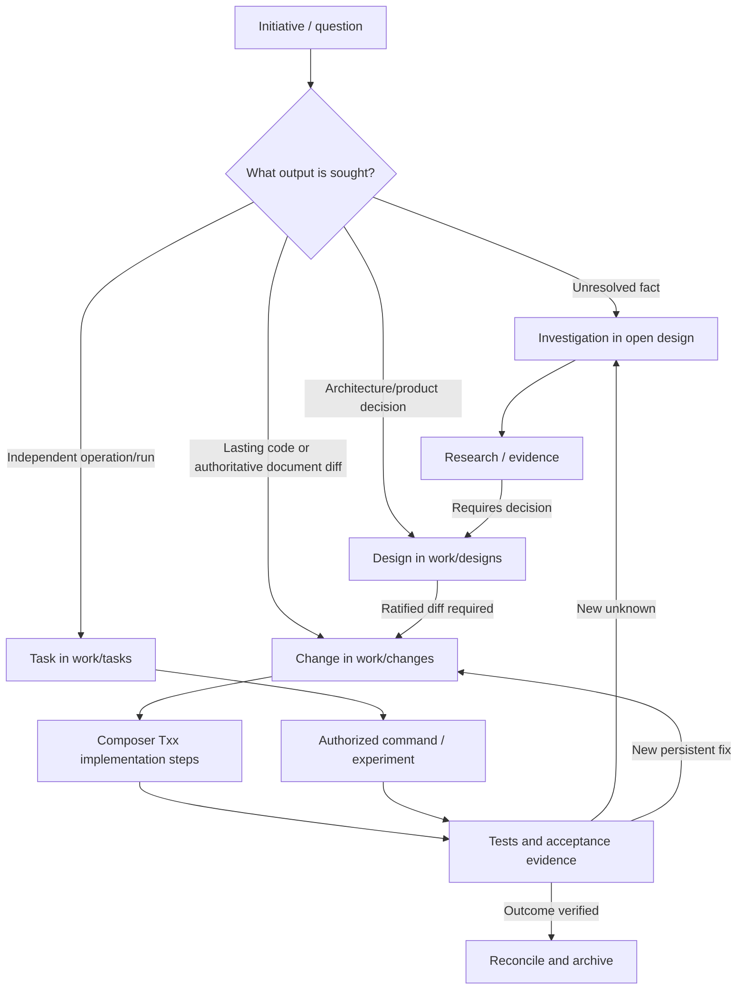

# Work taxonomy | what we decide, modify, execute and learn

**Placement/permanence:** [Repository structure](../REPOSITORY-STRUCTURE.md) distinguishes living authority, durable history, temporary workspaces and generated/source-owned output. This taxonomy remains the precise work-type classifier.

**Lifecycle walkthrough:** [How we work](../WORKFLOW.md) connects these types to the practical docs-first / ChatGPT-plans / Cursor-implements / verification and branch workflow. This file remains the precise classification reference.

**Status:** selected repository operating convention, 2026-11-20. **Owner:** engineering work management, not game product behavior. [One selection queue](QUEUE.md) · [Change standard](../.agents/references/change-work-unit-standard.md) · [Composer microtasks](../.agents/references/composer-first-execution.md) · [Tasks](tasks/README.md).

## Words that mean different things

| Noun | Question it answers | Durable owner | Terminal disposition |
| --- | --- | --- | --- |
| **Initiative** | Which broader outcome are we pursuing? | Existing product/technical initiative overview or program design; do not manufacture a folder per noun | Explicitly reconcile into [ROADMAP](../ROADMAP.md) and [STATUS](../STATUS.md) |
| **Undertaking** | Which temporary, named transformation are we concentrating on across several work units? | [work/undertakings/](undertakings/README.md) while active; normally one integration branch `undertaking/<slug>` | Land the coherent result, record a compact disposition, then remove the active dossier/branch; Git preserves the full history |
| **Design** | Which behavior, boundary or contract should we select? | [work/designs/](designs/README.md) only while actively unresolved; approved behavior lives in docs/product or docs/technical | Record completion, rejection, supersession or deferral in the [design ledger](designs/ledger/2026-11.md), then remove from HEAD after link review; exact source is recoverable from Git |
| **Investigation** | What is true, why, or still unknown? | Open design dossier for unresolved inquiry; source-based research note if independent | Findings in [research](../research/README.md), dated observations in [evidence](../evidence/README.md), new decisions back to canonical owners |
| **Change** | Which lasting **diff** should be produced? | [backlog/<domain>/<leaf>/CHANGE.md](changes/backlog/README.md) while deferred, then [open/<leaf>/CHANGE.md](changes/README.md) when selected | Reconcile to canonical owners; archive briefly, then prune the full packet after a cool-off/link audit, durable [Change ledger](changes/ledger/2026-11.md) and immutable Git source pointer |
| **Task** | Which bounded **action** should be executed, with no standalone product/code diff as the objective? | [work/tasks/open/<leaf>/TASK.md](tasks/README.md) **only if independent tracking is useful** | Actual run receipt in evidence, then Task archived |
| **Experiment** | Which hypothesis and failure condition should we test? | Protocol/scenario under existing Chamber/lab/technical owners; a standalone Task can schedule one run | Observation, negative result and reproducible recipe under evidence/research |
| **Evidence** | What actually happened, under which source SHA and conditions? | [evidence/](../evidence/README.md), not work ticket prose | Immutable dated result; may support a Change or Task closure |
| **Composer microtask** | Which tiny edit/test step belongs **inside one Change**? | That Change's `TASKS.md#Txx` | Receipt and reconciliation back to parent Change, **not** a standalone Task |

**The classifier is the desired outcome, not the verb.** A test-run command under a code Change is usually an embedded microtask. A separately scheduled repeatable verification run with its own authorization and evidence is a standalone Task. Writing a new migration is a Change; applying an existing migration to a specified approved database is a Task. Creating a chaos runner is a Change; executing one bounded chaos scenario is a Task/Experiment. An audit may be an Investigation and eventually produce Evidence, a Design, or a Change. The categories can relate without being identical.

## Undertakings coordinate themed transformations

An **Undertaking** is a temporary integration envelope for a coherent, memorable engineering push that spans several Changes, Designs, investigations or Tasks. It is useful when the work has one shared theme and integration boundary but is too large to pretend it is one Change. Examples include a documentation wikipedization, a Kubernetes-first developer-experience refoundation, or the current Storyteller Workshop.

An Undertaking **does not create another truth or execution authority**. It cannot mark a child Change Done, select work instead of [QUEUE](QUEUE.md), ratify a Design, or turn a proposal into shipped capability. Child artifacts retain their own lifecycle and evidence requirements. The undertaking dossier owns only scope, integration intent, constituent map, entry/exit conditions and branch identity.

Repository branch hygiene defaults to **two long-lived visible branches during an Undertaking**: `main` and one `undertaking/<slug>` branch. A **dedicated short-lived branch is mandatory for each commissioned implementation Change**, created from that Change's actual integration branch and squash-joined back at acceptance; temporary branches are removed after reconciliation. Do not create branches for every Design, Composer T-ID or standalone Task by habit. Worktrees are separate only when concurrent checkouts require isolation. An undertaking branch should be named for the actual transformation, not a generic sequence such as `evolution-2` or `consolidated`.

Lifecycle: **Active → Landing → Closed**. Active means the themed scope is still being shaped or implemented. Landing means constituent work has been reconciled and the branch is being validated as one coherent candidate for `main`. Closed means it has landed or been explicitly abandoned; the active dossier and branch should then disappear from HEAD after a compact disposition is retained. See [Undertakings](undertakings/README.md).

## Work retirement is part of completion

Git history is the permanent archive, **not** the current working tree. An accepted design becomes actual product/technical documentation. A deferred, rejected, abandoned or completed design receives a short [retirement ledger](designs/ledger/2026-11.md) entry with full Git SHA, disposition and unique-source note, then leaves `work/designs/open/`. There is intentionally no permanent designs archive.

A terminal Change spends a short review period in [the Change archive](changes/archive/README.md). A week after its last archive edit is a **review signal**, not automatic deletion permission. Its unique receipts must survive in evidence/canonical owners, the compact Change ledger must retain the decision and an exact Git source locator, and inbound links must be repaired before `git rm`.

Run `pnpm repo:retirement` during maintenance for an advisory inventory of aging designs and archived Changes. **Never infer approval, implementation, or permission to destroy from file age.**

## Routing decision

### A standalone Task is justified when

The execution needs **its own selection, schedule, environment/resource permission, recurring identity, coordination, independent result, or durable receipt**. It should be possible to close the Task with **zero intended code or normative-document changes**. A run can expose a bug and produce a new Change, but must not silently mutate into that Change. Conversely, implementing the runner, a new database table, test files, production config or a major documentation contract is always a Change, even when the work is described as a “task” conversationally.

Do **not** create a folder for an everyday command within a Change, a trivial correction, every individual test, or each Composer child assignment. One selected Change can own many `Txx` steps. Avoid duplicating one operation in two open queues.

## One selection authority, multiple catalogs

**Integration batch is a scheduling envelope, not a new work kind.** It groups an already authorized finite selection of Change-owned T-IDs (or one operational Task) under one Cursor coordinator. The [bounded parent contract](../.agents/references/bounded-parent-orchestration.md) owns its explicit stop, acceptance, coherent commit and archive checkpoint. No per-T-ID ticket, no new batch queue, no assumption that T-ID completion proves parent Goal.

[**work/QUEUE.md**](QUEUE.md) is the single source for the selected work item (`Current work:`), whether Change or Task. Exactly one primary selected item, or `none`, is valid. Concurrent explicitly approved batches use their own scoped handoff but cannot create another global selector. The [Changes index](changes/README.md) and [Tasks index](tasks/README.md) are catalogs, **not competing Current selectors**. Existing 2026-11 Changes, historical evidence, links and `TASKS.md` stay in place; no automatic mass migration or renaming.

Selection does **not** override permissions: a selected Task to apply a migration or kill a Pod still requires explicit environment, destructive-operation and ownership approval. `Ready` means prepared, not authorized. The Cursor coordinator normally uses Composer Standard and delegates a single bounded execution step, whether from a Change's `TASKS.md` or standalone `TASK.md`.

## Two examples that should not be confused

| Engineering story | Persistent modification | Separate execution | Proof |
| --- | --- | --- | --- |
| Storyteller regressions | Edit fixture or assertion **only if diagnosed**, as HK03 Change | Scheduled rerun of complete suite **if independently tracked**; otherwise HK03 T01 | Exact Node test counts, failing assertions and source SHA |
| Kubernetes chaos | Implement deterministic fake Storyteller driver + safe fault controller as K8S10 Change | Later approved, bounded chaos run with scenario/seed/context/pod allowlist as Task | Pod UID, recovery time, exact SQL/S3 invariants, zero model calls |
| Database migration | Write and test SQL migration as a Change | Apply migration to a *named approved disposable DB* as Task | Schema version, command, transaction and rollback evidence |

## Audits and research do not need an additional folder yet

An audit is a **method** of investigation, not automatically its own lifecycle type. Active open audits belong with designs/investigations; completed findings with dated source evidence belong in research/evidence. Create `work/audits/` only if audits develop a demonstrably independent recurring intake/selection and terminal lifecycle that these existing owners cannot support. A shiny folder structure is not an engineering accomplishment.

## Guardrails and governance

- Every active standalone Task has one `TASK.md` and appears in its Tasks catalog. Terminal Tasks move together with their unique receipts/links to `work/tasks/archive/YYYY-MM/<leaf>/`. No silent clearing, no auto-completion from a command exit code.
- Every active Change has `CHANGE.md`; optional `TASKS.md` is **subordinate** and cannot be individually selected as a top-level Task. Existing Change archive/ledger rules are unchanged.
- `docs/` remains accepted truth, `STATUS.md` observed capability, `ROADMAP.md` strategic priority, `evidence/` measured facts; this policy does not transfer authority to a Task.
- The maintenance scanner should reject orphaned folders, invalid or multiple selectors, unindexed active Task packets and terminal packets left under open, while preserving a valid **no work selected** state.
- Never represent a Proposed design or a fake scripted fixture as a deployed capability. The source inspection and real proof tier travel with each Change/Task receipt.
