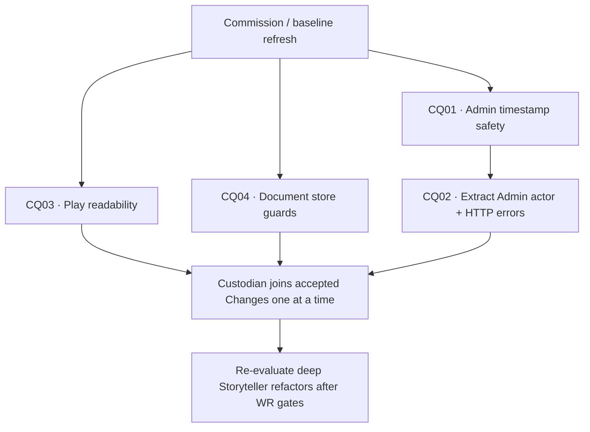

# Source architecture and code-craft remediation | 2026-11-21

**Standing:** source-grounded planning and prioritization, **not** an Undertaking and **not** an automatic work selector. The owner may commission individual Changes one by one or an explicitly authorized noncolliding parallel batch. `work/QUEUE.md` remains the single default selector. This program does not authorize Cursor to drain Ready packets.

**Planning baseline:** `undertaking/storyteller-workshop` HEAD `c13d64ee450ad6b2b1da75dddf0a3de8331efa1a`, remote committed source as inspected 2026-11-21. Running `change/wr03-workdesk` has **uncommitted/untracked writer-loop code** visible in the owner's screenshot and brief; GitHub cannot inspect that work. No tests, compilers, security scanning, actual provider calls or production telemetry were run by this planning pass.

**Goal:** human-maintainable software with tight responsibilities, TypeScript contracts that match runtime trust boundaries, Zod used for actual admission, explicit state/error/fence behavior and real negative tests. Not merely prettier indentation or generalized enterprise scaffolding. See [code craftsmanship](../../.agents/rules/code-quality.md) and [change packet standard](../../.agents/references/change-work-unit-standard.md).

## Evidence-led findings (severity and confidence)

| Lens | Inspected evidence | Judgment |
| --- | --- | --- |
| **Staff-session time admission** | `apps/api/src/modules/admin/controller.ts:AdminActorService.requireAuthProof` accepts `new Date(createdAt)` and `packages/application/src/admin/session.ts:createAdminSessions.enter` checks only `now - created > 15m`. Invalid Date makes comparison false; future timestamp is negative | **P0 correctness gap** when malformed/future timestamp reaches the path; remote exploitability **NOT PROVEN**. [CQ01](open/2026-11-21--cq01-admin-session-freshness/CHANGE.md) |
| **Admin authorization environment** | `apps/api/src/app.ts:adminEnvironmentForOrigin` returns `local` for loopback, and also returns `local` for all non-loopback origins/failures. Capability grants are environment-scoped | **High-risk deployment assumption**, not a demonstrated exploit. Needs selected production/staging environment policy before a code Change; do not silently default a hosted app to local grants |
| **API HTTP/auth responsibility** | `apps/api/src/modules/admin/controller.ts` ~1,003 lines mixing actor/cookie logic, DI symbols, routes, error mapper and factory wrappers; `app.ts` imports all through it | Coarse ownership and review friction. [CQ02](open/2026-11-21--cq02-admin-http-ownership/CHANGE.md) extracts only stable seams **after CQ01**, preserving grants |
| **React UI control-flow readability** | `apps/web/src/features/play/view.tsx` ~414 lines including Query/SSE/cache, frozen commands, status strings, nested JSX and `offer!` after boolean derivation | Real human-readability/type-narrowing debt, not proof of an incorrect command. [CQ03](open/2026-11-21--cq03-play-surface-readability/CHANGE.md) preserves all client authority |
| **Capability contract versus runtime store** | `scene-checkpoint.ts:checkpointWriterStore` asserts a five-method type after checking only three methods; `forks.ts:forkDocumentStore` layers more casts | Observable structural validation gap for partial adapters; actual production injection path not proven exploitable. [CQ04](open/2026-11-21--cq04-document-store-capability-guards/CHANGE.md) |
| **Capture/materialization complexity** | `packages/application/src/storyteller/context-capture.ts` ~3,078 lines/97 KB, `capture-materialization.ts` ~1,612 lines/53 KB; multiple schema variants and task assemblers, transactional lease/fence | High complexity and regression surface. **Do not blindly split** while ENG03/WR05/turn authority is changing; architecture refactor needs baseline and state/fence proof |
| **Provider/budget/publication** | `packages/storyteller/src/providers/openrouter.ts` ~1,104 lines; `packages/application/src/storyteller/{budget,publication,execution}.ts` ~978–1,157 lines each. Provider uses Zod parse, bounded response, explicit usage and uncertain send states | Good existing safeguards coexist with broad responsibility. Cross-cutting state and money refactor **not ready** without source-traced transport/replay proof; do not refactor live provider handling for aesthetics |
| **TypeScript/Zod correctness** | Base tsconfig `strict`, `noUncheckedIndexedAccess`, `exactOptionalPropertyTypes`; multiple discriminated schemas, typed outcomes, package ESLint boundaries; some `as` casts and non-null assertions remain | **Not globally untyped.** Evaluate exact `unknown`→validated→typed route and trust/fence retention. Prefer discriminated results and type inference; interfaces are not mandatory for every local object |
| **Automated quality** | Prettier + standard ESLint exist; `lint:quality` uses stricter curly/no-nested-ternary/no-non-null-assertion but is opt-in; new `repo:code-quality:changed` exists | Use targeted changed-file checks and typecheck at joins. **Command fixtures not yet run locally**, so do not claim mechanical quality enforcement proven |
| **Testability and maintainability** | Application stateful proofs rely on disposable SQL; API Admin has integration tests; Play view uses Vitest/MSW. Large integration suites include extensive fixtures | Preserve discriminating negatives and crash/replay evidence, don't declare architecture good because a single mock passes. Test commands/environment must be truthful |

## Explicit execution schedule

| Wave / packet | Status | Write ownership | Dependencies and merge fence |
| --- | --- | --- | --- |
| **CQ01 — P0** [Staff freshness](open/2026-11-21--cq01-admin-session-freshness/CHANGE.md) | **Planner-Ready / owner-unselected** | `packages/application/src/admin/session.ts`; API Admin actor conversion; focused tests | First security fix. Independent ChatGPT review before integration |
| **CQ03 — P1** [Play surface](open/2026-11-21--cq03-play-surface-readability/CHANGE.md) | **Planner-Ready / owner-unselected** | `apps/web/src/features/play/view.tsx`, focused `model/` and `ui/` helpers/tests | Parallel with CQ01 **only if WR08/UI owner isn't editing same surface** |
| **CQ04 — P1** [Store capability guard](open/2026-11-21--cq04-document-store-capability-guards/CHANGE.md) | **Planner-Ready / owner-unselected** | `packages/application/src/stories/{scene-checkpoint,forks}.ts` and focused tests | Parallel with CQ01/CQ03 **only if WR05/WR06 and historical-fork work isn't touching these owners**; independent source/security review |
| **CQ02 — P1** [Admin actor separation](open/2026-11-21--cq02-admin-http-ownership/CHANGE.md) | **Planner-Ready after CQ01 / owner-unselected** | `apps/api/src/modules/admin/controller.ts`, new actor/error helpers | **Serial after CQ01 integration**; preserve DI token identity, 403/404 and route behavior |
| **Deep Storyteller candidates** | **Not Cursor-Ready** | See gates below | ChatGPT designs later against stable landed source; don't commission children to investigate missing architecture |

**Integration owner:** For concurrent commissioned CQ01/CQ03/CQ04 Changes, human owner designates one existing Cursor coordinator/custodian to squash-integrate each accepted branch, refreshing the undertaking HEAD, shared docs and latest source anchors. No two Change parents simultaneously edit the integration checkout, `work/QUEUE.md`, status or catalogs. Each Change has a separate linked worktree and branch from the correct target; primary checkout stays untouched. Shared statuses are updated by custodian, not by several competing Cursor chats.

## Deep follow-up candidates (not executable Changes yet)

These are **named, evidence-backed planning targets**, not extra open Change folders that Cursor can mistake for Ready. Their decisions stay with ChatGPT and the owner.

### D1 · WR03 Writer loop: model output and tools trust boundary

**First evidence required:** actual landed `packages/application/src/storyteller/writer-loop.ts`, `writer-workdesk.ts`, `writer-library-tools.ts`, `packages/storyteller/src/tasks/writer-round-request.ts`, provider round schema and integration negatives. The untracked writer-loop shown by the owner cannot be audited from the current GitHub branch. Check specifically `applyToolCalls` dispatch by `name.startsWith('workdesk.')`, casts to tool-call types, runtime Zod validation, captured allowlist, root ownership, per-tool idempotency and stage revision, uncertain provider send and final proposal vs canon. A string-prefix dispatch plus cast is **a review hypothesis**, not proof of a vulnerability.

**Potential end-state:** one validated discriminated tool-request boundary, explicit read-only vs stage-capable ports, small orchestration phases with typed results and explanatory transaction/retry comments, no model-granted new capabilities. **Gate:** WR03 integrated; exact wire schema and captured tool-decision tests inspected. ChatGPT then creates new bounded Changes only for confirmed problems; no blanket task to “refactor Writer loop”.

### D2 · ENG03 capture/materialization responsibility split

**First evidence required:** post-WR05/TURN03 source of `context-capture.ts`, `capture-materialization.ts`, `publication.ts`, current persisted JSON schemas, captures and lease/fence tests. The actual baseline has multiple `purpose/sourceKind` variants, ~1.1k lines of schema+parsing at the top, seven `assemble*TaskFromCapture` branches, SQL lease and promotion stages. Design a pure versioned contract-module seam **without** changing capture JSON bytes/hash, Zod strictness, source pin identity, materialization timeout or CAS transactions. Extract only independently tested responsibilities with export compatibility; avoid circular imports.

**Gate:** relevant stateful Writer/ENG03/TURN changes integrated and source/test matrix revalidated. Requirement for planner readiness: exact import graph, same-byte hashes for fixtures, no object-store IO under story SQL lock, lease-loser and stale-source negatives.

### D3 · Provider / budget / publication seam

**First evidence required:** post-WR03/WR05 `openrouter.ts:send`, `budget.ts:createStorytellerBudget`, `execution.ts:createStorytellerExecution`, `publication.ts:publishStorytellerResult`, synthetic unknown-delivery/retry tests and full cost ledger mapping. Examine model JSON parsing, Zod output validation, response-size bounds, state transitions, charging reservation/settlement, malformed usage, retries, cancellation, redaction and exactly-once publication. Distinguish **admission**, **transport**, **accounting** and **publication** without moving network calls into SQL locks or changing financial rounding.

**Gate:** stable implementation + ChatGPT-selected algorithm and crash/negative tests. No paid provider request, no unreviewed “just extract helpers” change.

### D4 · Admin environment selection for hosted deployment

`apps/api/src/app.ts:adminEnvironmentForOrigin` currently returns `local` even for external hosts. The trust model requires an explicit decision about deployment environment derivation and allowed local grants **before** it is safe to change the function. Preferred target to decide with owner: explicit environment configuration with validation, loopback-only local fallback and failure on ambiguous non-loopback deployment. Check existing tests, environment wiring, staff bootstrap, hosted deployment and operational migration/rollback. This is a potential **deployment-blocking review**, not a license for Cursor to choose env policy on the fly. No production release is claimed.

## Procedure when commissioning

1. Commission a specific Ready CQ packet (or an authorized disjoint parallel batch), **not** this roadmap. Confirm no active WR/other worktree owns its files.
2. Parent starts **one dedicated linked worktree and branch**, runs `pnpm repo:change-branch --change CQxx --target undertaking/storyteller-workshop`, reads packet `CHANGE.md` / `TASKS.md`, then dispatches one bounded task.
3. Children implement only predecided algorithm, run proportionate normal and negative tests and changed-file formatting/quality-lint. Parent checks maintainability and evidence; high-risk Change gets independent ChatGPT review before custodian join.
4. Stop if actual source contracts changed, security constraints are unproved, tests fail for an architectural reason, or environment required for negative proof is unavailable. Do **not** close Done for formatting alone.
5. Custodian reconciles docs/source/STATUS/ledger and squash-integrates into Undertaking branch; archive packet and retire Change worktree when clean. Refresh dependent packet anchors. Do not merge into `main` until Undertaking landing.
