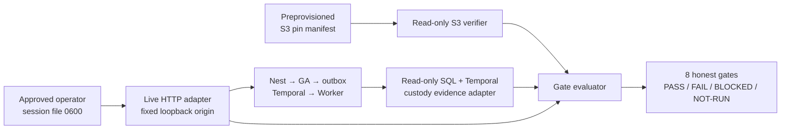

> **Terminal owner disposition:** TURN03 cancelled by owner 2026-11-27 because the monorepo and agent runtime will be fundamentally redesigned. Legacy scripted-path proof and architecture-specific recovery matrix are retired, not transferred as pending requirements. Historical evidence retained; no PASS inferred, existing implementation untouched. Future acceptance must be designed against the new architecture; preserve authorization, private data isolation, authoritative state integrity, idempotency, financial safety and truthful evidence. No dispatch or live authorization.
> All previous status, prerequisites, commissions and instructions below are historical only.

# TURN03 R2 | Real release operator design and custody map

**Source inspection:** `undertaking/storyteller-workshop@44ca5dbd`, 2026-11-23; R1 independently executing in Cursor. **Planner-only design**, no implementation or live acceptance. No change to R1-owned `infra/kubernetes/lab/app-release/turn03/{run,run.test,adversarial.test}.mjs`.

## What already exists and what it does not prove

| Owner / exact source | Observed | Correct R2 use |
| --- | --- | --- |
| `infra/verification/release-acceptance/release-acceptance-preflight.mjs::runReleaseAcceptancePreflightSmoke` | Read-only source/image/context/OAuth checks; explicit `authorizeMutatingAcceptance` invokes `install.sh`; stages labelled planned or not-run | Reuse as operator preflight, **not** a source of live PASS. No implicit install when R2 adapter tests run |
| `infra/verification/release-acceptance/turn03/preflight.mjs::runTurn03Preflight` | Validates `kind-offscreen-lab`, images, gateway, Postgres Secret existence, object-store Service, Temporal Service, local OAuth values | Keep read-only, never print Secret or cookie values; verify actual release/source digest at run time |
| `infra/environments/release/install.sh` | Owner of releasing Web/API/GA/Workers, migration and `game-db` / `game-runtime` Kubernetes Secrets. Auth values come from ignored root `.env`; S3 creds from `lab-objects/object-store-s3` | No duplicated credential creation, cluster bootstrap or secret copy into logs/evidence |
| `infra/kubernetes/lab/app-release/overlay/{edge,authority,workers}.yaml` | `lab-edge` Web/API, `lab-authority` GA, `lab-workers` control/executor/relay. S3 bucket `lab-objects`, cluster DNS object-store endpoint `http://object-store.lab-objects.svc.cluster.local:8333`, Temporal `temporal-server.lab-temporal.svc.cluster.local:7233` | Treat these as **cluster-internal** endpoints; host operator needs a deliberate local port-forward or a preconfigured trusted read-only gateway, never assume Kubernetes DNS resolves on the host |
| `tools/api-integration/test/story03-causal-multiprocess.integration.ts::{admitTurn03OpeningAndScene1,submitTurn03Resolution,assertContinuationSql}` | Real authenticated A–G public HTTP path, selected SQL/outbox/attempt/publication assertions, pinned checkpoint checks. Test harness uses disposable local DB and LocalDocumentStore | Reuse normal request/response schema and query identities; **do not copy local test authentication or LocalDocumentStore as live evidence** |
| `tools/api-integration/test/helpers/story03-causal-multiprocess-harness.ts::withStory03CausalMultiprocessHarness` | Better Auth `testUtils` creates/logs-in synthetic actors in a disposable `offscreen_auth_test` DB, spawns local processes | Its cookie is **not** accepted as an installed release actor, and its direct cleanup deletes local fixtures. Never use it against live lab PostgreSQL |
| `tools/api-integration/test/helpers/turn03-distributed-poc-fixture.ts::provisionTurn03DistributedPocFixture` | Existing `DocumentStore`-agnostic importer produces pinned rule/start hashes and orientation-only scene-1 fixture | Use only with an explicitly authorized S3 `DocumentStore` adapter, or consume a verified preprovisioned fixture manifest. No unpinned default rule assumptions |
| `packages/documents/src/s3-store.ts::S3DocumentStore` | Existing S3 adapter preserves canonical hashing | Exact-object hash verification through approved lab S3 read path, never invent a document root |

## Decisions within R2 (not a permission grant)

**A. Actor: operator-supplied disposable signed-in session.** Keep production Better Auth/OAuth path; no test-only auth API in release and no identity forgery. Require an operator-authorized session acquired through ordinary browser OAuth and stored in a user-owned, mode-0600, symlink-refusing file **outside the repo**. Read it only in the live adapter process, scope it to the fixed loopback/Gateway origin, avoid following redirects to arbitrary hosts, never print/persist `Cookie` or response `Set-Cookie`. Test expiry and an unauthenticated/other-actor denial before collecting PASS. A GitHub OAuth app merely being present in root `.env` does **not** prove the operator has a signed-in session. If no valid session is supplied, **auth-ssr BLOCKED** and related gates NOT-RUN. A story-only CL01 bearer cannot create drafts/openings.

**B. Fixture: externally pinned source, one bounded provisioning authority.** R2's default is **consume a preprovisioned, owner-approved manifest** of `{startPackageId,startRootHash,rulesRootHash,worldRootHash?,bucket,releaseSha}`, not silently import/write S3. Verify exact referenced objects through a scoped read-only S3 adapter against the real lab bucket, including kind, schema and SHA-256 hash; reject any mismatch before draft creation. A separate explicit fixture-provision action may later reuse `provisionTurn03DistributedPocFixture(S3DocumentStore)`, but only with approved disposable bucket credentials and isolated runId object prefix. The existing importer must not be given broad production credentials or overwrite persistent user data. **Potential compatibility gap:** the importer selects fresh startPackageId and content root; external fixture manifests must describe the generated pins exactly. Do not fabricate a pinned source from an application environment default.

**C. SQL/Temporal: least-privileged, read-only postcondition evidence.** The live runner must **not** read `game-db` or `game-runtime` Secrets itself, open a privileged DB session, or query application tables by direct Pod exec. Supply an explicitly authorized *read-only* evidence adapter from a separate operator process or trusted existing fixture service. Its inputs are frozen storyId, ownerId, operationId, generationId and source roots; its output is typed, minimal, sanitized rows: story revision, scene/passages/checkpoint hashes, outbox topic/idempotency key, attempt id/result hash, publication state, Temporal workflow ID/run state/history key, S3 digest checks. No user prompts, personal profiles, token values or raw documents in default evidence. Read-only is a credential/access guarantee, not just a `SELECT` SQL string. **Proof required:** write attempt and cross-tenant read fail; missing privilege is BLOCKED, not permission to borrow app credentials. The existing T09 `assertContinuationSql` is a query-field source guide, not a permission model.

**D. Public HTTP and gate truthfulness.** R1 handles real public request sequence under injected `http` but must continue to return mocked/not-run evidence. R2 adds a real HTTP transport with origin allowlist, session file protection, strict redirects and timeout, and a real correlated evidence collector. Only reports with proven release SHA/image digests, authenticated actor, GA/Temporal/SQL/S3 causality and source-specific checkpoints can receive `tier:'kind-cross-pod'`. Do not infer a gate from a service readiness probe or image tag alone. A failed OAuth/cookie, absent fixture pin, missing evidence reader or stale digest halts the operator and records a precise BLOCKED/FAIL. No automatic paid provider fallback.

**E. Faults and permissions.** Default R2 probes are passive: HTTP GETs, read-only SQL/Temporal/S3 evidence, frozen IDs. Installing a release, writing a draft or story, injecting worker faults and deleting a Pod are different permissions. R3 is the first authorized operator action that performs a disposable *game* flow; K8S10 T05 Pod deletion remains a separate explicit Pod-UID-specific approval after TURN03 all-eight PASS. No single `--run` flag authorizes all phases.

## Remaining planner blockers and their owners

| Blocker | Precise source/location to resolve | Acceptance before executor READY |
| --- | --- | --- |
| Real browser session handoff | Better Auth cookie domain/origin in `apps/api/src/modules/auth/**`, Gateway routes and `overlay/edge.yaml` | Valid named disposable human OAuth actor, fixed origin, protected session handoff, authorized negative actor |
| Scoped S3 fixture pin | `S3DocumentStore`, importer, lab object-store credentials/bucket, actual default-rule hash | Exact persisted object/digest lookup with **read-only** credentials, or explicit isolated provisioning authorization |
| Evidence transport authority | `assertContinuationSql`, DB credentials, Temporal namespace/client, checkpoint lookup owners | Show a real read-only adapter/authz surface and controlled root-ID correlation; no generic privileged `DATABASE_URL` |
| Eight gate matrix | `turn03/report.mjs`, TURN03 `PROOF.md` and negative matrix | Exact source-derived evidence/assertion per gate, including SSE, historical fork independent continuation, and recovery with separate fault authorization |
| Release mutation authorization | `release-acceptance-preflight.mjs`, `install.sh` | User/operator approves exact disposable cluster/release/source digest; no implicit runtime changes |
| R1 integration | Concurrent Cursor R1 source under `turn03/run.mjs` | R2 read-only adapters use the **landed** real route contract, never pre-merge synthetic API |

## Next planner move (not Cursor delegation)

Inspect real auth cookie origin/CSRF handling and the current operator's approved lab fixture and SQL/Temporal read-only access paths. If a read-only adapter does not yet exist, design a **small separate lab-only proof adapter** with typed projections and least-privileged connection rather than a broad new service or privilege escalation. Freeze host/port-forward lifetime, timeouts, redaction and fault isolation. Re-audit G0–G7 after R1 lands, then authorize a source-only R2-A implementation, followed by distinct R3 release execution. **No full R2 or live-cluster commission yet.**