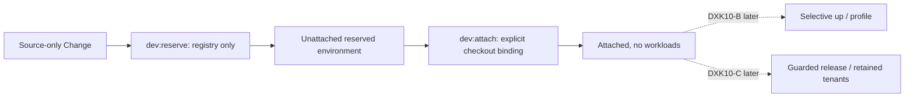

# DXK10-A | Reserve an idle developer environment and explicitly attach a checkout

**Profile:** STATE / local developer tooling · **State:** Done (2026-11-23) · **Integration:** `undertaking/storyteller-workshop` · **Planner source baseline:** `fb5bf588`, 2026-11-23. **No Kubernetes runtime or tenant writes in this Change.**

## Why

Today `dev:new` allocates and starts; a new Change cannot reserve a zero-cost environment. `resolveDevEnvironmentSelection` also allows an explicit `--instance` selection from a different idle checkout, without an explicit attach transaction. Before profile activation or reusable physical slots, decouple identity reservation from checkout binding and deny silent rebinds.

## Decided contracts

1. `pnpm dev:reserve` allocates a fresh monotonic `dev-N` identity and currently unused loopback bundle under the existing v2 registry lock, **with no checkout binding**. Must perform no Docker, Kind, Kubernetes, DB, S3, Temporal, image build, process spawn, pod scaling or port listener mutation. It returns the ID/ports and `RESERVED / UNATTACHED / UNPROVISIONED`. A checkout is not a prerequisite to reserve.
2. `pnpm dev:attach --instance dev-N` binds a **never-provisioned, never-activated and unattached** reservation to the calling canonical checkout. Must validate registry record, lack of default conflicts, no recorded owner/lease, no stored session and no retained resource UIDs. For a freshly allocated, never-provisioned ID this is a registry/session-only operation: cluster reachability is **not** required for attach. Activation must later refuse if any external namespace/tenant collision is observed or cannot be verified. Update registry record and checkout default atomically under lock; no Kubernetes or tenant mutation. If already attached to the same checkout, return idempotent success; foreign checkout refuses.
3. Maintain the existing `REGISTRY_VERSION_V2` where safely possible: make `worktreePath` nullable **only** for new unbound records; require absolute real path for attached records and any default map. Existing v1/v2 live records remain readable. Do not encode an unattached slot as an empty string, relative path or fake checkout.
4. Reservation ID and ports remain durable, not borrowed from an existing tenant. No ID reuse, `nextSequence` rewind, namespace recycling, credential/Secret changes or "release" in DXK10-A. If the registry is corrupt/missing, refuse rather than recreating an allocator counter. Reserve must remain registry-only; external resource collision is checked at attach and later activation, not through a Kubernetes call during reserve.
5. Harden the existing `resolveDevEnvironmentSelection` `--instance` path: **no implicit rebind** by ordinary `up/status/stop` from a foreign checkout, even when parked. For a newly attached checkout, keep existing full `pnpm dev` convenience behavior; existing `dev:new` retains allocate-and-start behavior. A bare `dev:status` stays read-only and never reserves or attaches.
6. Do not alter six-role manifests, Tilt, image loader, SQL/S3/Temporal provisioners, existing runtime freshness or release-lab behavior. No changes to active HR02 Web sources.

## Acceptance and stop criteria

- Focused v2 registry/allocator/CLI tests: fresh no-side-effect reserve, two concurrent reserves disjoint, unattached validation, explicit attach, idempotency, foreign refusal, default uniqueness, stale/unknown PID and inconsistent persisted session refusal, missing or indeterminate session identity refusal; activation must subsequently reject unknown cluster identity, no reuse of retained slots, migration compatibility, no implicit `--instance` rebind.
- Dependency-injected proof that `reserve` and `attach` do not invoke any bootstrap/cluster mutator. Test that late validation failure leaves registry byte-equivalent (aside from explicitly permitted lock artifacts) and no ports held.
- Existing `dev:new`, `dev`, `dev:status`, `dev:stop` fixture tests pass without semantic regression. No host live cluster test required; one local CLI smoke with temporary isolated registry may be used, never the live registry for this Change.
- **Stop** if registry v2 cannot model null attachment without a wider migration, if acquiring a reliable no-resource guarantee requires mutating the cluster, or if current launch/session paths implicitly adopt an unattached record. Return exact evidence to ChatGPT rather than improvising release or tenant transfer.

**Source map:** [SOURCE-MAP.md](SOURCE-MAP.md) · **Algorithm:** [EXECUTION.md](EXECUTION.md) · **Small tasks:** [TASKS.md](TASKS.md) · **Proof contract:** [PROOF.md](PROOF.md). DXK10-B/C stay future stages in [DXK10 parent proposal](../../../../backlog/platform-operations/2026-11-23--dxk10-demand-driven-dev-lifecycle/CHANGE.md).

## Reconciliation ledger

| Affected selected claim/heading | Authority | Target delta (changed/unchanged; reason) | Source delta & inspected SHA | Status/evidence tier | Negative proof | Map/link update or N/A |
| --- | --- | --- | --- | --- | --- | --- |
| Idle reservation without a checkout | docs/runbooks/dev-worktree-stacks.md | changed: `pnpm dev:reserve` allocates `dev-N` and ports with `worktreePath: null` and no default | scripts/repo-tools/dev-worktree-allocator.mjs @ change branch before join | fixture-tested | missing/corrupt registry, counter rewind, port exhaustion, and malformed unattached records write nothing | runbook command table |
| Explicit attach of a never-provisioned reservation | docs/technical/platform/developer-environments.md | changed: attach is registry/session only and idempotent for the same checkout | scripts/repo-tools/dev-worktree-allocator.mjs attachUnattachedEnvironment | fixture-tested | foreign checkout, default collision, lease, session, retained UID, occupied port leave the registry unchanged | technical lifecycle section |
| No implicit foreign rebind | docs/runbooks/dev-worktree-stacks.md | changed: ordinary `--instance` requires the attached checkout | scripts/repo-tools/dev-environment-session.mjs resolveDevEnvironmentSelection | fixture-tested | unattached and foreign checkout selections refuse | runbook |
| Existing full start | AGENTS.md | unchanged because `dev`, `dev:new`, `dev:status`, and `dev:stop` keep prior semantics | package.json and dev-tilt.mjs dispatch | fixture-tested | status does not reserve or attach; reserve/attach do not call launch mutators | AGENTS.md command list |
| Profiles and provisioned handoff | docs/architecture/10-developer-environments.md | unchanged because DXK10-B/C were not commissioned | no profile or release source | not implemented | a provisioned or parked slot is not eligible for this attach | architecture status table |
| Product play | none | unchanged because no player, story, or Web source was edited | no apps/web diff | source-observed | HR02 paths untouched | N/A |