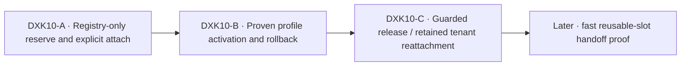

# DXK10 | Demand-driven development environment lifecycle

**State:** PROPOSED BACKLOG, PLANNER-HELD; not Cursor-ready or commissioned. **Selected technical contract:** [developer environments](../../../../../docs/technical/platform/developer-environments.md) and [human-first view](../../../../../docs/architecture/10-developer-environments.md). **Integration target:** `undertaking/storyteller-workshop`. **Owner:** developer infrastructure. **Dependency:** preserve current DXK09 implementation/proof; no concurrent edits to lifecycle tools. **Source basis:** originally `955e904b`; updated source inspection of integrated `fb5bf588` (DXK11 included) on 2026-11-23. **Execution decomposition:** [DXK10-A reserve/attach packet](../../../open/2026-11-23--dxk10a-reserve-attach-foundation/CHANGE.md) is prepared and separately bounded; DXK10-B selective profiles and DXK10-C guarded retained-tenant release remain planner-held, not automatically commissioned.

## Owner decision / user experience

A Change, Git worktree, environment reservation, checkout attachment, tenant provisioning, application activation, and resource release are **distinct lifecycles**. Any Change may be completed without acquiring an environment. Agents reserve an environment *when they need one*, possibly well after Change start, then stop/release it whenever appropriate, independently of Change archive. Reserving an identity allocates **zero application pods** and performs no build, SQL/S3/Temporal provisioning or mutation of another environment. An environment can be reserved without a live checkout attachment, and a checkout can exist without any reservation.

Application activation is demand-driven. A Cursor may activate a minimal, explicitly named capability/profile and later expand/shrink that selection, or request the full six workloads for integration proof. No silent fallthrough to another slot's API/Authority/worker. Shared backing services remain separate from per-slot application profiles; release lab stays independent and on-demand. Four fully healthy simultaneous stacks remain DXK09's **separate capacity acceptance target**, not a redefinition of reservation correctness.

**Decisions:**
- Preserve v2 registry environment IDs, dynamic port bundles, secrets, SQL/S3/Temporal identity, PID+start-ticks fencing, resource UID checks and local-only session records. No Git-tracked occupancy ledger.
- Keep `pnpm dev` as a backward-compatible convenience for the existing full-stack workflow during migration; do not silently change its meaning before the new explicit commands are proven.
- Add explicit *planned* operations `dev:reserve`, `dev:attach --instance <id>`, `dev:up --instance <id> --profile <name>`, `dev:stop --instance <id>` and `dev:release --instance <id>`; exact arguments and aliases are subject to current source reconciliation, not authorization for Cursor now.
- Reservation is local registry-only and must reject conflicts atomically; attach changes only source binding subject to an existing live-session fence; start reconciles only requested tenant/runtime dependencies; stop parks owned runtime while preserving reservation, attached checkout and tenants; release frees an idle reservation only after verified process/port/workload ownership and must **not** delete data.
- For retained tenant data: before allowing an environment ID or credential mapping to be reused, enforce an explicit non-reassignment rule or guarded reattachment to the same existing tenant identity. The exact tombstone/retention mechanism must be source-decided before implementation; **no implicit tenant wipe, tenant reassignment, secret rotation or ID reuse**.
- Start with a tiny profile catalog (`web`, `api`, `full`) only where dependencies are demonstrated. SQL/schema-only work needs no application profile. A profile resolves a validated dependency closure, not raw arbitrary pod names. Model traffic crossing a missing service as NOT READY rather than silently borrowing another environment.
- Read-only status never reserves, attaches, starts, provisions or releases. Separate `RESERVED`, `ATTACHED`, `PROVISIONED`, `ACTIVE(profile)`, `PARKED` and `RELEASED` dimensions; avoid treating these as one mutually exclusive state enum when they are independent facts.
- All admission/preflight refusals occur before tenant, workload, session or process mutation. Memory safety and existing 4 GiB preflight stay as-is until measured capacity warrants an independent decision.
- No automatic cleanup on Change completion, chat exit, or transient agent inactivity. No generic manager daemon, Kubernetes controller, Terraform/Helm/GitOps migration, or redesign of INF02 under this Change.

## Admission and partial-start rollback: decided failure contract (2026-11-23)

**Capacity claim:** Three simultaneous Cursor chats can work independently, but three full-stack activations are **not** guaranteed on a 20 GiB WSL budget. Two successful full stacks previously reached roughly 2.64 GiB MemAvailable and 3.38 GiB swap used. Do not lower the existing 4 GiB preflight, increase WSL or assume third-stack viability from a slot reservation. A reservation is not an admission guarantee.

**Activation semantics:**
1. The requested profile resolves to a deterministic set of required workloads before any mutation. Verify own slot/checkout binding, owner process fence, other live sessions, available ports, cluster context and capacity first. A missing service in the dependency closure is a planning error, never a fallback to a foreign slot.
2. Reconcile only the selected slot and requested roles. Inactive roles are explicitly parked (desired replicas zero) and are displayed as `INACTIVE`, not `NOT READY`. Readiness success requires **all** requested roles to be healthy and generation-current, plus required host endpoints. Stale image / old Kind image cannot count as ready while rollout is pending.
3. Startup is a bounded **attempt**, not success merely because some pods are Running. On timeout, insufficient memory, OOM/resource pressure, repeated crash loops or an unsatisfied required role, terminate only the attempt's owned process/port-forward, scale **all roles activated by the attempt** to zero (or restore the validated pre-attempt desired profile when safely replacing an existing session), verify their observed desired state, and report a deterministic `capacity-blocked` versus `startup-failed` result. No healthy fragment of a rejected fresh activation may remain running. Preserve tenants, credentials, images, slot identity, source attachment and other sessions. If cleanup fails, return `rollback-incomplete` with exact owned identifiers; no silent retry or false PARKED.
4. A low-memory admission refusal must happen before tenant, workload, registry-binding or process mutations. A launch that passed preflight but later exhausts available RAM is still obligated to park its own partial runtime. Capacity is **not reserved** by the initial MemAvailable check.
5. Cooperative contention: no chat-level global mutex, FIFO or automatic Kubernetes scheduler is introduced. Agents use the canonical status to see own occupancy, release their own unused runtime, and defer activation until measured headroom returns. Do not forcibly release another agent's slot, delete lab resources or loop-retry an unchanged blocked launch.
6. Explicit lifecycle boundaries: `reserve` is registry-only; `attach` affects source binding only; `up(profile)` may lazily provision only its proven dependencies; `stop` parks compute but retains tenancy and reservation; `release` requires no owned live processes/workloads and maintains tenant non-reassignment protection. No Change archive event implicitly triggers any of these transitions.

**Cheap proof required:** inject failing second role after one healthy role and verify automatic rollback to zero with foreign B unchanged; low-memory before mutation; memory drop during startup; mixed-profile inactive classification; recovery when resources later become available; rollback failure truthfulness; simultaneous reserve collision; wrong-owner refusal. Live proof should start one minimal Web profile and independently run two agent checkouts without requiring two six-workload stacks. Do not claim selective activation for a Web flow that actually needs API/auth unless dependency closure has been traced.

## Source inspection and ownership seams

Inspected `scripts/repo-tools/dev-environment-session.mjs::resolveDevEnvironmentSelection`: `new` allocates and returns `action:'up'`; `up` with no default allocates one. This currently couples reservation and activation. `scripts/repo-tools/dev-tilt.mjs::runDevTiltLaunch` invokes `reconcileOwnedDevSlot`, process replacement, runtime preflight and spawn; exact post-`6328a427` order must be verified before editing. `scripts/repo-tools/dev-slot-startup.mjs::reconcileOwnedDevSlot` calls `reconcileDevSlot` with SQL migration, S3/Temporal tenant and image/workload setup; these effects must become independently gated. `infra/kubernetes/lab/dev/backing/dev-slot-app-graph.mjs::deployment` hardcodes `replicas:1` for all six; renderer needs desired-role selection that preserves Services/Secrets and safe inactive role behavior. `package.json` exposes `dev`, `dev:new`, `dev:status`, `dev:stop` and no separate reservation/activation/profile commands in inspected snapshot. Tests include `scripts/repo-tools/dev-v2-cli-startup.test.mjs`, `dev-tilt.test.mjs` and slot graph/startup tests.

Dependency boundary: DXK10 changes **behavior**, not package ownership. INF02 is a deferred, separately authorized code-organization proposal and must not be merged into this implementation.

## Planner decisions after DXK10-A (not Cursor assignments)

**DXK10-B (selective activation):** source inspect `renderDevSlotAppGraph::deployment`, `renderTiltDeploymentDocuments`, Tilt image registrations and `runDevTiltLaunch` readiness. The current graph hardcodes six `replicas:1` deployments. Product-facing browser uses `API_PROXY_ORIGIN` / `API_INTERNAL_ORIGIN`; API calls Game Authority, so a `web` profile may not consist of just the Web Pod. Conservative proposed closures are `api = API + Authority`, `web = Web + API + Authority`, `full = all six`, but exact health and auth dependency tests must prove them before Cursor-ready promotion. Inactive roles must show INACTIVE, not healthy or failed. Tilt must not reconcile unrequested roles back to one replica. Preserve cache/image generation and rollback correctness; record scoped resource budgets.

**DXK10-C (retained tenant / guarded release):** never recycle `dev-N` IDs or credentials. Treat release of an unprovisioned reservation as a registry state transition and port reclamation only after read-only proof of zero external resources. A provisioned slot must retain a durable tombstone/tenant binding and cannot be implicitly reassigned; explicit later reattachment must check session PID/start ticks, all Pod desired replicas, listeners, resource UIDs, tenant identity and source generation, with fail-closed unknown states. Source ownership cannot be swapped by merely rewriting `worktreePath`. Port reclamation for tombstones requires a separate validity invariant and live listener check. No destructive tenant cleanup in DXK10.

## Original planner checklist for the entire DXK10 program

1. Re-read actual integrated DXK09 HEAD and any in-flight local branch diff; map registry v2 locks, allocation, default checkout mapping, sessions, stop/park behavior, workload application, Tilt resource selection, image and tenant lifecycle. Preserve all current DXK09 proofs.
2. Decide the reservation/release data model under persistent tenants, including released/tombstoned IDs, uniqueness across registry resets, exact atomic mutation boundary, reattachment authorization and recovery after crash.
3. Decide activation profiles from actual API/Web/Authority/worker dependency edges and test-only modes. Specify how selected replica counts and readiness are reconciled without deleting resource UID or restarting unrelated roles.
4. Create source-grounded `SOURCE-MAP.md`, `EXECUTION.md`, `TASKS.md`, `PROOF.md` with small ordered code tasks and exact functions. Require current-HEAD regression contracts for `pnpm dev`.
5. Perform the repo's adversarial G0–G7 readiness review; promote only when hard gates are resolved and implementation is explicitly commissioned.

## Required future proof

- Change/worktree with **no** environment works normally; status performs zero mutations.
- Reserve allocates unique ID/ports but **no** Kubernetes Deployment, SQL/S3/Temporal tenant, image build, Tilt process or port listener; concurrent reservations are collision-free.
- Attach/rebind refuse foreign live process or unverified PID/start-ticks; never signal another owner.
- Start one minimal profile and verify only required roles run; expand to full, shrink safely, no cross-slot fallback or false READY for inactive roles.
- Park A without impacting B; reattach/restart preserves A tenant and Kubernetes identity; release of truly idle A changes only appropriate reservations without deleting resources or freeing a still-live tenant identity to a different owner.
- Negative: low RAM/missing OAuth, foreign ports, wrong context, stale session, partial provisioning, compile error, missing service, race of two reservers and process crash all fail closed with no cross-environment mutation.
- Exact workload/host RAM and swap measured; no invented four-stack capacity PASS. Both one-stack and full-stack regression proof remain available.
- Existing `pnpm dev` workflow works throughout transition, until any intentional deprecation is separately approved.

## Dependency and dispatch policy

**Do not add DXK10 tasks to active DXK09's current Cursor implementation branch.** DXK09 must first resolve its current watcher-image packaging error and continue its honest two-worktree/unattended tests. This proposal can be planned in parallel by ChatGPT, but implementation touching `dev-tilt.mjs`, `dev-environment-session.mjs`, registry/session, startup, Tilt or deployment renderer must not overlap DXK09's active writer. HR01–HR03 may use worktree/source-only tests or documented staggered full-stack runs under a separately verified DXK09 dispatch gate; DXK10 is **not** an automatic new HR blocker.
