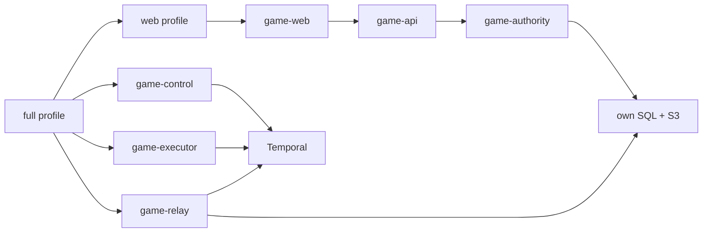

# DXK10-B | Source boundary for selectable developer workload profiles

**Planner orientation, 2026-11-23.** Inspected the supplied clean source snapshot `a755b183` and integration branch before HR01 finishes. **Proposed/backlog, not Cursor-ready.** No Kubernetes or Docker work was run.

## Source diagnosis

| Real owner | Current behavior | Required profile contract |
| --- | --- | --- |
| `tools/dev-environments/src/rendering/dev-slot-app-graph.mjs::deployment` | Hardcodes `replicas:1` on six Deployments | Deterministic desired replicas from a validated dependency-closed profile, while retaining identical namespaces, Services, secrets and slot labels |
| `renderDevSlotAppGraph` / `renderTiltDeploymentDocuments` | Both produce six one-replica Deployments | One pure profile resolver feeds **both** startup and Tilt; no separate uncoordinated scale policy |
| `infra/dev/Tiltfile` | Registers four custom-image builds and all six `k8s_resource` Deployments; live sync closure per role | Do not let a Tilt resync turn intentionally inactive workloads back on or create an unrelated resource writer |
| `tools/dev-environments/src/application/dev-slot-startup.mjs::reconcileDevSlot` | SQL, migration, S3, Temporal, image and workload ensure happen sequentially for every up | Enforce role prerequisites before mutations, lazily reconcile only dependencies selected by accepted profile where feasible; source identity stays pinned |
| `tools/dev-environments/src/cli/dev-tilt.mjs::{collectOwnedWorkloadReadiness,assessDevLaunch,runDevTiltLaunch}` | Six workloads unconditionally must be ready | Readiness is **all selected roles current-generation READY; all unselected roles INACTIVE (desired=0)**. Never count an inactive role ready or mark it failed for intentional zero |
| `tools/dev-environments/src/cli/dev-tilt.mjs::rollbackFailedOwnedStartup` and `dev-environment-session.mjs::parkSelectedEnvironment` | Full six-role park/rollback | If a profile activation fails, fence the owned attempt, return selected newly activated roles to zero (or verified prior profile), and preserve tenant UIDs and foreign slots; report incomplete rollback honestly |

## Decision: distinguish `READY` for a profile from playability

Existing dev graph has **Web → API → Game Authority** addresses; API/GA need database and S3 credentials. The Worker trio (control/executor/relay) connects Temporal, and relay reads SQL/S3. Without workers, a page can render and read a previously committed story, but a new scripted opening, command completion or durable publication cannot be assumed. In particular, a 200 from Web or Nest is not proof that the game can advance.

Proposed minimal catalog, subject to a focused final dependency test:

| Profile | Desired application roles | What READY may claim | What it must not claim |
| --- | --- | --- | --- |
| `api` | `game-api`, `game-authority` | Read and HTTP/API debugging, auth and existing committed state | Guaranteed new story or background continuation |
| `web` | `game-web`, `game-api`, `game-authority` | Browser/Web edits, SSR, sign-in and read-only UI journeys | Fully progressing campaign without worker trio |
| `full` | All six, including `game-control`, `game-executor`, `game-relay` | Existing six-role readiness contract | End-to-end story acceptance without TURN03 proof |

**Important source caveat:** This is a static dependency inference from Deployment environment variables and service routing, **not yet** a live authenticated profile test. Final `web` / `api` acceptance must verify minimum dependencies against current startup and auth paths, including identity and read-only story snapshots, before marking a Change Ready.

## Architectural decisions and hard gates

1. **Profile value is validated before side effects.** Only exact catalog names; no arbitrary list of Pod names, no hidden `web` fallback to foreign slot. Keep legacy `pnpm dev` meaning `full` unless separately ratified.
2. **One desired-role function.** It must feed the application graph and Tilt's declarative Deployment list. Do not use a post-`kubectl apply` scale-to-zero as the sole profile implementation while Tilt's YAML says replica 1. Preserve immutable selectors/labels/images and zero actual app replicas for unselected roles.
3. **Readiness is profile-scoped and truthful.** A selected role needs actual generation, image digest, compiled entry and health; an unselected role requires desired=0 and is `INACTIVE`. The current `assessDevLaunch` and `printDevStatus` assume six, so both need one consistent profile snapshot. An unexpected running inactive role is a mismatch, not an acceptable extra.
4. **Admission and rollback.** Preflight before tenant, processes or workload mutation. On second-role failure, stop only attempt-owned runtime and read back desired replicas; if rollback fails, surface `rollback-incomplete` and do not free lease. No full-stack capacity claim based on one lightweight profile.
5. **Retain worktree/tenant ownership.** DXK10-A's reserve/attach registry is independent of Pod activation. No tenant reassignment or `dev:release` in B; C separately owns those rules.
6. **Image identity.** A common union image still may be used for selected roles. Do not resurrect ten `kind load` operations or trust timestamps for source digests. Skip unnecessary role work only after truthful image/source proof.
7. **Integration coordination.** HR01 edits API application code, not this dev-lifecycle graph. Stage source-only profile tests independently, then perform one operator-owned lightweight activation when authorized and resources allow. Never run three six-Pod stacks to prove a source-only selector.

## Next planner investigation before promotion

- Inspect actual rendered app graph consumers, `applyOwnedSlotWorkloads`, `renderTiltDeploymentYaml`, Tilt live-update resource ordering, `runDevTiltLaunch` readiness, status and park tests against **new current HEAD** after HR01 integration.
- Freeze a matrix: **profile × required backing service × expected HTTP endpoint × readiness evidence × rollback behavior**, with exact positive and negative fixtures. Verify whether `api` can omit Web, and whether `web` can safely omit Temporal and all worker roles while offering only read/debug capabilities.
- Decide profile upgrade/downgrade transaction: authority of current desired profile, how inactive roles are parked before declaring the new profile READY, handling Tilt resync/failed partial rollouts, and how an old session profile is recovered after host crash.
- Prepare bounded `SOURCE-MAP.md`, `EXECUTION.md`, `TASKS.md`, `PROOF.md` in a separate next-days DXK10-B packet only when the design and G0–G7 hard gates close. Do not outsource architecture to Cursor.

**Audit result:** PLANNER-BLOCKED for implementation; concrete ownership and negative proof surfaces now mapped. This is separate from the TURN03 release acceptance runner and DXK10-C retained-tenant release.