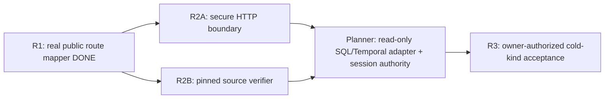
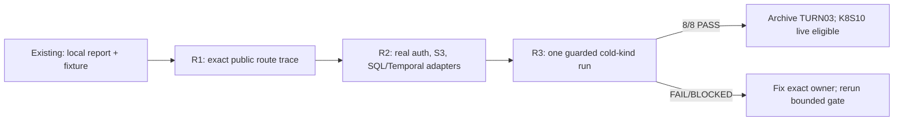

# TURN03 | next execution route after current-head audit

**2026-11-23 · source baseline `a755b183` · Existing Change remains OPEN.** [Source map](SOURCE-ROUTE-MAP-2026-11-23.md) · [release audit](../../../undertakings/storyteller-workshop/RELEASE-PROOF-AUDIT-2026-11-23.md).

## Next R2 source-only lanes after R2A/R2B landed (2026-11-23)

R2A secure HTTP, R2B pinned fixture verification and [R2C scripted player-smoke composition](../../archive/2026-11/storyteller/2026-11-23--turn03-r2c-scripted-smoke-composition/CHANGE.md) are **Done at injected fake tier**, not a real login, S3 read or cross-Pod PASS. [R2D causal SQL observer](../2026-11-23--turn03-r2d-causal-sql-observer/CHANGE.md) remains a source-bounded fake-only packet. R2D owns only `causal-sql.mjs` and tests. TURN03 stays OPEN. Shared docs are integrated serially by one owner; no live cluster, DB access, OAuth login, release install, paid send or Pod deletion is authorized.

## R2 source-only parallel implementation lanes (2026-11-23)

**Parent TURN03 stays OPEN.** Two independently bounded supporting Changes are now ready for owner-commissioned source-only execution, after local writer/branch checks:

| Supporting Change | Exclusive code write | Proof level |
| --- | --- | --- |
| [TURN03-R2A secure HTTP transport](../../archive/2026-11/storyteller/2026-11-23--turn03-r2a-secure-http-transport/CHANGE.md) | `turn03/live-http.mjs` + test, source-only Done | Injected fake fetch. 6/6 PASS. Not a live login or cross-Pod PASS. TURN03 stays OPEN |
| [TURN03-R2B pinned fixture verifier](../../archive/2026-11/storyteller/2026-11-23--turn03-r2b-pinned-fixture-verifier/CHANGE.md) | `turn03/fixture-pins.mjs` + test, source-only Done | Injected read-only DocumentStore. 7/7 PASS. Not a live or cross-Pod PASS. TURN03 stays OPEN |
| [TURN03-R2C scripted player smoke](../../archive/2026-11/storyteller/2026-11-23--turn03-r2c-scripted-smoke-composition/CHANGE.md) | `turn03/player-smoke.mjs` + test, source-only Done | Injected route. 9/9 PASS. Not a live session or cross-Pod PASS. TURN03 stays OPEN |

**Integration policy:** Each supporting Change has its own linked worktree, change branch and closing receipt; merge serially into `undertaking/storyteller-workshop`; archive each accepted support Change separately. Neither can archive TURN03 or remove its live blockers. Auth/session handoff authority, live S3 access, read-only SQL/Temporal and actual cross-Pod evidence remain planner-held. No third chat should begin cluster mutation.

## Reconciliation of implemented versus missing

**Already exists:** T01 read-only preflight, report schema/refusal tests; T02 synthetic injected-HTTP trace; T03 lower-tier adversarial/matrix harness, local fixture 4/4, local causal multiprocess 5/5. Source-only `node --test infra/kubernetes/lab/app-release/turn03/{preflight,run,adversarial}.test.mjs infra/kubernetes/lab/app-release/release-acceptance-preflight.test.mjs` passed **20/20** on the uploaded clean snapshot. This proves those tests only. Historical 2026-11-22 cold release stopped after scene1; Worker now has a retryable settlement status but no fresh cold retest.

**Missing:** real authenticated release actor, real S3 pins, no-synthetic HTTP operation path, read-only SQL/Temporal correlation, actual scene2/fork/recovery, one all-eight-gate report. K8S10 T05 remains a separate permission-gated live Pod deletion.

## Planner-decided task boundaries

**R1 status (2026-11-23):** source-only public-route correction. The injected runner calls the real Nest draft, opening, start, resolution, receipt, historical-scene and fork methods, keeps frozen operation identities, bounds polls, and still marks every gate local/mocked. It is not live acceptance. TURN03 stays OPEN.

**R2A status (2026-11-23):** source-only secure HTTP adapter. `createLiveHttpRequest` reads an owner-only session file and calls an injected fetch. Tests passed 6/6. No OAuth login, cluster call, or write retry was run. R3 stays unstarted.

**R1 / source-only route correction (eligible for separate bounded implementation commission after local branch guard).** Exclusive writes `infra/kubernetes/lab/app-release/turn03/run.mjs`, its `run.test.mjs` and `adversarial.test.mjs` (and narrowly necessary new helper under same directory). Use the existing injected `http` contract; make the scripted state machine take frozen `{draftId,generationId,storyId,operationId,sourcePins,campaign}`, then dynamically capture `interactionId`, `optionId`, `scene1PassageId` and checkpoint hash from validated responses/evidence. Implement real method/path/payload sequence A–G and I/J from SOURCE-ROUTE-MAP; do not attempt a fake private GA commit, fake future, browser UI, or direct SQL in this slice. Bound opening/scene2 polls by injected max-attempts and sleeper (test deterministic without real delays). Freeze operation IDs, never resend a different logical command after 202/timeout. Missing scene checkpoint, option, auth, receipt or stage transition produces deterministic BLOCKED/FAIL and never PASS. **Preserve current runner's default read-only / mocked evidence tier**; do not flip any cross-Pod gate to PASS. Negative test: route exactness; 202 still pending; missing scene1 checkpoint rejects fork; duplicate command not emitted by operator; wrong-owner 401/403 abort; no writes or calls when `runDisposableKind=false`; all gates never real-PASS under injected fake. Tests: same four source-only files, plus `git diff --check`. If live response contracts do not fit existing report schema, stop with exact mismatch rather than inventing new DTO.

**R2 / real operator adapters (PLANNER-BLOCKED, not a Cursor task yet).** [Source-inspected operator custody and permission design](R2-OPERATOR-DESIGN-2026-11-23.md) selects operator-supplied OAuth cookie, preprovisioned pinned S3 fixture, and a separately authorized read-only SQL/Temporal/S3 evidence adapter. Exact browser origin and least-privileged evidence access remain blocked pending further source/host verification. Do not implement the operator CLI in the R1 slice. No test-user minting bypass, no user-scope bearer for Drafts. Preserve redaction and zero provider dispatch.

**R3 / single cold-kind accepted story (PERMISSION + PREREQUISITE GATED).** One operator only, `kind-offscreen-lab`, currently validated release identity, scripted/no provider calls. Run genuine draft→opening→start→resolution→scene2→SSE/GET→historical fork+child, plus negative/recovery matrix, exact SQL/Temporal/S3 identities. Any missing gate remains NOT-RUN/BLOCKED, no archive.

**R4 / closure:** once all eight gates pass, reconcile report and archive existing TURN03. Only then evaluate K8S10 T05 under separately confirmed Pod/run/cluster authorization.

## G0–G7 adversarial checkpoint

| Gate | R1 | Whole TURN03 |
| --- | --- | --- |
| G0 branch/permissions | CONDITIONAL: current local HR01 writer check and independent worktree | BLOCKED: only single lab operator, explicit auth and run permissions |
| G1 source map | PASS: exact Nest routes and existing local T09 test inspected | PARTIAL: actual installed S3/PG/Temporal access not yet source-decided |
| G2 design | PASS for injected-HTTP, mock-tier trace only | BLOCKED: auth, live fixture, evidence adapter and full negative matrix |
| G3 task simulation | PASS for single R1 bounded ownership + listed existing tests | FAIL: R2 would still require Cursor to design auth/provisioning |
| G4 parent dispatch | PASS with local pre-edit checks, one Change branch | FAIL for full live operator |
| G5 concurrency | R1 disjoint from HR01 app source; do not run broad tests writing shared DB | Single lab operator, no concurrent release installs |
| G6 proof | PASS as source-only scripted request/negative assertions, not real acceptance | NOT RUN for 8 release gates |
| G7 cost/closure | bounded local tests; integrate R1 but **do not archive TURN03** | one final live run after prerequisites, then reconcile |

**Verdict:** R1 **READY WITH EXPLICIT LIMITS** as a small source-only slice inside the existing TURN03 Change, subject to owner commission and live checkout ownership check. The entire TURN03 remains **PLANNER-BLOCKED** for live proof. Finishing R1 alone is not completing the commissioned TURN03 Change; parent should integrate accepted R1 to undertaking with an honest partial receipt and keep TURN03 open, not wait for unrelated live permission. R2 requires further ChatGPT decisions before dispatch.