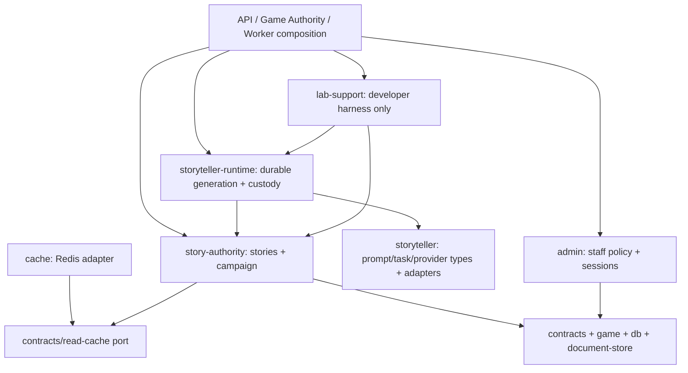

# Monorepo domain and module ownership | architecture decision dossier

**Status:** Proposed target, not selected technical authority or Cursor authorization. **Owner:** ChatGPT architectural planning and project owner. **Decision/review trigger:** after Writer Workshop landing and before starting the Modular Monolith Undertaking. This is an open Design within the existing code-architecture-health lifecycle, not a parallel permanent handbook. Promote accepted package boundaries and dependency law into `docs/technical/platform/`, then retire this dossier using the Design ledger and exact source SHA.

## Inspected source facts (2026-11-21)

Baseline `fa8e486533943e952c908c21af8d7a73aae84efa` on `undertaking/storyteller-workshop`, 2,890 Git tree entries; **15 workspaces** (4 apps, 9 packages, 2 tools). Package.json manifests and selected owners were read. No full-file AST import graph, transpilation, runtime tests or runtime telemetry has been run. Do not call this a complete source-level graph proof.

- `@offscreen/application`: 180 `src/**/*.ts` files, 1,747,669 bytes. Direct areas: `storyteller/` 63 files/741,865 bytes; `developer-tools/` 39/384,777; `stories/` 21/255,738; `campaign/` 32/229,309; `admin/` 13/102,357; plus generations, drafts, outbox, cache and logging.
- `@offscreen/storyteller`: 38 `src` TypeScript files, 358,961 bytes, owns provider request preparation, prompt/context schemas, model response parsing and OpenRouter transport, **not** SQL story authority.
- `packages/application/src/stories/index.ts:createStories` composes campaign operations, Storyteller recovery, document storage, SQL and developer Chamber response fixtures; `createStoryApplication.read` calls `chamberAllowsResponse(source)` for a production-facing projection. `developer-tools/chamber.ts` in turn imports `createStoryApplication`.
- `stories/resolution.ts` imports `storyteller/admission.ts` and generation helpers; `storyteller/publication.ts` imports `stories/{continuation,persistence,scene-checkpoint,errors}` and `campaign/{holds,persistence,delegated-offer}`. **Bidirectional source-domain coupling** is real even though separate npm packages currently have no obvious direct manifest cycle.
- Inspection at `fa8e486533943e952c908c21af8d7a73aae84efa`: `@offscreen/cache` imported `ReadCache` as a type from `@offscreen/application/cache`. **Landed in MA02:** the neutral port is `@offscreen/contracts/read-cache`; the Redis adapter depends on contracts, and application only re-exports it.
- `@offscreen/contracts/campaign` imports `@offscreen/documents/schema`, yet `@offscreen/documents` also owns `s3-store.ts` and `@aws-sdk/client-s3`; schema dependency and infrastructure ownership coexist in one workspace.
- `apps/api`, `apps/worker` and `apps/game-authority` all consume broad `@offscreen/application/*` subpaths. The exported `@offscreen/application/storyteller` index has ~39 wide star exports including a test-only synthetic insert.
- Existing `eslint.config.mjs` guards `game`, `contracts`, `storyteller`, `workflows` and the browser, but does **not** assert the intended direction between `application/stories`, `application/campaign`, `application/storyteller` and `application/developer-tools`.

## Diagnosis (confidence)

**High:** one coarse application package hides multiple mutually dependent business subdomains and development infrastructure; manifests alone cannot prove modularity. **High:** the Chamber import into ordinary story decisions is a misplaced dependency. **High at inspection, closed by MA02:** the cache adapter used a higher-level application port because the neutral contract lived in Application. That dependency now points at `@offscreen/contracts/read-cache`. **Medium:** broad wildcard barrels create unnecessary API/coupling risk; exact consumers and build effects have not been exhaustively measured. **Not established:** exploitable security defect, actual package cycle, TypeScript unsoundness throughout, exact optimal final partition, or that any large class should be moved without behavior-sensitive proof.

## Selected design recommendation for owner review: modular monolith, not service proliferation

**Dependency law:** pure `game` does not import business services; `contracts` has no dependency on application/runtime/worker; `storyteller` cannot import SQL authority; `story-authority` must never import `storyteller-runtime` or developer fixtures; `storyteller-runtime` may depend on authority-owned *stable ports* but may not bypass Game Authority's authorization/transaction/publication fences. App/worker/server composition is outermost. There is **no new network service requirement**: these are workspace/module ownership boundaries.

Proposed domains after seam proof:
1. `@offscreen/admin`: move the existing `application/src/admin` business module as one cohesive unit, retaining a temporary `@offscreen/application/admin` re-export. Existing API Admin controller remains HTTP/Nest-owned.
2. `@offscreen/story-authority`: group **stories + campaign** because they share transactions and types; avoid separating them simply to obtain more packages. Existing `outbox` transaction helpers stay available as a stable lower-level port or temporarily remain in the compatibility layer. Exact migration only after injection/port design.
3. `@offscreen/storyteller-runtime`: durable operations, capture, budget, publication, Writer custody; initially retain `@offscreen/storyteller` for request/proposal/provider logic. Naming alone must not determine a safe move. `application` becomes a thin temporary façade, then is retired if no genuine use-case composition remains.
4. `@offscreen/lab-support` (name to ratify): developer evaluation fixtures, tools and synthetic injections. **Nothing in production domain authority may import it**.
5. Document schemas versus S3 adapters: decide whether separate `@offscreen/document-model` / `@offscreen/document-store-s3` or existing subpath exports give enough isolation; inspect actual import closure and installed bundle before adding a workspace.

**Reject:** packages per class/function, immediate story/Writer directory shuffle, putting SQL Game Authority into pure `storyteller`, distributed microservice decomposition, parallel rewrites of active WR modules, an eternal compatibility façade with a different name, or a hard-coded domain-import whitelist without verified consuming modules.

## Dangerous cut: source-level cycles to resolve before extraction

- `stories/index.ts` → `storyteller/recovery.ts` and → `developer-tools/chamber-fixtures.ts`; callbacks/ports and explicit outer composition must replace these dependencies before authority extraction.
- `stories/resolution.ts` → `storyteller/admission.ts` (641 lines) and generation helpers, while `storyteller/publication.ts` → story/campaign transaction functions. **Do not** create two mutually importing workspace packages. The design choice is **dependency inversion**: story-owned authority API receives typed, injected generation admission/retry interfaces; publication may call story-owned narrowly exported transactional functions. Those ports and call sites must be source mapped and tests frozen before any file moves.
- `developer-tools/chamber.ts` → stories, while stories → chamber fixtures; place fixture-source policy at the outer composition boundary so the core does not import tests/dev support.
- Type-only adapter-to-application dependency in cache must move toward a minimal lower-level contract; runtime adapter still cannot own domain decisions.

## Criteria before target becomes normative

1. Run the MA01 package/source graph on the **post-Workshop integration HEAD**, including runtime/type-only import edges, SCCs, barrel/export consumers and manifest declaration checks. The manifest diagram above is only one layer.
2. Reconcile final package naming and authority with existing [selected engine modular-monolith target](../../../../docs/technical/engine/selected-architecture.md); no second binding spec here.
3. Decide interface/transaction owners for resolution admission, retry, generation, outbox and publication with real function/source routes; preserve exact story revision, custody, provider money, hash and retry semantics.
4. Record expected compatibility period and **deletion criterion** for old `application` exports; TypeScript build, NodeNext exports, Turbo task graph and all call sites must remain buildable at each boundary.
5. Owner accepts the package target; promote only then to `docs/technical/platform/` and mark implementation Changes ready. If graph contradicts these candidate boundaries, revise the Design here with exact evidence; do not send Cursor to choose a new architecture.

## Program ownership and disposition

[Monorepo Modular Monolith Undertaking](../../../undertakings/modular-monolith/UNDERTAKING.md) tracks MA01–MA06, without selecting any task. [Code-architecture-health README](README.md) remains the entrance. This Design retires when decisions are ratified and its active engineering questions are represented by specific Changes; historical reasoning remains via exact Git SHA/Design ledger.
