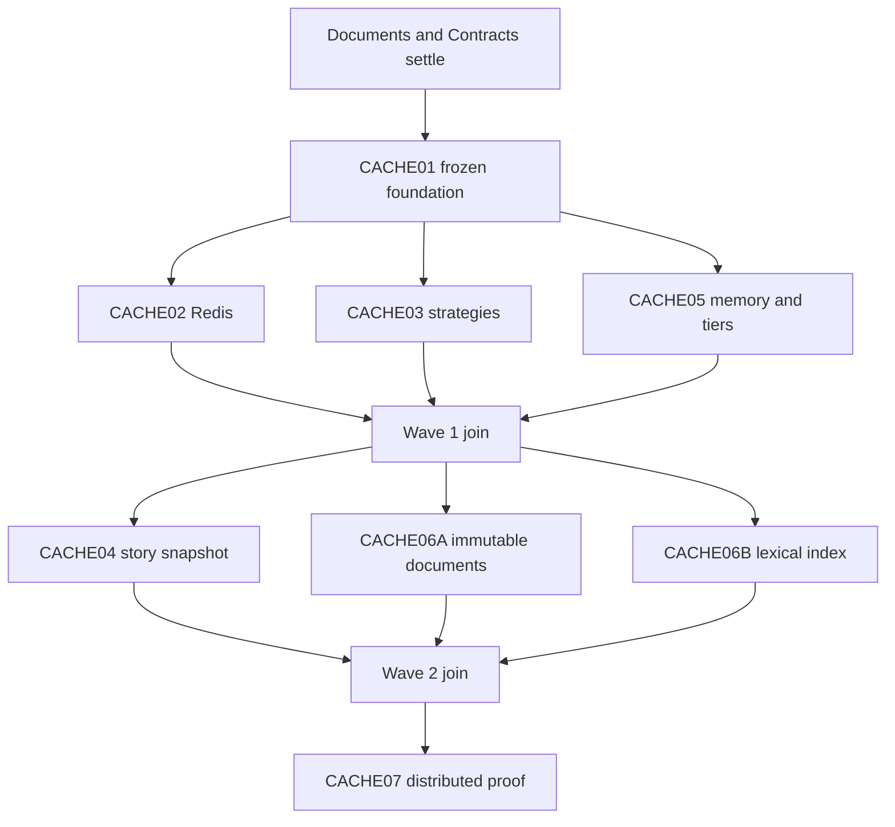

> **Current disposition 2026-11-25:** historical implementation schedule below is superseded. All eight original Changes are archived. CACHE04 source Done, CACHE07 superseded; VER06 source Done (owned Redis resource + harness migration + `pnpm verify package cache` source); live obligations remain VER07–08. CACHE08 source Done for residual runtime corrections (live still VER07/08). Main only. Do not dispatch old tasks or run legacy CACHE07 live CLI. [Current verification programme](VERIFICATION-PROGRAMME.md).

# Cache parallel implementation contract

Planning baseline: f28085e3e5cbf15bb32f430bd3b0b833f7429c6e, undertaking/storyteller-workshop. This is the implementation interface and coordination schedule for existing CACHE01–07, not a new Change, permission or queue. All eight packets are owner-commissioned as a finite dependency-gated batch. Post-DO07 release baseline: f26ce36dcee1bda6e9eee4d305ec6200ef924b44. CACHE01 admitted; successors execute after the actual dependency and exact interface gates pass, without requesting another owner release. Unresolved semantic contradictions or missing fixtures remain planner stops. The canonical [cache architecture](../../../docs/technical/platform/persistence-and-caching.md) owns semantics. CACHE01 parent owns the foundation join. CACHE02 parent (Cursor A) is the named integration custodian for both parallel waves, then CACHE07 parent owns final closure. One custodian only, no fourth paid agent. The coordinator serializes integration and shared docs/manifests, and must not self-select successors.

## Dependency DAG



No Redis implementation dependency for strategies or memory; no document dependency for lexical migration; no story migration prerequisite for memory. All three wave-1 branches start from the same integrated CACHE01 SHA. Wave-2 branches start from the same joined wave-1 SHA. This minimizes branch rebases and gives 1 + 3 + 3 + 1 Change schedule rather than eight serial Changes. Do not start any branch before its actual prerequisites; no live stack in either wave except separately authorized disposable SQL proof in CACHE04. Worktree and resource ownership remain mandatory.

## Foundation interface freeze (CACHE01)

Create the following interfaces in core/cache-store.ts, core/cache-policy.ts, core/cache-key.ts and core/cache-telemetry.ts; codecs in codecs/json-codec.ts, codecs/bytes-codec.ts. Names below are selected TypeScript interfaces, not observed code. CACHE01 owns all of them and the test script. All implementations use relative .js imports within Cache. No lane edits core during parallel work; contradiction returns to planner. Existing root index.ts stays legacy until CACHE02.

```ts
export type CacheEntry = Readonly<{
  bytes: Uint8Array;
  expiresAtMs: number;
  observedAtMs: number;
}>;
export type CacheBypassReason =
  | 'disabled' | 'unavailable' | 'timeout' | 'saturated'
  | 'circuit-open' | 'invalid' | 'oversize' | 'expired';
export type CacheLookup =
  | { kind: 'hit'; entry: CacheEntry }
  | { kind: 'miss' }
  | { kind: 'bypass'; reason: CacheBypassReason };
export type CacheWriteResult =
  | { kind: 'stored' }
  | { kind: 'skipped'; reason: 'oversize' | 'expired' }
  | { kind: 'bypass'; reason: CacheBypassReason };
export interface CacheStore {
  get(key: string): Promise<CacheLookup>;
  set(key: string, entry: CacheEntry): Promise<CacheWriteResult>;
}
export type CacheIdentity = readonly string[];
export type CacheClock = () => number;
export interface CacheCodec<T> {
  encode(value: T): Uint8Array;
  decode(bytes: Uint8Array): T;
}
export type CacheConsistency = 'immutable' | 'versioned' | 'expiring';
export type CacheDefinition<T> = Readonly<{
  namespace: string;
  version: number;
  consistency: CacheConsistency;
  codec: CacheCodec<T>;
  policy: Readonly<{
    ttlMs: number;
    maxEntryBytes: number;
    jitterRatio: number;
    maxActiveKeys: number;
    maxWaitersPerKey: number;
    originConcurrency: number;
    originQueueLimit: number;
    originQueueTimeoutMs: number;
  }>;
}>;
export type CacheTelemetry = (event: Readonly<{
  namespace: string;
  tier: 'l1' | 'l2' | 'origin' | 'runtime';
  operation: 'get' | 'set' | 'load' | 'coalesce' | 'evict' | 'connection' | 'breaker';
  outcome: string; // closed implementation-owned vocabulary, never arbitrary input
  durationMs?: number;
  bytes?: number;
}>) => void;
```

Core also exports makeCacheKey(environment, namespace, version, identity), validateCacheDefinition(definition), defineCache(definition) (identity function after validation), jsonCodec(parse), bytesCodec(), createDisabledStore(), createFakeStore(clock), emitCacheTelemetry(sink,event) (never throws). Key environment and namespace are lowercase ASCII token segments, max 50 and 64 chars respectively; positive safe integer version; identity 1–16 components each 1–1024 UTF-8 bytes, total <=4096 bytes; hash canonical concatenation of each 4-byte unsigned big-endian length followed by UTF-8 bytes, preceded by 4-byte component count. Reject unpaired surrogates to avoid lossy UTF-8 collisions. Output environment:namespace:vVERSION:sha256hex. All entry times safe integer epoch milliseconds; observation <= expiry; expired entry never hit. Max policy entry 1 MiB; default configured by caller per selected spec. Codec encodes validated values; parse both directions; strict UTF-8 decode; bytes copy. Absolute expiry derived from origin observation plus jittered TTL, not tier write time. Core test adapters use same outcomes, copy bytes, injected clock; fake store is test-only, not unbounded production store.

CACHE01 publishes ./core and ./codecs via src/core/index.ts and src/codecs/index.ts; test files src/cache01-*.test.ts. Test command pnpm --filter @offscreen/cache test builds then node --test dist/*.test.js. Root export remains legacy. Core must not depend on Redis SDK or strategy/adapters. No future exports pointing at missing files.

## Wave 1 interface commitments and exclusive writes

| Lane | Owns (relative to packages/cache/src) | Read-only dependencies | Tests |
| --- | --- | --- | --- |
| A CACHE02 | index.ts; adapters/redis-store.ts; runtime/redis-connection.ts; runtime/redis-config.ts; resilience/redis-circuit-breaker.ts; redis/index.ts | core and codecs | cache02-*.test.ts |
| B CACHE03 | strategies/**; resilience/single-flight.ts; resilience/bulkhead.ts | core and codecs | cache03-*.test.ts |
| C CACHE05 | adapters/memory-store.ts; adapters/tiered-store.ts; memory/** | core and codecs | cache05-*.test.ts |

No lane writes package.json, lockfile, tsconfig, other lane files, core, shared README, STATUS, canonical docs, queue or catalogs while peers work. Use relative imports from lane-specific tests and the existing package test script. Worktree-local dist and node_modules only. CACHE02 exposes legacy createCacheAdapter with unchanged cache/enabled/close and additional store: CacheStore; root legacy JSON keys remain unchanged until consumer migration. New Redis byte entries use only new canonical keys, envelope format v1, bounded base64 payload + observed/expiry integer fields; atomic PX remaining time; validate before decoding. Redis transport does not import strategy or memory. CACHE02 exports createRedisStore via redis/index.ts.

CACHE03 owns strategies/index.ts, exports bindCache<T>(definition, {store, environment, clock?, random?, telemetry?}) returning {getOrLoad(identity: CacheIdentity, load: () => Promise<{value:T; identity:CacheIdentity; observedAtMs:number}>, options?:{signal?:AbortSignal}):Promise<T>}. DefineCache and policy validation remain core-owned. Loader must be called under authorized domain preflight; observed identity controls population. For expiring strategy in this first slice, skip all shared writes without monotonic fence (no unversioned mutable overwrite). Source error propagates; cache errors bypass; caller cancellation only detaches waiter. Export createSingleFlight<T>(options:{maxActiveKeys:number;maxWaitersPerKey:number}) returning run(key:string, load:(canPublish:()=>boolean)=>Promise<T>, signal?:AbortSignal):Promise<{value:T;coalesced:boolean}>, invalidate(key), clear(). Old in-flight generations retain actual active capacity until settle; invalidation detaches mapping, not work. Overload throws named CacheOverloadError; no hidden fallback to unbounded origin. Bulkhead and timer logic internal; telemetry uses core sink, never edits Redis.

CACHE05 owns memory/index.ts and exports createMemoryStore({maxBytes,maxEntries,clock?}):CacheStore, createTieredStore({l1:CacheStore,l2:CacheStore,clock?}):CacheStore and createWeightedLru<T>({maxBytes,maxEntries,weight:(value:T)=>number,copy:(value:T)=>T}) returning get(key):T|undefined, set(key,value):boolean, delete(key), clear(). Weighted LRU charges validated weight + fixed 128 bytes per entry; no eviction on rejected admission; copy in/out; count and bytes bounded. Memory store enforces expiration on get and admission, and removes expired entries before live eviction; tiered store is generic composition over CacheStore only; test with core fake L2, never import concrete Redis or strategy. L2 promotion preserves exact entry times, writes independent; reject expired entries before promotion. A store hit is not a domain-validated hit; the strategy decodes/validates it before returning. Cache failures cannot prevent source read.

## Wave 1 join (single custodian)

Serialize accepted squash joins CACHE02, CACHE03, CACHE05 (or completion order if identical ownership); each receipt includes branch SHA, test command/result and owned diff. No concurrent merge or shared docs write. The custodian adds only explicit package exports for ./redis -> dist/redis/index, ./strategies -> dist/strategies/index, ./memory -> dist/memory/index, with types/default .d.ts/.js, after corresponding modules exist. Add direct @offscreen/cache workspace dependencies to packages/story-engine/package.json and packages/documents/package.json once as the explicit preparatory wiring for wave 2, regenerate lockfile with pnpm install --lockfile-only then pnpm install --frozen-lockfile, verify graph. No unused-dependency waiver: if repo guard rejects preparatory dependencies, planner arranges a separate serialized mechanical wiring commit with actual imports before wave-2 dispatch; do not ask children to improvise. All three lane branches leave manifests untouched. Run joined cache package test and typecheck; confirm core and memory imports do not load Redis, no inverse domain edge. Reconcile shared docs/catalog/status once per join and archive accepted packets; keep this contract at its stable undertaking location until all successors close. Do not claim source-only tests are live proof.

## Wave 2 ownership

| Lane | Exclusive production and test files | Frozen inputs |
| --- | --- | --- |
| A CACHE04 | packages/story-engine/src/stories/reads.ts and read-cache-options.ts; apps/api/src/app.ts and main.ts; tools/api-integration/test/stories-core.integration.ts | CACHE02 store + CACHE03 bindCache; existing legacy options preserved for tests; no L1 by default |
| B CACHE06A | packages/documents/src/s3-store.ts and local-store.ts, new immutable-read-cache.ts, packages/documents/test/document-read-cache.test.mjs | CACHE03 immutable strategy + CACHE05 memory; optional injection only, default off, origin read caps unchanged |
| C CACHE06B | packages/story-engine/src/storyteller/lexical-story-index-cache.ts; tools/api-integration/legacy-engine-tests/lexical-story-index-cache.test.mjs | CACHE03 single-flight + CACHE05 weighted LRU; no snapshot policy or API changes |

Both story consumers share the Story Engine manifest only at the prior serialized wiring barrier. Do not edit it in either worktree. Documents lane must not edit object-storage, library trie, navigation or domain permissions. If LIB08/LIB09 or other work still owns relevant files, wait only that lane; no unnecessary global wait. In lexical migration use restoreLexicalStoryIndex(snapshot) for copy isolation, preserve existing hit/coalesced stats and maxEntries default 8; weighted budget 32 MiB, skip oversize rather than lose authoritative build. Durable write failure is nonfatal; check canPublish before remembering; no late local repopulation after invalidation. Run the specific legacy test from root after building its actual imports; planner refreshes old test import paths and exact fixtures before dispatch. Story snapshot lane alone edits API main/app (actual composition). CacheStore injected only after authorization preflight; use actual built identity; no route change.

All three parents use independent worktrees, no shared build output. Wave-2 custodian serializes joins and closes shared docs/catalogs/ledger. CACHE07 source harness is Ready after joined consumer source; [exact fixture and commands](../../changes/archive/2026-11/cache/2026-11-24--cache07-distributed-proof/PLAN.md). Live execution alone requires explicit disposable local Docker Redis authorization. No live SQL, paid providers, Kubernetes or shared cache flush. CACHE04 SQL proof remains independent.

## Readiness

This revision removes false dependency edges and freezes the interface shape; it is not a readiness certificate on future post-DO07 source. At release baseline Contracts workspace is absent; cache and Story Engine import @offscreen/cache-port/read-cache, and legacy adapter remains intact. CACHE01 may start after local guard. Before each subsequent wave verify actual predecessor receipts, exact frozen signatures, test fixtures, source ownership, local worktrees and named custodian. Future-source readiness is conditional; no additional commissioning required. No tests run in this planning commit.
