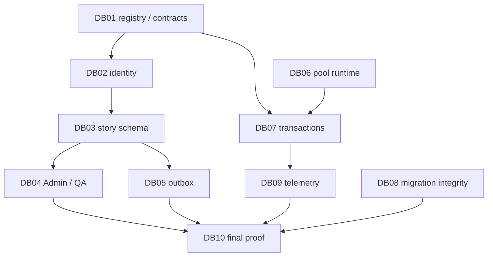

# Database redesign | parallel program

Planning baseline dbaefc4dafe84fbacb74067ccfa6f372f135545c; documentation commit fa77f2d3614ee821b8e4ad849a46a66342000132; target undertaking/storyteller-workshop. [Selected architecture](../../../docs/technical/platform/database-infrastructure.md). Owner commissioned DB01/DB06/DB08 for source work on 7033f654091a4fc66c7de6b0dce37e2b8fb504c1. Other seven remain Proposed pending their independent planner gates. Owner intends three Cursor chats. DB01, DB06 and DB08 are independently executable now; DB06 does not consume DB01 types, DB08 uses only existing config/migration APIs. Never let Cursor resolve the remaining planner gates by redesign. Cache work is already commissioned; preserve its ownership. DB06/08 infrastructure do not depend on Cache consumer edits; DB03/05 wait for CACHE04/06B and any active Story Engine/GA/Worker owners. No shared live DB tests.

| Stage | Cursor A | Cursor B | Cursor C |
| --- | --- | --- | --- |
| Wave 0 (released) | DB01 | DB06 | DB08 |
| Wave 1 | DB02 after DB01 | DB07 after DB01/06 | free or disjoint work |
| Wave 2 | DB03 after DB02 | DB09 after DB07 | free or disjoint work |
| Wave 3 | DB04 | free or disjoint work | DB05 if exact file map disjoint; else after DB04 |
| Final | DB10 | — | — |

Dependencies are edges, not global barriers: DB07 requires DB01 neutral types and DB06 runtime; DB09 after DB07; DB03 waits its own Cache/identity gates. One integration custodian (DB01 parent, then DB02 parent unless owner delegates) serializes actual merges and shared DB/consumer manifests, registry export keys, lockfile, status/catalogs and docs. While Cache is active, coordinate with Cache custodian on common integration checkout; do not start independent pushes. Each parent uses separate linked worktree and branch guard. Runtime lanes write only new src/connection, transaction, telemetry files and owned tests except database.ts/config.ts (DB06 then DB07), migrate.ts/cli and DB08 tests (DB08). Schema lanes own only named declaration moves and exact import tokens; integration custodian merges shared package.json keys and regenerates lock from combined manifests. DB09 may edit instrumented runtime files only after DB07. DB10 owns final graph guards. No cross-lane root index export collision: custodian adds explicit exports at each join; DB01 freezes Transaction and policy types, DB06 adds runtime property via database.ts without root-index edit, DB07 adds transaction property. No concurrent test schema mutation; source-only is default.

## Source ownership map (inspected live declarations)

| Old DB subpath / path | New owner export or file | Direct schema dependencies |
| --- | --- | --- |
| ./schema / schema/auth.ts | @offscreen/identity-persistence/auth | Drizzle |
| ./terminal-auth-schema | @offscreen/identity-persistence/terminal-auth | auth |
| ./terminal-auth-store | apps/api/src/modules/terminal-auth/store.ts | DB, identity |
| ./draft-schema | @offscreen/story-persistence/drafts | identity |
| ./generation-schema | @offscreen/story-persistence/generations | identity, drafts |
| ./story-schema | @offscreen/story-persistence/stories | identity, generations |
| ./campaign-schema | @offscreen/story-persistence/campaign | identity, generations, stories |
| ./launch-schema | @offscreen/story-persistence/launch | identity, generations |
| ./storyteller-schema | @offscreen/story-persistence/storyteller | generations; policy also identity; execution/writer/policy also funding |
| ./admin-schema | @offscreen/admin/persistence/schema | identity |
| ./qa-schema | @offscreen/lab-support/persistence/schema | identity |
| ./outbox-schema | @offscreen/outbox/schema | Drizzle |
| ./outbox | @offscreen/outbox/enqueue (Notice, enqueue); @offscreen/db (Transaction) | DB |
| ./outbox-relay | @offscreen/outbox/relay | DB, outbox |
| ./migrate | unchanged generic runner | pg, Drizzle |
| migrations/ | unchanged immutable SQL/journal | deployment assets |
| drizzle.config.ts / generate | tools/db-migrations | explicit per-family modules |

Identity must precede Story, Admin and QA because of real FK references. Temporary DB dependency on identity-persistence is permitted only until DB04 removes remaining schema imports; no new runtime domain edge. Schema migration is not DDL. Schema-only leaves have explicit named subpaths and no root barrel pulling app code. Admin/lab schema can live with existing runtime because DB never imports those packages. Migration composition tool depends on schema owners; DB never depends on tool (even dev dependency). Move schema identity tests to tool rather than create reverse DB test dependency. Preserve migration history paths for game-migrate Job, dev-slot-migrate.mjs, dev-slot-startup.mjs, lab sandbox, integration helpers, image closure; old baseline.mjs generation target changes only. Existing schema fingerprint is 20 Writer tables and frozen hash d6a9a98b262f8c31869e5ec75bc6f2fd14ac2a4f3c811a3cabfe52748759f3ba. Current release recounted exactly 71 pgTable declarations and three auth relations. Journal has 25 entries; latest checked-in snapshot idx4 has 48 tables. DB01 freezes synthetic current-schema identity and refuses tracked generation until DBOPS01 metadata reconciliation; no applied SQL/journal rewrites. No physical schema split, SQL changes, grants, provider calls or production deploy.

## Frozen runtime interfaces

DB01 owns src/transaction/types.ts, policy.ts and telemetry/types.ts. Export Transaction from root using existing Parameters<Parameters<Database['db']['transaction']>[0]>[0] without changing shape. Policy is readonly { name: string (registered semantic name), workload: 'interactive'|'worker'|'admin'|'migration', isolation: 'read committed'|'repeatable read'|'serializable', readOnly: boolean, retry: 'none'|'sql-only-conflicts', timeoutMs:number, statementTimeoutMs:number, lockTimeoutMs:number }; defaults and validation in technical owner. DB06 exposes managed withClient<T>(options:{timeoutMs:number;signal?:AbortSignal}, run:(client: PoolClient, remainingMs:()=>number, discard:()=>void)=>Promise<T>):Promise<T>; discard marks lease tainted, release once after callback settles. Use explicit optional signal, no abort claim after acquisition. DB07 exposes database.transaction<T>(policy, run:(tx:Transaction)=>Promise<T>):Promise<T>; name validated against bounded registered vocabulary before telemetry; no external side effects; no implicit retry. Error category closed: saturated, unavailable, timeout, cancelled, serialization, deadlock, constraint, lock-timeout, commit-unknown, closed, application, invalid-config. SQLSTATE walk max depth 4, cycle guard. Telemetry event closed operation acquire/transaction/retry/rollback/connection, workload, outcome, category, numeric duration/count; no dynamic strings or raw cause. DB01 type-only; DB06 and DB07 can use injected safe no-op sink; DB09 owns final instrumentation after both. Exact implementation proof for Drizzle transaction phase tracking is planner-held until pinned API verified: cannot substitute nested transactions or guess commit phase. No automatic domain adoption in this program; separately plan first actual SQL-only transaction after SQL01 source audit.

## Review and remaining gates

Wave 0 source promotion: [DB01 source map](../../changes/archive/2026-11/platform-operations/2026-11-24--db01-schema-composition-foundation/SOURCE-MAP.md), [DB06 execution](../../changes/open/2026-11-24--db06-connection-runtime/EXECUTION.md), [DB08 execution](../../changes/open/2026-11-24--db08-migration-integrity/EXECUTION.md). Current declaration count, config, runtime, migrations, pinned Drizzle 0.45.2 upstream source, existing fixtures, generator inputs, branch guard and shared ownership verified; exact source tests and stops selected. No local tests or live SQL performed by planner. DB01 owns manifest/lockfile/registry/index; DB06 owns database/config/connection tests; DB08 owns migrate and migration tests; only custodian updates default DB test script at serial join to include new db06/db08 source unit files. DB08 live proof NOT-RUN remains open, not a prerequisite to unrelated source work. CACHE04 source is joined, SQL proof remains open; CACHE07 harness/runtime correction owns Cache files, not DB. Coordinate shared docs joins with Cache parent; no DB schema extraction edits overlapping another active owner. DB02/03/04/05 still require exact current consumer maps; DB07 requires final transaction phase/typing decision using actual DB06 implementation; DB09 actual predecessor symbols; DB10 disposable fixture/resource permission. No paid investigation or false Ready claims. Existing known authority-writer graph violation and API integration exactOptionalPropertyTypes baseline must remain distinguishable. DBOPS01/02 and SQL01 remain complementary. No queue change.
