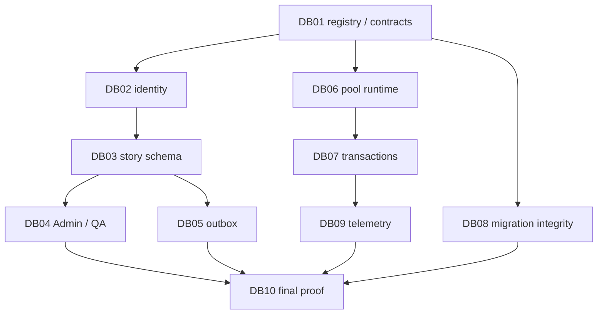

# Database redesign | parallel program

Planning baseline dbaefc4dafe84fbacb74067ccfa6f372f135545c; documentation commit fa77f2d3614ee821b8e4ad849a46a66342000132; target undertaking/storyteller-workshop. [Selected architecture](../../../docs/technical/platform/database-infrastructure.md). All ten Changes Proposed, not commissioned. Owner intends three Cursor chats. Never let Cursor resolve the remaining planner gates by redesign. Cache work is already commissioned; preserve its ownership. DB06/08 infrastructure do not depend on Cache consumer edits; DB03/05 wait for CACHE04/06B and any active Story Engine/GA/Worker owners. No shared live DB tests.

| Stage | Cursor A | Cursor B | Cursor C |
| --- | --- | --- | --- |
| Foundation | DB01 | — | — |
| Wave 1 | DB02 | DB06 | DB08 |
| Wave 2 | DB03 | DB07 | free or other disjoint work |
| Wave 3 | DB04 | DB09 | DB05 if exact file map disjoint; else after DB04 |
| Final | DB10 | — | — |

Dependencies are edges, not global barriers: DB07 can start after DB06 lands; DB09 after DB07; DB03 waits its own Cache/identity gates. One integration custodian (DB01 parent, then DB02 parent unless owner delegates) serializes actual merges and shared DB/consumer manifests, registry export keys, lockfile, status/catalogs and docs. While Cache is active, coordinate with Cache custodian on common integration checkout; do not start independent pushes. Each parent uses separate linked worktree and branch guard. Runtime lanes write only new src/connection, transaction, telemetry files and owned tests except database.ts/config.ts (DB06 then DB07), migrate.ts/cli and DB08 tests (DB08). Schema lanes own only named declaration moves and exact import tokens; integration custodian merges shared package.json keys and regenerates lock from combined manifests. DB09 may edit instrumented runtime files only after DB07. DB10 owns final graph guards. No cross-lane root index export collision: custodian adds explicit exports at each join; DB01 freezes Transaction and policy types, DB06 adds runtime property, DB07 adds transaction property. No concurrent test schema mutation; source-only is default.

## Source ownership map (inspected live declarations)

| Old DB subpath / path | New owner export or file | Direct schema dependencies |
| --- | --- | --- |
| ./schema / schema/auth.ts | @offscreen/identity-persistence/auth | Drizzle |
| ./terminal-auth-schema | @offscreen/identity-persistence/terminal-auth | auth |
| ./terminal-auth-store | apps/api/src/modules/terminal-auth/store.ts | DB, identity |
| ./draft-schema | @offscreen/story-persistence/drafts | identity |
| ./generation-schema | @offscreen/story-persistence/generations | identity, drafts |
| ./story-schema | @offscreen/story-persistence/stories | identity, generations |
| ./campaign-schema | @offscreen/story-persistence/campaign | identity, generations, stories |
| ./launch-schema | @offscreen/story-persistence/launch | identity, generations |
| ./storyteller-schema | @offscreen/story-persistence/storyteller | generations; policy also identity; execution/writer/policy also funding |
| ./admin-schema | @offscreen/admin/persistence/schema | identity |
| ./qa-schema | @offscreen/lab-support/persistence/schema | identity |
| ./outbox-schema | @offscreen/outbox/schema | Drizzle |
| ./outbox | @offscreen/outbox/enqueue (Notice, enqueue); @offscreen/db (Transaction) | DB |
| ./outbox-relay | @offscreen/outbox/relay | DB, outbox |
| ./migrate | unchanged generic runner | pg, Drizzle |
| migrations/ | unchanged immutable SQL/journal | deployment assets |
| drizzle.config.ts / generate | tools/db-migrations | explicit per-family modules |

Identity must precede Story, Admin and QA because of real FK references. Temporary DB dependency on identity-persistence is permitted only until DB04 removes remaining schema imports; no new runtime domain edge. Schema migration is not DDL. Schema-only leaves have explicit named subpaths and no root barrel pulling app code. Admin/lab schema can live with existing runtime because DB never imports those packages. Migration composition tool depends on schema owners; DB never depends on tool (even dev dependency). Move schema identity tests to tool rather than create reverse DB test dependency. Preserve migration history paths for game-migrate Job, dev-slot-migrate.mjs, dev-slot-startup.mjs, lab sandbox, integration helpers, image closure; old baseline.mjs generation target changes only. Existing schema fingerprint is 20 Writer tables and frozen hash d6a9a98b262f8c31869e5ec75bc6f2fd14ac2a4f3c811a3cabfe52748759f3ba. Total observed pgTable declarations 71, check registry against actual code and journal before release. No physical schema split, SQL changes, grants, provider calls or production deploy.

## Frozen runtime interfaces

DB01 owns src/transaction/types.ts, policy.ts and telemetry/types.ts. Export Transaction from root using existing Parameters<Parameters<Database['db']['transaction']>[0]>[0] without changing shape. Policy is readonly { name: string (registered semantic name), workload: 'interactive'|'worker'|'admin'|'migration', isolation: 'read committed'|'repeatable read'|'serializable', readOnly: boolean, retry: 'none'|'sql-only-conflicts', timeoutMs:number, statementTimeoutMs:number, lockTimeoutMs:number }; defaults and validation in technical owner. DB06 exposes managed withClient<T>(options:{timeoutMs:number;signal?:AbortSignal}, run:(client: PoolClient, remainingMs:()=>number, discard:()=>void)=>Promise<T>):Promise<T>; discard marks lease tainted, release once after callback settles. Use explicit optional signal, no abort claim after acquisition. DB07 exposes database.transaction<T>(policy, run:(tx:Transaction)=>Promise<T>):Promise<T>; name validated against bounded registered vocabulary before telemetry; no external side effects; no implicit retry. Error category closed: saturated, unavailable, timeout, cancelled, serialization, deadlock, constraint, lock-timeout, commit-unknown, closed, application, invalid-config. SQLSTATE walk max depth 4, cycle guard. Telemetry event closed operation acquire/transaction/retry/rollback/connection, workload, outcome, category, numeric duration/count; no dynamic strings or raw cause. DB01 type-only; DB06 and DB07 can use injected safe no-op sink; DB09 owns final instrumentation after both. Exact implementation proof for Drizzle transaction phase tracking is planner-held until pinned API verified: cannot substitute nested transactions or guess commit phase. No automatic domain adoption in this program; separately plan first actual SQL-only transaction after SQL01 source audit.

## Review and remaining gates

This is a source-grounded target and packet set, not a claim of full readiness. Current live schema/FK definitions, DB runtime, migration runner and representative consumers inspected; prior ZIP 7e2b554f provides 224-path consumer inventory, but DO/Cache drift means it is not a complete current import manifest. ChatGPT must freeze exact latest consumer maps per schema/outbox extraction, confirm new package exports and graph/ESLint/workspace closure, generator no-DDL fixture and Drizzle transaction/ledger driver behavior before Ready. DB01 fingerprint full registry baseline requires actual local build; DB08 ledger validation exact pinned Drizzle format must be checked. DB06 requires exact admission config and factory interface review. DB09 needs actual predecessor symbols; DB10 needs exact disposable fixtures/resource permission. G0 verified target; G1–G7 not certified for all packets; no paid Cursor discovery. Existing DO07 known api-integration exactOptionalPropertyTypes failure remains separately diagnosed, never mask new failures. No execution authorization from this planning commit. DBOPS01, DBOPS02, SQL01 stay backlog with scopes narrowed to complementary evidence and human review; no duplicate migration or runtime implementation.
