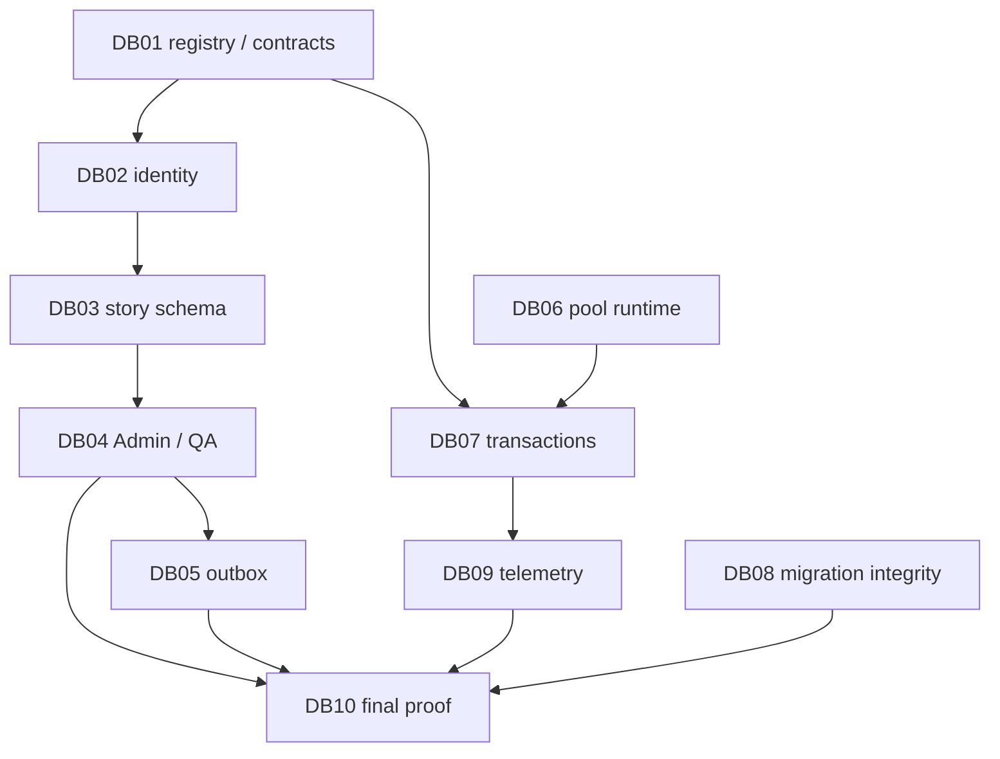

# Database redesign | parallel program

Planning baseline dbaefc4dafe84fbacb74067ccfa6f372f135545c; documentation commit fa77f2d3614ee821b8e4ad849a46a66342000132; historical target undertaking/storyteller-workshop; current integration target main (owner decision 2026-11-24). [Selected architecture](../../../docs/technical/platform/database-infrastructure.md). DB01, DB02, DB03, DB06, and DB08 are Done source-only and archived. DB01, DB06, and DB08 were commissioned on 7033f654091a4fc66c7de6b0dce37e2b8fb504c1 and joined on undertaking/storyteller-workshop. DB02 was released later and joined source-only; DB03 joined source-only on `change/db03-story-persistence` (pending-commit at closure). Live SQL remains NOT RUN. Five remaining Changes are commissioned for source implementation as of 2026-11-25; source baseline d08e36d809bb53c48fef3351224994bae92b6e7c, packet refresh dabc729235a92c1740fb31ebdc04a6f96e7136f1. Schema lane next: DB04 (DB03 joined); DB07 Ready in runtime lane; DB05/09/10 dependency-gated. DB06 does not consume DB01 types, DB08 uses only existing config/migration APIs. No redesign by Cursor; enforce the selected source maps and execution decisions. Cache work is already commissioned; preserve its ownership. DB06/08 infrastructure do not depend on Cache consumer edits; DB05 waits for DB04 and CACHE04/06B. No shared live DB tests.

| Lane | First | Successor | Last |
| --- | --- | --- | --- |
| Schema | DB03 (Done) | DB04 | DB05 |
| Runtime | DB07 (T00 first) | DB09 | — |
| Final join | DB10 after both lanes | source first | authorized disposable SQL proof |

Dependencies are edges, not global barriers: DB07 requires DB01 neutral types and DB06 runtime; DB09 after DB07; DB04 waits DB03. One integration custodian (active DB07 parent for runtime lane, DB04 parent for schema lane after DB03; DB07 parent serializes shared main joins until it exits, then schema successor parent) serializes actual merges and shared DB/consumer manifests, registry export keys, lockfile, status/catalogs and docs. While Cache is active, coordinate with Cache custodian on common integration checkout; do not start independent pushes. Each parent uses separate linked worktree and branch guard. Runtime lanes write only new src/connection, transaction, telemetry files and owned tests except database.ts/config.ts (DB06 then DB07), migrate.ts/cli and DB08 tests (DB08). Schema lanes own only named declaration moves and exact import tokens; integration custodian merges shared package.json keys and regenerates lock from combined manifests. DB09 may edit instrumented runtime files only after DB07. DB10 owns final graph guards. No cross-lane root index export collision: custodian adds explicit exports at each join; DB01 freezes Transaction and policy types, DB06 adds runtime property via database.ts without root-index edit, DB07 adds transaction property. No concurrent test schema mutation; source-only is default.

## Source ownership map (inspected live declarations)

| Old DB subpath / path | New owner export or file | Direct schema dependencies |
| --- | --- | --- |
| ./schema / schema/auth.ts | @offscreen/identity-persistence/auth | Drizzle |
| ./terminal-auth-schema | @offscreen/identity-persistence/terminal-auth | auth |
| ./terminal-auth-store | apps/api/src/modules/terminal-auth/store.ts | DB, identity |
| ./draft-schema | @offscreen/story-persistence/drafts | identity |
| ./generation-schema | @offscreen/story-persistence/generations | identity, drafts |
| ./story-schema | @offscreen/story-persistence/stories | identity, generations |
| ./campaign-schema | @offscreen/story-persistence/campaign | identity, generations, stories |
| ./launch-schema | @offscreen/story-persistence/launch | identity, generations |
| ./storyteller-schema | @offscreen/story-persistence/storyteller | generations; policy also identity; execution/writer/policy also funding |
| ./admin-schema | @offscreen/admin/persistence/schema | identity |
| ./qa-schema | @offscreen/lab-support/persistence/schema | identity |
| ./outbox-schema | @offscreen/outbox/schema | Drizzle |
| ./outbox | @offscreen/outbox/enqueue (Notice, enqueue); @offscreen/db (Transaction) | DB |
| ./outbox-relay | @offscreen/outbox/relay | DB, outbox |
| ./migrate | unchanged generic runner | pg, Drizzle |
| migrations/ | unchanged immutable SQL/journal | deployment assets |
| drizzle.config.ts / generate | tools/db-migrations | explicit per-family modules |

Identity must precede Story, Admin and QA because of real FK references. Temporary DB dependency on identity-persistence is permitted only until DB04 removes remaining schema imports; no new runtime domain edge. Schema migration is not DDL. Schema-only leaves have explicit named subpaths and no root barrel pulling app code. Admin/lab schema can live with existing runtime because DB never imports those packages. Migration composition tool depends on schema owners; DB never depends on tool (even dev dependency). Move schema identity tests to tool rather than create reverse DB test dependency. Preserve migration history paths for game-migrate Job, dev-slot-migrate.mjs, dev-slot-startup.mjs, lab sandbox, integration helpers, image closure; old baseline.mjs generation target changes only. Existing schema fingerprint is 20 Writer tables and frozen hash d6a9a98b262f8c31869e5ec75bc6f2fd14ac2a4f3c811a3cabfe52748759f3ba. Current release recounted exactly 71 pgTable declarations and three auth relations. Journal has 25 entries; latest checked-in snapshot idx4 has 48 tables. DB01 freezes synthetic current-schema identity and refuses tracked generation until DBOPS01 metadata reconciliation; no applied SQL/journal rewrites. No physical schema split, SQL changes, grants, provider calls or production deploy.

## Frozen runtime interfaces

DB01 owns src/transaction/types.ts, policy.ts and telemetry/types.ts. Export Transaction from root using existing Parameters<Parameters<Database['db']['transaction']>[0]>[0] without changing shape. Policy is readonly { name: string (registered semantic name), workload: 'interactive'|'worker'|'admin'|'migration', isolation: 'read committed'|'repeatable read'|'serializable', readOnly: boolean, retry: 'none'|'sql-only-conflicts', timeoutMs:number, statementTimeoutMs:number, lockTimeoutMs:number }; defaults and validation in technical owner. DB06 exposes managed withClient<T>(options:{timeoutMs:number;signal?:AbortSignal}, run:(client: PoolClient, remainingMs:()=>number, discard:()=>void)=>Promise<T>):Promise<T>; discard marks lease tainted, release once after callback settles. Use explicit optional signal, no abort claim after acquisition. DB07 exposes database.transaction<T>(policy, run:(tx:Transaction)=>Promise<T>):Promise<T>; name validated against bounded semantic identifier syntax; DB09 maps unregistered names to fixed generic label before telemetry; no external side effects; no implicit retry. Error category closed: saturated, unavailable, timeout, cancelled, serialization, deadlock, constraint, lock-timeout, commit-unknown, closed, application, invalid-config. SQLSTATE walk max depth 4, cycle guard. Telemetry event closed operation acquire/transaction/retry/rollback/connection, workload, outcome, category, numeric duration/count; no dynamic strings or raw cause. DB01 type-only; DB06 and DB07 can use injected safe no-op sink; DB09 owns final instrumentation after both. DB07 EXECUTION.md freezes pinned Drizzle transaction construction and explicit commit phase tracking, including T00 inherited admission fixes; no nested transactions. No automatic domain adoption in this program; separately plan first actual SQL-only transaction after SQL01 source audit.

## Review and remaining gates

Wave 0 source promotion: [DB01 source map](../../changes/archive/2026-11/platform-operations/2026-11-24--db01-schema-composition-foundation/SOURCE-MAP.md), [DB06 execution](../../changes/archive/2026-11/platform-operations/2026-11-24--db06-connection-runtime/EXECUTION.md), [DB08 execution](../../changes/archive/2026-11/platform-operations/2026-11-24--db08-migration-integrity/EXECUTION.md). Current declaration count, config, runtime, migrations, pinned Drizzle 0.45.2 upstream source, existing fixtures, generator inputs, branch guard and shared ownership verified; exact source tests and stops selected. No local tests or live SQL performed by planner. DB01 owns manifest/lockfile/registry/index; DB06 owns database/config/connection tests; DB08 owns migrate and migration tests; only custodian updates default DB test script at serial join to include new db06/db08 source unit files. DB08 live proof NOT-RUN remains open, not a prerequisite to unrelated source work. CACHE04 source is joined, SQL proof remains open; CACHE07 harness/runtime correction owns Cache files, not DB. Coordinate shared docs joins with Cache parent; no DB schema extraction edits overlapping another active owner. DB02 is archived. DB03/04/05 have refreshed exact source selectors and workspace maps; DB07 implementation seam remains frozen; DB09 and DB10 selected execution contracts are in their packets.md and current admission defects rechecked; DB09 actual predecessor symbols; DB10 disposable fixture/resource permission. No paid investigation or false Ready claims. Existing known authority-writer graph violation and API integration exactOptionalPropertyTypes baseline must remain distinguishable. DBOPS01/02 and SQL01 remain complementary. No queue change.

## 2026-11-25 source refresh

Current source baseline `7322b6f1a6df6f5ae612763b9786563dca2989eb`; main is the only join target. DB07 T00 remains mandatory: queued deadlines reset in admission.ts; managed-client.ts counts caller settlement rather than pending connection cleanup; rejection of undefined and release error precedence remain incorrect. No new live authorization or proof credit. DB10 source graph work must not wait on live resource permission. Superseded by the 2026-11-25 ZIP-based packet refresh. Current exact schema selectors, consumer groups, manifest changes and generator verification are recorded in DB03/04/05 SOURCE-MAP.md; DB09/10 EXECUTION.md freezes instrumentation and final proof.

## Current dispatch (2026-11-25)

Run two Cursor parents at most for this DB program. DB07 owns connection, transaction, DB root and test script keys; DB04 owns the next schema declaration moves after DB03. DB04 and DB05 serialized (shared DB exports, tool registry/dependency keys, and overlapping consumer manifests). DB09 runs after DB07, owning instrumentation and concurrency only. Custodian DB07 parent serializes main joins initially; when finished, explicitly hand off to remaining schema parent (or DB09 parent if schema lane already finished). No concurrent independent pushes; reconcile lockfile against combined manifests before joining. Each successor gets its own branch/worktree from latest main, not from predecessor Change branch. No automatic dispatch of unnamed backlog work. DB10 T01–T03 source may integrate as progress even if live authorization absent, but keep packet OPEN until required proof or explicit owner disposition.

- [DB03 source map](../../changes/archive/2026-11/platform-operations/2026-11-24--db03-story-persistence/SOURCE-MAP.md)
- [DB04 source map](../../changes/open/2026-11-24--db04-admin-lab-persistence/SOURCE-MAP.md)
- [DB05 source map](../../changes/open/2026-11-24--db05-durable-outbox/SOURCE-MAP.md)
- [DB07 execution](../../changes/open/2026-11-24--db07-managed-transactions/EXECUTION.md)
- [DB09 execution](../../changes/open/2026-11-24--db09-telemetry-and-concurrency/EXECUTION.md)
- [DB10 execution](../../changes/open/2026-11-24--db10-dependency-closure-and-proof/EXECUTION.md)

Review boundary: planner inspected committed ZIP and current GitHub baseline, actual schema declarations, registry, manifests, import-bearing workspaces, outbox custody, admission/runtime, migration and proof fixtures, graph/closure/wiki guards. No local builds/tests or live DB run by planner. Existing CACHE04 SQL and CACHE07 Redis acceptance remain separate; no runtime proof credit. DBOPS01/02 and SQL01 remain future separately scoped operational/domain audit work, not automatic successor dispatch. Local untracked work was excluded from snapshot; preserve it.
