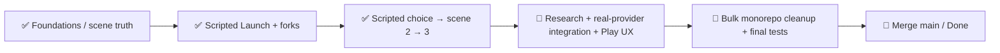

## Planning update: modular-monolith finish line expanded (2026-11-21)

**Latest inspected integrated code:** MA08 on `undertaking/storyteller-workshop`. The earlier modularization percentage was optimistic relative to the now-enforced target. **Revised rough estimate after MA08:** modular monolith **~70% complete / ~30% remaining**, Storyteller **~60% / ~40% remaining**, blended undertaking **~65% / ~35% remaining**, **±10 percentage points**. MA08 moved the remaining real Application owners out and left the 112-test compatibility package. Baseline worker generation-evidence typecheck and `repo:module-graph` undeclared-import errors are still not green.

**Next executable architecture Change:** none until a planner clears [WR09](../../changes/open/2026-11-21--wr09-provider-ready-writer-runtime/CHANGE.md). [MA09](../../changes/open/2026-11-21--ma09-authority-writer-dependency-inversion/CHANGE.md) stays blocked on WR09. [MA10](../../changes/open/2026-11-21--ma10-module-boundary-enforcement/CHANGE.md) migrates the 112 tests and removes `@offscreen/application` after MA09 and WR09. [MA08](../../changes/archive/2026-11/other/2026-11-21--ma08-application-owner-extraction/CHANGE.md) is Done. Existing older status charts further below are historical; do not commission obsolete WR04/WR08 links.

## Post-MA08 execution choice, November 21

**MA08 is complete on the undertaking** (`6dd12761`); the next *planned, not implemented* wave has three source-disjoint full Change packets: [MA10](../../changes/open/2026-11-21--ma10-module-boundary-enforcement/CHANGE.md) removes the entire old Application facade while protecting **112 tests**, [WR09A](../../changes/open/2026-11-21--wr09a-durable-writer-provider-response/CHANGE.md) makes real-provider response custody replayable and protects billing (using fake network only), and [MA11](../../changes/open/2026-11-21--ma11-story-engine-boundary-ratchet/CHANGE.md) makes internal Story Engine domain dependencies measurable and ratchets new forbidden imports. [Integration protocol and exact file exclusions](PROGRAM.md#post-ma08-three-lane-execution-contract-2026-11-21). No parallel parent edits the undertaking catalogs or merges into the shared branch.

**Progress remains estimated at modular monolith ~80% (~20% remaining), Storyteller ~60% (~40% remaining), combined ~65% (~35% remaining), ±10–15 percentage points.** Merely creating this batch makes **zero** progress on tested product acceptance. Real Writer worker wiring, authority→Writer inversion, public API/SCC cleanup, longform quality proof and final main landing remain beyond this batch. None of the packets authorize paid provider calls.

## 🎯 What are we building?

You give a one-sentence premise and enter a persistent fictional life. You can choose, work, wait, leave and come back. The Writer remembers what *actually* happened and narrates the next consequential scene. Old scenes are available to read or fork into a different future. The monorepo beneath it has clear owners and no accumulating `application` junk drawer.

## 📊 Rough completion estimates

| Track | Our current estimate | Remaining | What the number means |
| --- | ---: | ---: | --- |
| 🏗️ **Modular Monolith shaping** | **~80%** | ~20% | Production hosts import Story Engine directly. Compatibility forwarders, graph hygiene and final validation remain |
| 🎭 **Storyteller evolution** | **~60%** | ~40% | Library, scene truth, launch, forks and a scripted scene-1→2→3 gameplay kernel exist; real integrated provider, research, user-facing journey and convincing quality proof are incomplete |
| 🧭 **Combined undertaking** | **~65%** | ~35% | A subjective effort-and-risk blend: roughly **70% Storyteller / 30% architecture**, rounded to the nearest 5 percentage points |

```text
Modular Monolith  80%  ████████████████░░░░   ~20% left
Storyteller       60%  ████████████░░░░░░░░   ~40% left
Combined          65%  █████████████░░░░░░░   ~35% left
```

**Confidence:** low-to-moderate, **roughly ±10–15 percentage points**. These are **subjective estimates of remaining engineering effort and integration risk**, not completed-Change ratios, tested-feature coverage, a deadline or a promise that exactly 35% effort remains. Storyteller's *proven end-user experience* lags behind the foundational code. Percentages can go **down** if real provider or long-form acceptance reveals major defects; do not mechanically increase them whenever a packet closes.

**Why these numbers?** Monorepo package extraction is done and production hosts now call Story Engine directly. Application forwarders and final integration work remain. Storyteller's core pieces, scripted continued-scene tests, and provider-free research children are present. The live provider journey, narrative quality, and broad fault/end-to-end proof remain. A successful scripted test is not the same as a demonstrated live AI-powered game.

## At a glance

| Major capability | Verified state on undertaking | Human interpretation |
| --- | --- | --- |
| 🧱 Package separation and domain owners | **Mostly achieved** | API, Game Authority, and worker import Story Engine directly. Compatibility forwarders remain for tests and scripts |
| 📚 Library, Writer Workdesk and immutable scene history | **Implemented** | Source-aware memory foundation and v2 publication are in place |
| 🌿 Historical forks with active commitments | **Implemented** | WR06 is archived; broader player journey still needs acceptance |
| 🚪 One-prompt opening | **Scripted implementation** | WR07B archived; public Launch feature remains gated |
| 🎭 Actual choices and subsequent Writer scenes | **Scripted kernel implemented** | P3-A plus WR08: characterless `observe` on the first scene and a scripted `writer.scene.v1` wake; not a live-model UI |
| 💳 Real provider transport / spending custody | **Code integrated, live proof missing** | P3-B archived, transport and usage-settlement tests exist; end-to-end Writer-loop injection/real spend must still be verified |
| 🧪 Long-form acceptance harness | **Harness integrated** | P3-C archived; does not prove all long-story or live-narrative quality criteria |
| 🔍 Independent research children | **Scripted implementation** | WR04: explicit grant, read-only children, shared operation cap, verified join. Not a live provider proof |
| 🎮 Complete Play/reentry UI | **Gated scripted path implemented** | WR08 archived: Play uses the real action API when the Launch flag is on. History and fork UI were already present. Live provider play is not accepted |
| 🧹 Final monorepo cleanup / main merge | **Outstanding** | Host consumer migration is done. Forwarder retirement, final joined validation, and undertaking retirement remain |

## 🗺️ The journey



**Interpretation:** we've moved beyond building the engine room. The next stretch is turning these pieces into a *complete, observable, trustworthy experience*, then finishing the package structure. It is not 65% of end-user acceptance tests passing.

## ✅ What is already achieved

- Major Story Engine/Admin ownership extraction and core package restructuring.
- Persistent Library and Workdesk, verified sources, Writer missions and historical v2 scene truth.
- WR07B scripted one-prompt opening and WR06 active historical fork reconstruction.
- **P3-A** integrated world-neutral narrative-intent admission, existing fictional-time authority and Writer scene 2→3 publication, with focused scripted tests.
- **P3-B** integrated real Writer transport and usage-settlement custody with provider-free tests. **No funded live call has been proved.**
- **P3-C** integrated a provider-free long-form acceptance runner. Its presence does not by itself certify narrative quality.

## 🔨 What remains, as concrete outcomes

1. **Parallel architectural and custody wave (not yet implemented):** [MA10](../../changes/open/2026-11-21--ma10-module-boundary-enforcement/CHANGE.md) retires Application with **all 112 tests preserved**, [WR09A](../../changes/open/2026-11-21--wr09a-durable-writer-provider-response/CHANGE.md) atomically persists/replays the provider response and cost without real spend, and [MA11](../../changes/open/2026-11-21--ma11-story-engine-boundary-ratchet/CHANGE.md) makes actual engine domains visible and rejects new forbidden imports. Their implementation sources are separate, with one integration custodian.
2. **Actually run the creative Writer.** A later WR09B wires real provider-shaped model decisions, Worker credential/policy composition, launch/continuation and delegated research into existing admission/publication, first through fake fetch and no paid calls. Provider funding requires separate explicit approval.
3. **Close the authoritative architecture.** MA09 inverts the existing Authority→Writer implementation edges while preserving current SQL locks/receipts; final module SCC/public export ratchet after it, not premature splitting of packages.
4. **Product and release acceptance.** Demonstrate actual prompt → meaningful playable choices → source-faithful long-form scenes → reentry/history/fork, recover after faults, prove owner/permissions/charge/idempotency negatives; reconcile ledgers/STATUS and merge the undertaking to `main` only after end gates.

## 🧭 Current decision and evidence

**MA08 is Done at `6dd12761`**, including real Lab, Drafts, DB relay and Runtime Logging owners; the old Application is test-only compatibility. The next three source-disjoint implementation packets are READY for separate user-authorized Cursor commissions, **not yet tested or integrated**. The known two undeclared-production-import errors in `pnpm repo:module-graph` remain triage items, not waved-away passes. The rough status figures above remain **80% architecture, 60% Storyteller, 65% combined** with ±10–15 percentage-point uncertainty. No external provider spend has been authorized.

**Integration rule:** Three worktrees can implement in parallel; only one custodian joins `undertaking/storyteller-workshop`, regenerates the lockfile, runs combined proofs, archives and updates the overview. See [exact collision matrix](PROGRAM.md#post-ma08-three-lane-execution-contract-2026-11-21). Future Cursor parents must not independently self-merge these three Changes while siblings remain active.

## ⚑ Required maintenance

- **ChatGPT reads this page first** at Undertaking cold start, rechecks its claims against integrated HEAD/Change receipts and updates **the three numeric estimates** after material integrations, scope or risk changes and before commissioning another wave. Do not leave estimates frozen while underlying capabilities change.
- Preserve **three numbers (Storyteller %, monorepo %, combined %)**, remaining percentages, an uncertainty statement and the reasoning behind movements. Round to 5% increments; prefer a defensible judgment to fake precision. If cannot estimate one axis, explicitly mark it uncertain and explain instead of silently deleting the metric.
- **Proactively show the supervisor the numbers and a plain-language interpretation** at significant milestones and handoffs, with a link here. No need to repeat an unchanged chart after every T-ID; do not promise autonomous background monitoring.
- The **integration custodian** serializes substantive overview edits from accepted receipts. The technical ledger, `STATUS.md` and branch state stay factual authorities; this page is a human communication layer, not a second queue.
- On closure present a final before/after and any limitations, then retire the temporary page with the undertaking.

**Technical evidence:** [Undertaking ledger](UNDERTAKING.md#whole-undertaking-completion-control--living-ledger) · [Execution program](PROGRAM.md) · [Monorepo dossier](../modular-monolith/UNDERTAKING.md) · [Demonstrated status](../../../STATUS.md).
