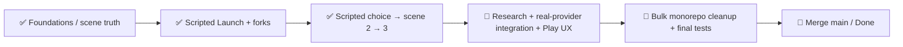

# Storyteller Workshop | The big picture

**The supervisor's first page.** This is the accessible, numeric progress view for **both** Storyteller evolution and Modular Monolith reshaping. The [technical undertaking ledger](UNDERTAKING.md#whole-undertaking-completion-control--living-ledger) owns factual evidence and [Program](PROGRAM.md) owns execution planning.

**Checked:** 2026-11-21 · **Reference branch:** `undertaking/storyteller-workshop` · **Latest inspected implementation:** P3-A `852f01a0` (P3-B `4005a0e2`, P3-C `5615f077` are ancestors). Additional overview/planning commits may advance HEAD. **Not merged to `main`**, not live-product verification.

## 🎯 What are we building?

You give a one-sentence premise and enter a persistent fictional life. You can choose, work, wait, leave and come back. The Writer remembers what *actually* happened and narrates the next consequential scene. Old scenes are available to read or fork into a different future. The monorepo beneath it has clear owners and no accumulating `application` junk drawer.

## 📊 Rough completion estimates

| Track | Our current estimate | Remaining | What the number means |
| --- | ---: | ---: | --- |
| 🏗️ **Modular Monolith shaping** | **~75%** | ~25% | The major package/domain extraction is done; consumer/compatibility cleanup, graph enforcement and final validation remain |
| 🎭 **Storyteller evolution** | **~60%** | ~40% | Library, scene truth, launch, forks and a scripted scene-1→2→3 gameplay kernel exist; real integrated provider, research, user-facing journey and convincing quality proof are incomplete |
| 🧭 **Combined undertaking** | **~65%** | ~35% | A subjective effort-and-risk blend: roughly **70% Storyteller / 30% architecture**, rounded to the nearest 5 percentage points |

```text
Modular Monolith  75%  ███████████████░░░░░   ~25% left
Storyteller       60%  ████████████░░░░░░░░   ~40% left
Combined          65%  █████████████░░░░░░░   ~35% left
```

**Confidence:** low-to-moderate, **roughly ±10–15 percentage points**. These are **subjective estimates of remaining engineering effort and integration risk**, not completed-Change ratios, tested-feature coverage, a deadline or a promise that exactly 35% effort remains. Storyteller's *proven end-user experience* lags behind the foundational code. Percentages can go **down** if real provider or long-form acceptance reveals major defects; do not mechanically increase them whenever a packet closes.

**Why these numbers?** Monorepo already underwent its main package extractions but retains old forwarding imports and final integration work. Storyteller's core pieces, scripted continued-scene tests, and provider-free research children are present. The live provider journey, narrative quality, and broad fault/end-to-end proof remain. A successful scripted test is not the same as a demonstrated live AI-powered game.

## At a glance

| Major capability | Verified state on undertaking | Human interpretation |
| --- | --- | --- |
| 🧱 Package separation and domain owners | **Mostly achieved** | Story Engine and Admin have distinct ownership; compatibility cleanup remains |
| 📚 Library, Writer Workdesk and immutable scene history | **Implemented** | Source-aware memory foundation and v2 publication are in place |
| 🌿 Historical forks with active commitments | **Implemented** | WR06 is archived; broader player journey still needs acceptance |
| 🚪 One-prompt opening | **Scripted implementation** | WR07B archived; public Launch feature remains gated |
| 🎭 Actual choices and subsequent Writer scenes | **Scripted kernel implemented** | P3-A plus WR08: characterless `observe` on the first scene and a scripted `writer.scene.v1` wake; not a live-model UI |
| 💳 Real provider transport / spending custody | **Code integrated, live proof missing** | P3-B archived, transport and usage-settlement tests exist; end-to-end Writer-loop injection/real spend must still be verified |
| 🧪 Long-form acceptance harness | **Harness integrated** | P3-C archived; does not prove all long-story or live-narrative quality criteria |
| 🔍 Independent research children | **Scripted implementation** | WR04: explicit grant, read-only children, shared operation cap, verified join. Not a live provider proof |
| 🎮 Complete Play/reentry UI | **Gated scripted path implemented** | WR08 archived: Play uses the real action API when the Launch flag is on. History and fork UI were already present. Live provider play is not accepted |
| 🧹 Final monorepo cleanup / main merge | **Outstanding** | One bulk consumer migration, final joined validation and undertaking retirement |

## 🗺️ The journey



**Interpretation:** we've moved beyond building the engine room. The next stretch is turning these pieces into a *complete, observable, trustworthy experience*, then finishing the package structure. It is not 65% of end-user acceptance tests passing.

## ✅ What is already achieved

- Major Story Engine/Admin ownership extraction and core package restructuring.
- Persistent Library and Workdesk, verified sources, Writer missions and historical v2 scene truth.
- WR07B scripted one-prompt opening and WR06 active historical fork reconstruction.
- **P3-A** integrated world-neutral narrative-intent admission, existing fictional-time authority and Writer scene 2→3 publication, with focused scripted tests.
- **P3-B** integrated real Writer transport and usage-settlement custody with provider-free tests. **No funded live call has been proved.**
- **P3-C** integrated a provider-free long-form acceptance runner. Its presence does not by itself certify narrative quality.

## 🔨 What remains, in outcome-sized chunks

1. **Independent Writer research (WR04).** Bounded child contexts, read-only tools, trustworthy citations and one shared finite budget. Conditional packet exists; recheck post-P3 interfaces before executing.
2. **One cohesive player experience (WR08).** Prompt → loading/held → scene → executable choice → later scene; revisit history and fork, preserve drafts and honor the feature gate.
3. **Finish the actual AI runtime.** Confirm P3-B transport is connected to the Writer loop, exercise a bounded provider-backed mission with **explicit spending approval**, and verify uncertainty/billing/recovery. An adapter alone is not a live game.
4. **Bulk monorepo finish.** Replace obsolete `@offscreen/application` forwarding consumers, enforce clear graph boundaries and compile/test the joined apps.
5. **Prove and land the whole thing.** Long-running source-correct story/fork/reentry scenarios, permissions/financial negatives, product docs, merge to `main` and retire worktrees/undertaking.

## 🧭 Right now and next decision

**Current next wave:** [WR04 independent research](../../changes/open/2026-11-21--wr04-delegated-writer-research/TASKS.md) and [WR08 complete Play/reentry](../../changes/open/2026-11-21--wr08-one-prompt-client-and-integrated-acceptance/TASKS.md) are **source-reconciled, owner-commissioned PLANNER-READY (with explicit limits)**. The earlier blocked packets were repaired; independent G0–G7 review is in each `PROOF.md`. They have **NOT** been implemented or tested yet. WR04 T01–T03 may run beside WR08, but WR04 T04 must wait for WR08's shared Worker/Workflow integration. Important current discovery: WR07B first scene contains no executable offer and P3-A queues a Writer continuation without a registered Worker wake, both now explicitly included in WR08, without real provider spend. Final bulk architecture cleanup follows stabilized Writer/Play interfaces.

**Most important next milestone:** a user can start a story, make two *real* choices and return to subsequent scenes in the browser using the same trusted backend, with honest pending/error states. A scripted engine test alone is not this milestone.

**Supervisor decision:** real paid provider testing requires an explicit spending grant; none has been authorized here.

**Risks:** integration between P3-B transport and real Writer mission execution; child research cost/source isolation; incomplete public Play UX; cleanup during moving gameplay interfaces.

## ⚑ Required maintenance

- **ChatGPT reads this page first** at Undertaking cold start, rechecks its claims against integrated HEAD/Change receipts and updates **the three numeric estimates** after material integrations, scope or risk changes and before commissioning another wave. Do not leave estimates frozen while underlying capabilities change.
- Preserve **three numbers (Storyteller %, monorepo %, combined %)**, remaining percentages, an uncertainty statement and the reasoning behind movements. Round to 5% increments; prefer a defensible judgment to fake precision. If cannot estimate one axis, explicitly mark it uncertain and explain instead of silently deleting the metric.
- **Proactively show the supervisor the numbers and a plain-language interpretation** at significant milestones and handoffs, with a link here. No need to repeat an unchanged chart after every T-ID; do not promise autonomous background monitoring.
- The **integration custodian** serializes substantive overview edits from accepted receipts. The technical ledger, `STATUS.md` and branch state stay factual authorities; this page is a human communication layer, not a second queue.
- On closure present a final before/after and any limitations, then retire the temporary page with the undertaking.

**Technical evidence:** [Undertaking ledger](UNDERTAKING.md#whole-undertaking-completion-control--living-ledger) · [Execution program](PROGRAM.md) · [Monorepo dossier](../modular-monolith/UNDERTAKING.md) · [Demonstrated status](../../../STATUS.md).
