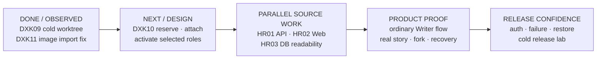
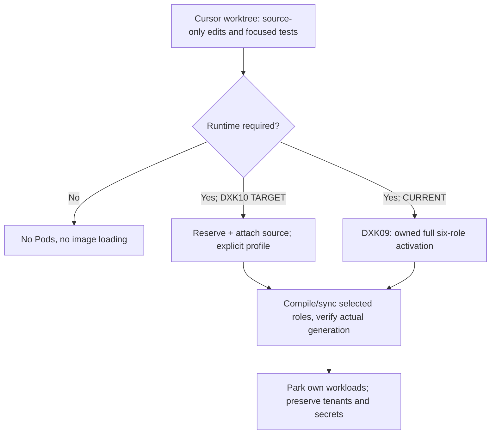

# Storyteller Workshop | reality check and finish line

**Human checkpoint · 2026-11-23 · inspected integration HEAD `8a782ffd`.** Developer-environment correctness is demonstrably better, but this is **not yet a proven end-to-end AI Storyteller product**. DXK09's unattended new-worktree start/status/stop passed; DXK11's canonical-image reuse and timing improvements are integrated. The next architectural goal, DXK10's source attachment and selective activation, remains **proposed, not implemented**.

## At a glance

| Track | Rough complete | Still remaining | Interpretation |
| --- | ---: | ---: | --- |
| Monorepo architecture + developer workflow | **~65%** | ~35% | Reproducible isolated dev lifecycle, but source readability, runtime demand and full checks remain |
| Storyteller + playable experience | **~40%** | ~60% | Durable Writer/story foundations, not an ordinary provider-backed end-to-end player experience |
| Distributed operations + reliability | **~25%** | ~75% | Dev isolation exists; cold release, restore, sustained scale and crash-free readiness remain open |
| **Combined undertaking** | **~40%** | **~60%** | Judgment, not measured feature coverage or shipping readiness |

**Uncertainty:** at least ±20 percentage points for these subjective estimates. DXK11 improved the developer workflow; it did not materially change the product-completion estimate.

## What the dev-loop measurements really say

| Trial | Outcome | Evidence level |
| --- | --- | --- |
| Original parked warm activation | **376 s**, including 346.5 s image work and ten redundant Kind archive loads | Reported live timing |
| DXK11 optimized image reuse | Zero archive imports when exact digest already present on both nodes; role aliases are local containerd tags | Reported live proof |
| `8a782ffd` owned `dev-9` activation | **115.8 s** to six truthful READY roles; one new Docker artifact (4.0 s), two legitimate node imports (~63.6 s), readiness 23.8 s | Reported live timing; **not** a same-image warm-hit baseline |
| Same-commit warm-image activation | Expected to omit Docker rebuild and both imports; timing **not measured** | Projection only; do not report as a pass |

**Safety boundary:** one checkout's lease cannot be appropriated by another; no premature tenant reassignment, foreign-process stop or weakened digest check. A future reusable-slot handoff needs explicit fencing and retained-tenant safeguards. One agent working on source does **not** require one full running stack.

**Still not proven:** four simultaneous full stacks, browser OAuth, cold release-lab acceptance, completed provider-free story and ordinary provider-backed playable campaign. The `game-control` watcher has logged `RangeError: Invalid atomic access index` despite Kubernetes readiness. These are distinct gaps, not a reason to repeat already-accepted DXK09 work.

**Planning checkpoint, 2026-11-23:** DXK10-A is now a [bounded, source-grounded reserve/attach packet](../../changes/open/2026-11-23--dxk10a-reserve-attach-foundation/CHANGE.md) with negative proof and [G0–G7 readiness review](../../changes/open/2026-11-23--dxk10a-reserve-attach-foundation/READINESS.md). This is planning only: no new CLI has been implemented or tested. DXK10-B profile activation and DXK10-C guarded retained-tenant handoff remain proposed. The owner has started HR02 independently; no implementation outcome has yet been reported here. These lanes do not overlap source ownership.

**Next decision:** source-ground DXK10 against `8a782ffd`, decide persistent tenant reservation/release semantics and profile dependency closure, then create small Cursor-ready implementation slices. HR01–HR03 should proceed as source-only lanes where safe, without making three full-stack runtimes a prerequisite. [DXK10 proposal](../../changes/backlog/platform-operations/2026-11-23--dxk10-demand-driven-dev-lifecycle/CHANGE.md) · [HR wave](NEXT-WAVE.md) · [demonstrated status](../../../STATUS.md).

---
### Historical checkpoints (do not use as today's instructions)

## Progress, recalibrated to the real end state

| Track | Rough complete | Rough remaining | Confidence / explanation |
| --- | ---: | ---: | --- |
| **Monorepo architecture and developer workflow** | **~65%** | **~35%** | Application retired; 18 workspace manifests, dependency tools and local affected planner exist. Authority/Writer separation, oversized module ownership, full builds, tooling health and measured cache correctness remain |
| **Real Storyteller and playable product** | **~40%** | **~60%** | Durable Library, missions, Workdesk, checkpoint/forks and scripted game path exist. No ordinary player path executes the provider-backed Writer; no convincing live-agent/longform acceptance |
| **Distributed reliability and Kubernetes operations** | **~25%** | **~75%** | Separate roles, outbox/Temporal, lab manifests and local process-kill tests exist. Cold-kind whole-game POC, sustained scale, end-to-end tracing and real restore are not proven |
| **Combined undertaking** | **~40%** | **~60%** | Judgment weighted toward completing the usable Storyteller and proving the running platform, not counting finished packets |

**Uncertainty: at least ±20 percentage points**, especially on Writer quality, provider behavior and operational readiness. These are estimates of *scope-adjusted remaining effort and risk*, not measured feature coverage. Earlier **85% monorepo / 60% Storyteller / 70% combined** was too optimistic for the full product + distributed Kubernetes + maintainability vision. The numbers fell because the audit **expanded the recognized finish line**, not because completed code vanished. They must be revised downward again if actual trials uncover deeper faults. There is **no defensible shipping percentage** yet.

## Historical checkpoints and dated planning notes

The entries below preserve earlier scope decisions and source/proof snapshots; **they are history, not a current startup or dispatch instruction**. Follow the current summary above and the current queue instead.

**Current DXK09 checkpoint (2026-11-23; repository inspected at `ce8fc609`, live facts from Cursor receipts):** the separate `kind-offscreen-dev` cluster now has two independently proven PostgreSQL databases/roles, S3 bucket-scoped identities persistent across a SeaweedFS Pod restart, and two Temporal namespaces with isolated workflow routing. The first `offscreen-dev-1` application stack has run all six roles; SQL runtime DML/DDL fencing, scoped signed S3 calls, Game Authority reachability and executor activity claim have been exercised. A normal authenticated provider-free *completed story* and real browser OAuth across two slots are not yet established. **T05 two-slot partial proof is integrated at `5d8be46c`: root `dev`, `dev:status`, and `dev:stop` exist; two distinct frontends, one-sided web live updates, manual-copy API reload, compile-failure detection and isolated stop/restart are evidenced. Unattended third-worktree provisioning, API Tilt sync/no-emit-on-error, truthful runtime status and PID/start-time fenced lifecycle remain unproven. Four concurrent watched stacks and saved provider-free stories remain open.** See [the canonical worktree runbook](../../../docs/runbooks/dev-worktree-stacks.md) and [two-worktree gating for HR01–HR03](NEXT-WAVE.md). Rough overall program estimates below are historical, high-uncertainty judgments, not recalculated from the DXK09 progress; do not mistake infra maturity for Storyteller quality.

**Reviewed:** 2026-11-22 · **Integration branch:** `undertaking/storyteller-workshop` · **Inspected HEAD:** `d3ba291763de26a0135c1ad84b077bf4f1c153a8` · [Technical ledger](UNDERTAKING.md) · [Historical program](PROGRAM.md) · [Demonstrated status](../../../STATUS.md)

**DXK09 execution checkpoint (2026-11-22; undertaking HEAD `6cc0ad7a`):** T01 dev Docker context has one successful 9.75MB / 123s real image build; T02 dynamic allocation, T06a nonmutating preflight, and T04a per-slot Better Auth cookie prefix are code-integrated with focused tests. No dev Kind cluster or four-stack live acceptance exists. DXK09's next safe task is T03a, a dev-only guarded bootstrap code path with no permission to create the cluster; tenant SQL/S3/Temporal provisioning and live OAuth remain planner-held. TURN03 cold writer HTTP503 remains a separate failure. Estimates stay **~65% monorepo / ~40% Storyteller / ~25% distributed operations / ~40% overall**, ±20 percentage points; infrastructure preparation is not user-facing proof.

**WR10B joined:** new Writer scene wakes use `writerSceneDistributedV2` and the execution worker under an explicit lab-only scripted transport. That is a zero-cost distributed bridge, not a paid model scene and not a TURN03 gate PASS. TURN03 T04 can be rerun against the joined undertaking HEAD.

**Developer infrastructure priority (2026-11-22):** DXK08's fast Tilt source-sync landed at `62c930a2`, but TURN03 subsequently exposed oversized Docker contexts/pnpm symlink build failure, process/compiled-output uncertainty, slow manual Tilt/Kubernetes recovery and release/dev workload replacement. The owner now prioritizes [DXK09](../../changes/open/2026-11-22--dxk09-isolated-parallel-development-stacks/CHANGE.md) while TURN03's prior evidence and real cold-release writer HTTP503 remain open. DXK09 is **staged: foundation T01/T02 and release preflight code T06a are executable; dev backing tenants and OAuth/live four-stack deployment remain planner-held until exact source/host gates close**. The proposed design uses dynamic per-worktree allocation with no hardcoded slot ceiling, a dedicated dev cluster and an independent release acceptance lab. This is planning/reprioritization only: no new cluster, application proof or completion credit. The prior estimates ~65% monorepo/~40% Storyteller/~25% distributed operations/~40% overall (at least ±20pp) remain uncertain and unchanged.

**2026-11-22 provider-free testing foundation landed:** [TESTLAB01](../../changes/archive/2026-11/infrastructure/2026-11-22--testlab01-repeatable-provider-free-game-tests/CHANGE.md) gives repeatable, finite, auditable per-owner grants in real SQL plus a fail-closed zero-paid-provider test harness, reusing current schema and test entitlement without automatic first-user rights. Disposable Postgres proof passed. Live kind grant creation for TURN03 still requires separate approval. Completion percentages are unchanged.

**2026-11-22 TESTLAB02:** [Guarded kind operator adapter](../../changes/archive/2026-11/infrastructure/2026-11-22--testlab02-kind-operator-adapter/CHANGE.md) is integrated. Read-only kind `status` is usable. Live grant write and TURN03 acceptance are not done. The previous approximate progress percentages and uncertainty remain unchanged.

**2026-11-22 TURN03 historical fork blocker:** [FORK01](../../changes/archive/2026-11/data/2026-11-22--fork01-historical-situation-authorization/CHANGE.md) is Done in Story Engine: fork reconstruction projects wrapped selected authorization into live campaign state. Disposable selected, none, malformed, hash, actor, and idempotent proofs passed. TURN03's existing kind fork replay and recovery matrix are still not PASS. Completion percentages are unchanged.

**2026-11-22 checkpoint reconstruction integrity:** [FORK02](../../changes/archive/2026-11/data/2026-11-22--fork02-v2-checkpoint-roundtrip-fidelity/CHANGE.md) is Done in Story Engine. Disposable SQL readback matches the mapped v2 snapshot, including JSON null plans versus an empty array. TURN03 still has to replay the live kind fork. Completion percentages are unchanged.

**One-sentence verdict:** We have a substantial, carefully constrained **foundation** for a durable game/Writer, not yet a functioning, AI-driven Storyteller product on a demonstrated resilient Kubernetes system. Treat “implemented”, “focused-test passed”, “local connected proof”, “cold Kubernetes proof” and “user-experienced quality” as **five different claims**. The first is far ahead of the last two.

## Next three implementation Changes prepared (2026-11-22; NO COMPLETION CREDIT YET)

Following the source audit, three independent impactful Changes have been source-mapped and planned on this undertaking branch: [WR10 private GA/Worker Writer round protocol](../../changes/open/2026-11-22--wr10-private-writer-round-protocol/CHANGE.md) (real missing execution boundary, fake provider only), [MA12 API Lab runtime isolation](../../changes/open/2026-11-22--ma12-production-api-lab-isolation/CHANGE.md) (one-way outer developer tools, no Lab in production API), and the **existing** [TURN03 full cold-kind gameplay proof](../../changes/open/2026-11-19--turn03-full-distributed-forkable-turn-proof/CHANGE.md) (scripted authenticated turn and fork, not a model-quality test). [Exact ownership, integration and cluster gates](PROGRAM.md#selected-next-engineering-wave-2026-11-22-source-grounded-not-yet-implemented). **All three are planned, none implemented or tested by these planning commits.** Prior estimates **65% monorepo / 40% Storyteller / 25% operations / 40% overall** remain the source-audit judgment, at least ±20 points. WR10 still leaves ordinary Launch/provider enablement to a later deliberately designed phase; TURN03 live execution cannot be claimed until correct local kind/OAuth/S3/Pod resources exist and all eight gates PASS.

## Subsequent three Changes already prepared (2026-11-22; planning only)

[CL01 terminal player](../../changes/archive/2026-11/experience/2026-11-22--cl01-terminal-player-client/CHANGE.md) is integrated: browser-approved story-only pairing and the same public story API, with no SQL from the terminal. [WR11 provider-authored continuation](../../changes/archive/2026-11/storyteller/2026-11-22--wr11-authorized-provider-continuation/CHANGE.md) is integrated on the existing Writer path with a provider-free fake-transport proof. Paid OpenRouter smoke, opening, and research remain out of scope. **[K8S10 game chaos/load](../../changes/open/2026-11-19--k8s10-distributed-fault-and-load-harness/K8S10-CURRENT-EXECUTION.md)** stays open: the harness source is on this branch, and the live Pod mutation still waits for TURN03 PASS plus explicit owner authorization. This does not move the rough completion percentages below.

CL01 and WR11 are implemented on this branch. K8S10 live chaos is not. Scope-adjusted figures remain **~65% monorepo, ~40% Storyteller, ~25% distributed operations, ~40% combined**, at least ±20 percentage points uncertainty. [Exact dependency DAG / integration owner](PROGRAM.md#subsequent-three-lane-wave-designed-in-advance-2026-11-22-not-implemented).

## Next-after-next: three human-readable code ownership Changes (near-term planning, not implemented)

The long-term owner needs to read Nest routes, Next.js play flows and Drizzle SQL directly. Source inspection identifies ~644-line Stories and ~849-line Admin controllers, ~415-line Nest composition, a flat 13-production-file Web Stories feature and a ~1,240-line Writer/Storyteller table-definition module. **These are readability hotspots, not proof of incorrect functionality.** Most important SQL mutations are in Story Engine's Stories/Campaign/Writer owners, not in `@offscreen/db`, so moving every query into a generic repository layer would be counterproductive.

Promoted into near-term open, but still dependency-gated: package-scoped [HR01 API](../../changes/open/2026-11-22--hr01-api-route-ownership-readability/CHANGE.md), [HR02 Web](../../changes/open/2026-11-22--hr02-web-player-feature-readability/CHANGE.md) and [HR03 DB/SQL navigation](../../changes/open/2026-11-22--hr03-db-schema-and-sql-navigation/CHANGE.md). [Wave launch, prerequisites and integration ownership](NEXT-WAVE.md). They fix semantic folder/route/table boundaries and allow Composer mechanical freedom inside explicit source owners. Test policy: **preserve current behavior and important regression tests** without a per-helper testing explosion; no schema/transaction changes. HR01 waits for MA12 and CL01 because their API files will change. These plans **do not increase** the ~65% monorepo / ~40% Storyteller / ~25% operational / ~40% overall scope estimates (±20pp or more). [Program coordination](PROGRAM.md#human-readability--ownership-refactor-wave-prepared-2026-11-22).

## Provider reconciliation and financial operations recognized (2026-11-22; proposed)

Future external-service spending needs **financial traceability beyond immediate Writer reservations**. Existing `packages/story-engine/src/storyteller/budget.ts` and account usage windows can reserve conservative exposure, settle known usage and hold uncertain liability. That does not yet establish an independently verified pipeline joining delayed/corrected **provider-native usage and invoice/export evidence** to exact historical attempts and responsible payer, especially for future image/unit-priced suppliers. Provider outages and model retirement can also change which **new** calls are eligible, without changing the identity/cost of prior attempts. A provider account's aggregate invoice may not permit exact per-request allocation, so such differences must stay **explicitly unmatched** rather than invented or silently written off.

Four high-level **Proposed** Changes record the separate work: [FIN01 provider evidence/reconciliation](../../changes/backlog/policy-finance/2026-11-22--fin01-provider-usage-reconciliation-ledger/CHANGE.md), [FIN02 multi-provider pricing/metering](../../changes/backlog/policy-finance/2026-11-22--fin02-provider-cost-adapter-contracts/CHANGE.md), [PROV01 availability/outages and safe retry/routing](../../changes/backlog/policy-finance/2026-11-22--prov01-provider-health-outage-and-routing/CHANGE.md), and [FIN03 internal Finance/Admin spend investigation](../../changes/backlog/policy-finance/2026-11-22--fin03-internal-spend-controls-and-investigation/CHANGE.md). Existing CFG01/CFG03 handle effective policy and future route eligibility, and ADI03 handles historical configuration; no duplicate payment ledger or public usage dashboard is selected. The owner is studying this domain, and no external billing API is assumed available without later vendor/source confirmation.

[35 named brainstorming work outcomes in the Change catalog](../../changes/README.md#external-provider-usage-costs-reconciliation-and-reliability-4-more-2026-11-22) · [owner minutes](../../sessions/2026-11-22.md#14-external-provider-economics-usage-delayed-reconciliation-model-outages-and-multi-product-financial-integrity). These are planned commitments, not implemented or proven features. **$0 authorized paid provider spend**, no completion-percentage credit and no customer data modification.

## Production-minded data operations workstream recognized (2026-11-22; proposed only)

The owner wants this repository to illustrate how a team would preserve **valuable state for thousands of users**, not merely run an ephemeral local PostgreSQL. The current foundation includes `@offscreen/db` Drizzle migration commands, a database-wide advisory migration lock and a Kubernetes one-off `game-migrate` Job. The current runbooks select rolling-compatible expand/contract and backup/restore, but **do not demonstrate** online schema evolution, prolonged backfills, PostgreSQL operational health or a coherent application-Postgres/Temporal/CAS disaster recovery.

Three new high-level **PROPOSED** Changes record distinct outcomes: [DBOPS01 compatible migration/release lifecycle](../../changes/backlog/platform-operations/2026-11-22--dbops01-safe-schema-migrations-and-release-compatibility/CHANGE.md), [DBOPS02 PostgreSQL operational health, capacity, indexes, vacuum/WAL and safe maintenance](../../changes/backlog/platform-operations/2026-11-22--dbops02-postgres-operational-health-and-performance/CHANGE.md), and [DATAOPS01 cross-store backups/restore/retention and real recovery rehearsal](../../changes/backlog/platform-operations/2026-11-22--dataops01-cross-store-backup-restore-and-retention/CHANGE.md). Existing [SCALE02](../../changes/backlog/platform-operations/2026-11-22--scale02-stateful-data-and-workflow-ha/CHANGE.md) still owns replica/primary failover and [SQL01](../../changes/backlog/platform-operations/2026-11-22--sql01-transaction-and-lease-source-audit/CHANGE.md) domain transaction/lease correctness. Schema migration, daily DB operations, cluster HA and disaster recovery must not be conflated.

[Current brainstorming catalog (31 named outcomes)](../../changes/README.md#production-minded-database-and-data-lifecycle-3-more-2026-11-22) · [owner minutes](../../sessions/2026-11-22.md#13-owner-requests-production-minded-database-and-complete-data-lifecycle-operations). No implementation, protected SQL data export, paid infrastructure or runtime tests were performed, and no completion credit was awarded. Baseline percentages remain unchanged and highly uncertain.

## Future multi-replica scaling and zero-token load tests planned (2026-11-22)

The owner requests an eventual **minimum horizontal-scale proof** once a complete single-instance real-game TURN03 path works: independently duplicate/triplicate Web/API/GA/Temporal Worker roles where appropriate, test a **three-instance PostgreSQL HA design** (not three primaries), ensure Workflow/Temporal and object durability, and run **up to 100 simulated independent players** with scripted legal stories and realistic provider delay **without any real model calls**. The owner's focus includes learning Kubernetes controllers, routing, HPA/KEDA, PostgreSQL replication, Temporal, SQL locks and observability through human-readable evidence.

Four independent **Proposed** Change packets preserve it: [SCALE01 app replicas](../../changes/backlog/platform-operations/2026-11-22--scale01-replicated-application-runtime/CHANGE.md), [SCALE02 stateful HA/restore](../../changes/backlog/platform-operations/2026-11-22--scale02-stateful-data-and-workflow-ha/CHANGE.md), [SIM01 deterministic provider simulator](../../changes/backlog/platform-operations/2026-11-22--sim01-realistic-zero-cost-provider-simulator/CHANGE.md), and [LOAD01 seeded 100-user/HPA test](../../changes/backlog/platform-operations/2026-11-22--load01-scripted-multiuser-load-and-autoscaling/CHANGE.md). The earlier K8S10 only proposes a **single Pod fault and nine commands** and must not be reported as high-scale proof. Streaming provider behavior is included in SIM01 only if the *actual integrated provider transport* supports it. **One reverse proxy address is not the same as highly available ingress**, and Kubernetes requires explicitly installed/authed metrics and autoscalers to change replica counts.

[Full brainstorm Change catalog: now 28 named outcomes](../../changes/README.md#future-horizontal-scaling-and-zero-funded-load-rehearsal-4-more-2026-11-22) · [Owner minutes](../../sessions/2026-11-22.md#12-owner-asks-for-future-minimal-horizontal-scalability-and-100-user-zero-llm-load-rehearsal). All are **planning-only**, not Cursor-ready, no implementation/evidence and no completion-percent credit. Provider budget remains $0 authorized; no paid infrastructure or cluster mutation approved.

## Historical Admin inspection and safe story resumption added (2026-11-22; Proposed only)

The owner needs a **comfortable, case/permission-scoped visual staff workspace** for navigating a story by actual scenes, comparing before/after canonical states, inspecting historical Markdown Library roots and observing which effective policy, model and cost actually governed each task. This is not one unbounded admin query: Support, Engineering and Business/Product/Finance have different legitimate information needs and must not inherit raw narrative/prompt reads from their job titles.

Four additional high-level Changes extend this conversation's brainstorm coverage to **24 named outcomes**: [ADI01 historical scene/state explorer](../../changes/backlog/experience-admin/2026-11-22--adi01-scene-history-game-state-explorer/CHANGE.md), [ADI02 pinned Library file/diff browser](../../changes/backlog/experience-admin/2026-11-22--adi02-historical-library-explorer/CHANGE.md), [ADI03 effective-policy/model/entitlement history](../../changes/backlog/experience-admin/2026-11-22--adi03-effective-policy-history-explorer/CHANGE.md), and [CFG03 safe re-admission after plan/model changes and future portability stress test](../../changes/backlog/policy-finance/2026-11-22--cfg03-resume-policy-eligibility-and-portability/CHANGE.md). The distinction matters: AI03 owns exact model-visible prompt and tool transcript; ADI02 owns what Library documents were **available**; CFG02 owns future Admin policy edits; CFG03 owns **new** task eligibility and preserves immutable prior attempt financial identities. A possible future story export/transfer is **not** authorized by CFG03.

The earlier 20-outcome [catalog map](../../changes/README.md#complete-2026-11-22-brainstorm-to-change-coverage-map-20-bounded-outcomes) remains as historical first batch; [four additional items and current 24 count](../../changes/README.md#extended-admin-historical-inspection-and-safe-resume-proposals-4-more-2026-11-22). All four are **Proposed, not implementation-ready**, and no customer data access, code implementation or tests were performed by this planning step. Completion percentages remain unchanged.

## Complete brainstorm backlog now recorded (2026-11-22; scope only)

The owner's current brainstorming is covered by **20 distinct Change records** including current Writer/monorepo/Kubernetes proof, terminal gameplay, real Writer opening and continuation, human-readable API/Web/DB/agent topology, historical context inspection, configurable model/effort/funding policies, Chamber, zero-default-spend evaluations, Admin governance, empirical build caching and a human SQL lock/lease audit. [Read the grouped Change coverage map](../../changes/README.md#complete-2026-11-22-brainstorm-to-change-coverage-map-20-bounded-outcomes) and [dated owner minutes](../../sessions/2026-11-22.md).

Four newly added high-level **Proposed** outcomes close distinct gaps: [WR12 generated opening](../../changes/backlog/agent-runtime/2026-11-22--wr12-provider-authored-opening/CHANGE.md), [CTX01 context packing/retrieval](../../changes/backlog/agent-runtime/2026-11-22--ctx01-context-composition-and-retrieval-policy/CHANGE.md), [DX13 real cache measurement](../../changes/backlog/quality-evaluation/2026-11-22--dx13-measured-monorepo-build-cache/CHANGE.md), and [SQL01 human SQL transaction/lease audit](../../changes/backlog/platform-operations/2026-11-22--sql01-transaction-and-lease-source-audit/CHANGE.md). Earlier CFG01/EV01/CH01/CFG02 remain the canonical future configuration and evaluation packets. These records preserve intent without pretending the actual source will remain stable or that their implementation contracts are settled.

**No completion credit:** estimated monorepo ~65%, Storyteller ~40%, distributed operations ~25%, combined ~40%, at least ±20 percentage points uncertainty. This is a snapshot judgment from earlier source review, not evidence that the new 20-Change inventory is exhaustive of future technical work. No new provider calls, deployment or runtime tests are authorized by these plans.

## Agent internals and scene-by-scene inspection: newly recognized gap (2026-11-22)

The agent needs to be **understandable by its human owner**, not just replayable by SQL and Temporal. Current source splits its responsibilities across Writer mission capture, a two-message round compiler (system instruction + JSON pins and prior tool summaries), Library/Workdesk tool execution, private response storage, Story Engine custody, outbox, Temporal workflows and Worker activities. That is not one obvious “agent loop”. The initial Writer request **does not include the entire Library**; it grants bounded tools to retrieve relevant objects. Observed `requestCasHash` is a wire SHA, not proof every original request body was archived. Strict private response and tool-result pointers exist, but reconstructing a complete exact historical conversation with all tool arguments is **not yet demonstrated**. Temporal activity history is separate from the model conversation, and hidden provider reasoning cannot be fabricated.

Prepared **three sequential, planner-gated stages**: [AI01 readable agent/capture modules and Temporal topology](../../changes/backlog/agent-runtime/2026-11-22--ai01-agent-runtime-and-temporal-navigation/CHANGE.md), [AI02 immutable request/tool evidence and truthful transcript reconstruction](../../changes/backlog/agent-runtime/2026-11-22--ai02-durable-agent-execution-provenance/CHANGE.md), and [AI03 private Admin Agent Inspector with scene comparison](../../changes/backlog/agent-runtime/2026-11-22--ai03-staff-agent-context-inspector/CHANGE.md). AI01 follows WR10/WR11 source rebase; AI02 follows HR03 schema work and must resolve retention/deletion; AI03 follows HR01 and must establish a new tightly scoped **case+campaign** permission for sensitive raw prompts. No implementation has occurred and none may claim PASS. [Execution DAG and context meanings](PROGRAM.md#future-agent-internals-and-inspectability-sequence-2026-11-22-planned-not-done).

This adds recognized remaining product/maintainability scope; the existing **65% monorepo / 40% Storyteller / 25% operations / 40% overall** estimates have not been mechanically changed from planning docs. Confidence is low enough (±20pp+) that subsequent implementation may reveal further work.

## Evaluation and operational configuration vision captured (2026-11-22; planning only)

The owner wants an unusually **money-conscious** tuning workflow: default $0 deterministic and previously recorded model-output evaluation; when evidence justifies it, one manually authorized, tightly capped provider call and extended human inspection. Repeated model sweeps, paid LLM judges and automatic $0.75 experiments are inappropriate without fresh per-run approval. [EV01 proposal](../../changes/backlog/quality-evaluation/2026-11-22--ev01-centwise-agent-evaluation/CHANGE.md) reuses the existing Lab Support scoring and funding/preflight.

Runtime must ultimately support **versioned, strongly typed, product/business-configured** model routes, sampling where supported, context length/packing, output, tool/model round counts, soft conserve targets, hard ceilings, usage windows and spending/recovery policy. Effective policy stays frozen per mission and bounded by separate entitlement, funding and platform authority. The continuation still has hard-coded 4 rounds, 8k input tokens, 2k output tokens and 250k microusd in `writer-continuation.ts`; the rich documented policy is not yet consistently operational. [CFG01 proposal](../../changes/backlog/policy-finance/2026-11-22--cfg01-versioned-writer-execution-policy/CHANGE.md) and later [CFG02 Admin governance](../../changes/backlog/policy-finance/2026-11-22--cfg02-admin-policy-management/CHANGE.md) record the work, **not** an implementation.

The owner envisions Chamber as a real, disposable **Scenario × Recipe × Experiment** laboratory: instantly synthesize a coherent hypothetical scene-20 campaign, preview context/cost, run free fake or previously paid responses, and only manually approve paid one-call experiments, preserving traces/annotations and comparison. [CH01 proposal](../../changes/backlog/experience-admin/2026-11-22--ch01-chamber-experiment-workbench/CHANGE.md). This is **not** a second game engine or hidden Admin production override. All new packets are **PROPOSED/DEFERRED**, no new tests/spend/completion credit. [Complete owner minutes](../../sessions/2026-11-22.md) retain nuanced rationale. Previous estimates remain roughly **65% monorepo, 40% Storyteller, 25% distributed operations, 40% overall**, ±20 percentage points or more, pending real proof.

## What definitely landed on the undertaking branch

- **Architecture:** `@offscreen/application` is gone. We have 18 workspace manifests and concrete Game, Contracts, DB, Documents, Storyteller task/provider, Story Engine, Admin, Lab Support and host owners. MA10 migrated all **112** legacy test files into API Integration. MA11 added a Story Engine AST dependency graph and repaired two host dependency declarations.
- **Writer foundations:** WR02/WR03 Library v2, private Workdesk, pinned source identity and Writer mission ledger; WR04 bounded research-child contracts; WR09A exact private provider-response CAS plus settled-attempt custody; WR09B provider-shaped **offline two-round** replay/tool/proposal handling, with persisted-policy replay fences. Its recorded focused suite was **4/4**; WR09A custody **9/9**. These are not real-provider runs.
- **Canonical gameplay:** deterministic Game Authority and clock, actor/operation/root checks, checkpointed scene-v2 content, committed source identity, restricted historic fork, durable Launch ledger, and a scripted opening → scene 2 → scene 3 route. The existing local STORY03 multiprocess test previously exercised a separate Nest, Game Authority, relay, control and executor, including some kill/replay fault cases.
- **Worker and DX:** OPS12 made injected startup rollback/stop/connection cleanup idempotent (**16/16** focused lifecycle tests). DX12 added `pnpm repo:affected` and **15/15** selector tests, with a conservative full-check fallback. Neither change alone proves successful production rollouts, actual cache speedups or distributed process recovery.

**Evidence convention:** these test counts are from integrated Change receipts and STATUS, not tests rerun during this review. The lean ZIP omits archived packet files and runtime evidence directories; archived receipts were rechecked through GitHub. No build, SQL, kind, browser, provider or load test was executed by this audit.

## The main flows: present versus still missing

| User/system journey | Actually demonstrated | What we have **not** demonstrated |
| --- | --- | --- |
| **Prompt → playable opening** | Gated UI and authenticated scripted Launch, persisted operation/story, scene-1 v2 checkpoint | Ordinary generated opening chosen and authored by a real model; true source-aware open scene and meaningful player choice; flag default is **off** |
| **Player choice → consequences → next scene** | Deterministic authority; local scripted scene1→2→3, outbox/Temporal replay tests, two-process/relay/executor local trials | Writer-generated narrative/choices flowing through the production Worker/activity routing, real provider usage, diverse situations, sustained progression |
| **Writer decision → tools → continuation** | Library/Workdesk APIs; WR09A durable response; WR09B fake-provider rounds, result and tool-call replay | Production dispatch into `runDurableWriterMissionModelRound`; Worker credential and spend-policy composition; genuine delegated research under provider; behavioral quality |
| **History and fork** | Scene-v2 selector, quiescent/restorable checkpoint and historical fork source isolation in selected fixtures | Arbitrary active-scene fork across all mechanics and later-world commitments; full browser/kind multi-turn fork after process failures |
| **Distributed deployment** | Docker/kind manifests for Next, Nest, GA, three worker roles, backing services; standalone lab component exercises | **TURN03** complete cold-kind authenticated browser→SSE/GET→commit→fork proof, realistic failure/load experiments, HA topology and release rollback |
| **Operations, repair, scaling** | Local SQL/outbox and Temporal identities; injected Worker cleanup; synthetic OpenTelemetry experiment | Real game-wide trace/metrics, p95/p99/queue-age and cost SLOs, concurrency/load proof, backup+restore across DB/Temporal/documents, rolling deploy/version skew |

**Highest-signal code fact:** `apps/game-authority/src/launch-put.ts` still constructs a `scripted-offline` Writer capture. Worker activities in `apps/worker/src/activities/index.ts` still route `runScriptedLaunchWriter`, `runScriptedWriterScene`, and `runScriptedWriterResearchChild`. The durable Writer implementation `packages/story-engine/src/storyteller/writer-round-replay.ts` is currently referenced by integration tests and exported from the Writer loop, **not used by those player-facing Worker activities**. This is the critical missing seam. Avoid describing WR09B as a live Writer integration.

## Critical known gaps, ranked by impact

1. **P0, usable Storyteller vertical:** choose and ratify the *actual* provider-enabled launch/continuation mode, policy/credential and authorized spend boundary. Wire existing strict custody + durable Writer loop into a Worker action without bypassing Game Authority. Verify exactly one prompt → created scene → consequential choice → next generated scene through the current private authority path. Start with injected fake transport; a genuine paid call is a **separate explicit consent gate**. Also test recovery between provider result, tools, publication and SSE/GET.
2. **P0, code must build:** the joined Worker package's full TypeScript build/typecheck has been reported blocked by the pre-existing `storyteller-generation-evidence` / `GameAuthoritySeam` mismatch. A set of focused tests cannot substitute for a clean affected-workspace build. Prove the complete on-branch compile/boot matrix before claiming architectural readiness.
3. **P0, connected Kubernetes truth:** finish the already-open [TURN03](../../changes/open/2026-11-19--turn03-full-distributed-forkable-turn-proof/CHANGE.md) cold-kind end-to-end gate, with K8S11/other actual prerequisites reconciled. Keep a machine-readable correlation ledger through browser, Nest, GA, SQL, outbox, Temporal, executor, document object, checkpoint, fork, and viewer GET. A Pod Ready or a synthetic two-hop trace does not satisfy this.
4. **P1, true domain dependency direction:** [MA09](../../changes/backlog/agent-runtime/2026-11-21--ma09-authority-writer-dependency-inversion/CHANGE.md) remains open. `story-engine` contains **164 TS files (~1.63 MB of source bytes)**, with conspicuous concentration in Writer context capture (~98 KB), materialization (~53 KB) and custody (~50 KB). Source import sampling shows Stories↔Campaign (30/34 direct relative edges) and five known Authority→Writer implementation backedges. Treat Stories+Campaign as one authoritative consistency boundary; eliminate Writer reverse imports before contemplating a separate Writer-runtime package. Never split by file size alone.
5. **P1, recoverability and operations:** finish the existing [K8S10](../../changes/open/2026-11-19--k8s10-distributed-fault-and-load-harness/CHANGE.md) *real game* Pod-kill/load gate after TURN03. Verify at-least-once event delivery produces **one logical effect**, uncertain provider attempts never resend, and a lost acknowledgement does not duplicate scene publication. Add product telemetry, queue/backlog/lease ages, recovery latency and operator runbooks. The synthetic RabbitMQ fault exercise actually observed **two applied effects** after redelivery: this was a deliberately revealing **failure**, not a game exactly-once pass.
6. **P1, deploy/release/restore:** Kubernetes lab overlay uses **single replicas**; no horizontal scale, safe rolling schema/Temporal compatibility, real load, DB HA or cross-store restore has been proven. [Release/restore readiness](../../../docs/runbooks/release-restore-readiness.md) explicitly says NOT TESTED. Commit/version and migration fences, resource limits, capacity, probes, secrets and backup restore require an acceptance scorecard.
7. **P1, monorepo hygiene and cache evidence:** MA11 reports internal domain edges, but does not make all of Story Engine modular. The API still imports `@offscreen/lab-support` in its runtime source (guarded developer/lab routes); decide whether this developer-only dependency belongs in a separately composed host/dev entry instead of shipping it with production. DX12 provides a safe *affected plan*, but live `--run` and two-run warm-cache savings were **not measured**. Production builds, lint/typecheck/tests, output caching and impacted-only selection need a measured baseline.
8. **P1, documents/wiki correctness:** this snapshot's own full-checkout documentation health reports **7 regressions**; `wiki-health` reports **66 hard errors**, and the portable index contains **67 unresolved included links** plus **116 exclusions intentionally caused by the lean ZIP profile**. Many point at deleted Application paths or historical packet locations. The 116 exclusions are **not** repository defects. Repair current source navigation and stale normative/status prose rather than proliferating new documentation.
9. **P2, quality/game design proof:** narrative coherence, character agency, world physics, allowed custom intentions, active obligations, playable choice affordances, library source-faithfulness, fork-safe retrieval, cost/latency budgets and sustained multi-scene storytelling need *human-observed and measured* acceptance, not only parse/schema tests or fixture scores.

## The intended end state (what “Done” must mean)

An authenticated person submits a premise; an actually authorized Writer reads the appropriate persistent Library context, possibly researches through bounded children, proposes a fresh first scene and choices; Game Authority commits only valid canonical state. The person plays, leaves, returns, searches history and forks a past scene without future-information leakage. The system preserves those facts during retries, Worker/Pod crashes, stale roots, network loss, provider uncertainty and releases. Every cross-service transaction has a replay/idempotence trace, and the running cluster can be observed, recovered and measured under load. A maintained monorepo makes boundaries and affected builds obvious.

**Release gates, not optional polish:** (a) green clean build/typecheck/source graph and safe tests, (b) fake-provider full player vertical, (c) explicitly approved bounded real-provider run, (d) cold-kind gameplay+fork with fault matrix, (e) operational telemetry, capacity/load and restore proof, (f) permission/privacy/spend/rollback negatives, (g) selected product-quality review and documented remaining limitations, and (h) only then deliberate undertaking→`main` landing. The open Change folders above are **candidates with their own readiness gates**, not commissions or proof.

## Where to resume next session

**Start with this page, [the refreshed evidence ledger](UNDERTAKING.md#2026-11-22--source-audit-checkpoint-at-d3ba2917), [current work selector](../../QUEUE.md) and actual branch HEAD.** The selector currently says `none`. The next strategic decision should be the **real Writer→Worker admission/credentials/spend composition**, paired with a compile blocker and a cold-cluster vertical proof plan. Review and update existing WR09/MA09/TURN03/K8S10 packets **rather than creating duplicate Changes**. For parallel Cursor work, map source, Git worktree, database and kind cluster ownership before commissioning. Do not start a paid provider, destructive operation, or production deployment merely because documentation declares the architecture selected.

**Status honesty rule:** a future status update must list evidence at *unit, SQL fixture, local multiprocess, cold-kind, real-provider, load/chaos and real-user* tiers. A higher number of passing unit tests cannot silently stand in for missing tiers. At each significant integration reassess the four estimates above, including uncertainty. Tomorrow's first objective is to make **one complete real Writer-powered player turn** a designed and testable vertical, not add another arbitrary package.

**References:** [technical Owner architecture](../../../docs/technical/engine/selected-architecture.md) · [monorepo dossier](../modular-monolith/UNDERTAKING.md) · [technical overview](../../../docs/technical/README.md) · [status evidence](../../../STATUS.md).
